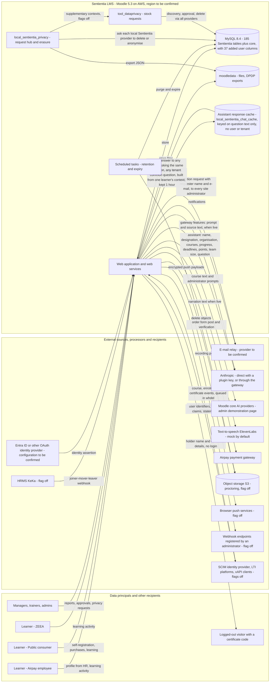

# DPDP module: technical design and security review document

**Sentientia LMS: personal-data handling, privacy architecture and data-protection safeguards, for security review**

| Field | Value |
|---|---|
| Prepared for | Information Security team (Airpay Payment Services) and SISA (external security assessor, under a non-disclosure agreement, NDA) |
| Document owner | Head of Learning & Development, Airpay Payment Services |
| Version | 1.2 |
| Date | 21 November 2026 |
| Status | Draft for review |
| Pack | 01 DPDP and security review: 01a (this document), 01b compliance mapping, 01c code review bundle manifest |

Confidential: Airpay Payment Services internal. Not for external distribution, except to SISA (external security assessor) under NDA.

---

## 1. Document control

### 1.1 Version history

| Version | Date | Author (role) | Change |
|---|---|---|---|
| 1.0 | 20 November 2026 | Technical writer for the Head of Learning & Development | First issue for review |
| 1.1 | 20 November 2026 | Technical writer for the Head of Learning & Development | Internal review applied: AI direct-key path and prompt content (F-22), core-table columns (F-23), DPDP-route gaps (F-24), capability-based rights exposure (F-25), core provider test failure (F-26), public certificate verification (F-27); new disclosure flows; corrected retention, status labels, build steps and dates; bundle rebuilt with redacted review copies |
| 1.2 | 21 November 2026 | Technical writer for the Head of Learning & Development | Second internal review applied: shared assistant response cache (F-28); AI gateway bypass list corrected (assistant chat, agent and authoring bypass; AI quiz, skills extraction, translation and recommendations refuse live calls without gateway routing) and AI key list extended (F-21, F-22); anonymising providers 9, not 10; legacy BizLMS columns such as `gender` added to F-23; core test path corrected; status labels moved to master labels with notes columns; Rule 6(1) citations; Gazette text cited; repository paths prefixed; acronyms defined; bundle version 1.2 with the AI clients added and the residue in two core-modification records removed |

### 1.2 Reviewers and sign-off

| Role | Organisation | Sign-off sought |
|---|---|---|
| Head of Information Security | Airpay Payment Services | Review scope, findings and remediation plan |
| Lead assessor | SISA (under NDA) | Independent code and design review against sections 16 and 18 |
| Data Protection Officer (DPO) or designated privacy contact | Airpay Payment Services (role holder to be confirmed by Legal) | Retention, consent and rights decisions in sections 8 to 10 |
| DevOps lead | Airpay Payment Services IT | Infrastructure facts marked "to be confirmed by IT" |
| Head of Learning & Development | Airpay Payment Services | Document owner; product decisions |

### 1.3 Related documents

| Document | Location |
|---|---|
| 01b DPDP Act 2023 and DPDP Rules 2025: compliance mapping | `moodle-enhancement/docs/stakeholder-packs/2026-11/01-dpdp-security-review/01b-DPDP-COMPLIANCE-MAPPING.md` |
| 01c Code review bundle manifest | `moodle-enhancement/docs/stakeholder-packs/2026-11/01-dpdp-security-review/01c-CODE-REVIEW-BUNDLE-MANIFEST.md` |
| ADR-035 Privacy erasure completeness | `moodle-enhancement/docs/adr/ADR-035-privacy-erasure-completeness.md` |
| ADR-031 Cross-tenant authority | `moodle-enhancement/docs/adr/ADR-031-cross-tenant-authority.md` |
| Erasure rehearsal results, 13 November 2026 | `moodle-enhancement/docs/cutover/A4-ERASURE-REHEARSAL-RESULTS-2026-11-13.md` |
| UAT security posture review, 3 September 2026 | `moodle-enhancement/docs/security/UAT-SECURITY-POSTURE-2026-09-03.md` |
| Security architecture pack (pack 02) | `moodle-enhancement/docs/stakeholder-packs/2026-11/02-security-architecture/` |

Path rule. Repository paths are written from the repository root (for example `moodle-enhancement/docs/adr/...`, `.github/workflows/ci.yml`, `theme/sentientia/`, `admin/tool/certificate/`), with two shorthands: a path that starts with a plugin type (`local/`, `blocks/`, `enrol/`, `payment/`, `mod/`) is relative to `moodle-enhancement/`, the canonical plugin tree; and `_facts/` stands for `moodle-enhancement/docs/stakeholder-packs/2026-11/_facts/`, the shared fact base.

---

## 2. Executive summary

**What this is.** Sentientia LMS is a multi-tenant learning platform that Airpay Payment Services has built on Moodle 5.3 LTS. Airpay Academy is its first deployment, with three tenants: Airpay (internal employees, tenant 1), Public (consumer storefront, tenant 77) and ZEEA Mafunzo (Tanzania, tenant 177). Sentientia is **not live**. It runs on a user-acceptance test (UAT) environment, academy2.airpay.ninja, which holds a fresh installation with synthetic test personas, and on development machines, where the development environment holds a copy of the production database imported for testing only. The production site, www.airpay.academy, still runs BizLMS, the legacy learning platform on Moodle 4.1.2 that Sentientia replaces at cutover. This document describes how Sentientia handles personal data and asks the Information Security team and SISA to review the design and code before cutover.

**Key facts** (source: `_facts/00-FACTS-INDEX.md`).

- Our plugins create **185 tables**; **111** hold personal data by column name (13 with direct identifiers, 98 linked to a user id). Five more hold secrets or credential hashes.
- **All 57** product components declare a privacy provider: 43 describe and handle personal data, 14 declare that they hold none. Two of the 14 declarations are wrong or under review (findings F-1, F-3).
- The DPDP plugin, `local_sentientia_privacy` 1.1.0, is **Available (UAT)**. It offers a data download and an account-deletion request to Public-tenant users, and a request panel for cross-tenant administrators.
- Stock Moodle erasure is incomplete because of a **core defect** that we found and reproduced. In a rehearsal on a local copy (test data), 515 deletion requests gave 286 processed, 229 not processable, 0 failed deletes and 0 notifications sent, yet stock Moodle left **22,944 rows** of the erased people behind. Our mitigation (ADR-035) is built and deployed to UAT, but its two flags are **off by default** and wait for a retention decision.
- `local_sentientia_core` adds **37 columns to Moodle's core `user` table** (and 18 to `course`), including date of birth, employee id, payment information, qualification, address parts and supervisor. No privacy provider declares, exports or erases these user columns (F-23).
- The AI assistant drawer (Available (UAT); its flag is on by default) calls Anthropic **directly with its own key** as soon as an administrator enters one, bypassing the AI gateway's ledger and quota, and sends the learner's name, designation and organisation with their learning context (F-22). The agent and the authoring studio also bypass the gateway when their own live flags are on; AI quiz, skills extraction, translation and recommendations refuse live calls unless gateway routing is on.
- The assistant keeps a **shared response cache** keyed only on the question text. Once a key is entered (or the gateway goes live), the first learner's personalised answer to a quick-action chip such as "What should I learn next?" is served to every other learner, in any tenant, for an hour (F-28).
- Consent capture, the privacy notice, grievance redressal, nomination and breach notification are **not built** in code, or exist only as unverified static text.

**What we ask of the reader** (details in section 20).

1. Information Security and SISA: review the code bundle (01c) and this design against sections 11, 16 and 18, and return findings with Common Weakness Enumeration (CWE) identifiers by **18 December 2026** (proposed; to be confirmed at kick-off).
2. DPO and Legal: decide the erasure retention option in section 10.5 by **15 January 2027**, and the consent and notice approach in section 8 by **15 February 2027** (proposed dates), using 01b.
3. IT: confirm the infrastructure facts marked "to be confirmed by IT" (encryption at rest, region, backups, key management, database credentials) by **11 December 2026** (proposed).
4. Platform engineer: confirm by **27 November 2026** whether any of the AI keys listed in F-21 is set on UAT, and whether the policy setup tool (F-16) was ever run there. F-22 and F-28 should be closed before any key is entered.

**Top risks.**

| Risk | Why it matters | Finding |
|---|---|---|
| Erasure leaves data behind while the request says "Deleted" | A data principal is told the data is gone when it is not | F-5, F-13 |
| No valid consent record, and a tool that would create acceptance records without user action | Consent cannot be demonstrated; records could mislead | F-8, F-16 |
| Payment-gateway provider claims to hold no personal data | Access and erasure requests return nothing for payment records | F-1 |
| AI assistant sends identified learner context to Anthropic once a key is entered, outside the gateway | Cross-border transfer with no ledger, quota or processor contract | F-22 |
| Assistant response cache serves one learner's personalised answer to other learners, across tenants | Disclosure of personal data to other data principals; breaks tenant isolation (ADR-031) | F-28 |
| HR, financial and education columns on the core user table are outside every privacy provider | Access requests omit them; erasure leaves them | F-23 |
| Static notice pages make claims we cannot evidence ("DPDP Act 2023 Compliant", hosting in India, encryption at rest) | Misleading notice | F-17 |
| No breach-notification process | DPDP Rules 2025, Rule 7 (in force from May 2027): initial intimation to the Data Protection Board and to affected data principals without delay, and a detailed report to the Board within 72 hours. CERT-In reporting within 6 hours applies today | F-11 |

---

## 3. Scope and review objectives

### 3.1 In scope

| Area | Content |
|---|---|
| DPDP plugin | `local_sentientia_privacy` 1.1.0: request hub, DPDP erasure route, ADR-035 supplementary provider, its tests |
| Privacy providers | `classes/privacy/provider.php` of all 57 product components |
| Data model | 185 tables in 46 `db/install.xml` files, plus the 37 columns `local_sentientia_core` adds to the core `user` table and the 18 it adds to `course` |
| Tenant isolation | `local_sentientia_platform\tenant` and ADR-031, as they protect the request panel and personal-data queries |
| Retention | 6 purge tasks (the API cleanup task alone prunes five tables) and 2 expiry tasks |
| Notices and consent | Self-service template, static DPDP and privacy pages, signup consent flags, policy-setup command-line tool |
| Integration with Moodle | `tool_dataprivacy` (data requests, data registry, expiry) |

### 3.2 Out of scope

- Moodle core and vendored third-party plugins (`tool_certificate`, `block_learnerscript`), except where they affect erasure (section 10).
- Infrastructure configuration on UAT and production. This document records what the repository shows and marks the rest "to be confirmed by IT".
- The payment flow's security (covered by pack 02), except the privacy provider (F-1).
- Legacy BizLMS on www.airpay.academy.

### 3.3 Review objectives

1. Confirm that every table and every column holding personal data, including the columns Sentientia adds to Moodle core tables, is declared, exported and erased (or deliberately kept) by a privacy provider.
2. Confirm that the DPDP request panel and personal-data queries respect tenant boundaries (ADR-031).
3. Assess the ADR-035 supplement: correctness, scope of deletion, failure handling, performance and upgrade safety.
4. Assess safeguards against DPDP Rules 2025, Rule 6(1) (reasonable security safeguards), and the Open Worldwide Application Security Project (OWASP) Application Security Verification Standard (ASVS) 4.0.3 chapter V8, data protection, at level 2 (section 18).
5. Validate or challenge the findings in section 16 and add new ones with CWE identifiers.

### 3.4 Method used for this document

Facts come from the repository at commit `4df7d4573` plus the working tree of 20 November 2026, from the shared fact base (`_facts/`), and from read-only counts on a development copy (test data). Code on UAT is commit `af6e65c0e`; the DPDP plugin and the AI clients cited in F-21, F-22 and F-28 are identical in both. More than 15 claims were checked against the code; section 17.4 lists them. Legal text was checked against public sources listed in Appendix B (accessed 20 and 21 November 2026). Version 1.1 applies the findings of an internal review of version 1.0; version 1.2 applies a second internal review.

### 3.5 Status labels

Every feature and control carries one of these labels.

| Label | Meaning |
|---|---|
| Available (UAT) | Deployed and verified on the UAT environment |
| Built (verified on development) | Code complete, verified on the development environment, not yet on UAT |
| Built (behind a feature flag, off by default) | Shipped dark; turned on per customer or tenant |
| In progress | Code started, not complete |
| Planned | In the roadmap; no code yet |
| Not planned | Considered and rejected; the reason is stated |
| No control | Gap marker, not a product status: nothing exists in code or documents, and nothing is in the roadmap |
| n/a | Marker, not a product status: the item is infrastructure or Moodle core configuration outside Sentientia code; the notes say what is known and, where the state is unknown, "To be confirmed (owner: ...)" |

Qualifiers (for example, "table deployed, no grant events written") go in the notes or gap column, not in the status. Where one row covers parts with different statuses, the row is split, or the status names each part with its master label.

---

## 4. System context

### 4.1 Context (C4 model, level 1)

The C4 model describes software at four levels: system context, containers, components and code. This section gives the first two.

| Actor or system | Relationship to Sentientia | Personal data exchanged |
|---|---|---|
| Learner (Airpay tenant, employee) | Uses courses, assessments, certificates | Profile from HR data, learning records |
| Learner (Public tenant, consumer) | Self-registers, buys and takes courses | Name, e-mail, password hash, country, purchases, learning records |
| Learner (ZEEA tenant, Tanzania) | Uses courses | Profile, learning records |
| Line manager, trainer, course author, tenant administrator | Manage people and content within their tenant | Team members' learning records |
| Site administrator and cross-tenant staff | Operate the platform, process privacy requests | All tenants |
| HRMS (KeKa) | Joiner-mover-leaver events (Built, behind a feature flag, off by default) | Employee records |
| Microsoft 365 and Entra ID | Single sign-on; calendar and SharePoint read (flag off) | Identity, OAuth tokens |
| E-mail relay (SMTP) | Notifications (Available (UAT)) | Name, e-mail, message content |
| Airpay payment gateway | Course purchases (Available (UAT)) | Order identifiers, amount |
| AI provider (Anthropic) | Gateway-routed AI features are mock by default (Built, behind a feature flag, off by default). The assistant drawer is Available (UAT) and calls Anthropic directly with its own key whenever that key is set and gateway routing is off, which is the default (F-22); its answers to common questions are cached and shared across learners (F-28). The agent and the authoring studio also call directly when their own live flags are on and gateway routing is off | Prompt text; for the assistant: the learner's first and last name, designation, organisation name, course list, progress, deadlines, certificates, points and team size; trainer-pasted source text for authoring features |
| Moodle core AI providers (for example OpenAI, Azure OpenAI, Google Gemini) | Site-administrator demonstration page `local/sentientia_assistant/ai_demo.php` through `core_ai_bridge` (course summary, quiz question, translation). The page is Available (UAT); whether any core provider is configured is to be confirmed (owner: platform engineer) | Course text and text typed by the administrator |
| Text-to-speech provider (ElevenLabs) | Narration audio, mock by default | Narration text (no personal data by rule) |
| Cloud hosting (AWS) | UAT compute, load balancer, managed database; proctoring object storage (flag off) | All platform data |
| Webhook endpoints registered by an administrator | Outbound course-completion, enrolment and certificate events, signed with a hash-based message authentication code (HMAC) (Built, behind a feature flag, off by default) | User id and event data; payloads queued in `local_sentientia_api_whdel` |
| SCIM identity provider; LTI 1.3 platforms and tools; xAPI clients | Provisioning (System for Cross-domain Identity Management, SCIM), Learning Tools Interoperability (LTI) launches, Experience API (xAPI) statements (all Built, behind a feature flag, off by default) | User identifiers, names and e-mail (SCIM), launch claims (LTI), learning statements (xAPI) |
| Logged-out visitor holding a certificate code | Public certificate verification page of the vendored `tool_certificate` (Available (UAT)) | Holder's full name, certificate name and issue date (F-27) |

### 4.2 Containers (C4 level 2)

| Container | Technology | Notes |
|---|---|---|
| Web application | Moodle 5.3 on PHP 8.3 (UAT: PHP 8.3.6 under PHP-FPM, Apache 2.4) behind an AWS Application Load Balancer | 47 local plugins, 6 blocks, 1 enrolment plugin, 1 payment gateway, 1 quiz access rule, 1 theme |
| Database | MySQL 8.4 (UAT: 8.4.9, managed service) | 185 Sentientia tables plus Moodle core |
| File store (`moodledata`) | Server file system, outside the web root | Uploads, certificate PDFs, DPDP export files |
| Scheduled tasks | Moodle cron, every minute on UAT | 34 Sentientia tasks, 7 disabled by default |
| Object storage | AWS S3 bucket (setting) | Proctoring recording chunks; recording itself is Planned |

Sources: `_facts/60-eng-qa-infra.md` section 9; `00-FACTS-INDEX.md` sections 2.1, 2.7, 2.11.

### 4.3 Tenancy model

A tenant is identified by the first segment of the user's `open_path` column (a legacy BizLMS column): `/1/...` is Airpay, `/77` Public, `/177/...` ZEEA (`local/sentientia_platform/classes/tenant.php`, `VALID_TENANTS = [1, 77, 177]`). All tenant filters go through `tenant::path_descendant_filter()` and related helpers. Only site administrators and holders of `local/sentientia_platform:crosstenant` act across tenants (ADR-031). Section 11.1 gives the detail.

### 4.4 Roles in data-protection terms

| Party | DPDP role (proposed, for Legal to confirm) |
|---|---|
| Airpay Payment Services, for Airpay Academy | Data Fiduciary for all three tenants |
| Cloud host, e-mail relay, AI and text-to-speech vendors, HRMS vendor | Data Processors (contracts to be confirmed, section 13) |
| Airpay Payment Services, for a future Sentientia customer | Expected to be that customer's Data Processor; contract model Planned |

---

## 5. Personal-data inventory

### 5.1 Summary

| Category | Tables | Source |
|---|---|---|
| Tables created by our plugins | 185 in 46 `install.xml` files | `_facts/40-data-privacy.md` section 1 |
| Direct identifiers (e-mail, phone, address, IP address, user agent, username) | 13 | same, section 2 |
| Linked to a person by a user-id column | 98 | same |
| Secrets or credential hashes, no person | 5 | same |
| Free text with no user column (may contain personal data typed by people) | 19 | same |
| No personal data by column name | 50 | same |
| Columns Sentientia adds to Moodle core tables | 37 on `user`, 18 on `course` | `local/sentientia_core/classes/substrate.php` (`user_fields()`, `course_fields()`); `moodle-enhancement/docs/core-mods/2026-06-04-open-substrate-ownership.md` |
| Other legacy BizLMS columns on core `user` (for example `gender`) | Present after the in-place upgrade of the production database; full list to be confirmed on the Stage B rehearsal (owner: platform engineer) | `local/sentientia_platform/cli/source_baseline.php` line 437; `moodle-enhancement/docs/cutover/SENTIENTIA-MIGRATION-PLAN-2026-09-04.md` line 562 |

The classification is by column name, not by reading data. Section 5.3 lists personal data hidden in generic columns. Tables created only at runtime or in `db/upgrade.php` are outside the count; a structural test reads `classes/schema/*::TABLES` constants to cover the known ones (`local/sentientia_platform/tests/privacy_coverage_test.php`). Appendix C lists all 135 tables that fall in the first four classes (direct identifiers, user-linked, secrets, free text), with their fields, purpose and retention control. One table classed "free text, no user link" by name can hold other learners' personal data: the assistant response cache `local_sentientia_chat_cache` (F-28). One table classed "no personal data" by name holds an actor id: `local_sentientia_courses_tenant_share.shared_by`, a foreign key to `user` (F-26).

The 37 `open_*` columns on the core `user` table are not legacy columns outside Sentientia's control. `local_sentientia_core` creates them at install and upgrade with raw data-definition statements (`substrate::ensure_all()`), to reproduce the BizLMS schema. They are listed in section 5.2. The structural privacy guard reads plugin `install.xml` files only, so it cannot see them (F-23). The BizLMS `user` table also carries columns that `substrate.php` does not create, for example `gender`: the Stage B baseline compares it and the migration plan checksums it, so the in-place upgrade brings it across. No provider declares it either (F-23).

### 5.2 Inventory by data category

The DPDP Act 2023 does not define "sensitive" personal data. The "higher-risk" column applies Airpay's own judgment for prioritising safeguards: financial, biometric-adjacent, credential, behavioural-monitoring and human-resources data.

| Data category | Main stores | Purpose | Higher-risk | Retention control in code |
|---|---|---|---|---|
| Identity and profile | Moodle `user` table (name, e-mail, username, phones, address, city, country, last IP address, id number, institution, department, profile picture, custom profile fields); ADR-017 profile tables | Account, tenant scoping | Yes (HR data) | None; partly anonymised on the DPDP route (section 9.3) |
| Columns Sentientia adds to the core `user` table (37, `local_sentientia_core`) | HR: employee id, prefix, date of birth, join date, designation, job title, job function, grade, band, HRMS role, employment type, position, supervisor (id and employee id), company, client, team, group, field work. Education: qualification, education level. Location: country id, state, states, region, zone, district, sub-district, village, location. Financial: payment information. Legacy BizLMS acceptance flags: privacy policy, terms and conditions. Tenant and audit: `open_path`, domain, organisation active, user modified | HR attributes, tenant scoping, reporting lines, legacy BizLMS records | Yes (HR, financial) | None. No provider declares, exports or erases them; the DPDP route clears 8 of 37; the stock route clears none (F-23) |
| Other legacy BizLMS columns on the core `user` table, present after the in-place upgrade | For example `gender` (compared by the Stage B baseline, `local/sentientia_platform/cli/source_baseline.php` line 437; checksummed in the migration plan, `moodle-enhancement/docs/cutover/SENTIENTIA-MIGRATION-PLAN-2026-09-04.md` line 562). Full list to be confirmed on the Stage B rehearsal (owner: platform engineer) | Legacy BizLMS profile | Yes (HR) | None. No provider declares them; neither erasure route clears them (F-23) |
| Columns Sentientia adds to the core `course` table (18) | Course attributes; one actor column, `open_coursecreator` (declared by the `local_sentientia_core` provider) | Catalogue and BizLMS compatibility | No | Course lifecycle |
| Learning records | Course completions, grades, quiz attempts, Sharable Content Object Reference Model (SCORM) tracking (core); learning paths, programs, classroom attendance, recompletion archive, transcript import | Delivery and evidence of training | No | None (kept for compliance; anonymised on the DPDP route by 9 providers; challenge attempts are erased, section 7.3) |
| Compliance training status | `local_compliance_snapshot`, `_exemptions`, `_email_log` | Mandatory-training tracking | Medium | None |
| Commerce and billing | `local_sentientia_cart_history`, `_invoices`, `_creditnotes` (billing e-mail, phone, address, Goods and Services Tax (GST) data); `paygw_airpay*` | Purchases, GST invoices | Yes (financial) | None; statutory retention to be decided by Finance and Legal |
| Communications | `local_sentientia_email_log`, `_notif_log`, `local_sentientia_send_log` (recipient number or address), push subscriptions and log | Notifications, delivery audit | Medium | Push log 90 days; others none |
| Messaging consent | `local_sentientia_user_channel_prefs` (mobile number, opt-in, DLT consent text), `_user_channel_audit` (with IP address) | Consent provenance for WhatsApp and SMS | Medium | None (audit is kept as evidence) |
| Privacy records | `local_privacy_requests`, `local_privacy_consent_log` (IP address, user agent) | Record of DPDP requests and consent | Medium | Kept by design |
| Assessment integrity | `local_sentientia_proctor_sessions`, `_identity`, `_events`, `_recordings`, `_reviews` | Proctored assessment (flags off) | Yes (behavioural monitoring; identity checks) | Recording objects 90 days; rows none |
| AI usage | `local_sentientia_ai_ledger` (metadata only); AI draft tables with source text; `local_sentientia_chat_log` (message text); `local_sentientia_chat_cache` (assistant answers built from one learner's context, served to others, F-28) | AI features, spend control | Medium (free text); High for the response cache (cross-user and cross-tenant disclosure) | None; cache rows carry a 3,600 s expiry that nothing purges (F-28) |
| Engagement | Points, badges, streaks, leaderboards (with opt-out), challenges, live-session responses | Gamification, live polls | Low | Leaderboard event journal 7 days |
| Talent and skills | Skills, skill history, succession (`talent_succ.notes`), interest expressions | Development and mobility | Yes (HR data) | None |
| Integration and provisioning | `local_sentientia_integration_log.payload` (raw HRMS webhook body), SCIM mapping and attestation, API request log, webhook delivery queue, xAPI statements | Integration and audit | Medium to high (F-3) | API log, webhook deliveries and SCIM attestation events 90 days; xAPI 730 days |
| Credentials | Calendar feed token (with last-used IP), OAuth tokens (encrypted), SCIM and xAPI token hashes, webhook secrets, push `auth_secret` | Authentication to integrations | Yes (credentials) | Revoked calendar tokens 90 days |
| HR import errors | `local_sentientia_users_sync_errors` (e-mail, username, names) | Failed HR import rows | Medium | None |
| Activity logs | `logstore_standard_log` (user id, IP, context); 2,596,772 rows on the development copy | Audit and reporting | Medium | `loglifetime` 0 (never delete) on the development copy; UAT value to be confirmed by IT |

Sources: `_facts/40-data-privacy.md` sections 2.2 to 2.4 and 8; plugin `db/install.xml` files.

### 5.3 Personal data in generic columns (found by reading code)

| Store | What it holds | Source |
|---|---|---|
| `local_sentientia_send_log.recipient` | Destination phone number or e-mail address | `local/sentientia_whatsapp/db/install.xml` |
| `local_sentientia_integration_log.payload` | Raw HRMS webhook body; content depends on the vendor and is unconfirmed | `local/sentientia_integrations/webhook.php` |
| AI draft tables (`*_draft.sourcetext`, `local_sentientia_tr_log.sourcetext`, `local_sentientia_skai_job.sourcetext`) | Text pasted by trainers and sent to the AI model; the interface warns against pasting personal data | respective `install.xml` |
| `local_sentientia_chat_log.message` | Learner questions and assistant replies | `local/sentientia_assistant/db/install.xml` |
| `local_sentientia_chat_cache.query`, `.response` | The question and the assistant's answer, which was generated from the asking learner's context (name, designation, organisation, courses with due dates, overdue count, points, team size). The row has no user or tenant column and is served to any learner who asks the same question (F-28) | `local/sentientia_assistant/classes/ai_client.php` lines 74 to 95 (lookup), 155 to 167 and 190 to 199 (store), 387 to 397 (`is_cacheable()`) |
| DPDP export files | Full JSON export of a person's data in `moodledata/privacy_exports/` | `local/sentientia_privacy/classes/privacy_manager.php` (`process_download`) |
| Proctoring recording chunks | In object storage, not the database (feature off) | `local/sentientia_proctoring/classes/task/purge_old_recordings.php` |

---

## 6. Data flows

### 6.1 Data flow diagram



### 6.2 Flow descriptions

| Stage | Flow | Status | Notes |
|---|---|---|---|
| Collection | Employee profiles arrive from the BizLMS import and HR uploads (CSV); HRMS webhook and reconcile pull are behind flags | Available (UAT) for import and upload; HRMS Built (behind a feature flag, off by default) | Failed HR rows are kept with names and e-mail in `local_sentientia_users_sync_errors` |
| Collection | Public users self-register (`local/sentientia_users/signup.php`); registration is off unless an administrator enables `activeregistration` | Available (UAT) | Terms tick required; marketing and leaderboard consent default to off |
| Collection | Learning activity, assessments, attendance, purchases, messages | Available (UAT) | Core and plugin tables |
| Storage | Database and `moodledata`; tokens for third-party services encrypted with Moodle core `\core\encryption::encrypt()` | Available (UAT) | Database and volume encryption at rest to be confirmed by IT |
| Processing | Reports by tenant and team; compliance snapshots; recommendations and AI features | Available (UAT) for reports, snapshots and the assistant drawer; other AI features Built (behind a feature flag, off by default) | The AI gateway ledger stores metadata only; the assistant's direct path writes no ledger row (F-22) |
| Processing | Assistant response cache: answers to questions matching four "cacheable" patterns ("what should i learn", "my deadlines", "compliance status", "what courses") are stored for 3,600 s under a hash of the question text alone and served to any learner who asks the same question, before any routing. The drawer's quick-action chips send fixed questions, so every learner shares the same key | Available (UAT) | Rows are written only by a live answer (assistant key set, or gateway live); no user or tenant in the key; no purge task; no erasure route clears it (F-28) |
| Sharing | E-mail relay; AI vendors (assistant direct path once a key is set; gateway features when live); Moodle core AI providers from the administrator demonstration page; text-to-speech vendor when live; HRMS; payment gateway; push services; Microsoft 365 | E-mail relay, payment gateway and assistant drawer: Available (UAT); the others: Built (behind a feature flag, off by default) or Planned, per processor in section 13.1 | Contracts and locations to be confirmed |
| Disclosure | Outbound webhooks to administrator-registered endpoints, payloads kept in `local_sentientia_api_whdel` until purged | Built (behind a feature flag, off by default) | Flags `sentientia.api.enabled` and `sentientia.api.webhooks.enabled` |
| Disclosure | SCIM provisioning, LTI launches and xAPI statements to integration partners | Built (behind a feature flag, off by default) | Recipients configured per integration |
| Disclosure | Public certificate verification page shows the holder's full name to anyone with the code, without login | Available (UAT) | F-27 |
| Disclosure | Each DPDP deletion request e-mails the requester's full name and e-mail address to every site administrator | Available (UAT) | Minimisation to be reviewed by the DPO |
| Access request | Public user clicks "Download My Data"; the JSON file is written to `moodledata/privacy_exports/` | Available (UAT) | The page's download link is not served (F-14) |
| Erasure (DPDP route) | Public user requests deletion; a cross-tenant administrator approves; `process_deletion()` runs | Available (UAT) | Section 9.3 |
| Erasure (stock route) | `tool_dataprivacy` delete request, automatic on user deletion (`automaticdeletionrequests` = 1 on the development copy) | Available (UAT) | Section 10; the ADR-035 supplement is Built (behind a feature flag, off by default) and off |
| Retention | 5 purge tasks (xAPI statements, push log, API cleanup, revoked calendar tokens, leaderboard events) | Built (behind a feature flag, off by default) | Section 11.6 |
| Retention | Proctoring recording purge (corrected setting names) and external-trainer expiry | Built (verified on development) | Section 11.6; on the UAT commit the proctoring purge reads the wrong setting names and deletes nothing |
| Retention | Evaluation assignment expiry (`expire_assignments`) | Available (UAT) | Section 11.6 |

---

## 7. Privacy module architecture

### 7.1 Components

| Component | Responsibility | Status | Notes |
|---|---|---|---|
| `local_sentientia_privacy` 1.1.0 (`2026111300`): request hub and DPDP route | Request hub (self-service and administration), DPDP erasure route, export file, consent ledger table | Available (UAT) | Gaps in sections 8 and 9 |
| ADR-035 supplementary provider (inside `local_sentientia_privacy`) | Recovers contexts that stock erasure and export drop (section 7.5) | Built (behind a feature flag, off by default) | Deployed to UAT with both flags off |
| 57 per-plugin privacy providers | Declare metadata; export and delete per Moodle privacy API; 9 also offer `anonymise_data_for_user()`. 43 metadata providers, 14 `null_provider` | Available (UAT) | Section 7.3 |
| `tool_dataprivacy` | Stock data requests, DPO approval, data registry, expired-context deletion | Available (UAT) | Moodle core component; configuration in section 7.4 |
| `local_sentientia_platform` | Tenant helpers, feature flags, privacy coverage guard test | Available (UAT) | |
| Retention: 5 purge tasks (xAPI, push log, API cleanup, calendar tokens, leaderboard events) | Purge data on a schedule | Built (behind a feature flag, off by default) | Section 11.6 |
| Retention: proctoring recording purge and external-trainer expiry | Delete recording objects; suspend expired external trainers | Built (verified on development) | Section 11.6; the purge on the UAT commit reads the wrong setting names |
| Retention: evaluation assignment expiry | Expire evaluation assignments | Available (UAT) | Section 11.6 |

### 7.2 Request hub

| Element | Behaviour | Source |
|---|---|---|
| Entry point | `/local/sentientia_privacy/index.php`; `require_login()` | `index.php` |
| Administration view | Shown only when `privacy_manager::can_administer()` is true: a site administrator, or a holder of `local/sentientia_privacy:manage` who is also cross-tenant (ADR-031). Lists every request on the site; Approve (= erase) and Reject act only on pending requests, with `confirm_sesskey()` | `classes/privacy_manager.php`; `index.php`; `tests/admin_scope_test.php` (5 tests) |
| Employee view (tenant 1) | Policy notice only, with no download or deletion, **unless** the user is a site administrator or passes `\local_sentientia_courses\course_manager::can_manage()` (capability `local/sentientia_courses:manage`). Those users skip this view and get the full self-service page, including Download My Data and Delete My Account (F-25) | `index.php` lines 213 and 250 |
| Other non-enabled tenants (ZEEA by default) | Short notice only, with the same capability exception as the employee view (F-25). The list of self-service tenants is the plugin setting `dpdp_tenants`, default `77`; the plugin has no settings page, so it can be changed only by configuration command | `index.php` |
| Public view (tenant 77) | "Download My Data" and "Delete My Account" (with a reason) | `templates/self_service.mustache` |
| Notifications | Every site administrator is messaged on a deletion request; the e-mail body carries the requester's full name and e-mail address. The user is messaged when an export is ready. Message provider `privacy_request`, popup and e-mail on by default | `db/messages.php`; `privacy_manager.php` |
| Capabilities | `local/sentientia_privacy:manage` (`RISK_PERSONAL`, no archetype); `:view` (archetype user; declared but not checked by any page, F-15) | `db/access.php` |

### 7.3 Per-plugin privacy providers

- 57 of 57 product components have a provider (`00-FACTS-INDEX.md` section 2.4).
- A structural PHPUnit test fails the build when a local plugin with a user-identifying column declares `null_provider` or has no provider (`local/sentientia_platform/tests/privacy_coverage_test.php`, group `tenant_isolation`, blocking in continuous integration (CI)). It walks `local/*` only, so it does not reach `payment/gateway/*` (F-1).
- Seven providers that once falsely declared `null_provider` were corrected between 22 September and 1 October 2026 (F-5 history in `_facts/40-data-privacy.md` section 3.2).
- Nine providers offer `anonymise_data_for_user()`: classroom, compliance_report, courses, learningpath, org, proctoring, programs, recompletion, xapi. They remove personal data and keep the learning, attendance or compliance record against the anonymised user.
- The `local_sentientia_challenge` provider deliberately has no anonymise hook (`local/sentientia_challenge/classes/privacy/provider.php` lines 30 to 53). On the DPDP route its attempts and leaderboard rows are therefore erased, not kept anonymised; only `createdby` (and the creator's `open_path`) on challenges the user authored is anonymised, so other participants keep the challenge.

### 7.4 `tool_dataprivacy` integration

Configuration on the development copy (test data; UAT values to be confirmed by IT):

| Setting | Value | Effect |
|---|---|---|
| `automaticdeletionrequests` | 1 | Every user deletion creates a delete request |
| `contactdataprotectionofficer` | 0 | No DPO contact shown to users |
| `dporoles` | unset | Privacy officers are the site administrators (4 on the development copy) |
| `allowfiltering` | 0 | Export not filtered by the data registry |
| `privacyrequestexpiry` | 604,800 s (7 days) | Request expiry |
| Data registry | 0 purposes, 0 categories, no site defaults | Stock retention filter skipped; every iterated context is deleted |

### 7.5 ADR-035 supplementary provider

| Item | Detail |
|---|---|
| Decision | Accepted 13 November 2026: add a supplementary privacy provider inside `local_sentientia_privacy`; no Moodle core file is edited (ADR-033 decision 4) |
| Defect 1 (core bug) | `contextlist_base::set_contextids()` stores `array_unique()` without renumbering. A duplicate context id leaves a key gap and the iterator stops there, so `tool_dataprivacy` never approves later contexts. Affected in practice: `tool_log`, `report_stats`, `mod_quiz`, `mod_scorm`, `core_course`. The request still ends "Deleted" with no error. Present in Moodle 4.x to 5.1, 5.3 and `main` |
| Defect 2 (core gap) | `core_course` discovery finds `course_completions` only where the user touched a completion criterion |
| Mechanism | With a flag on, the plugin adds the dropped contexts to its own gap-free context list. They pass the same DPO approval and data-registry checks, then each is erased or exported through the component that owns it |
| Flags | `sentientia.privacy.erasure_completeness.enabled` (defect 1) and `sentientia.privacy.completion_gap.enabled` (defect 2); both default off; read at global scope only (customer 0, tenant 0) so erasure and export cannot differ by tenant |
| Self-check | `stock_approval_truncates()` turns the truncation recovery off once core is fixed |
| Audit | Event `\local_sentientia_privacy\event\erasure_supplemented`, counts only |
| Failure handling | A failing component is reported to the DPO after every other component has run; the request still completes, so the subject needs the residue sweep |
| Performance (development copy) | About 0.9 s discovery per subject; worst case about 60 s for one log pass over an account with 165,710 log rows |
| Status | Built (behind a feature flag, off by default); deployed to UAT with both flags off |

Source: `moodle-enhancement/docs/adr/ADR-035-privacy-erasure-completeness.md`; `local/sentientia_privacy/classes/local/erasure_completeness.php`.

---

## 8. Notice and consent

### 8.1 What is shown, and where

| Surface | What it shows | Status | Gap |
|---|---|---|---|
| Self-service page, Public tenant | Title "DPDP Act 2023 Notice"; rights to access, download and request deletion; download available for 72 hours; deletion reviewed in 3 to 5 business days | Available (UAT) | No itemised data list, purposes, retention, withdrawal method or Board complaint route (DPDP Rules 2025, Rule 3). Wrong legal claims in `templates/self_service.mustache`: line 45 says deletion "typically takes 3-5 business days as required under DPDP Act Section 12(3)", but s.12(3) sets no period; line 95 promises 72 hours for access and 30 days for deletion with no process behind it (F-17) |
| Self-service page, employees | Processing under the employment contract; learning records kept for compliance; correction through HR or the DPO; DPO contact from setting `dpo_email` with a fixed fallback mailbox | Available (UAT) | Notice cites "Section 4" for employment; the Act's employment ground is section 7(i). Legal to confirm wording |
| Static page `local/sentientia_pages/pages/dpdp.html` | A "DPDP Act 2023 Compliant" badge; data collected; purposes; rights with section numbers; response times (72 hours access, 30 days deletion); safeguards ("encryption at rest", "AWS infrastructure within India", "regular security audits"); retention ("7 years") | Available (UAT) | Several claims cannot be evidenced in the repository (F-17); correction is cited as section 11 (it is section 12) |
| Static page `local/sentientia_pages/pages/privacy.html` | Similar content: "servers within India", "regular security audits", 7-year retention | Available (UAT) | Same as above |
| Cookie banner | None found in the theme or in the users, pwa and privacy plugins | No control | Non-essential cookies on public pages to be confirmed by Marketing and the DPO |
| Moodle site policies (`tool_policy`) | Not wired: `sitepolicyhandler` is empty on the development copy | No control | See 8.3 for the setup tool |

### 8.2 Consent records

| Control | Behaviour | Status |
|---|---|---|
| Consent ledger `local_privacy_consent_log` | Append-only table with user, consent type, granted or withdrawn, IP address, user agent, time. In the privacy, platform, users and core plugins the only writer is Step 5 of `process_deletion()`, which writes a withdrawal without IP address or user agent. No grant event is written; the table is unused for grants (F-8). 0 rows on the development copy | Available (UAT) |
| Legacy BizLMS acceptance flags | `open_privacypolicy` and `open_termscondition` (TINYINT, default 0) on the core `user` table, created by `local_sentientia_core` and filled by the BizLMS import. No Sentientia code reads or writes them. What they hold for imported accounts, and whether they evidence an earlier acceptance and an earlier notice (relevant to notice for existing users under s.5(2) and to F-8), is to be assessed by the platform engineer with the DPO (F-23). The columns are present on the core `user` table | Available (UAT) |
| Signup | `signup_service::validate()` requires the terms tick (`agree_tos`) but no record of the acceptance is stored. `consent_marketing` and `consent_leaderboard` are stored as profile data, default 0 (opt-in) | Available (UAT) |
| Messaging consent | Opt-in per channel (WhatsApp, SMS, e-mail) with the DLT (Distributed Ledger Technology, the TRAI commercial-messaging registry) consent text; each change appended to `local_sentientia_user_channel_audit` with IP address | Built (behind a feature flag, off by default) |
| Leaderboard | Per-user opt-out from public listing (`local_sentientia_lb_optouts`); the opt-out flag defaults on when the leaderboard is enabled | Built (behind a feature flag, off by default) |
| Proctoring | `give_consent` web service records the candidate's consent timestamp before a proctored attempt | Built (behind a feature flag, off by default) |

### 8.3 Policy setup tool (finding F-16)

`local/sentientia_pages/cli/setup_policies.php` sets `sitepolicyhandler` to `tool_policy`, creates "Privacy Policy" and "Terms of Use" from the static pages, and then inserts an **accepted** row in `tool_policy_acceptances` for **every existing user**, with `usermodified` set to that user's own id, and prints each username. If run, it would create records that look like each person's own acceptance without any action by them. It has not been run on the development copy (`sitepolicyhandler` is empty). Whether it was run on UAT is to be confirmed by the platform engineer. Recommendation: remove the auto-accept step, or change it to record "accepted on behalf" with the operator's id and a reason, and never run it against real accounts.

### 8.4 Withdrawal of consent

There is no stand-alone withdrawal control. The consent ledger receives a withdrawal only as a side effect of erasure. Marketing and leaderboard consents can be switched off on the profile page; messaging opt-outs are per channel. DPDP section 6(4) and Rule 3 require withdrawal to be about as easy as giving consent (01b, rows S6 and R3).

---

## 9. Data principal rights

### 9.1 Summary

Section 11 (access) and section 12 (correction and erasure) of the DPDP Act apply to personal data processed on consent or under section 7(a). Employee data processed under section 7(i) (employment) may fall outside those two sections; grievance redressal (section 13) and nomination (section 14) apply to all data principals. Legal is asked to confirm how this applies to the Airpay and ZEEA tenants (01b).

| Right or duty | How Sentientia fulfils it | Status | Gap |
|---|---|---|---|
| Access (s.11) | DPDP export JSON for Public users; stock `tool_dataprivacy` export for any user, made by the privacy officer | Available (UAT) | The self-service download link is not served (F-14); export files are neither expired nor encrypted (F-7); export does not cover every Sentientia table (it collects profile, enrolments, completions, certificates, last 50 quiz attempts, last 100 log events, points, consent history) |
| Correction (s.12) | Profile editing in Moodle; HR sync for employees; employee notice directs correction to HR or the DPO | Available (UAT) | Profile editing only: no correction-request workflow or audit |
| Erasure (s.12) | DPDP route (9.3) for Public users and for anyone with the capability exception (F-25); stock route with ADR-035 supplement (section 10) | Available (UAT); supplement Built (behind a feature flag, off by default) | F-5, F-6, F-13, F-18, F-23, F-24 |
| Grievance redressal (s.13) | No grievance contact or ticket flow; the request hub is the only channel | No control | F-11; Rule 14(3) sets a maximum of 90 days to respond; proposed process in 01b |
| Nomination (s.14) | Nothing in code | No control | F-11 |
| Withdraw consent (s.6(4)) | Profile switches for marketing and leaderboard consents; per-channel messaging opt-out | Available (UAT) | Ledger records a withdrawal only on erasure (F-8) |

### 9.2 Right of access in detail

`privacy_manager::process_download()` runs synchronously when the user clicks the button. It writes `user_data_<id>_<timestamp>.json` (pretty-printed, unencrypted) to `moodledata/privacy_exports/`, stores the server file path in `local_privacy_requests.download_url`, sets an expiry of 72 hours and messages the user. The template then shows a "Download" link to `index.php?action=getfile&id=...`; `index.php` has no `getfile` handler, so the link reloads the page and the file is never served (F-14). No task deletes expired files (F-7).

### 9.3 Right to erasure on the DPDP route

`privacy_manager::process_deletion()`:

1. **Step 0.** Calls every `local_sentientia_*` provider (except its own) with exactly the contexts it reports. Providers that offer `anonymise_data_for_user()` (9, section 7.3) anonymise; the others, including challenge, delete. A provider that throws is recorded. Only local plugins are asked. The code comment's premise that "local plugins are the whole set" is wrong: `enrol_sentientiasub` (a metadata provider with a user table) and `theme_sentientia` (user preferences) are never asked to erase (F-24).
2. **Step 1.** Anonymises the user row (`privacy_manager.php` lines 242 to 264): name "Deleted User"; e-mail and username replaced with `deleted_<id>_<time>` values; phones, address, city, description and picture text cleared; 8 of the 37 added columns cleared (employee id, designation, location, team, band, supervisor employee id, date of birth, join date); account suspended. It leaves the core fields `country`, `lastip`, `idnumber`, `institution`, `department`, `middlename`, `alternatename`, the phonetic name fields and `url`, the profile picture files and custom profile field data, and 29 of the 37 added columns, including `open_path`, `open_paymentinfo`, `open_qualification`, `open_educationlevel`, `open_supervisorid`, `open_jobtitle`, `open_company` and the address parts (state, district, sub-district, village, region, zone) (F-18, F-23).
3. **Step 2.** Deletes eight named tables (points, badges, streaks, chat log, notification log and preferences, self-assessed skills, skill history); a missing table is recorded, never silently skipped.
4. **Step 3.** Sets `user.deleted = 1` directly. Core `delete_user()` is not called, so core clean-up (enrolments, role assignments, sessions, the `user_deleted` event and the automatic `tool_dataprivacy` request) does not run (F-18; reviewers to confirm the effect on active sessions).
5. **Step 4.** Status `completed` only if nothing was missed, otherwise `partial`, with a note naming what remains.
6. **Step 5.** Writes a withdrawal row to the consent ledger.

Anonymised learning records are kept for audit; core providers are deliberately not called on this route. Recommendation: iterate the provider of every Sentientia component (all plugin types, not only `local`), then call core `delete_user()`; or document and test the chosen behaviour field by field (F-18, F-24). Tests: `privacy_manager_test` (3), `erasure_scope_test` (8), passing on 17 November 2026.

---

## 10. Erasure completeness

### 10.1 The contextlist truncation issue in Moodle core

| Item | Detail |
|---|---|
| What | `contextlist_base` iteration stops at the first duplicate context id, so deletion and export requests silently skip contexts |
| Versions | Moodle 4.x to 5.1, 5.3 and `main` (code unchanged) |
| Found | 13 November 2026, in the erasure rehearsal; confirmed by two independent read-only investigations and a deterministic reproduction |
| Upstream report | Draft only, not filed (`moodle-enhancement/docs/cutover/DRAFT-MDL-REPORT-contextlist-truncation-2026-11-13.md`); contains no Airpay or Sentientia data. Filing is an owner decision |
| Mitigation | ADR-035 supplement (section 7.5), no core edit |
| Residual risk | While the flags are off, every erasure needs a residue check afterwards; requests already "Deleted" keep their residue because stock never reprocesses them |

### 10.2 Erasure rehearsal (development copy, test data)

Source: `moodle-enhancement/docs/cutover/A4-ERASURE-REHEARSAL-RESULTS-2026-11-13.md`. Environment: local copy of a production backup, Moodle 5.1.3+. Identifiers and counts only.

| Item | Result |
|---|---|
| Requests | 515 automatic delete requests created by BizLMS between June 2023 and May 2026 |
| Processed | 286, all ended "Deleted"; 23 minutes of processing |
| Not processable | 229 subjects with no user row; the stock task throws a `TypeError` and would retry for about 34 hours, then notify every administrator (about 916 messages if run on the production site) |
| Failed deletes | 0 (`a4_verify.php`: 0 violations) |
| Notifications sent | 0. Message providers off, outbound HTTP and mail disabled, 127 event observers replaced by a recorder, maintenance mode on, cron off; notification, message and task counts equal before and after |
| Components that deleted data | 32; 14 Sentientia plugins ran their delete for all 286 subjects, 3 more where they held data |
| Largest deletions | Quiz question steps 23,396; step data 23,177; SCORM values 9,751; question attempts 7,972; grade history 3,373; log entries 2,346; certificates 367 |
| Other people's data | Unchanged in all 56 tables checked |
| Left behind by stock Moodle | 22,944 rows: 15,129 from the truncation bug (3,309 contexts dropped in 221 requests); 1,713 course completions never discovered; 5,584 in contexts already deleted; 518 from the first 8 canary requests |
| User row | Still holds username, hashed e-mail, names (275 rows), employee id (272), tenant path (283), phone numbers (150) and other BizLMS fields |

### 10.3 Supplement dry run (read-only, 17 November 2026)

Inside an always-rolled-back, read-only transaction (`tools/privacy-erasure-rehearsal/a4_supplement_plan.php`): of 16,844 leftover rows in scope, 704 would go with a plain stock re-run, 16,140 only through the supplement, 0 uncovered; 0 plan failures; plan time per subject 0.46 s minimum, 0.61 s median, 7.8 s maximum. 5,727 rows sit in contexts that no longer exist and are out of any provider's reach. The replay driver `a4_sweep.php --execute` has never run.

The two figures for rows in deleted contexts come from different measurements: 5,584 is the rehearsal report's count of residue rows in contexts already deleted when the rehearsal ran (13 November, section 10.2); 5,727 is the dry run's count of leftover rows whose context no longer exists, taken four days later over the full 16,844-row scope (17 November, ADR-035 Proof). Both are from the same development copy.

### 10.4 What remains with both flags on

- The user row and BizLMS profile columns on the stock route (F-6).
- Log rows where the subject is only `relateduserid` or `realuserid` (core design).
- 5,727 rows in deleted contexts; 713 log rows of the 229 subjects with no user row.
- Course completions on partial course-context expiry (known residual, not built).

### 10.5 Retention decision required before the flags go on

ADR-035 offers the DPO two options:

- **(a)** Configure the data registry: a system purpose and category, so system-level login logs stay, and protected purposes for compliance-training course categories.
- **(b)** DPO-signed acceptance that authentication logs, audit-trail rows and learning records of erased subjects are deleted, with the privacy notice updated.

Two legal duties bear on this choice and have not been checked against the code: the CERT-In directions of 28 April 2022 (logs kept for a rolling 180 days) and DPDP Rules 2025, Rules 6(1)(e) and 8(3) (logs and associated personal data kept for at least one year, unless another law requires otherwise; in force from May 2027). Option (b) could delete log rows younger than one year for a recently active subject. Legal is asked to confirm.

### 10.6 Cutover gate

`moodle-enhancement/docs/cutover/SENTIENTIA-CUTOVER-MASTER.md` blocks any production approval of a delete request until (1) the retention decision is recorded, (2) both flags are on site-wide, and (3) a post-erasure residue check is green on UAT. The residue sweep command-line tool and the UAT residue check are not built (F-13).

---

## 11. Security safeguards

### 11.1 Access control and tenant isolation

| Control | Fact | Status | Source |
|---|---|---|---|
| Capability model | 181 capabilities in 48 `db/access.php` files; 2 custom roles | Available (UAT) | `00-FACTS-INDEX.md` section 2.6 |
| Single cross-tenant authority | Only site administrators and holders of `local/sentientia_platform:crosstenant` act across tenants; no role holds that capability on the development database | Available (UAT) | ADR-031; `tenant::is_cross_tenant()` |
| Fail closed | A user with no resolvable tenant sees nothing (`scope_path()` returns null; filters return `1=0`) | Available (UAT) | `tenant.php` |
| Bounded path filters | `path_descendant_filter()` matches `/1` and `/1/...` but never `/10` or `/177`; pre-commit check 18 and a CI gate block unbounded prefixes | Available (UAT) | `tenant.php`; `.claude/hooks/pre-commit.sh` |
| Writes on other users | Required by ADR-031 decision 5: `tenant::require_same_tenant_user()` on every write that names another user. The cross-tenant authority sweep of 25 September 2026 records the call sites (`moodle-enhancement/docs/audits/CROSS-TENANT-AUTHORITY-SWEEP-2026-09-25.md`). Coverage of every write path is for SISA to verify | Available (UAT) | ADR-031 decision 5; sweep record |
| Tests | `@group tenant_isolation`, 135 files, blocking in CI (2,203 tests on Moodle 5.2 with MariaDB in the first green run) | Available (UAT) | `.github/workflows/ci.yml`; `moodle-enhancement/PROJECT-STATE.md` |
| DPO panel | Cross-tenant callers only; a per-tenant DPO panel is not built | Available (UAT) | `privacy_manager::can_administer()` |
| Earlier cross-tenant defect | A Public learner could self-enrol into another tenant's course (finding C2, 3 September 2026); fixed the same day with a tenant gate and tests | Available (UAT) | `moodle-enhancement/docs/security/UAT-SECURITY-POSTURE-2026-09-03.md` |
| Residual | `privacy_manager::is_public_tenant()` uses an unbounded prefix (`77` would match `/770`); the method is not called anywhere (F-20, proposed Low) | Available (UAT) | `privacy_manager.php` |
| Residual | The assistant response cache is shared across users and tenants: one learner's personalised answer is served to learners in other tenants (F-28, proposed High) | Available (UAT) | `local/sentientia_assistant/classes/ai_client.php` |

### 11.2 Authentication and sessions

| Control | Fact | Status | Notes |
|---|---|---|---|
| Authentication | Moodle core (manual accounts with Moodle's password policy check at signup) | Available (UAT) | Moodle core |
| Single sign-on | Moodle OAuth 2 issuers (Entra ID recommended for Airpay, Google optional for Public); SAML and LDAP documented only | n/a | Moodle core configuration. To be confirmed (owner: DevOps lead): which issuers are configured on UAT |
| Multi-factor authentication (MFA) | `tool_mfa` sequence (grace factor, then a time-based one-time password, TOTP) documented in `moodle-enhancement/MFA-ENFORCEMENT-RUNBOOK.md`; not run on UAT as of 3 September 2026 | n/a | Moodle core configuration. To be confirmed (owner: DevOps lead): current MFA state on UAT |
| Signup account enumeration | Enumeration fixed (3 September 2026) | Available (UAT) | UAT posture review |
| Signup CAPTCHA and per-IP throttle | CAPTCHA keys not set; no per-IP throttle on signup | No control | Finding H2 of the UAT posture review, still open |
| Session cookie (UAT) | `Secure; HttpOnly; SameSite=Lax` | Available (UAT) | Observed on UAT |
| Session timeout | 28,800 s (8 hours) on the development copy | n/a | Moodle core setting. To be confirmed (owner: DevOps lead): UAT value |
| Account lockout | Moodle lockout setting not recorded | n/a | Moodle core setting. To be confirmed (owner: DevOps lead) |
| Integration authentication | SCIM bearer tokens stored as SHA-256 hashes; outbound webhooks signed with HMAC-SHA256 (hash-based message authentication code over SHA-256); HRMS webhook secret compared in constant time (`hash_equals`); xAPI client token and Basic password stored as hashes | Built (behind a feature flag, off by default) | |

### 11.3 Encryption

| Data | Control | Status | Notes |
|---|---|---|---|
| In transit, UAT | Transport Layer Security (TLS) 1.3 with an AWS-issued certificate on the load balancer; HTTP Strict Transport Security (HSTS) for one year with `includeSubDomains`; `X-Content-Type-Options`, `Referrer-Policy`, `Permissions-Policy` | Available (UAT) | Content Security Policy (CSP) deferred |
| Load balancer to web server | Apache listens on port 80 behind the load balancer; the internal hop is unencrypted | n/a | Infrastructure. To be confirmed (owner: DevOps lead): network controls on the internal hop |
| Third-party OAuth tokens | Moodle core `\core\encryption::encrypt()` (calendar, Microsoft 365) | Built (behind a feature flag, off by default) | The encryption code is deployed on UAT; the calendar and Microsoft 365 features that store tokens are flag-gated |
| Web push | RFC 8291 payload encryption; the Voluntary Application Server Identification (VAPID) private key is wrapped with AES-256-GCM when a master key is configured | Built (behind a feature flag, off by default) | |
| Database at rest | Not in the repository | n/a | The ISO 27001 readiness document lists key management as a gap. To be confirmed (owner: DevOps lead) |
| `moodledata` and DPDP exports | No application-level encryption | No control | Volume encryption to be confirmed (owner: DevOps lead); F-7 |

### 11.4 Key and credential management

- Credentials live in `.env` files and Moodle configuration, never in code; a pre-commit check blocks committed credentials (`.claude/hooks/pre-commit.sh`).
- Moodle core encryption uses a site key held in the site data directory by default; its location and protection on UAT are to be confirmed by IT.
- The UAT posture review recorded that the UAT database user was the managed-database superuser and that its password had once been sent by e-mail in plain text; rotation to a least-privilege user was deferred until after install. Current state to be confirmed by IT (F-12).
- No secrets manager integration exists in the repository.

### 11.5 Logging and monitoring

| Log | Content | Retention |
|---|---|---|
| Moodle standard log | User id, IP address, context, event | `loglifetime` 0 (kept forever) on the development copy; UAT to be confirmed |
| Feature-flag audit | Every Switchboard change with reason | None |
| Role audit log | Role and capability changes through the roles plugin | None |
| SCIM attestation log | Every identity-provider-initiated create, reactivate, deactivate | 90 days (setting `log_retention_days`, API cleanup task) |
| Webhook delivery queue (`local_sentientia_api_whdel`) | Event payloads queued for outbound delivery | Sent and failed rows purged after 90 days (same setting) |
| API request log | Every public-API request, no bodies | 90 days |
| AI gateway ledger | Metadata per call; no prompt text | None |
| Erasure event | `erasure_supplemented`, counts only | Core log retention |
| Web push log | Titles and bodies hashed unless an opt-in setting stores readable copies | 90 days |
| Daily UAT log scan (`moodle-enhancement/tools/ops/sentientia-logscan.sh`, run by cron each morning on the UAT server) | Counts of PHP errors and HTTP 5xx responses in the last 24 hours, failing scheduled and ad hoc tasks, resource use; written to a daily text report on the server | Reports deleted after 30 days |

The daily log scan is the only monitoring artefact in the repository; it writes a report and raises no alert. No security information and event management (SIEM) integration or alerting exists in the repository; to be confirmed by IT. The CERT-In directions of 28 April 2022 also require information and communication technology (ICT) system logs to be kept within Indian jurisdiction; with the UAT and production region still to be confirmed (section 13), compliance with that duty is to be confirmed by IT. DPDP Rules 2025, Rule 6(1)(c) and (e), expect access logs to be monitored and kept for at least one year; the 90-day API and push logs need Legal review against that rule (01b, row R6).

### 11.6 Retention tasks

| Data | Task | Default | Status |
|---|---|---|---|
| xAPI statements | `purge_old_statements` | 730 days | Built (behind a feature flag, off by default) |
| Push log | `push_log_retention` | 90 days | Built (behind a feature flag, off by default) |
| API cleanup: request log, rate-limit counters, LTI nonces, webhook deliveries (`_whdel`), SCIM attestation events (`_scimevt`) | `cleanup` (one task, five tables) | 90 days for the log, deliveries and attestation events (setting `log_retention_days`); counters and nonces by window | Built (behind a feature flag, off by default) |
| Revoked calendar tokens | `purge_old_tokens` | 90 days | Built (behind a feature flag, off by default) |
| Leaderboard live events | `purge_old_events` | 7 days | Built (behind a feature flag, off by default) |
| Proctoring recordings | `purge_old_recordings` (signed delete of the object) | 90 days | On the UAT commit the task reads `aws_access_key` and `aws_secret_key`, but the settings page saves `aws_key` and `aws_secret`, so every run skips as "config incomplete" and nothing would leave the bucket (ADR-038). The fix exists only in development code: Built (verified on development). Recording itself is Planned, so no objects exist yet |
| External-trainer accounts | `external_trainer_expiry` (suspend) | 30 days after last session | Built (verified on development) |
| Evaluation assignments | `expire_assignments` | Per assignment | Available (UAT) |

No purge task exists for the send log, AI ledger, chat log, notification log, integration log, compliance e-mail log or cart records (F-10). DPDP export files have no expiry task (F-7). Source: `_facts/40-data-privacy.md` section 8.

### 11.7 Backups

| Environment | Fact |
|---|---|
| Production (BizLMS, not Sentientia) | Managed-database automated backups, default 7-day retention as stated in `moodle-enhancement/docs/security/ISO-27001-2022-READINESS.md`, which lists backup schedule, tested restore and backup encryption as a gap |
| UAT | Not recorded in the repository; the Secure Shell (SSH) user cannot read `config.php`, so database backups depend on IT snapshots. To be confirmed by IT |
| Development copy | A pre-rehearsal SQL dump kept outside the repository |
| Erasure and backups | Erasure does not reach backups; no rule on how long backups holding erased subjects are kept. To be confirmed by IT and the DPO |

---

## 12. Breach detection and notification

### 12.1 Legal timelines (verified 20 November 2026)

| Source | Duty |
|---|---|
| DPDP Act 2023, s.8(6) | Inform the Data Protection Board and each affected data principal of a personal data breach, in the prescribed form and manner |
| DPDP Rules 2025, Rule 7(1) | Tell each affected data principal **without delay**, through the user account or a registered contact: nature, extent, timing, likely consequences, mitigation, safety steps, and a contact person |
| DPDP Rules 2025, Rule 7(2)(a) | Initial intimation to the Board **without delay**: nature, extent, timing, location and likely impact |
| DPDP Rules 2025, Rule 7(2)(b) | Detailed report to the Board **within 72 hours** of becoming aware (or longer if the Board allows on written request): facts, circumstances and reasons, mitigation, findings on who caused it, remedial measures, and the intimations sent to data principals |
| Commencement | Rules 1, 2 and 17 to 21 on publication (G.S.R. 846(E), headed "New Delhi, the 13th November, 2025" in the Gazette text, W13; the Press Information Bureau explainer gives 14 November 2025 as the date the Rules were notified, W5); Rule 4 after one year; Rules 3, 5 to 16, 22 and 23 (including Rule 7) after eighteen months, that is in May 2027 (Rule 1(2) to (4)). Legal to confirm the exact date of publication in the Official Gazette |
| CERT-In directions, 28 April 2022 | Report specified cyber incidents to CERT-In within 6 hours of noticing them; keep ICT system logs for a rolling 180 days, maintained within Indian jurisdiction |
| Sector regulators | Any Reserve Bank of India incident-reporting duty that applies to Airpay Payment Services as an entity: to be confirmed by Compliance |

Sources: Appendix B, items W1 to W6 and W11 to W13.

### 12.2 Current state

No breach-handling workflow exists in code. The incident-response plan is a named gap in `moodle-enhancement/docs/security/ISO-27001-2022-READINESS.md` and `moodle-enhancement/docs/security/TRUST-TRACK-README.md`. Detection relies on the logs in section 11.5 and on infrastructure monitoring to be confirmed by IT. Status: **Planned** (F-11).

### 12.3 Proposed process (Planned, for Information Security to adopt or replace)

| Step | Owner role | Target time from awareness | Platform support available today |
|---|---|---|---|
| 1. Detect and triage | Information Security on-call | Immediate | Moodle logs, API log and rate-limit responses (429), role and flag audit logs, cron health block, the daily UAT log scan report (`moodle-enhancement/tools/ops/sentientia-logscan.sh`) |
| 2. Report to CERT-In if the incident is reportable | Head of Information Security | Within 6 hours | None in code |
| 3. Initial intimation to the Board | DPO | Without delay | None in code |
| 4. Identify affected data principals and data | Platform engineer with DPO | As fast as possible | Privacy providers can enumerate a person's contexts; tenant helpers scope queries |
| 5. Notify affected data principals | DPO | Without delay | Moodle messaging and e-mail to registered addresses; templates to be written |
| 6. Detailed report to the Board | DPO with Information Security | Within 72 hours | None in code |
| 7. Remediate and record lessons | Information Security and engineering | Per incident | ADR and core-mod discipline for any code change |

---

## 13. Processors, sub-processors and cross-border transfer

### 13.1 Processor inventory

| Processor or service | Purpose | Personal data | Status | Notes | Location | Contract and DPDP terms |
|---|---|---|---|---|---|---|
| AWS (compute, load balancer, managed database) | Hosting UAT; planned production | All platform data | Available (UAT) | | Region not recorded in the repository; to be confirmed by IT | To be confirmed by IT and Legal |
| AWS S3 | Proctoring recording chunks | Recordings (Planned feature) | Built (behind a feature flag, off by default) | Recording itself is Planned; the purge task does not work on the UAT commit (section 11.6) | Bucket and region are settings; delete code defaults to `ap-south-1` | To be confirmed |
| AWS Rekognition | Face matching of ID photo and selfie | Biometric data | Built (verified on development) | The development code no longer offers it: `verifier_factory` returns only the mock verifier. The class `aws_verifier.php` remains in the code for a possible later version. The UAT commit still offers an `aws` option behind the off proctoring flag. Do not enable | n/a | Do not enable |
| E-mail relay (SMTP) | Notifications | Name, e-mail, message content | Available (UAT) | | Provider to be confirmed by IT | To be confirmed |
| Anthropic, assistant chat (direct path) | Learner question and answer | The learner's first and last name, designation, organisation name, course list with progress and due dates, overdue count, certificates, points and team size, with each question (`ai_client::build_context()`, lines 209 onwards) | Available (UAT) | Calls Anthropic directly with `local_sentientia_assistant` `api_key` whenever that key is set and `sentientia.ai.gateway.enabled` is off (the default); its own flag `ai.assistant.enabled` is on by default; no gateway ledger row and no gateway quota on this path (F-22). Answers to common questions are cached and shared across learners and tenants (F-28) | Vendor processing location to be confirmed by vendor management | Required before any key is entered |
| Anthropic, agent and authoring studio (direct path) | Agentic copilot proposals; course drafts | Learner question with course context (agent); trainer-pasted source text (authoring) | Built (behind a feature flag, off by default) | Each calls Anthropic directly with its own key (`local_sentientia_assistant` `api_key`; `local_sentientia_authoring` `anthropic_api_key`) when its own live flag (`sentientia.assistant.agentic.live_api`, `sentientia.authoring.live_api`) is on and gateway routing is off; no guard refuses this (F-22) | To be confirmed by vendor management | Required before any key is entered |
| Anthropic, AI quiz, skills extraction, translation, recommendations | Generated questions, skills, translations, rankings | Trainer-pasted source text; learning history and candidate courses (recommendations) | Built (behind a feature flag, off by default) | These consumers refuse a live call unless gateway routing is on (`gateway_routing_required`, a code invariant since 22 September 2026, present at the UAT commit). Only the administrator command-line smoke test `local/sentientia_aiquiz/cli/live_smoke.php` calls `call_live()` directly | To be confirmed by vendor management | Required before any key is entered |
| Anthropic, through the gateway (`local_sentientia_ai`) | All consumers when routing is on | Prompt text as above | Built (behind a feature flag, off by default) | Live needs `sentientia.ai.gateway.enabled`, `sentientia.ai.live_api.enabled` and a key: the gateway's own `api_key`, or, when that is empty, the calling consumer's `api_key` (`legacy_component` fallback, `gateway.php` lines 119 to 121) | To be confirmed by vendor management | Required before any key is entered |
| Anthropic, content pipeline Agent 2 (command line) | Narration text from parsed SOPs | SOP text (no personal data by rule) | Built (verified on development) | Direct call, live only with `--confirm` and a key in the environment (`scripts/agents/agent2_narration_generator.py`) | To be confirmed by vendor management | Required before live use |
| Moodle core AI providers (for example OpenAI, Azure OpenAI, Google Gemini) | Administrator demonstration page `ai_demo.php` through `core_ai_bridge` | Course text, administrator prompts | Available (UAT) | Site administrators only. To be confirmed (owner: platform engineer): whether any core provider is configured on UAT | Per provider; to be confirmed | Required before a provider is configured |
| ElevenLabs | Text-to-speech | Narration text; no personal data by rule | Built (behind a feature flag, off by default) | Mock by default | To be confirmed | Required before live use |
| Microsoft 365 / Entra ID | Single sign-on; calendar and SharePoint read | Identity, OAuth tokens, calendar | Built (behind a feature flag, off by default) | | To be confirmed | Airpay enterprise agreement, to be confirmed |
| KeKa HRMS | Joiner-mover-leaver events, reconcile | Employee records | Built (behind a feature flag, off by default) | | To be confirmed | To be confirmed |
| WhatsApp and SMS providers | Template messages | Mobile number, message | Planned | Live sending is Planned; only a mock sender exists | n/a | Required before build |
| Browser push services | Web push | Encrypted payload | Built (behind a feature flag, off by default) | | Browser vendor | n/a (end-to-end encrypted payload) |
| Microsoft Teams incoming webhook | Channel alerts | Alert content | Built (verified on development) | Setting-gated: active only when configured in the plugin settings | To be confirmed | To be confirmed |
| Webhook endpoints registered by an administrator | Outbound course-completion, enrolment and certificate events | User id and event data; queued payloads kept up to 90 days | Built (behind a feature flag, off by default) | | Customer-chosen | Required per endpoint before the flag is turned on |
| SCIM identity provider, LTI platforms and tools, xAPI clients | Provisioning, launches, learning statements | User identifiers, names and e-mail (SCIM), launch claims (LTI), statements (xAPI) | Built (behind a feature flag, off by default) | | Per partner | Required per partner |
| Public certificate verification (`tool_certificate`, vendored) | Anyone with a certificate code, without login | Holder's full name, certificate name, issue date | Available (UAT) | F-27 | n/a (public web page) | Disclosure to be stated in the notice (F-27) |
| Content marketplaces (Go1 and others) | Catalogue import | None (no user columns) | Built (behind a feature flag, off by default) | | n/a | n/a |
| Airpay payment gateway | Course payments | Order id, amount, user id | Available (UAT) | | Airpay | Internal |

### 13.2 Cross-border transfer position

- DPDP Act s.16 and Rule 15 allow transfer outside India unless the Central Government restricts it for a country or by order. Whether any restriction has been notified is to be confirmed by Legal.
- Transfers that would occur: assistant calls to Anthropic as soon as a key is entered (F-22); agent and authoring calls when their own live flags are on, even with gateway routing off (F-22); other AI vendor calls through the gateway when live; Moodle core AI providers if configured; possibly e-mail relay and HRMS, depending on vendors. None is assessed in the repository (F-21).
- CERT-In requires ICT system logs to be kept within Indian jurisdiction; the hosting region decides whether logs leave India (to be confirmed by IT).
- The AI gateway has no data-residency control beyond provider choice; ADR-034 requires personal-data scanning and in-India processing for the content engine (Planned). A self-hosted model path is Planned.
- ZEEA users are in Tanzania; whether Tanzania's data-protection law also applies is to be confirmed by Legal.

---

## 14. Children's data and verifiable parental consent

- DPDP Act s.9 and Rule 10 require verifiable consent of a parent before processing a child's personal data (a child is under 18), and bar tracking, behavioural monitoring and targeted advertising directed at children.
- Sentientia has no age gate. Public self-registration does not collect a date of birth. The imported BizLMS `open_dateofbirth` column exists for employee accounts.
- The Public storefront could attract learners under 18. Features that would be "behavioural monitoring" if used on a child include proctoring (flag off), leaderboards and gamification.
- Rule 12 and the Fourth Schedule exempt some classes (for example educational institutions) for some purposes; whether any exemption applies is for Legal.
- Status: **to be confirmed by the DPO**. Recommended options: an age declaration at signup with refusal under 18, or a verifiable parental consent flow (Planned only if the DPO requires it).

---

## 15. Significant Data Fiduciary considerations

- The Central Government may notify a Data Fiduciary or class as a Significant Data Fiduciary (SDF) on volume and sensitivity of data, risk to rights, and other factors (s.10). Rule 13 then requires an annual Data Protection Impact Assessment (DPIA) and audit, a report of significant observations to the Board, due diligence that algorithmic software does not risk data principals' rights, and possible localisation of specified data.
- The Data Fiduciary is the legal entity, Airpay Payment Services, not the product. If the entity is notified as an SDF for its payments business, SDF duties would cover Airpay Academy processing too: a DPO based in India, an independent data auditor, annual DPIA and audit, and algorithmic due diligence for the AI features (recommendations, quiz generation, skills extraction) and for proctoring.
- Sentientia's design target is 3,500 or more users in 3 tenants; the development copy holds 2,906 accounts (test data). Volume alone is unlikely to drive notification; Legal to confirm.
- Recommendation: run a DPIA before cutover in any case, using sections 5, 6 and 16 as input.

---

## 16. Findings and remediation plan

Severities are proposed by the document owner for the reviewers to confirm. F-1 to F-13 come from the fact base (`_facts/40-data-privacy.md` section 10). F-14 to F-21 were identified while preparing this document, from the code at commit `4df7d4573`. F-22 to F-27 were added in version 1.1 after an internal review of version 1.0, and F-28 in version 1.2 after a second internal review (code at commit `4df7d4573`; the cited files are unchanged at the UAT commit `af6e65c0e`).

| Ref | Finding | Proposed severity | CWE / DPDP | Owner role | Remediation | Target milestone |
|---|---|---|---|---|---|---|
| F-1 | `paygw_airpay` declares `null_provider` over 3 tables with user columns (one holds username); guard test does not reach `payment/gateway` | High | CWE-359; s.11, s.12 | Platform engineer | Write a metadata provider with export and delete; extend the guard to all plugin types | Before UAT sign-off |
| F-2 | `content_market` reason string missing; breaks 4 core privacy tests | Low | Test defect | Platform engineer | Add the string | Before UAT sign-off |
| F-3 | Raw HRMS webhook body stored in `local_sentientia_integration_log.payload`; no retention; `null_provider` | Medium to high | CWE-532; s.8(7) | Platform engineer with HRMS owner | Classify payload, store only what is needed, add purge task and provider | Before the HRMS flag is turned on |
| F-4 | `evaluation_template.createdby_userid` not declared | Low | Provider coverage | Platform engineer | Declare and handle | Next release |
| F-5 | ADR-035 flags off: stock erasure left 22,944 rows for 286 subjects; retention decision open | High until decided | s.8(7), s.12 | DPO; Head of L&D | Decide option (a) or (b); turn flags on after the UAT residue check | Before cutover |
| F-6 | Stock route erases none of the 37 `open_*` columns on the user row (see F-23) | Medium | s.12 | Head of L&D with DPO | Decide anonymise-on-erasure for the profile row | Before cutover |
| F-7 | DPDP export files neither expired nor encrypted on disk | Medium | CWE-312, CWE-459; s.8(5) | Platform engineer; IT | Expiry task; volume encryption | Before UAT sign-off |
| F-8 | Consent ledger holds withdrawals only; no grant events; signup terms acceptance not recorded; no banner; `tool_policy` not wired | Medium | s.6; Rule 3 | DPO and Head of L&D; Platform engineer | Define consent journey; record grants with time, version, IP and user agent | Before cutover |
| F-9 | 229 stuck automatic requests; stock task fails on subjects without a user row and would notify every administrator | Medium (operational) | Availability | DPO | Cancel or reject with a recorded reason; set `dporoles` | Before cutover |
| F-10 | No retention task for send log, chat log, AI ledger, notification log, integration log, compliance e-mail log, cart records | Medium | s.8(7); Rule 8 | DPO; Platform engineer | Retention schedule; tasks | Before May 2027 |
| F-11 | No grievance, nomination or breach-notification workflow | Medium | s.8(6), s.8(10), s.13, s.14; Rules 7, 14 | DPO and Information Security; Platform engineer | Define; build after approval | Before May 2027 |
| F-12 | Database credential and key-management state on UAT and production unverified | To be confirmed | CWE-798; Rule 6(1) | IT | Least-privilege database user; rotation; secrets manager | Before Stage B rehearsal |
| F-13 | Residue sweep tool and UAT residue check not built | High for cutover | Cutover gate | Platform engineer | Build and run on UAT | Before cutover |
| F-14 | Self-service "Download" link calls `action=getfile`, which `index.php` does not handle; the export cannot be retrieved from the page; the server file path is stored in `download_url` | Medium | CWE-440; s.11; ASVS 8.3.2 | Platform engineer | Add a handler that checks ownership, expiry and `sesskey`, serves the file with `send_file`/`send_stored_file` and no-cache headers, then deletes it; store files in the Moodle file API, not a raw path | Before UAT sign-off |
| F-15 | Capability `local/sentientia_privacy:view` is declared but never checked; the page relies on `require_login()` and tenant logic | Low | CWE-862 | Platform engineer | Check `:view` for self-service, or remove the capability | Next release |
| F-16 | `local/sentientia_pages/cli/setup_policies.php` inserts "accepted" policy rows for every existing user as if made by that user, and prints usernames | High if run | CWE-345; s.6 | Head of L&D; Platform engineer | Remove the auto-accept step; confirm it was never run on UAT | Immediately |
| F-17 | Static DPDP and privacy pages claim "DPDP Act 2023 Compliant", encryption at rest, hosting in India, regular security audits, 7-year retention and fixed response times, none evidenced in the repository; section references partly wrong. The self-service template (`templates/self_service.mustache` lines 45 and 95) cites a 3-to-5-business-day period "as required under" s.12(3), which sets no period, and promises 72 hours for access and 30 days for deletion | Medium | s.5; Rule 3 | DPO with Marketing | Replace with a DPO-approved notice; remove unevidenced claims | Before cutover |
| F-18 | DPDP route marks the user deleted by direct field update instead of core `delete_user()`; core clean-up (enrolments, role assignments, sessions, events) does not run. Step 1 leaves `country`, `lastip`, `idnumber`, `institution`, `department`, `middlename`, `alternatename`, the phonetic names, `url`, profile picture files, custom profile fields and 29 of the 37 `open_*` columns (section 9.3) | Medium | CWE-613 (sessions, to be confirmed); s.12 | Platform engineer | Call core `delete_user()` after the Sentientia steps, or document and test the chosen behaviour | Before cutover |
| F-19 | Self-service rights limited to tenant 77 by default (`dpdp_tenants`); no settings page; ZEEA and employee positions not legally confirmed; the exception for capability holders is F-25 | Medium | s.11 to s.14 | Legal; Head of L&D | Legal decision per tenant; add settings page | Before cutover |
| F-20 | `privacy_manager::is_public_tenant()` uses an unbounded tenant prefix; unused | Low | CWE-697 | Platform engineer | Remove or use `path_descendant_filter()` | Next release |
| F-21 | No processor contracts, transfer assessment or residency record for AI, e-mail, HRMS and hosting. The AI configuration keys that enable a transfer are: `local_sentientia_ai` `api_key` (gateway); `local_sentientia_assistant` `api_key` (assistant chat and agent, direct, and gateway fallback); `local_sentientia_aiquiz` `api_key`, `local_sentientia_skillsai` `api_key`, `local_sentientia_translate` `api_key` and `local_sentientia_recommendations` `api_key` (each used by the gateway when its own key is empty, through the `legacy_component` fallback in `local/sentientia_ai/classes/gateway.php` lines 119 to 121, once the gateway flags are on); `local_sentientia_authoring` `anthropic_api_key` (direct only; the gateway fallback reads `api_key` and does not see it) and `elevenlabs_api_key` (text-to-speech); plus any Moodle core AI provider. The platform engineer is asked to confirm whether any of them is set on UAT | Medium | s.8(2), s.16; Rule 6(1)(f) | Vendor management with Legal; Platform engineer | Record contracts and locations; block live AI until signed | Before any AI key is entered |
| F-22 | Three AI consumers bypass the gateway through their own keys. (1) The assistant chat calls Anthropic directly whenever its `api_key` is set and gateway routing (`sentientia.ai.gateway.enabled`) is off, the default; its flag `ai.assistant.enabled` is on by default; this path writes no ledger row and has no quota (`local/sentientia_assistant/classes/ai_client.php` lines 171 to 203; gateway branch lines 103 to 169). The context it sends includes the learner's first and last name, designation and organisation name (lines 209 to 223). (2) The agent (`local/sentientia_assistant/classes/agent/agent_client.php` lines 132 to 137, `call_live()` from line 243) and (3) the authoring studio (`local/sentientia_authoring/classes/course_generator.php` lines 142 to 147, `call_live()` from line 321) call with their own keys whenever their own live flag is on and routing is off; neither refuses. Two command-line paths also call directly: the administrator smoke test `local/sentientia_aiquiz/cli/live_smoke.php` (line 118) and pipeline Agent 2 (`scripts/agents/agent2_narration_generator.py`, `--confirm`). By contrast, AI quiz, skills extraction, translation and recommendations refuse a live call while routing is off (`gateway_routing_required`; `anthropic_client.php` lines 165, 148, 147 and 150; a code invariant since 22 September 2026, present at the UAT commit) | High (proposed) | CWE-359; s.8(2), s.16 | Platform engineer; DPO | Apply the same `gateway_routing_required` invariant to the assistant chat, the agent and authoring, so that no live call leaves without `sentientia.ai.gateway.enabled` and `sentientia.ai.live_api.enabled`; drop the name and other direct identifiers from the assistant context; confirm no key in F-21 is set on UAT; close together with F-28 | Before any AI key is entered on UAT or production |
| F-23 | `local_sentientia_core` adds 37 `open_*` columns to the core `user` table (and 18 to `course`), including date of birth, employee id, payment information, qualification, education level, address parts, supervisor, job title, company and the legacy acceptance flags `open_privacypolicy` and `open_termscondition`. Other legacy BizLMS columns on `user`, for example `gender`, arrive with the in-place upgrade (compared by the Stage B baseline, `local/sentientia_platform/cli/source_baseline.php` line 437); the full list is to be confirmed on the Stage B rehearsal (owner: platform engineer). Its provider declares only `course.open_coursecreator`; no provider declares, exports or erases these user columns; the structural guard cannot see columns added to core tables. What the legacy acceptance flags hold has not been assessed (bears on F-8 and on notice to existing users under s.5(2)) | High (proposed; Medium if the DPO rules the columns out of scope for export) | CWE-359; s.11, s.12 | Platform engineer with DPO | Declare the columns (the 37 and the other legacy columns) in the `local_sentientia_core` provider, export them, anonymise them on both erasure routes; extend the guard to `substrate::user_fields()` and to the legacy column list; assess the legacy acceptance flags with a read-only count | Before cutover |
| F-24 | DPDP route Step 0 asks only `local_sentientia_*` providers; `enrol_sentientiasub` (a metadata provider with a user table) and `theme_sentientia` (user preferences) are never asked to erase | Medium | CWE-459; s.12 | Platform engineer | Iterate every Sentientia component's provider (all plugin types), then call core `delete_user()`; or document and test the chosen behaviour | Before cutover |
| F-25 | Rights exposure depends on a capability, not on the legal position. `index.php` skips the employee view and the non-DPDP-tenant view for site administrators and for holders of `local/sentientia_courses:manage`, so Airpay-tenant and ZEEA users with that capability get Download My Data and Delete My Account | Medium | CWE-285; s.11 to s.14 | Head of L&D with Legal; Platform engineer | Decide rights per tenant (F-19); base the view on the tenant and that decision, not on a course-management capability | Before cutover |
| F-26 | Core `provider_test` table coverage fails for `local_sentientia_courses`: `local_sentientia_courses_tenant_share.shared_by` has a foreign key to `user` and is not declared. The uncommitted 20 November provider change declares only the new `local_sentientia_courses_certmap` table and does not fix this (static reading of the test and the schema; the test was not re-run for this document) | Low | CWE-359; s.11 | Platform engineer | Declare, export and handle `shared_by` as an actor column; re-run `provider_test` | Before UAT sign-off |
| F-27 | The logged-out certificate verification page shows the holder's full name on a plain GET since 19 November 2026 (on UAT). Codes are 10 random digits plus the holder's initials; the page has no rate limit; `noindex` keeps it out of search results but not out of link previews (`moodle-enhancement/docs/core-mods/2026-11-19-tool-certificate-verify-on-arrival.md`, risks 1 and 2) | Medium (proposed) | CWE-359, CWE-799; s.8(5) | Platform engineer with DPO | Add a per-address rate limit on verification attempts; consider showing a masked name unless the holder opts in; state the disclosure in the notice | Before cutover |
| F-28 | The assistant's shared response cache can show one learner's personal data to another learner, across tenants. `ai_client::ask()` looks up `local_sentientia_chat_cache` by `sha256(lower(trim(query)))` alone, with no user or tenant in the key, before any routing (`local/sentientia_assistant/classes/ai_client.php` lines 74 to 95). Answers to questions matching four "cacheable" patterns ("what should i learn", "my deadlines", "compliance status", "what courses") are stored for 3,600 s (lines 155 to 167, 190 to 199 and 387 to 397). Each answer is generated from `build_context()`, which carries the asking learner's name, designation, organisation, course list with due dates, overdue count, points and team size. The drawer's quick-action chips (`classes/hook_callbacks.php` lines 132 and 140) send the fixed questions "What should I learn next?" and "What are my deadlines?", so every learner sends the same key; the first chip is shown to every learner in every tenant. The first learner's personalised answer is then served to every other learner who presses the chip, in any tenant, for an hour. Trigger: as F-22, an assistant key is entered (direct path) or the gateway goes live; the assistant flag is on by default, so nothing else stands in the way. The provider says the cache "carries no personal data" (`classes/privacy/provider.php` lines 14 to 15); no erasure route clears it and no task purges expired rows | High (proposed) | CWE-524, CWE-359; s.8(5); Rule 6(1)(a) and (b); breaks ADR-031 tenant isolation | Platform engineer; DPO | Key the cache by user (and tenant), or stop caching personalised patterns; purge existing rows; add a purge task for expired rows; correct the provider comment and declare the table if it keeps user-derived text; add a regression test with two learners in different tenants | Before any AI key is entered on UAT or production, together with F-22 |

---

## 17. Test evidence

### 17.1 DPDP plugin tests

| Test file | Methods | Last recorded result |
|---|---|---|
| `local/sentientia_privacy/tests/erasure_completeness_test.php` (group `privacy_erasure`) | 16 | OK, 16 tests, 134 assertions, Moodle 5.1.3+ development site, 17 November 2026 |
| `local/sentientia_privacy/tests/erasure_scope_test.php` | 8 | OK, 17 November 2026 |
| `local/sentientia_privacy/tests/admin_scope_test.php` | 5 | OK, 17 November 2026 |
| `local/sentientia_privacy/tests/privacy_manager_test.php` | 3 | OK, 17 November 2026 |

### 17.2 Core and platform suites (flags off)

| Suite | Result (development, Moodle 5.1.3+, 16 and 17 November 2026) |
|---|---|
| `public/privacy/tests/privacy/provider_test.php` (the table-coverage test; `provider_advanced_test.php` sits beside it) | 1,769 tests, 1 error, 4 failures, none in the DPDP plugin: `content_market` reason string (F-2); `block_learnerscript` (vendored); `local_sentientia_courses` table coverage (F-26: `courses_tenant_share.shared_by` undeclared, not fixed by the 20 November change); `paygw_airpay` table coverage (F-1). Every `local_sentientia_privacy` data set passes |
| `core_privacy` suite without `provider_test.php` | 391 tests OK |
| `tool_dataprivacy` suite | 323 tests, 3 errors, all from the `content_market` reason string (F-2) |
| `privacy_coverage_test` | OK (2) |
| On the local Moodle 5.3 runtime | Not run yet |

### 17.3 Continuous integration

- Blocking PHPUnit groups `tenant_isolation` and `privacy_erasure` run on Moodle 5.2 stable with MariaDB in `.github/workflows/ci.yml`; the full suite is advisory.
- The first CI run including the ADR-035 supplement (commit `bee62721a`) passed both blocking groups (`moodle-enhancement/PROJECT-STATE.md`, entry of 17 November 2026).
- The bundle (01c) contains 50 test files plus one fixture, with 502 test methods by static count.

### 17.4 Claims spot-checked against the code for this document

| # | Claim | Evidence |
|---|---|---|
| 1 | Plugin release 1.1.0, version 2026111300, flags default off | `local/sentientia_privacy/version.php`; `db/feature_flags.php` |
| 2 | `:manage` has `RISK_PERSONAL` and no archetype | `db/access.php` |
| 3 | Panel needs site admin or `:manage` plus cross-tenant | `privacy_manager::can_administer()` |
| 4 | Export is unencrypted JSON with 72-hour stated expiry | `process_download()` |
| 5 | No `getfile` handler | `index.php` (only the template references it) |
| 6 | Erasure Steps 0 to 5 as described | `process_deletion()` |
| 7 | `open_path` not cleared on DPDP erasure | `process_deletion()` Step 1 field list |
| 8 | Consent ledger written only with a withdrawal | `process_deletion()` Step 5 |
| 9 | `dpdp_tenants` default `77`, no `settings.php` | `index.php`; plugin file list |
| 10 | Policy tool auto-accepts for existing users | `local/sentientia_pages/cli/setup_policies.php` |
| 11 | Static notice claims | `local/sentientia_pages/pages/dpdp.html`, `privacy.html` |
| 12 | Signup validates but does not store terms acceptance | `local/sentientia_users/classes/signup_service.php` |
| 13 | `paygw_airpay` implements `null_provider` | `payment/gateway/airpay/classes/privacy/provider.php` |
| 14 | OAuth tokens encrypted with core encryption | `local/sentientia_calendar/classes/oauth/token_vault.php` |
| 15 | SCIM tokens stored as SHA-256 | `local/sentientia_api/classes/scim/client.php` |
| 16 | HRMS webhook constant-time secret check | `local/sentientia_integrations/webhook.php` |
| 17 | AWS face matching no longer selectable in development code (`verifier_factory` returns only the mock verifier); `aws_verifier.php` remains; the UAT commit still offers `aws` behind the off flag | `local/sentientia_proctoring/classes/identity/verifier_factory.php`; section 13.1 |
| 18 | Blocking `privacy_erasure` and `tenant_isolation` CI steps | `.github/workflows/ci.yml` |
| 19 | Tenant list `[1, 77, 177]` | `local/sentientia_platform/classes/tenant.php` |
| 20 | Assistant calls Anthropic directly when gateway routing is off; context includes name, designation, organisation | `local/sentientia_assistant/classes/ai_client.php` (`ask()`, `call_claude()`, `build_context()`); entry point `classes/external.php` line 41 |
| 21 | `ai.assistant.enabled` defaults on | `local/sentientia_platform/db/feature_flags.php` line 28 |
| 22 | 37 user and 18 course `open_*` columns created by the core plugin | `local/sentientia_core/classes/substrate.php` |
| 23 | DPDP Step 1 clears 8 `open_*` columns; Step 0 asks local providers only | `privacy_manager.php` lines 186 to 264 |
| 24 | Capability exception on the employee and non-DPDP views | `local/sentientia_privacy/index.php` lines 213 and 250 |
| 25 | API cleanup prunes five tables, 90-day default | `local/sentientia_api/classes/task/cleanup.php`; `webhooks/queue.php`; `scim/attestation.php` |
| 26 | Proctoring purge read the wrong setting names on the UAT commit | `local/sentientia_proctoring/classes/task/purge_old_recordings.php`; ADR-038 |
| 27 | `tenant_share.shared_by` foreign key to `user` not declared | `local/sentientia_courses/db/install.xml`; `classes/privacy/provider.php` |
| 28 | Assistant response cache keyed on the question hash only; four cacheable patterns; 3,600 s; looked up before routing | `local/sentientia_assistant/classes/ai_client.php` lines 22 to 23, 74 to 95, 387 to 397 |
| 29 | Quick-action chips send fixed questions that match the cacheable patterns | `local/sentientia_assistant/classes/hook_callbacks.php` lines 132 and 140; `lang/en/local_sentientia_assistant.php` (`qa_learn_q`, `qa_deadlines_q`) |
| 30 | AI quiz, skills extraction, translation and recommendations refuse live calls without gateway routing; the agent and authoring do not | `anthropic_client.php` of the four plugins (`gateway_routing_required`, same at the UAT commit); `agent_client.php` lines 132 to 137; `course_generator.php` lines 142 to 147 |
| 31 | Gateway falls back to the calling consumer's `api_key` when its own key is empty | `local/sentientia_ai/classes/gateway.php` lines 113 to 121 (`resolve_api_key()`) |
| 32 | Challenge provider has no anonymise hook; 9 providers do | `local/sentientia_challenge/classes/privacy/provider.php` lines 30 to 53; search for `function anonymise_data_for_user` |
| 33 | `gender` column carried from BizLMS on `user` | `local/sentientia_platform/cli/source_baseline.php` line 437 |

---

## 18. OWASP ASVS 4.0.3, V8 data protection: mapping

Mapped against ASVS 4.0.3 chapter V8 (level 2 target; level 3 items included for completeness). This is a design mapping, not a verification; SISA is asked to verify.

| ID | Requirement (summary) | Level | Sentientia position | Assessment |
|---|---|---|---|---|
| 8.1.1 | Keep sensitive data out of server-side caches | L2 | Moodle Universal Cache (MUC) not assessed; the assistant response cache stores answers built from one learner's personal context, keyed on the question text only, and serves them to other learners and tenants (F-28) | Gap |
| 8.1.2 | Protect or purge temporary server copies | L2 | DPDP export files stay on disk (F-7, F-14) | Gap |
| 8.1.3 | Minimise request parameters | L2 | Moodle forms and web services; not assessed | To be verified |
| 8.1.4 | Detect abnormal request volumes | L2 | Rate limits: public API 600 per 60 s, xAPI endpoint, server-sent events (SSE) caps, assistant 20 questions per day; no signup throttle (H2); no limit on certificate verification (F-27); no alerting | Partial |
| 8.1.5 | Regular backups with tested restore | L3 | Section 11.7 | To be confirmed by IT |
| 8.1.6 | Backups stored securely | L3 | Section 11.7 | To be confirmed by IT |
| 8.2.1 | Anti-caching headers for sensitive data | L1 | Moodle's standard `no-store` headers observed on the UAT login page; export download not served | Partial |
| 8.2.2 | No sensitive data in browser storage | L1 | Progressive web app (PWA) service worker and theme storage not assessed | To be verified |
| 8.2.3 | Clear client data at session end | L1 | Moodle logout; PWA caches not assessed | To be verified |
| 8.3.1 | Sensitive data not in query strings | L1 | Employee id moved out of HRMS URL path (fixed M1); `sesskey` in the download link; calendar feed token in the iCalendar (ICS) feed URL by design; certificate code in the verification URL by design (F-27) | Partial |
| 8.3.2 | Users can export and remove their data | L1 | Public tenant (and capability holders, F-25): request hub; all: stock route via privacy officer; download link broken (F-14); erasure incomplete while flags off (F-5); added user columns neither exported nor erased (F-23); DPDP route skips two providers (F-24) | Partial |
| 8.3.3 | Clear notice and opt-in consent before use | L1 | Notice incomplete; no grant records (F-8, F-16, F-17) | Gap |
| 8.3.4 | Sensitive data identified, with a handling policy | L1 | 185-table inventory and provider guard; 37 added user columns outside the guard (F-23); no approved data-handling policy | Partial |
| 8.3.5 | Access to sensitive data audited, without logging the data | L2 | Moodle event log; DPO panel views and exports are not logged as distinct events | Partial |
| 8.3.6 | Overwrite sensitive data in memory | L2 | PHP runtime; not addressed | Not addressed |
| 8.3.7 | Approved encryption with confidentiality and integrity | L2 | Core encryption for OAuth tokens; AES-256-GCM for the VAPID key; hashes for API tokens; exports and database at rest to be confirmed | Partial |
| 8.3.8 | Retention classification with automatic deletion | L2 | 6 purge and 2 expiry tasks; many tables without (F-10) | Partial |

---

## 19. How to review

### 19.1 Scope of code

- The DPDP plugin in full (`local/sentientia_privacy`, 3,136 lines excluding tests).
- The 57 privacy providers and 46 schemas.
- Tenant helpers, feature-flag resolver and the privacy coverage guard.
- Notice and consent code: static pages, signup service, policy setup tool.
- ADR-035, ADR-031, the rehearsal results, the draft core bug report and four core-modification records. 7 of these 8 records are redacted review copies; the 4 June 2026 substrate record is an exact copy. The rehearsal tooling is available through repository access.
- The core-table substrate (`local/sentientia_core/classes/substrate.php`), the assistant AI client and its quick-action chips (`local/sentientia_assistant/classes/ai_client.php`, `hook_callbacks.php`), and, from bundle version 1.2, the other AI clients cited in F-21, F-22 and F-28: the gateway, the agent, the Moodle core AI bridge and its demonstration page, the AI quiz client and smoke test, the authoring generator, and the skills, translation and recommendations clients.

### 19.2 The bundle

Bundle `sentientia-dpdp-code-review-2026-11-20`, version 1.2 (208 files, 43,792 lines; 24 are redacted review copies), and its zip are described in 01c, with a SHA-256 hash per file and for the zip. Read-only access to the repository branch can be arranged on request through the document owner.

### 19.3 Suggested review path

1. `local/sentientia_privacy/README.md`, then `classes/privacy_manager.php` and `index.php` (request hub, sections 7.2, 9).
2. `classes/privacy/provider.php` and `classes/local/erasure_completeness.php` against ADR-035 (section 10).
3. Each provider against its schema (Appendix C): declared tables, export completeness, delete or anonymise behaviour.
4. `local/sentientia_platform/classes/tenant.php` against ADR-031 (section 11.1).
5. Notice and consent artefacts (section 8).

### 19.4 Build and run on a reviewer-owned Moodle 5.3 instance

The bundle is a reading set; running the tests needs the full plugin set from the repository.

1. Prepare Moodle 5.3 (branch `MOODLE_503_STABLE`) on PHP 8.3 or later with **MySQL 8.4 or later, or MariaDB 11.4 or later** (ADR-033). MariaDB 10.11 cannot host Moodle 5.3; the continuous-integration job that uses it runs Moodle 5.2. **PostgreSQL is not supported**: `local/sentientia_core/classes/substrate.php` adds columns to core tables with MySQL data-definition statements. Use a fresh, empty site with no real data.
2. From the repository (read-only access on request), copy the canonical plugin tree into the Moodle 5.1+ layout: `moodle-enhancement/local/sentientia_*` to `public/local/`; `moodle-enhancement/blocks/sentientia_*` to `public/blocks/`; `moodle-enhancement/enrol/sentientiasub` to `public/enrol/`; `moodle-enhancement/payment/gateway/airpay` to `public/payment/gateway/`; `moodle-enhancement/mod/quiz/accessrule/sentientia_proctoring` to `public/mod/quiz/accessrule/`; `theme/sentientia` to `public/theme/`. Also install the vendored certificate plugin, `tool_certificate` 5.0.12, from `admin/tool/certificate/` in the repository to `public/admin/tool/certificate/`: `privacy_manager::collect_user_data()` reads `{tool_certificate_issues}` without checking that the table exists.
3. Install the site (web installer or `php admin/cli/install_database.php` with your own administrator values), then run `php admin/cli/upgrade.php --non-interactive`.
4. Create a Public-tenant learner. Either turn on self-registration (`php admin/cli/cfg.php --component=local_sentientia_users --name=activeregistration --set=1`) and sign up through `/local/sentientia_users/signup.php`, which assigns `open_path` `/77`; or create a user and set its `open_path` column to `/77` on the test database.
5. For PHPUnit, set `$CFG->phpunit_prefix` and `$CFG->phpunit_dataroot` in `config.php`, run `composer install`, then `php public/admin/tool/phpunit/cli/init.php`.
6. Enable the ADR-035 flags only on the test site, at global scope (customer 0, tenant 0), through the Switchboard page (`local/sentientia_platform/admin/switchboard.php`); the PHPUnit tests set them themselves.

### 19.5 Test commands

Run from the Moodle root:

```bash
vendor/bin/phpunit --group privacy_erasure
vendor/bin/phpunit --testsuite local_sentientia_privacy_testsuite
vendor/bin/phpunit --group tenant_isolation
vendor/bin/phpunit public/local/sentientia_platform/tests/privacy_coverage_test.php
vendor/bin/phpunit public/privacy/tests/privacy/provider_test.php
vendor/bin/phpunit --testsuite core_privacy_testsuite
vendor/bin/phpunit --testsuite tool_dataprivacy_testsuite
```

Expected on the code of 20 November 2026: the first four pass; the core suites show only the failures listed in section 17.2 (`public/privacy/tests/privacy/provider_test.php` holds the table-coverage test; `public/privacy/tests/provider_test.php` does not exist) (F-1, F-2, F-26 and the vendored `block_learnerscript`). None of these has been run on Moodle 5.3 yet; a 5.3 result from the reviewer is itself useful evidence.

### 19.6 Manual checks suggested

| # | Check | Expected today |
|---|---|---|
| 1 | Create a Public-tenant learner (`open_path` = `/77`, step 4 of 19.4) and request "Download My Data" | With `tool_certificate` installed: file written to `moodledata/privacy_exports/`, and the page's Download link does not serve it (F-14). Without it: the request fails with a database error on `{tool_certificate_issues}` |
| 2 | Request deletion as that learner; approve as a site administrator | Status `completed` or `partial`; user row anonymised and marked deleted |
| 3 | Log in as an Airpay-tenant learner without `local/sentientia_courses:manage`; then grant that capability and reload | Without it: policy notice only. With it: the full self-service page with Download My Data and Delete My Account (F-25) |
| 4 | Grant `local/sentientia_privacy:manage` to a tenant administrator without `crosstenant` | Not the administration panel. A Public-tenant administrator, or one who also holds `local/sentientia_courses:manage`, gets the self-service page; an Airpay or ZEEA administrator without it gets the policy notice |
| 5 | Create a stock `tool_dataprivacy` delete request for a user with duplicate log contexts, flags off then on | Flags off: residue in dropped contexts; flags on: none (as in `erasure_completeness_test`) |
| 6 | Before any key is set, block outbound traffic from the test site at network level, or route it through an intercepting proxy that records request bodies and does not forward them. `call_claude()` uses raw PHP cURL, so Moodle's HTTP blocked-hosts list does not stop it; without a network-level control the dummy key and the test learner's context go to Anthropic. Then set a dummy `local_sentientia_assistant` `api_key` (gateway routing off, the default) and ask the assistant a question | With an intercepting proxy: a request to the Anthropic Messages API whose system prompt holds the test learner's name, designation and organisation, and no `local_sentientia_ai_ledger` row (F-22). With a network-level block only: no ledger row and a connection error; the prompt content cannot be seen |
| 7 | Create two learners in different tenants (for example `/1` and `/77`). Put an answer in the cache for the chip question "What should I learn next?": either through the proxy of check 6 returning a canned live answer to learner A, or by inserting a test row in `local_sentientia_chat_cache` with `cache_key` = SHA-256 of `what should i learn next?` and a future `timeexpires`. Then learner B presses the same chip | Learner B receives the answer generated for learner A (`model` `cached` in B's `local_sentientia_chat_log` rows): one learner's personalised context is shown to a learner in another tenant (F-28) |

### 19.7 Contacts by role

| Role | For |
|---|---|
| Head of Learning & Development (document owner) | Scope, access to the repository, product decisions |
| Platform engineer | Code questions, test runs, fixes |
| DPO or designated privacy contact (to be confirmed by Legal) | Retention, consent, rights, breach process |
| DevOps lead | UAT infrastructure, encryption, backups, credentials |
| Head of Information Security | Engagement coordination with SISA |

Contact details are shared through the document owner, not in this document.

---

## 20. Asks and next steps

All dates are proposed by the document owner and are to be confirmed at the review kick-off. No cutover date is set; the Stage B rehearsal waits on IT and is not yet scheduled, so dates are given as calendar dates.

| # | Ask | From | By | Form |
|---|---|---|---|---|
| 1 | Review this document and the bundle; confirm or re-rate F-1 to F-28; add findings with CWE identifiers | Information Security and SISA | 18 December 2026 | Findings register |
| 2 | Decide the ADR-035 retention option (a) or (b), with the log-retention duties in section 10.5 | DPO with Legal | 15 January 2027 | Signed decision record |
| 3 | Confirm rights positions for employees (s.7(i)) and ZEEA users, and the children's-data approach | Legal | 31 January 2027 | Written opinion |
| 4 | Approve a notice text and consent journey to replace the static pages and the self-service template text | DPO | 15 February 2027 | Approved text |
| 5 | Confirm encryption at rest, region, log location, backups, session and lockout settings, MFA state, database credentials and key storage on UAT and the target production server | IT | 11 December 2026 | Completed checklist |
| 6 | Confirm whether `setup_policies.php` was ever run on UAT, and whether any of these is set there: `local_sentientia_ai` `api_key`; `api_key` of `local_sentientia_assistant`, `local_sentientia_aiquiz`, `local_sentientia_skillsai`, `local_sentientia_translate` and `local_sentientia_recommendations` (the last four also feed the gateway's `legacy_component` fallback); `local_sentientia_authoring` `anthropic_api_key` and `elevenlabs_api_key`; any Moodle core AI provider (F-21). Confirm that `local_sentientia_chat_cache` is empty on UAT (F-28) | Platform engineer | 27 November 2026 | Yes or no per key, with evidence |
| 7 | Adopt or replace the breach process in section 12.3 | Head of Information Security | 31 January 2027 | Incident-response procedure |

## 21. Risks and open questions

| # | Item | Owner role | Proposed resolution |
|---|---|---|---|
| Q1 | Turning ADR-035 flags on may delete logs Rule 6(1)(e) or CERT-In would require to keep | DPO with Legal | Prefer option (a) with a system purpose that keeps system-level logs for the legal period |
| Q2 | Employees have no self-service rights; the legal basis is unconfirmed | Legal | Opinion on s.7(i) and s.11 to s.14 |
| Q3 | ZEEA users may be subject to Tanzanian law as well | Legal | Opinion |
| Q4 | Processor locations unknown; the assistant can transfer identified learner context to Anthropic as soon as a key is entered (F-22), and its shared response cache would then show that context to other learners (F-28) | Vendor management; Platform engineer | Close F-22 and F-28 before any key is entered; record locations and contracts before any live integration |
| Q5 | Whether Airpay Payment Services will be notified as an SDF | Legal | Monitor notifications; plan DPIA anyway |
| Q6 | Breach detection depends on infrastructure monitoring not described in the repository | IT | Describe monitoring and alerting on UAT and production |
| Q7 | The core bug report is unfiled; other Moodle sites carry the same defect | Head of L&D | Decide on filing the draft upstream |
| Q8 | Core privacy suites have not been run on Moodle 5.3 | Platform engineer | Run on the local 5.3 runtime before cutover |
| Q9 | DPDP export coverage is narrower than the full inventory | Platform engineer with DPO | Use the stock export (all providers) for access requests, or extend the DPDP export |

---

## Appendix A. Glossary

| Term | Meaning |
|---|---|
| ADR | Architecture Decision Record, in `moodle-enhancement/docs/adr/` |
| C4 model | A way to describe software at four levels: system context, containers, components and code |
| ASVS | OWASP Application Security Verification Standard |
| BizLMS | The legacy learning platform on Moodle 4.1.2 that runs www.airpay.academy today; Sentientia replaces it at cutover and inherits its database schema |
| Board | Data Protection Board of India, established under the DPDP Act |
| CERT-In | Indian Computer Emergency Response Team |
| CI | Continuous integration (GitHub Actions workflows) |
| CSP | Content Security Policy, a browser security header |
| Context (Moodle) | A scope in Moodle's permission model (system, category, course, module, user) used by the privacy API |
| Contextlist | The list of contexts in which a person has data, returned by a privacy provider |
| Cross-tenant | Able to act in all tenants: site administrators and holders of `local/sentientia_platform:crosstenant` |
| CWE | Common Weakness Enumeration |
| Data Fiduciary / Data Principal / Data Processor | DPDP terms: the entity deciding purpose and means; the person the data is about; an entity processing on the fiduciary's behalf |
| DLT | Distributed Ledger Technology registry for commercial SMS and messaging templates in India |
| DPDP | Digital Personal Data Protection Act 2023 and Rules 2025 (India) |
| DPIA | Data Protection Impact Assessment |
| DPO | Data Protection Officer |
| Feature flag | A registered on/off switch with a default, overridable globally, per customer or per tenant |
| GST | Goods and Services Tax (India) |
| HMAC | Hash-based message authentication code |
| HRMS | Human resources management system (KeKa) |
| HSTS | HTTP Strict Transport Security |
| ICS | iCalendar file format, used for calendar feeds |
| ICT | Information and communication technology |
| IdP | Identity provider |
| LTI | Learning Tools Interoperability (1EdTech standard) |
| MFA | Multi-factor authentication |
| MUC | Moodle Universal Cache, Moodle's caching framework |
| NDA | Non-disclosure agreement |
| `null_provider` | A privacy provider declaring the plugin holds no personal data |
| `open_*` columns | Columns `local_sentientia_core` adds to the core `user` (37) and `course` (18) tables, reproducing the BizLMS schema |
| `open_path` | User column, carried from BizLMS, holding the organisation path; source of tenant identity |
| OWASP | Open Worldwide Application Security Project |
| PWA | Progressive web app |
| Privacy provider | A plugin class that tells Moodle's privacy API what personal data the plugin holds and how to export and delete it |
| SCIM | System for Cross-domain Identity Management |
| SCORM | Sharable Content Object Reference Model, a packaging standard for e-learning content |
| SDF | Significant Data Fiduciary |
| SIEM | Security information and event management |
| SMTP | Simple Mail Transfer Protocol, used by the e-mail relay |
| SOP | Standard operating procedure, the input of the content pipeline |
| SSH | Secure Shell, an encrypted remote-login protocol |
| SSE | Server-sent events, a one-way streaming HTTP connection |
| Stage B | Rehearsal of the live-backup upgrade (4.1.2 to 4.5 to 5.3) with a full parity check |
| Supplement | The ADR-035 supplementary erasure in `local_sentientia_privacy` |
| Tenant | A top-level organisation tree: Airpay (1), Public (77), ZEEA (177) |
| TLS | Transport Layer Security |
| `tool_dataprivacy` | Moodle core plugin that manages data requests, the data registry and expiry |
| TOTP | Time-based one-time password |
| UAT | User-acceptance test environment, academy2.airpay.ninja |
| VAPID | Voluntary Application Server Identification, the key scheme for web push |
| xAPI | Experience API, a standard for learning statements |

## Appendix B. References

### B.1 Repository

| Item | Path |
|---|---|
| Fact base | `moodle-enhancement/docs/stakeholder-packs/2026-11/_facts/00-FACTS-INDEX.md`, `40-data-privacy.md`, `20-flags-roles.md`, `30-apis.md`, `50-ai.md`, `60-eng-qa-infra.md` |
| DPDP plugin | `moodle-enhancement/local/sentientia_privacy/` |
| State card | `moodle-enhancement/state-cards/sentientia_privacy-state.md` |
| ADRs | ADR-031 Cross-tenant authority; ADR-033 Moodle 5.3 target; ADR-034 content engine; ADR-035 Privacy erasure completeness; ADR-036 Training programs and external trainers; ADR-038 Assessment integrity; ADR-041 Patching vendored plugins (all in `moodle-enhancement/docs/adr/`) |
| Rehearsal | `moodle-enhancement/docs/cutover/A4-ERASURE-REHEARSAL-RESULTS-2026-11-13.md`; `moodle-enhancement/tools/privacy-erasure-rehearsal/` |
| Core bug draft | `moodle-enhancement/docs/cutover/DRAFT-MDL-REPORT-contextlist-truncation-2026-11-13.md` |
| Cutover gate | `moodle-enhancement/docs/cutover/SENTIENTIA-CUTOVER-MASTER.md` |
| Security records | `moodle-enhancement/docs/security/UAT-SECURITY-POSTURE-2026-09-03.md`, `ISO-27001-2022-READINESS.md`, `TRUST-TRACK-README.md`; `moodle-enhancement/docs/audits/B25-CRYPTO-AUDIT-2026-05-21.md` |
| Notices | `moodle-enhancement/local/sentientia_pages/pages/dpdp.html`, `privacy.html`; `cli/setup_policies.php` |
| Tenant helpers | `moodle-enhancement/local/sentientia_platform/classes/tenant.php`; `moodle-enhancement/docs/audits/CROSS-TENANT-AUTHORITY-SWEEP-2026-09-25.md` |
| Core-table substrate | `moodle-enhancement/local/sentientia_core/classes/substrate.php`; `moodle-enhancement/docs/core-mods/2026-06-04-open-substrate-ownership.md` |
| Certificate verification | `moodle-enhancement/docs/core-mods/2026-11-19-tool-certificate-verify-on-arrival.md`; `2026-11-19-tool-certificate-verify-result-escaping.md` |
| AI clients | `moodle-enhancement/local/sentientia_assistant/classes/ai_client.php`, `classes/agent/agent_client.php`, `classes/core_ai_bridge.php`, `classes/hook_callbacks.php`, `ai_demo.php`; `local/sentientia_aiquiz/classes/anthropic_client.php`, `cli/live_smoke.php`; `local/sentientia_skillsai/classes/anthropic_client.php`; `local/sentientia_translate/classes/anthropic_client.php`; `local/sentientia_recommendations/classes/anthropic_client.php`; `local/sentientia_authoring/classes/course_generator.php`; `local/sentientia_ai/classes/gateway.php`; `scripts/agents/agent2_narration_generator.py` (repository root) |
| Legacy BizLMS columns | `moodle-enhancement/local/sentientia_platform/cli/source_baseline.php`; `moodle-enhancement/docs/cutover/SENTIENTIA-MIGRATION-PLAN-2026-09-04.md` |
| Monitoring | `moodle-enhancement/tools/ops/sentientia-logscan.sh` |
| MFA runbook | `moodle-enhancement/MFA-ENFORCEMENT-RUNBOOK.md` |
| CI | `.github/workflows/ci.yml` |

### B.2 External sources (accessed 20 November 2026; W13 accessed 21 November 2026)

The W-numbers are shared with 01b: the same number points to the same source in both documents. 01b also cites W14 and W15.

| # | Source | URL |
|---|---|---|
| W1 | DPDP Rules 2025, Rule 7 (text and commentary) | https://www.dpdpa.com/dpdparules/rule7.html |
| W2 | DPDP Rules 2025, Rule 1 (commencement) | https://www.dpdpa.com/dpdparules/rule1.html |
| W3 | MeitY page for the DPDP Rules 2025 (official; returned HTTP 403 to automated access on the access date) | https://www.meity.gov.in/documents/act-and-policies/digital-personal-data-protection-rules-2025-gDOxUjMtQWa?pageTitle=Digital-Personal-Data-Protection-Rules-2025 |
| W4 | Notification numbers and dates (G.S.R. 843(E) to 846(E)) | https://www.mondaq.com/india/data-protection/1708164/digital-personal-data-protection-rules-2025-notified ; https://www.taxmann.com/post/blog/govt-notifies-digital-personal-data-protection-rules/ |
| W5 | Press Information Bureau, "DPDP Rules, 2025 Notified", 17 November 2025 (official explainer; states that the Rules were notified on 14 November 2025 with an eighteen-month phased period) | https://static.pib.gov.in/WriteReadData/specificdocs/documents/2025/nov/doc20251117695301.pdf |
| W6 | CERT-In directions of 28 April 2022 (summary) | https://www.linklaters.com/en/insights/blogs/digilinks/2022/may/india-new-and-onerous-cyber-security-framework-and-breach-reporting-obligations |
| W7 | DPDP Rules 2025, Rules 3, 6, 8, 10, 13, 14, 15 | https://www.dpdpa.com/dpdparules/rule3.html (and `rule6`, `rule8`, `rule10`, `rule13`, `rule14`, `rule15` on the same site) |
| W8 | DPDP Act 2023, sections 7, 8, 12 | https://www.dpdpa.com/dpdpa2023/chapter-2/section7.html ; https://www.dpdpa.com/dpdpa2023/chapter-2/section8.html ; https://www.dpdpa.com/dpdpa2023/chapter-3/section12.html |
| W9 | DPDP Act 2023, section list and Schedule (Government of India Law-as-Code) | https://lawascode.negd.in/laws/the-digital-personal-data-protection-act-2023 |
| W10 | OWASP ASVS 4.0.3, V8 Data Protection | https://raw.githubusercontent.com/OWASP/ASVS/v4.0.3/4.0/en/0x16-V8-Data-Protection.md |
| W11 | Gazette of India (eGazette), the official publication of G.S.R. 846(E), 13 November 2025 (DPDP Rules 2025) and G.S.R. 843(E) (commencement of the Act). Search by notification number; the copy is to be obtained manually by Legal | https://egazette.gov.in |
| W12 | DPDP Act 2023 (Act No. 22 of 2023), official text on India Code; Gazette of India Extraordinary, Part II, Section 1, 11 August 2023 | https://www.indiacode.nic.in/bitstream/123456789/22037/2/a2023-22.pdf |
| W13 | Copy of the Gazette of India, Extraordinary, Part II, Section 3(i) pages carrying G.S.R. 846(E) (DPDP Rules 2025), headed "New Delhi, the 13th November, 2025", English text, hosted by a third party; read in full for Rule 1(2) to (4), Rule 6(1)(a) to (g) and 6(2), Rule 7 and Rule 8 | https://dpdpa.com/DPDP_Rules_2025_English_only.pdf |

Official sources are W3 (MeitY), W5 (Press Information Bureau), W11 (eGazette) and W12 (India Code). W13 is a copy of the Gazette pages of G.S.R. 846(E) hosted by a third party; the rule numbers and wording cited in this document (Rule 1(2) to (4), Rule 6(1)(a) to (g), Rule 7, Rule 8(3)) were read from it. The MeitY page and the eGazette search could not be read by automated tools on the access date. Secondary sources (W1, W2, W4, W6 to W8) are commentary only. Legal is asked to confirm the rule numbers against the eGazette copy of G.S.R. 846(E).

## Appendix C. Personal-data inventory by table

Tables created by Sentientia plugins whose columns, by name, hold or may hold personal data (135 tables: 111 with personal data, 5 with credentials, 19 with free text and no user column). Source: `_facts/40-data-privacy.md` section 2.2, generated from every `db/install.xml`; the purpose is the first sentence of the table comment in `install.xml`, shortened; claims in those comments are quoted, not verified, unless the row says otherwise. The 37 columns added to the core `user` table are in section 5.2, not here. "No purge task found" means no scheduled task in the plugin deletes rows by age; it does not mean the data is never deleted (erasure requests still apply).

| # | Plugin | Table | Class (by column name) | Personal-data fields (by name) | Purpose (from the table comment in `install.xml`) | Retention control in code |
|---|---|---|---|---|---|---|
| 1 | ai | `local_sentientia_ai_ledger` | User-linked | `userid` | One row per gateway call (mock, live, failed, denied) | No purge task found |
| 2 | aiquiz | `local_sentientia_aiquiz_draft` | User-linked | `ownerid`, `sourcetext` | One row per AI-generation request | No purge task found |
| 3 | aiquiz | `local_sentientia_aiquiz_question` | Free text, no user link | `qoptions_json`, `reviewer_note` | One row per generated question | No purge task found |
| 4 | api | `local_sentientia_api_log` | User-linked | `userid` | Append-only audit of every public-API request (no response bodies; the table comment's further claim that it holds no personal data is not a verified fact: the row carries `userid`) | Purge task, 90 days (setting) |
| 5 | api | `local_sentientia_api_rate` | User-linked | `userid` | Fixed-window rate-limit counters per (userid, window-start) | Pruned by the API cleanup task |
| 6 | api | `local_sentientia_api_lti_reg` | Credential or secret | `authtokenurl` | LTI 1.3 platform/tool registrations (provider + consumer) | No purge task found |
| 7 | api | `local_sentientia_api_whsub` | Credential or secret | `secret` | Outbound webhook subscriptions . One HMAC secret per subscription; tenant-scoped (costcenterid 0 = all... | No purge task found |
| 8 | api | `local_sentientia_api_whdel` | User-linked | `userid`, `payload` | Outbound webhook delivery queue + audit . Retried with exponential backoff; dead-lettered after the attempt... | Sent and failed deliveries purged after 90 days (setting `log_retention_days`) |
| 9 | api | `local_sentientia_api_scimcli` | Credential or secret | `tokenhash` | SCIM 2.0 provisioning clients : one bearer token per IdP integration, hashed at rest, tenant-bound | No purge task found |
| 10 | api | `local_sentientia_api_scimmap` | User-linked | `userid` | SCIM externalId to Moodle user mapping, per client . externalid kept at 191 chars so the composite unique... | No purge task found |
| 11 | api | `local_sentientia_api_scimevt` | User-linked | `userid` | SCIM provisioning attestation log : every IdP-initiated create / reactivate / deactivate / update / group... | Purged after 90 days (setting `log_retention_days`) |
| 12 | assistant | `local_sentientia_chat_log` | User-linked | `userid`, `message` | Chat conversation log for AI assistant | No purge task found |
| 13 | assistant | `local_sentientia_chat_cache` | Free text, no user link by column name; may hold other learners' personal data (F-28) | `query`, `response` (an answer built from the asking learner's name, designation, organisation, courses, deadlines, points and team size) | Cached responses for common queries, served to any learner who asks the same question, in any tenant | No purge task found; rows carry a 3,600 s expiry that nothing deletes; no erasure route clears them (F-28) |
| 14 | assistant | `local_sentientia_agent_audit` | User-linked | `userid`, `args_json` | Agentic assistant: immutable audit of every tool proposal, authorisation outcome and execution result | No purge task found |
| 15 | authoring | `local_sentientia_auth_template` | User-linked | `ownerid`, `body`, `structure_json` | Editable instructional-design templates | No purge task found |
| 16 | authoring | `local_sentientia_auth_draft` | User-linked | `ownerid`, `sourcetext` | One row per course-generation request | No purge task found |
| 17 | authoring | `local_sentientia_auth_card` | Free text, no user link | `body`, `reviewer_note` | One row per interactive lesson card within a draft | No purge task found |
| 18 | authoring | `local_sentientia_auth_question` | Free text, no user link | `qoptions_json`, `reviewer_note` | One row per generated question | No purge task found |
| 19 | authoring | `local_sentientia_scd` | Free text, no user link | `scd_json` | One row per stored version of a Sentientia Canonical Course Document... | No purge task found |
| 20 | calendar | `local_sentientia_calendar_token` | Direct identifiers + secret | `last_used_ip`, `userid`, `token` | One row per user per active ICS subscription token | Revoked tokens purged after 90 days |
| 21 | calendar | `local_sentientia_calendar_oauth` | User-linked | `userid`, `access_token_enc`, `refresh_token_enc` | Encrypted-at-rest OAuth 2.0 token storage for Microsoft 365 (Microsoft Graph)... | No purge task found |
| 22 | cart | `local_sentientia_cart_id` | User-linked | `userid` | Order number sequence | No purge task found |
| 23 | cart | `local_sentientia_cart_history` | Direct identifiers | `billing_email`, `billing_phone`, `billing_address`, `userid`, `items_json`, `notes` | Cart + order history | No purge task found |
| 24 | cart | `local_sentientia_cart_ledger` | Free text, no user link | `reason`, `payload_json` | Append-only payment ledger | No purge task found |
| 25 | cart | `local_sentientia_cart_credits` | User-linked | `userid` | User credit balances | No purge task found |
| 26 | cart | `local_sentientia_cart_invoices` | Direct identifiers | `billing_email`, `billing_phone`, `billing_address`, `userid`, `line_items_json`, `supplier_json` | Issued invoices (the table comment says "GST-compliant"; quoted, not verified) | No purge task found |
| 27 | cart | `local_sentientia_cart_creditnotes` | Direct identifiers | `billing_email`, `billing_phone`, `billing_address`, `userid`, `reason`, `supplier_json` | GST credit notes issued on refunds | No purge task found |
| 28 | cart | `local_sentientia_cart_credit_txn` | User-linked | `userid`, `reason` | Credit transactions imported from BizLMS (frozen history) | No purge task found |
| 29 | challenge | `local_sentientia_challenge_challenges` | User-linked | `createdby` | Challenge definitions (course-completion based) | No purge task found |
| 30 | challenge | `local_sentientia_challenge_attempts` | User-linked | `userid` | Per-user enrolment + progress on a challenge | No purge task found |
| 31 | challenge | `local_sentientia_challenge_leaderboard` | User-linked | `userid` | Pre-computed leaderboard snapshot | No purge task found |
| 32 | classroom | `local_sentientia_classroom` | User-linked | `trainerid`, `createdby` | Classroom/ILT sessions | No purge task found |
| 33 | classroom | `local_sentientia_classroom_trainers` | User-linked | `trainerid` | Every trainer of a classroom (BizLMS local_classroom_trainers) | No purge task found |
| 34 | classroom | `local_sentientia_classroom_sessions` | User-linked | `trainerid`, `notes` | Session instances (dates/times) | No purge task found |
| 35 | classroom | `local_sentientia_classroom_users` | User-linked | `userid` | Roster: users enrolled in a classroom (precondition for attendance) | No purge task found |
| 36 | classroom | `local_sentientia_classroom_attendance` | User-linked | `userid`, `notes` | Attendance records per session | No purge task found |
| 37 | classroom | `local_sentientia_classroom_waitlist` | User-linked | `userid`, `reason` | Waiting list for a full classroom | No purge task found |
| 38 | classroom | `local_sentientia_locations` | Direct identifiers | `address` | Training venues for classroom sessions | No purge task found |
| 39 | compliance_report | `local_compliance_courses` | User-linked | `createdby` | Admin-configured mandatory compliance courses | No purge task found |
| 40 | compliance_report | `local_compliance_snapshot` | User-linked | `userid` | Denormalized compliance status per employee per course - cron refreshed | No purge task found |
| 41 | compliance_report | `local_compliance_exemptions` | User-linked | `userid`, `reason` | Admin-managed exemptions for specific users from specific courses | No purge task found |
| 42 | compliance_report | `local_compliance_email_log` | User-linked | `userid` | Log of compliance emails sent - prevents duplicates | No purge task found |
| 43 | content_market | `local_sentientia_cm_sync_log` | Free text, no user link | `errormsg` | Append-only audit log of every provider sync run | No purge task found |
| 44 | core | `local_sentientia_org_member` | User-linked | `userid`, `managerid` | User-to-org-unit membership with role . One row per (userid, unitid) | No purge task found |
| 45 | core | `local_sentientia_admin_log` | User-linked | `userid` | Imported BizLMS admin log (course insert, update and delete) and bulk course upload errors | No purge task found |
| 46 | courses | `local_sentientia_courses_requests` | User-linked | `requester_userid` | Pull/request flow | No purge task found |
| 47 | courses | `local_sentientia_courses_remind_sent` | User-linked | `userid` | Tracks every deadline-reminder notification fired by the course_reminder scheduled task | No purge task found |
| 48 | courses | `local_sentientia_courses_certmap` | User-linked | `userid` | The course a course-completion certificate was issued for (added 20 November 2026) | No purge task found |
| 49 | emails | `local_sentientia_email_overrides` | Free text, no user link | `body_text` | Per-tenant email template overrides | No purge task found |
| 50 | emails | `local_sentientia_email_rules` | Free text, no user link | `conditions_json`, `cadence_days_json` | Smart notification rules with trigger conditions and channel config | No purge task found |
| 51 | emails | `local_sentientia_email_log` | User-linked | `userid`, `sender_userid` | Unified delivery log for all Airpay-originated notifications | No purge task found |
| 52 | emails | `local_sentientia_email_prefs` | User-linked | `userid` | Per-user notification channel preferences | No purge task found |
| 53 | evaluation | `local_sentientia_evaluation_responses` | User-linked | `userid`, `subject_userid` | Submitted evaluation responses | No purge task found |
| 54 | evaluation | `local_sentientia_evaluation_triggers` | User-linked | `userid` | 5: queued evaluation triggers awaiting their fire_after delay | No purge task found |
| 55 | evaluation | `local_sentientia_evaluation_template` | User-linked | `createdby_userid`, `payload` | DB-backed reusable templates | No purge task found |
| 56 | evaluation | `local_sentientia_evaluation_assign` | User-linked | `userid`, `assigned_by_userid` | Assignments — tracks WHO was meant to respond to an evaluation | Expiry task per assignment |
| 57 | exams | `local_sentientia_exams_remind_sent` | User-linked | `userid` | Tracks every deadline-reminder notification fired by the exam_reminder scheduled task | No purge task found |
| 58 | gamification | `local_sentientia_points_log` | User-linked | `userid` | Point awards log — every point transaction | No purge task found |
| 59 | gamification | `local_sentientia_user_badges` | User-linked | `userid` | Badges earned by users | No purge task found |
| 60 | gamification | `local_sentientia_streaks` | User-linked | `userid` | Daily login streak tracking | No purge task found |
| 61 | integrations | `local_sentientia_integration_log` | Free text, no user link | `payload`, `errormsg` | Audit log of every inbound webhook + outbound sync event from KeKa, Teams, M365, and FCM. Append-only — read... | No purge task found |
| 62 | leaderboard | `local_sentientia_lb_boards` | User-linked | `ownerid`, `skill_ids_json`, `settings_json` | A leaderboard definition | No purge task found |
| 63 | leaderboard | `local_sentientia_lb_entries` | User-linked | `userid` | Precomputed ranking snapshot, one row per (board, user) | No purge task found |
| 64 | leaderboard | `local_sentientia_lb_optouts` | User-linked | `userid` | Per-user opt-out from being publicly LISTED on any leaderboard | No purge task found |
| 65 | leaderboard | `local_sentientia_lb_events` | Free text, no user link | `payload_json` | Append-only event journal that drives the SSE stream | Purge task, 7 days |
| 66 | leaderboard | `local_sentientia_lb_notify_log` | User-linked | `userid` | Rank-change notification throttle | No purge task found |
| 67 | learningpath | `local_sentientia_learningpath_users` | User-linked | `userid` | User enrolments in learning paths | No purge task found |
| 68 | learningpath | `local_sentientia_lp_course_status` | User-linked | `userid` | Per-course status rows of the BizLMS local_plan_course_status table | No purge task found |
| 69 | learningpath | `local_sentientia_lp_adaptive_log` | User-linked | `userid`, `skills_gap_json`, `decision_notes` | Adaptive learning-path decision log | No purge task found |
| 70 | live | `local_sentientia_live_sessions` | User-linked | `ownerid`, `settings_json` | A live engagement session: one row per live poll or quiz event a trainer creates | No purge task found |
| 71 | live | `local_sentientia_live_slides` | Free text, no user link | `settings_json` | Slides within a live session — questions, polls, prompts | No purge task found |
| 72 | live | `local_sentientia_live_participants` | User-linked | `userid`, `join_token` | Audience members in a live session | No purge task found |
| 73 | live | `local_sentientia_live_responses` | User-linked | `participantid`, `value_text` | Individual audience responses to one slide | No purge task found |
| 74 | live | `local_sentientia_live_events` | Free text, no user link | `payload_json` | Append-only event journal that drives the SSE stream | No purge task found |
| 75 | live | `local_sentientia_live_sse` | User-linked | `userid` | Open Server-Sent-Events connection registry | No purge task found |
| 76 | m365 | `local_sentientia_m365_tokens` | User-linked | `userid`, `access_token_enc`, `refresh_token_enc` | Encrypted Microsoft 365 OAuth tokens, one row per user and customer | No purge task found |
| 77 | manager | `local_sentientia_mgr_requests` | User-linked | `userid`, `managerid`, `reason` | Enrolment requests from learners awaiting manager approval | No purge task found |
| 78 | manager | `local_sentientia_mgr_allocations` | User-linked | `managerid`, `userid`, `note` | Manager-driven allocations to direct reports — course, classroom, program, or learning path | No purge task found |
| 79 | notifications | `local_sentientia_notif_log` | User-linked | `userid`, `message` | Sent notification log — prevents duplicates + audit trail | No purge task found |
| 80 | notifications | `local_sentientia_notif_prefs` | User-linked | `userid` | User notification preferences | No purge task found |
| 81 | org | `local_sentientia_org` | Direct identifiers | `email_from_addr`, `support_email`, `footer_text` | Organization hierarchy (fork of local_costcenter) | No purge task found |
| 82 | platform | `local_sentientia_feature_flag_audit` | Free text, no user link | `reason` | Every toggle on the Switchboard creates a row here | No purge task found |
| 83 | platform | `local_sentientia_user_type` | User-linked | `userid` | Polymorphic user-type classification, 1:1 with mdl_user | No purge task found |
| 84 | platform | `local_sentientia_employee_profile` | User-linked | `userid`, `manager_userid` | Employee-only profile shape (Airpay-customer staff) | No purge task found |
| 85 | platform | `local_sentientia_consumer_profile` | User-linked | `userid`, `interests_json` | Consumer-only profile shape (public-signup learners) | No purge task found |
| 86 | platform | `local_sentientia_partner_employee_profile` | User-linked | `userid`, `partner_manager_userid` | B2B partner-organisation staff profile shape | No purge task found |
| 87 | platform | `local_sentientia_operator_profile` | Direct identifiers | `contact_phone`, `userid` | Platform-operator profile shape (Site Admins, Sentientia-side staff) | No purge task found |
| 88 | platform | `local_sentientia_legacymap` | Free text, no user link | `reason` | One primary row per BizLMS source row (subkey empty) plus one row per fan-out sub-row | No purge task found |
| 89 | platform | `local_sentientia_legacyrun` | Credential or secret | `decisionshash`, `codehash` | One row per import run (apply or purge) | No purge task found |
| 90 | privacy | `local_privacy_requests` | User-linked | `userid`, `processed_by`, `reason`, `admin_notes` | User data access and deletion requests (DPDP Act 2023) | Kept by design (record of processing) |
| 91 | privacy | `local_privacy_consent_log` | Direct identifiers | `ip_address`, `user_agent`, `userid` | DPDP consent tracking - when users agreed to data processing | Kept by design (record of processing) |
| 92 | proctoring | `local_sentientia_proctor_sessions` | User-linked | `userid` | One proctored attempt | No purge task found |
| 93 | proctoring | `local_sentientia_proctor_identity` | User-linked | `userid` | Identity verification results | No purge task found |
| 94 | proctoring | `local_sentientia_proctor_events` | Free text, no user link | `payload_json` | Append-only attempt events | No purge task found |
| 95 | proctoring | `local_sentientia_proctor_reviews` | User-linked | `reviewer_userid`, `note` | Human reviewer decisions | No purge task found |
| 96 | programs | `local_sentientia_programs_users` | User-linked | `userid` | User enrolments in programs | No purge task found |
| 97 | programs | `local_sentientia_programs_lvlcomp` | User-linked | `userid` | Stored level completions per learner . The history readers and the program state read it | No purge task found |
| 98 | programs | `local_sentientia_programs_trainers` | User-linked | `userid` | Trainers assigned to a program | No purge task found |
| 99 | programs | `local_sentientia_programs_trainerfb` | User-linked | `programtrainerid`, `trainerid`, `userid` | Feedback given on a program trainer | No purge task found |
| 100 | pwa | `local_sentientia_push_subs` | Direct identifiers + secret | `user_agent`, `userid`, `endpoint_hash`, `auth_secret` | One row per (user, browser) push subscription | No purge task found |
| 101 | pwa | `local_sentientia_push_log` | User-linked | `userid` | One row per push delivery attempt | Purge task, 90 days (setting) |
| 102 | ratings | `local_sentientia_ratings` | User-linked | `userid` | Individual user ratings | No purge task found |
| 103 | ratings | `local_sentientia_ratings_reviews` | User-linked | `userid` | Free-text reviews a learner left on an item . A learner may leave several, so there is no unique key | No purge task found |
| 104 | ratings | `local_sentientia_ratings_reactions` | User-linked | `userid` | Like and dislike reactions . One row per learner and item | No purge task found |
| 105 | recommendations | `local_sentientia_rec_log` | User-linked | `userid` | One row per generated course recommendation | No purge task found |
| 106 | recompletion | `local_sentientia_recompletion_history` | User-linked | `userid`, `reset_by_userid`, `reason` | Append-only reset audit log | No purge task found |
| 107 | recompletion | `local_sentientia_recompletion_archive` | User-linked | `userid`, `payload` | Archived evidence of the cycle a reset ended | No purge task found |
| 108 | request | `local_sentientia_request` | User-linked | `userid`, `approver_userid`, `decided_by_userid`, `reason`, `decision_note` | Self-service enrolment requests — course, learning path, classroom, program (polymorphic) | No purge task found |
| 109 | roles | `local_sentientia_roles_auditlog` | User-linked | `targetuserid`, `reason` | Append-only audit trail of role + capability mutations made through the sentientia_roles UI. Persists role... | No purge task found |
| 110 | skills | `local_sentientia_user_skills` | User-linked | `userid` | User's current skill levels (earned through courses/assessments) | No purge task found |
| 111 | skills | `local_sentientia_user_skill_hist` | User-linked | `userid`, `changed_by_userid` | Append-only audit log of every skill-level change | No purge task found |
| 112 | skills | `local_sentientia_skill_interest` | User-linked | `userid` | Skills a learner said they are interested in | No purge task found |
| 113 | skillsai | `local_sentientia_skai_job` | User-linked | `ownerid`, `sourcetext` | One row per AI skill-extraction request | No purge task found |
| 114 | skillsai | `local_sentientia_skai_cand` | Free text, no user link | `reviewer_note` | One row per AI-proposed candidate skill | No purge task found |
| 115 | skillsai | `local_sentientia_skai_impact` | User-linked | `createdby` | Skills -> business-impact mapping surface | No purge task found |
| 116 | skillsai | `local_sentientia_skai_gap` | User-linked | `userid` | Per-user skills-gap feed | No purge task found |
| 117 | talent | `local_sentientia_talent_succ` | Free text, no user link | `notes` | Succession plan: nominates a candidate user as a successor for a key designation, with readiness rating | No purge task found |
| 118 | talent | `local_sentientia_talent_int` | User-linked | `userid`, `message` | Expression of interest: an employee registers interest in an internal opportunity | No purge task found |
| 119 | talent | `local_sentientia_talent_audit` | User-linked | `targetuserid` | Append-only audit trail of every HR-sensitive talent mutation (succession nominations, opportunity changes,... | No purge task found |
| 120 | translate | `local_sentientia_tr_log` | User-linked | `ownerid`, `sourcehash`, `sourcetext` | One row per translation request | No purge task found |
| 121 | users | `local_sentientia_users_sync_errors` | Direct identifiers | `email`, `username`, `firstname`, `lastname` | One row per CSV row that failed validation or upsert during an HRMS sync | No purge task found |
| 122 | users | `local_sentientia_users_transcript` | User-linked | `userid` | Earlier training records imported from the BizLMS transcript history . History only: never counted in... | No purge task found |
| 123 | users | `local_sentientia_users_logindays` | User-linked | `userid` | One row per user per day with a web login, imported from the BizLMS uniquelogins table . Read only by the... | No purge task found |
| 124 | users | `local_sentientia_external_trainer_profile` | User-linked | `userid`, `invitedby` | One row per external-trainer account (ADR-036) | Account suspended 30 days after last session |
| 125 | whatsapp | `local_sentientia_user_channel_prefs` | Direct identifiers | `mobile_number`, `userid`, `dlt_consent_text` | Per-user opt-in preferences for WhatsApp / SMS / email channels | No purge task found |
| 126 | whatsapp | `local_sentientia_user_channel_audit` | Direct identifiers | `ip_address`, `userid`, `reason` | Append-only audit trail of every preference change | No purge task found |
| 127 | whatsapp | `local_sentientia_dlt_templates` | Free text, no user link | `body`, `variables_json` | DLT-approved message template registry (iter 2) | No purge task found |
| 128 | whatsapp | `local_sentientia_send_log` | User-linked | `userid` | Per-attempt log of every WhatsApp/SMS/email send (iter 3+) | No purge task found |
| 129 | xapi | `local_sentientia_xapi_stmts` | User-linked | `actorid` | XAPI 1.0.3 statement store | Purge task, 730 days (setting) |
| 130 | xapi | `local_sentientia_xapi_cmi5` | User-linked | `userid`, `launchtoken` | Cmi5 Assignable Unit (AU) session records | No purge task found |
| 131 | xapi | `local_sentientia_xapi_clients` | Credential or secret | `token_hash`, `basic_pass_hash` | Registered xAPI client credentials (per-tenant) | No purge task found |
| 132 | enrol_sentientiasub | `enrol_sentientiasub_subscription` | User-linked | `userid` | One row per user subscription against an enrol instance | No purge task found |
| 133 | paygw_airpay | `paygw_airpay` | User-linked | `userid` | Stores airpay related information | No purge task found |
| 134 | paygw_airpay | `paygw_airpay_errorlog` | User-linked | `userid` | Stores airpay payment error log | No purge task found |
| 135 | paygw_airpay | `paygw_course_enrolmentlog` | Direct identifiers | `username`, `userid` | Stores courses enroled after payment | No purge task found |
