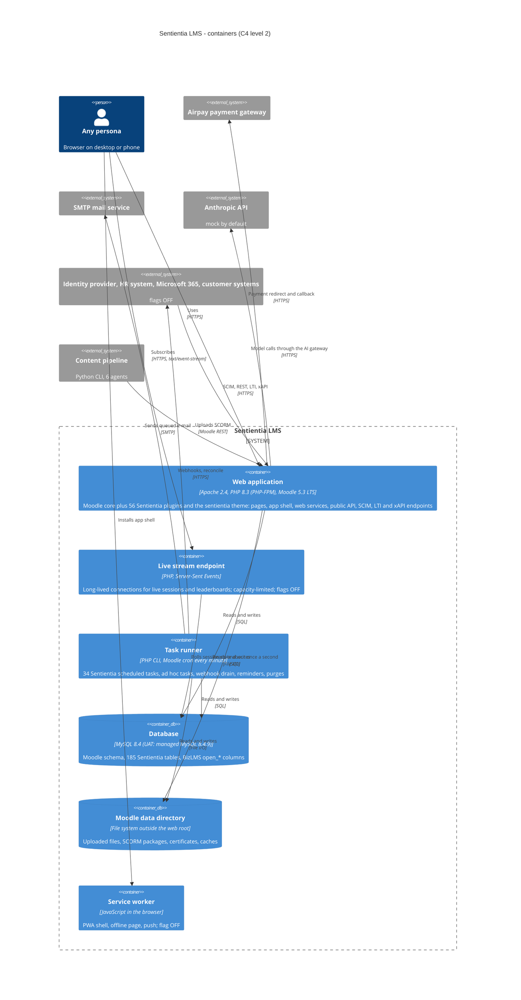
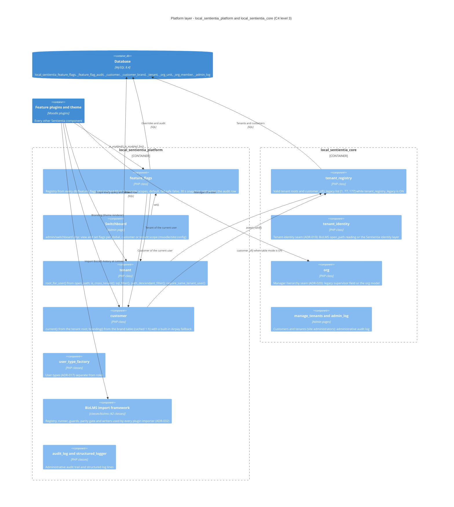
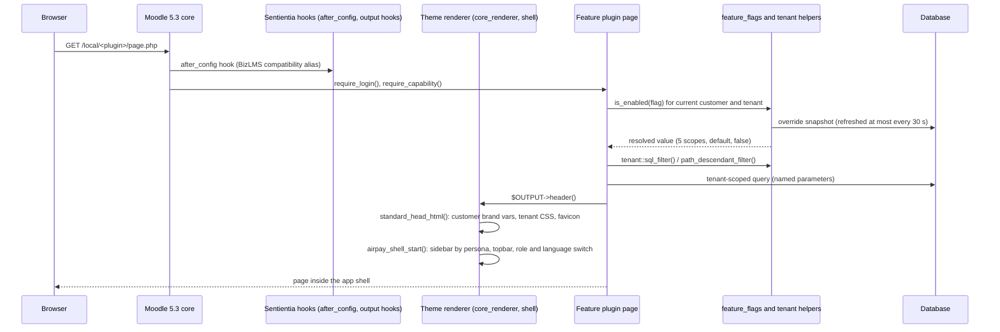

# Sentientia LMS: Product Guide for the Chief Technology Officer

**Subtitle:** The Moodle 5.3 LTS base and everything built on it: architecture (arc42 and C4), every component and feature, end-to-end scenarios, administration, integrations, quality, roadmap and full potential

| Field | Value |
|---|---|
| Prepared for | Chief Technology Officer, Airpay Payment Services |
| Document owner | Head of Learning & Development, Airpay Payment Services |
| Version | 1.0 |
| Date | 20 November 2026 |
| Status | Draft for review |
| Classification | Confidential: Airpay Payment Services internal. Not for external distribution. |

---

## Document control

### Version history

| Version | Date | Author (role) | Change |
|---|---|---|---|
| 1.0 | 20 November 2026 | Solution architecture writer for the Sentientia LMS programme | First issue for review by the Chief Technology Officer. Extends the earlier, shorter C-suite product guide (`moodle-enhancement/docs/SENTIENTIA-PRODUCT-GUIDE.md`) and re-verifies its facts against the code and the fact base of 20 November 2026 |

### Reviewers to sign off

| Role | Organisation | What the sign-off covers |
|---|---|---|
| Chief Technology Officer | Airpay Payment Services | Architecture (sections 2 to 4), the asks in section 13, the risks in section 14 |
| Head of Learning & Development (product owner) | Airpay Payment Services | Feature status labels, flag posture, scenarios (sections 5 to 8) |
| Engineering lead (platform engineer) | Airpay Payment Services | Technical accuracy of sections 2 to 4, 9 and 10 and of Appendices A to C |
| DevOps lead | Airpay Payment Services | Deployment view (section 3.7), environment facts, items marked "to be confirmed (owner: DevOps lead)" |
| QA architect | Airpay Payment Services | Quality and engineering practices (section 11) |
| Security architect | Airpay Payment Services | Tenant isolation (section 2.5), integration surface (section 9); consistency with Pack 02 (security architecture) |
| Data Protection Officer | Airpay Payment Services | Privacy statements; consistency with Pack 01 (DPDP) |

### Related documents

| Document | Location |
|---|---|
| Canonical fact base (numbers used in this guide) | `moodle-enhancement/docs/stakeholder-packs/2026-11/_facts/00-FACTS-INDEX.md` and the domain files `10-plugins-a.md` to `70-ui-surfaces.md` |
| Earlier C-suite product guide (executive overview) | `moodle-enhancement/docs/SENTIENTIA-PRODUCT-GUIDE.md` |
| Pack 01: DPDP technical design, compliance mapping and code-review bundle | `moodle-enhancement/docs/stakeholder-packs/2026-11/01-dpdp-security-review/` |
| Pack 02: Security architecture and threat model | `moodle-enhancement/docs/stakeholder-packs/2026-11/02-security-architecture/02-SECURITY-ARCHITECTURE-AND-THREAT-MODEL.md` |
| Pack 04: Offline LLM requirements brief | `moodle-enhancement/docs/stakeholder-packs/2026-11/04-offline-llm-brief/04-OFFLINE-LLM-REQUIREMENTS-BRIEF.md` |
| Pack 05: UI/UX review | `moodle-enhancement/docs/stakeholder-packs/2026-11/05-uiux-review/05-UIUX-REVIEW-PACK.md` |
| Pack 06: Marketing study | `moodle-enhancement/docs/stakeholder-packs/2026-11/06-marketing-study/06-MARKETING-STUDY.md` |
| Pack 07: QA architecture and harness review | `moodle-enhancement/docs/stakeholder-packs/2026-11/07-qa-review/07-QA-ARCHITECTURE-AND-HARNESS-REVIEW.md` |
| Pack 08: Infrastructure and DevOps review | `moodle-enhancement/docs/stakeholder-packs/2026-11/08-infra-devops/08-INFRASTRUCTURE-AND-DEVOPS-REVIEW.md` |
| Pack 10: Go-live readiness and risk register | `moodle-enhancement/docs/stakeholder-packs/2026-11/10-go-live-readiness/10-GO-LIVE-READINESS-AND-RISK-REGISTER.md` |
| Architecture Decision Records | `moodle-enhancement/docs/adr/` (index in Appendix E.3) |

---

## How to read this guide

### Status labels

Every feature, control or capability in this guide carries one of six status labels. They are applied with one rule, taken from the fact base (`_facts/00-FACTS-INDEX.md` section 1):

| Label | Situation in the repository |
|---|---|
| **Available (UAT)** | Code is in commit `af6e65c0e` (the code on UAT) and no default-OFF master switch hides it |
| **Built (behind a feature flag, off by default)** | Code is in that commit, but its master switch defaults OFF |
| **Built (verified on development)** | Code changed after that commit (commits `4a78b8f82`, `76e8ec572` and the uncommitted work of 20 November 2026), plus "behind a feature flag, off by default" where a flag gates it |
| **In progress** | Code started, not complete |
| **Planned** | An ADR, a plan, or a flag that is registered but read by no code |
| **Not planned** | Considered and rejected, with the reason |

The labels describe product features and controls deployed to an environment. Tooling and documents (CI gates, GitHub workflows, plans) are described in plain words instead, for example "in CI, blocking", "workflow present, never run" or "draft for CTO review".

Which flags are switched ON on UAT is a runtime setting held in the UAT database, not in the repository. It is **to be confirmed** from the UAT Switchboard (owner: Head of Learning & Development). Where this guide says "behind a flag", it describes the registered default, not the UAT state.

### Paths

Every plugin exists in a canonical tree (`moodle-enhancement/<type>/<plugin>/`) and, for most plugins, in a twin tree at the repository root, kept identical by a drift gate apart from 38 recorded baseline differences (section 3.2). Paths in this guide follow one convention:

| A path that starts with | Is relative to |
|---|---|
| `moodle-enhancement/` | The repository root (full path) |
| `local/`, `blocks/`, `enrol/`, `payment/`, `mod/`, `docs/`, `core-patches/`, `state-cards/` | `moodle-enhancement/` (the canonical tree) |
| `theme/`, `admin/`, `tools/`, `scripts/`, `tests/`, `.github/`, `.claude/` | The repository root |
| `_facts/` | `moodle-enhancement/docs/stakeholder-packs/2026-11/` |

Tools that exist only under `moodle-enhancement/tools/` are always written with their full path. Page addresses such as `/local/sentientia_privacy/index.php` are relative to the site root.

### Reading map

| Sections | What they cover | arc42 / C4 mapping |
|---|---|---|
| 1 | Executive summary | n/a |
| 2 | Vision, customer and tenant model, branding, feature flags, multi-customer readiness | arc42 sections 1 and 8 |
| 3 | Architecture: goals, stakeholders, constraints, context, strategy, building blocks, runtime, deployment, concepts, decisions | arc42 sections 1 to 9; C4 levels 1 to 3 |
| 4 | The Moodle 5.3 LTS base: what we rely on and what we changed | arc42 sections 2 and 5 |
| 5 and 6 | Feature catalogue by domain, including privacy rights and organisation, user and role administration | arc42 section 5 (building blocks, functional view) |
| 7 | Ten end-to-end persona scenarios | arc42 section 6 (runtime view) |
| 8 | Administration and configuration | arc42 sections 7 and 8 |
| 9 and 10 | Integrations and APIs; AI, mobile, internationalisation and accessibility | arc42 sections 3 and 8; C4 levels 1 and 3 |
| 11 | Quality and engineering practices | arc42 section 10 |
| 12 | Roadmap and full potential | C4 level 2 (future containers) |
| 13 and 14 | Asks and next steps; risks, limitations and open questions | arc42 section 11 |
| Appendices A to E | Plugin, flag and web-service references; glossary; references | arc42 section 12 (glossary) |

---

## 1. Executive summary

### 1.1 What this guide is

This guide describes Sentientia LMS for the Chief Technology Officer (CTO): the Moodle 5.3 LTS (long-term support) base, every component built on it, how the components fit together, and what the platform can become. It follows the arc42 architecture template and the C4 model (context, container and component levels). Every statement is traced to the repository or to the shared fact base (`_facts/`), as of 20 November 2026.

Sentientia LMS is a white-label, multi-tenant learning platform: a learning management system (LMS) with learning experience platform (LXP) features, built by Airpay Payment Services on Moodle 5.3 LTS. Airpay Academy is its first deployment ("customer zero").

**Sentientia is not live.** www.airpay.academy still runs the legacy BizLMS platform on Moodle 4.1.2. Sentientia runs on development machines, whose database is a copy of the production database imported for testing only, and on the user-acceptance test (UAT) environment, academy2.airpay.ninja, which is a fresh install with synthetic test personas. Cutover is staged: UAT sign-off, a rehearsal on a fresh live backup with a 100% parity check, then cutover with all data.

### 1.2 Key facts

| Fact | Value (source: `00-FACTS-INDEX.md`) |
|---|---|
| Platform and UAT | Moodle 5.3 LTS (ADR-033), security support to 2029-10-01. UAT runs 5.3 at commit `af6e65c0e` on one 2 vCPU / 2 GB server with managed MySQL 8.4.9 |
| Components | **57**: 47 local plugins, 6 blocks, 1 enrolment plugin, 1 payment gateway, 1 quiz access rule, 1 theme. 39 Available (UAT); 18 Built (behind a feature flag, off by default) |
| Feature flags | **142**: 13 default ON, 129 default OFF; resolved per customer and per tenant |
| Data and access | **185** tables (111 with personal data by column name); **181** capabilities; 3 tenants under one customer |
| Interfaces | **174** web-service functions; public API, SCIM, webhooks and LTI 1.3 behind default-OFF flags |
| Moodle core | 1 core file patched (Built (verified on development)); 2 added overlay files (Available (UAT)) |
| Tests | 4,861 PHPUnit test methods; 2 groups block continuous integration (CI) |
| AI | 8 large language model (LLM) features, all mock by default; no key or signed spend cap; the AI operating budget is pending C-suite approval and needs a line-item spend plan |

The three tenants are Airpay (internal employees, tenant 1), Public (consumer storefront, tenant 77) and ZEEA Mafunzo (Tanzania, tenant 177).

### 1.3 The architecture in three sentences

Sentientia is a set of standard Moodle plugins and one standalone theme, with a shared platform layer that supplies feature flags, the customer and tenant model, tenant scoping, branding and BizLMS import. Tenant isolation is one fail-closed decision (ADR-031): only site administrators and holders of one deliberately granted capability act across tenants. Every new feature and every integration ships behind a registered flag, default OFF or mock, so one code base can serve many customers and a change can be rolled back by a flag flip.

### 1.4 Decisions and actions asked of the CTO

Section 13.1 gives the reason, form and milestone for each ask.

- **A1** Sponsor the production-class infrastructure request (PHP 8.3, MySQL 8.4, a larger server, a database snapshot path).
- **A2** Have the DevOps lead confirm region, encryption at rest, recovery point and recovery time objectives (RPO and RTO), and monitoring.
- **A3** Set the multi-customer readiness bar before a second customer, as an ADR.
- **A4** Endorse the core-modification discipline for future Moodle upgrades.
- **A5** Name the owner of the cross-tenant capability `local/sentientia_platform:crosstenant`.
- **A6** Review the native learner app decision (ADR-040) after its two spikes.
- **A7** Direct the AI provider strategy, as an ADR.
- **A8** Approve moving CI PHPUnit to Moodle 5.3 with MySQL 8.4, full suite blocking once green.

### 1.5 Top risks

| # | Risk | Owner role | Proposed resolution |
|---|---|---|---|
| R1 | Capacity unproven against 3,500 or more users; no load test on a production-class environment | DevOps lead | Provision the target environment (A1); load-test before cutover |
| R2 | CI runs PHPUnit on Moodle 5.2 with MariaDB, not 5.3 with MySQL 8.4 | QA architect | Add a 5.3 job; make the full suite blocking (A8) |
| R3 | No staging tier; no machine-readable record of what is deployed on UAT | DevOps lead | Add staging and a deployed-version marker |
| R4 | Live AI, WhatsApp and SMS not usable today | Head of Learning & Development | Treat as Planned in external material |
| R5 | Two plugin trees must stay identical | Platform engineer | Keep the drift gate blocking; decide on the twin tree |

Section 14 holds the full register (L-01 to L-39). R1 maps to L-03, R2 to L-09 and L-10, R3 to L-02 and L-08, R4 to L-17 and L-20, and R5 to L-12.

---

## 2. Product vision and the white-label, multi-customer model

### 2.1 What we are building

Sentientia LMS is a product, not a site customisation. ADR-001 (Accepted, 2026-05-20) records the pivot: the legacy platform was forked, rebuilt as a product and made sellable, with Airpay Academy as the first customer used to harden every feature against real enterprise data.

| Aspect | Position | Source |
|---|---|---|
| Category | White-label enterprise LMS with LXP features (catalogue, recommendations, skills, social and live engagement), built as Moodle plugins | ADR-001 (Context and Decision) |
| First customer | Airpay Payment Services (customer id 1): Airpay (internal employees), Public (consumer storefront) and ZEEA Mafunzo (Tanzania) | `local/sentientia_platform/classes/customer.php` (`AIRPAY = 1`); `tenant.php` (`VALID_TENANTS = [1, 77, 177]`) |
| Future customers | Designed for; none signed. A second customer record on the development database is test data | `20-flags-roles.md` section 6.1 |
| Base platform | Moodle 5.3 LTS, open source under the GNU General Public License v3 (GPL v3); our plugin files carry GPL v3 headers | ADR-033; plugin file headers, for example `theme/sentientia/classes/role_detector.php` |
| Replaces | The legacy BizLMS platform: Moodle 4.1.2 with 22 purchased third-party `local_*` plugins, absorbed and de-branded (ADR-024, ADR-025) | `docs/adr/ADR-024-absorb-and-debrand-bizlms.md` |

### 2.2 Design principles

These principles come from ADR-001 (the product pivot), the later ADRs, and the project engineering rules that the pre-commit hook and CI enforce. They explain most of the structure the CTO will see in the code.

| # | Principle | How the code enforces it |
|---|---|---|
| P1 | Two customers in mind for every decision: Airpay today, "Enterprise N" tomorrow | Customer and tenant concepts in the data model (`local_sentientia_customer`, `local_sentientia_tenant`); customer-scoped flags and branding |
| P2 | Backward compatibility with Airpay Academy's current behaviour is non-negotiable | New behaviour ships additive and dark; legacy-mode settings (section 2.8) keep BizLMS-shaped behaviour until switched |
| P3 | Every new user-visible feature ships behind a feature flag, default OFF | Flag registry per plugin; `feature_flags::set()` refuses an unregistered key. Exception by design: 13 flags default ON (section 2.7.4) |
| P4 | One cross-tenant authority, fail closed | `tenant::is_cross_tenant()` and the scoping helpers (ADR-031); blocking `tenant_isolation` test group in CI |
| P5 | Core changes are allowed only with a record | `docs/core-mods/` ledger, `SENTIENTIA-CORE-MOD` markers, pre-commit check 6 and the CI `core-mods.yml` workflow (ADR-001, ADR-041, ADR-044) |
| P6 | Ship whole: a partial plugin or a partial flag is a defect | Project engineering rule with no formal record yet (owner: engineering lead, to formalise as an ADR); version-bump and upgrade-step gates in CI (`.github/workflows/ci.yml`) |
| P7 | Evidence for every UI change | Dated desktop and mobile screenshots in `docs/visual-evidence/` (1,528 images in 47 folders); folder structure set by ADR-001 |

### 2.3 The customer hierarchy

Sentientia models four nested levels. Only the first three are Sentientia concepts; the fourth is Moodle's.

| Level | Meaning | Stored in | Example | Status |
|---|---|---|---|---|
| Customer | A purchaser of Sentientia; owns one or more tenants, a brand and customer-level flag overrides | `local_sentientia_customer`; brand in `local_sentientia_customer_brand` | Customer 1, Airpay | Available (UAT); customer flag layer Built (behind a feature flag, off by default) |
| Tenant | A top-level organisation tree inside a customer; the isolation boundary for data and administration | `local_sentientia_tenant` (`rootid`, `customerid`, `name`, `status`); legacy list `[1, 77, 177]` | Tenant 77, Public storefront | Available (UAT) |
| Organisation unit | Departments and sub-units below the tenant root; drives manager scope and reporting | `local_sentientia_org` (fork of the BizLMS cost-centre tree); `local_sentientia_org_unit`, `local_sentientia_org_member` (ADR-020) | A department under tenant 1 | Available (UAT) |
| User | A Moodle user with an organisation path, a user type and Moodle roles | Moodle `user` table plus the BizLMS column `open_path`; user type in `local_sentientia_user_type` (ADR-017) | "Learner (Airpay tenant)" | Available (UAT) |

User type (ADR-017) is a permanent account attribute separate from roles: `employee`, `consumer`, `partner_employee` and `operator` are Available (UAT); `external_trainer` is In progress (provider written, not registered in `user_type_factory`, so no user-type row is written; the external-trainer accounts themselves are Built (verified on development), behind a feature flag, off by default, section 6.7); `candidate` is Planned (ADR-038). Source: `20-flags-roles.md` section 4.4.

### 2.4 Tenancy: how a user's tenant is decided

| Rule | Detail | Source |
|---|---|---|
| Identity column | The user's `open_path`, a slash-separated path of organisation ids inherited from BizLMS. The first segment is the tenant root: `/1/2/3` is tenant 1, `/77` is tenant 77, `/177/5` is tenant 177 | `local/sentientia_platform/classes/tenant.php` (`root_for_user()`) |
| Not used | `open_costcenterid`: the column does not exist on the production database, so no tenant logic reads it | `tenant::root_for_user()` reads `open_path` only (`local/sentientia_platform/classes/tenant.php`); ADR-019 (tenant-identity seam) |
| Valid tenants | While the legacy registry setting is ON (default), validation uses the hard-coded list `[1, 77, 177]` and every tenant maps to customer 1. With it OFF, validation and the customer of a tenant come from `local_sentientia_tenant` (ADR-021) | `local/sentientia_core/classes/tenant_registry.php` |
| Seam | `local_sentientia_core` provides the tenant-identity seam so plugins stop reading `open_path` inline (ADR-019); a setting chooses between the BizLMS reading and the Sentientia identity layer | `local_sentientia_core/tenant_identity_legacy` setting |
| Customer of the current user | `customer::current()` derives the customer from the tenant root; with the legacy registry ON, or for a site administrator or guest, it returns customer 1 | `local/sentientia_platform/classes/customer.php` |
| Path filters | Every tenant path filter goes through `tenant::path_descendant_filter()`: `/1` matches `/1` and `/1/2`, never `/10` or `/177`. Hand-written `LIKE '/1%'` filters over-counted sibling ids; this defect class shipped more than once before the helper and its guards existed | `tenant.php`; pre-commit check 18; CI `path-boundary-check` |

### 2.5 Cross-tenant authority (ADR-031)

ADR-031 (Accepted, 25 September 2026) closed a defect class found by a sweep of the code (73 hits, 70 confirmed): about 30 plugins granted `manage_all`, `viewall`, `manage` or `view` capabilities to the manager archetype and treated holding the capability as licence to skip the tenant filter. A tenant administrator could read other tenants' personal data, write into other tenants and escalate roles. Where a non-administrator's `open_path` did not resolve, most engines read the empty tenant as "every tenant".

| # | Decision | Effect in code |
|---|---|---|
| 1 | Cross-tenant means a site administrator or a holder of `local/sentientia_platform:crosstenant` (no archetype default) | Tenant administrators, including Airpay's own, are confined to their tenant |
| 2 | One helper decides | `tenant::is_cross_tenant()`; `viewer_can_access()`, `require_path_access()`, `sql_filter()` and `path_filter()` route through it |
| 3 | A capability says what, never where | Tenant scope applies unless `is_cross_tenant()` is true |
| 4 | Fail closed | No resolvable tenant means nothing: `scope_path()` returns `null`, filters return `1=0` |
| 5 | Writes check the target | `require_same_tenant_user()`, `require_access()`, `require_path_access()` |
| 6 | Escalation closed | Role management limited to site administrators or cross-tenant callers; scoped role assignment only of roles the actor holds, inside the actor's tenant |
| 7 | Revoke, not just remove | Upgrade steps call `unassign_capability()`, because changing an archetype default never revokes an existing grant |
| 8 | Every fix ships tests in `@group tenant_isolation` | 135 test files carry the group by the CI count (top-level test files); 178 tagged test files in the canonical tree (177 local, 1 block), including subdirectories such as `tests/external/`; the group blocks CI (floor of 40 files) |

Status: Available (UAT). Open owner action: no role holds `local/sentientia_platform:crosstenant` on the development database, so site administrators are today the only cross-tenant principals (fact base `20-flags-roles.md` section 7, R3). The compliance report adds a three-level viewer scope (site, tenant, team) on top of this rule (`local/sentientia_compliance_report/classes/viewer_scope.php`).

### 2.6 Per-customer and per-tenant branding

Branding is applied in five layers. The theme defaults and theme settings set the site-wide base, the customer bundle sets the customer's colours and icons, and tenant settings override all of them for users of that tenant. For example, the renderer uses the tenant logo first, then the logo from the theme settings, then the theme's default logo (`theme/sentientia/classes/output/traits/branding_assets.php`); tenant colour overrides and custom CSS are injected after the customer variables (`core_renderer::standard_head_html()`).

| Layer (lowest to highest precedence) | What it controls | Mechanism | Status |
|---|---|---|---|
| 1. Theme defaults | Brand Book 2026-06 tokens: primary `#0066A7`, accent `#1985DD`, background `#F2F4FB`, Montserrat, 8 px spacing grid, 6 breakpoints (380, 590, 768, 992, 1280, 1600 px), dark-mode tokens | Compiled SCSS; tokens in `theme/sentientia/scss/moodle/_tokens.scss` and `_tokens-dark.scss` as CSS custom properties | Available (UAT) |
| 2. Theme settings | Logo, five login slider images, login text, social links, brand colours | Theme admin settings (`theme/sentientia/settings.php`, strings in `lang/en/theme_sentientia.php`) | Available (UAT) |
| 3. Customer brand | Display name, short name, primary colour, background colour, 192 px and 512 px icons (also used as favicon), PWA start URL, language, status-bar style, app categories | `customer::branding()` reads `local_sentientia_customer_brand` (application cache, 1-hour lifetime) and falls back to a built-in Airpay bundle; `core_renderer::standard_head_html()` injects `--ap-color-primary` and `--ap-color-bg` and the favicon | Available (UAT); for customer 1 the values equal the theme defaults, so the layer is a visual no-op today |
| 4. Tenant brand | Logo, favicon, colour overrides, custom CSS, footer HTML, sender address, support address, help URL, landing hero | `local_sentientia_org\tenant_settings` over the `local_sentientia_org` row of the tenant root | Available (UAT) |
| 5. Product naming | User-visible "Moodle" strings renamed to Sentientia; customer name comes from the site name and language strings; the footer carries a private and confidential notice as a per-customer string | `docs/core-mods/2026-05-20-moodle-to-sentientia-rename.md` (a note, no core edit); theme language strings | Available (UAT) |

Verification note: the older C-suite guide stated that the customer brand registry also controls light and dark logos and typography. The code does not: `customer::branding()` returns colours, icons and PWA fields only. Logos are set per tenant (layer 4) and in theme settings (layer 2); the font family is fixed in the theme tokens. ADR-008, which designs the brand table, still carries the status Proposed (implementation deferred), although the table and resolver exist in code. Customer branding has no administration page; it is a database row (section 8.2).

### 2.7 The feature-flag platform

#### 2.7.1 Registry and storage

| Item | Fact | Source |
|---|---|---|
| Declaration | Each plugin declares `$flags = [key => ['default' => bool, 'description' => string]]` in `db/feature_flags.php` | `local/sentientia_platform/db/feature_flags.php` |
| Registry size | 142 keys in 43 registry files (41 local plugins, `enrol_sentientiasub` and `theme_sentientia`); no duplicate keys | `_facts/20-flags-roles.md` sections 1 and 2.1 |
| Discovery | `feature_flags::load_registry()` walks every installed plugin of every type, themes included, and merges every readable registry file | `local/sentientia_platform/classes/feature_flags.php` (`load_registry()`) |
| Registry cache | Moodle Universal Cache (MUC) application cache, 60-second lifetime, static acceleration | `local/sentientia_platform/db/caches.php` |
| Overrides | Table `local_sentientia_feature_flags` (key, customer id, tenant id, value, actor, times) | `db/install.xml` |
| Audit | Table `local_sentientia_feature_flag_audit`: old value, new value, actor, reason and time for every change | `feature_flags::set()` |
| Unknown keys | `set()` throws `unknownflagkey`; `is_enabled()` returns `false` | `feature_flags.php` |
| Administration | The Switchboard (`/local/sentientia_platform/admin/switchboard.php`), site administrators only (`moodle/site:config`); shows default, resolved value and the layer that set it | `admin/switchboard.php` |

#### 2.7.2 Resolution order

For a user in customer C and tenant T, `is_enabled($key)` stops at the first row found:

| Step | Scope | Applies when |
|---|---|---|
| 1 | Key, customer C, tenant T | Customer layer ON, C > 0 and T > 0 |
| 2 | Key, customer C, all tenants | Customer layer ON and C > 0 |
| 3 | Key, customer 0, tenant T ("legacy tenant override") | T > 0 |
| 4 | Key, customer 0, tenant 0 (global override) | Always |
| 5 | Registered default from `db/feature_flags.php` | Key registered |
| 6 | `false` (fail-safe) | Key not registered |

Rules around the order (source: `feature_flags.php`; ADR-002):

- **Customer layer gate.** Steps 1 and 2 run only when `sentientia.customer_level_flags.enabled` resolves ON. It defaults OFF, is itself resolved without a customer scope, and cannot be written at customer scope. With the gate OFF the resolver behaves exactly like the original three-level resolver; this is the backward-compatibility guarantee for Airpay Academy.
- **Site administrators** resolve to tenant 0, so they see defaults and global overrides unless they choose a tenant in the Switchboard.
- **Explicit scope.** `is_enabled_for($key, $customerid, $tenantid)` and `is_enabled_for_tenant($key, $tenantid)` evaluate a flag for someone other than the current user (for example in a scheduled task that e-mails many users).
- **Freshness.** Overrides are read once per process into a snapshot that expires after 30 seconds (`SNAPSHOT_TTL = 30`). Long-running processes (cron, task runners, Server-Sent Events connections) pick up a change within 30 seconds without a restart.
- **Writes.** `feature_flags::set($key, $tenantid, ?bool $value, $byuserid, $reason, $customerid)`; a `null` value deletes the override so the scope inherits again. Every effective change writes one audit row.
- **Test isolation.** Registry and snapshot live in a dependency-injection container object that PHPUnit resets for every test.

#### 2.7.3 Flag inventory by category

| Category (first key segment) | Flags | Examples |
|---|---|---|
| `sentientia.*` | 115 | Product features, sub-switches, readers for imported BizLMS history |
| `live.*` | 9 | Live engagement sessions and question types |
| `engagement.*` | 6 | Gamification, WhatsApp, SMS |
| `ai.*` | 3 | Assistant, authoring pipeline, recommendations |
| `commerce.*` | 3 | Cross-tenant course share and request, public marketplace |
| `ux.*` | 3 | Command palette, dark mode, language switcher |
| `identity.*` | 1 | Single sign-on master switch |
| Irregular keys | 2 | `sentientia_m365_enabled`, `sentientia_whatsapp_content_notifications` (underscore form; listed under "other" in the Switchboard) |

Source: `_facts/20-flags-roles.md` section 3.2. The largest registries are `local_sentientia_platform` (17), `local_sentientia_live` (9), `local_sentientia_leaderboard` (7) and `local_sentientia_content_market` (6).

#### 2.7.4 Flags that default ON, and reserved flags

Thirteen flags default ON: `ai.assistant.enabled`, `engagement.gamification.enabled`, `engagement.gamification.confetti`, `commerce.crossTenantShare.enabled`, `commerce.crossTenantRequest.enabled`, `ux.commandPalette.enabled`, `live.realtime.enabled`, `sentientia.catalog.public_lxp.enabled`, `sentientia.leaderboards.realtime.enabled`, `sentientia.leaderboards.optout.enabled`, and the three calendar-sync event flags (`.courses`, `.classroom`, `.exams`). Most of these are sub-switches under a master switch that defaults OFF (for example `live.realtime.enabled` under `live.enabled`), so they have no effect until the master switch is turned on. One registry inconsistency is open: `sentientia.catalog.public_lxp.enabled` defaults ON while its description says "default OFF" (`local/sentientia_catalog/db/feature_flags.php`). Source: `_facts/20-flags-roles.md` section 3.3.

**Reserved flags.** Ten registered flags switch on no feature, because no feature code exists behind them. Each is therefore Planned. This is the one consolidated list; sections 5.2.3, 6.6.4, 8.4 and Appendix B refer to it. Source: registry files and a repository search of plugin and theme code, 20 November 2026.

| # | Flag | Default | Owning plugin | Why it is reserved |
|---|---|---|---|---|
| 1 | `ux.commandPalette.enabled` | ON | `local_sentientia_platform` | No command palette exists; no code reads the flag |
| 2 | `engagement.gamification.confetti` | ON | `local_sentientia_platform` | No code reads the flag |
| 3 | `ai.recommendations.enabled` | OFF | `local_sentientia_platform` | No code reads it; recommendations use their own flags (section 5.2.3) |
| 4 | `ai.sentientia.enabled` | OFF | `local_sentientia_platform` | Reserved for an in-product SOP-to-SCORM pipeline; the pipeline runs from the command line (section 6.5) |
| 5 | `commerce.publicMarketplace.enabled` | OFF | `local_sentientia_platform` | No code reads the flag (section 5.3) |
| 6 | `identity.sso.enabled` | OFF | `local_sentientia_platform` | No code reads it; single sign-on depends on Moodle's own OAuth 2 (open authorisation standard, version 2) configuration (section 9.8) |
| 7 | `sentientia.recommendations.auto_cron` | OFF | `local_sentientia_recommendations` | No scheduled task exists behind it (L-22) |
| 8 | `sentientia.assessment.seb_preset.enabled` | OFF | `local_sentientia_proctoring` | Safe Exam Browser preset, stage B3 of ADR-038; added after the UAT commit |
| 9 | `sentientia.proctoring.recording.enabled` | OFF | `local_sentientia_proctoring` | Webcam recording, stage B4 of ADR-038; added after the UAT commit. Read only by the `upload_chunk` web service, which refuses every call while the flag is OFF; no recording feature exists behind it |
| 10 | `sentientia.assessment.candidates.enabled` | OFF | `local_sentientia_proctoring` | Hiring-candidate accounts, stage B5 of ADR-038; added after the UAT commit |

#### 2.7.5 Flag state on UAT

Which flags are ON on UAT is a runtime database setting and is not recorded in the repository: **to be confirmed** from a Switchboard export (owner: Head of Learning & Development). At the UAT commit the registry held 134 flags: 133 in the plugin registries plus the theme's `sentientia.dashboard.blocksdrawer.enabled`, which matches the 19 November deploy record. The development database figures (35 override rows over 31 flags) are not UAT state. A read-only snapshot tool exists for before-and-after comparisons around a deploy: a deploy may add flags only as OFF and must not change an existing resolved value (`tools/uat/flag_snapshot.php`). UAT and production flag changes are decided by the Head of Learning & Development.

### 2.8 Multi-customer readiness: what is in place and what is not

| Capability | State today | What a second customer needs | Status |
|---|---|---|---|
| Customer and tenant tables | Present; customer 1 only | Seed the second customer and its tenant roots (`local/sentientia_core/cli/seed_tenants.php`) | Available (UAT) |
| Tenant registry | Legacy mode ON by default: hard-coded roots `[1, 77, 177]`, all mapped to customer 1 | Switch the registry to table mode (ADR-021). The development database already runs in table mode | Table mode is code in the UAT build (no change since commit `af6e65c0e`), held off by the setting `local_sentientia_core/tenant_registry_legacy` (default ON, legacy list; a setting, not a registered flag); the setting's value on UAT is **to be confirmed** (owner: platform engineer) |
| Customer flag layer | Gate `sentientia.customer_level_flags.enabled` default OFF | Turn the gate on; set customer-level overrides | Built (behind a feature flag, off by default) |
| Customer branding | Resolver and table in code; Airpay values equal theme defaults | Insert a brand row; supply icons | Available (UAT); ADR-008 status Proposed |
| Tenant administration | Confined per tenant (ADR-031) | Create the customer's tenant administrator assignments | Available (UAT) |
| Role look-ups | Most code looks up BizLMS roles by short name (role ids differ between copies: the `administrator` role is id 9 on UAT and 11 on another copy). One exception remains: the dashboard layout's onboarding redirect checks `roleid = 9` (`theme/sentientia/layout/dashboard.php` line 80) | Replace the remaining id check with a short-name look-up | In progress (one known site) |
| White-label naming | Customer name from site name and language strings; product chrome says Sentientia | Set site name and customer strings | Available (UAT) |
| Isolation between customers | Logical isolation inside one Moodle site and one database (shared schema, tenant filters) | A decision on single-site multi-customer versus one site per customer: **to be confirmed** (owner: solution architect, with the CTO) | Planned (decision) |

---

## 3. Architecture (arc42 and C4)

This section follows the arc42 template: introduction and goals (3.1), constraints (3.2), context and scope (3.3), solution strategy (3.4), building blocks (3.5), runtime (3.6), deployment (3.7), cross-cutting concepts (3.8) and decisions (3.9). Diagrams follow the C4 model and are given as Mermaid code so they can be rendered or edited.

### 3.1 Introduction and quality goals

**Requirements overview.** Sentientia must deliver an enterprise learning platform for several organisations in one installation: course catalogue and enrolment, compliance training with deadlines and escalation, classroom (instructor-led training, ILT) and online exams, programmes and learning paths, skills, analytics, commerce for a consumer storefront, and AI-assisted authoring, while staying upgradeable with Moodle LTS releases.

| Priority | Quality goal | Scenario | Main mechanism |
|---|---|---|---|
| 1 | Tenant isolation | A tenant administrator of tenant 77 requests a report: only tenant 77 rows are returned; a user whose tenant cannot be resolved gets nothing | ADR-031 helpers; blocking `tenant_isolation` tests |
| 2 | Upgradeability | A new Moodle 5.3 point release is applied: plugins upgrade through `upgrade.php`; the one core patch is re-applied by script against a pinned upstream hash | Plugin-only design; `core-patches/MANIFEST`; ADR-044 |
| 3 | Safe change | A new feature is deployed dark and turned on per tenant; a fault is rolled back by a flag flip within 30 seconds | Feature-flag platform (section 2.7) |
| 4 | Privacy by design | A data principal's erasure request reaches every plugin that holds their data | Privacy providers in all 57 components; ADR-035 |
| 5 | Backward compatibility | Airpay Academy users see today's behaviour until a flag or setting changes | Legacy modes; default-OFF flags |
| 6 | Localisation | A learner reads the interface in Hindi with parity to English | en and hi parity enforced by pre-commit and CI |

**Stakeholders** (arc42 section 1.3). Roles, not people.

| Stakeholder (role) | Interest in the architecture | Where this guide serves them |
|---|---|---|
| Chief Technology Officer | Upgradeability, multi-customer readiness, infrastructure, AI and mobile strategy, technical risk | Sections 1, 3, 4, 12 to 14 |
| Head of Learning & Development (product owner) | Feature scope and status, flag posture, cutover readiness, customer zero's behaviour | Sections 5 to 8, 13 |
| Engineering lead and platform engineer | Plugin structure, platform services, extension rules, core-modification discipline | Sections 2 to 4, 8, Appendices A to C |
| DevOps lead and IT infrastructure | Environments, deployment, hosting facts, capacity, backup and monitoring | Sections 3.7, 11.4, 14.1; Pack 08 |
| QA architect | Quality goals, gates, test coverage, CI target | Sections 3.1, 11; Pack 07 |
| Security architect | Tenant isolation, interface inventory, credentials handling | Sections 2.5, 9; Pack 02 |
| Data Protection Officer | Personal data in the data model, data-principal rights, erasure | Sections 3.8, 6.8, 14.4; Pack 01 |
| Finance | AI spend caps, commerce and GST, roadmap estimates | Sections 5.3, 10.4, 12 |
| Learners, line managers, trainers, authors and administrators (as personas) | A working, isolated, localised learning service | Section 7 |
| Future customers ("Enterprise N") | Isolation, branding, configuration without code changes | Sections 2.8, 8.2, 12.5.1 |

### 3.2 Constraints

| Type | Constraint | Source |
|---|---|---|
| Technical | Moodle 5.3 LTS; PHP 8.3 or later (8.3 is the one version both upgrade hops accept); MySQL 8.4 or later (or MariaDB 11.4, PostgreSQL 17); Apache 2.4 with `mod_rewrite` to `r.php`; `max_input_vars` 5000 or more; `memory_limit` 512M or more; `max_allowed_packet` 64M or more | ADR-033; `60-eng-qa-infra.md` section 9 |
| Technical | Code must run on MariaDB and MySQL 8: no MySQL 8 reserved words as column or alias names | ADR-033 (MySQL 8.4 target); ADR-039 (column-name rule); `tools/uat/mysql84_reserved_scan.py`; note on the PHPUnit job in `.github/workflows/ci.yml` |
| Technical | Moodle core is not in git for 5.3; the package is a vanilla 5.3 tree verified by SHA-256 (Secure Hash Algorithm, 256-bit) checksums, plus our overlay | ADR-044; `tools/packaging/build-standalone.sh` |
| Data | The production schema carries 37 BizLMS `open_*` columns on `user` and 18 on `course`; tenant identity depends on `open_path` | `docs/core-mods/2026-06-04-open-substrate-ownership.md` |
| Migration | Cutover path is two hops: 4.1.2 to 4.5.x to 5.3, a clean code directory per hop, then the BizLMS data import (ADR-032) | ADR-033 decision 2 |
| Organisational | UAT deploys, UAT flag changes and anything on production are decided by the Head of Learning & Development; production is never patched in place | Project release rule with no formal record yet (owner: Head of Learning & Development, to formalise as an ADR); the UAT deploy tool runs dry by default (`tools/uat/deploy_to_uat.sh`); cutover plan `docs/cutover/SENTIENTIA-CUTOVER-MASTER.md` |
| Organisational | Paid external calls (AI, text-to-speech) need explicit approval; AI features run in mock mode by default | `local/sentientia_ai/`; ADR-034 |
| Convention | Moodle coding standards: parameter API for input, output escaping, `$DB` API with named parameters, no raw superglobals; every core change recorded | Moodle coding guidelines; checks in the pre-commit hook (`.claude/hooks/pre-commit.sh`); ADR-001 (core-change ledger) |
| Convention | Every plugin exists in a canonical tree (`moodle-enhancement/<type>/<plugin>/`); 44 of the 47 local plugins and all 9 other plugins (6 blocks, the enrolment plugin, the payment gateway and the access rule) also have a twin under `<type>/<plugin>/`, kept identical by a drift gate apart from 38 recorded baseline differences (`tools/tree-drift-baseline.txt`, L-12); the theme lives at the repository root only | `tools/check-tree-drift.php` |

### 3.3 Context and scope (C4 level 1)

```mermaid
C4Context
  title Sentientia LMS - system context (C4 level 1)

  Person(learner, "Learner", "Employee, consumer or partner learner in one tenant")
  Person(manager, "Line manager", "Approves requests, follows team compliance")
  Person(trainer, "Trainer", "Internal or external; runs classrooms and live sessions")
  Person(author, "Course author", "Creates courses and AI-drafted content")
  Person(ldadmin, "L&D / tenant administrator", "Administers one tenant")
  Person(siteadmin, "Site administrator", "Operates the platform across tenants")

  System(sentientia, "Sentientia LMS", "Moodle 5.3 LTS plus 56 Sentientia plugins and the sentientia theme")

  System_Ext(pay, "Airpay payment gateway", "Payments for the Public storefront")
  System_Ext(mail, "SMTP mail service", "Outbound e-mail")
  System_Ext(push, "Browser push services", "Web Push (VAPID); flag OFF")
  System_Ext(ai, "Anthropic API", "Model calls via the AI gateway; mock by default")
  System_Ext(idp, "Customer identity provider", "OAuth 2 sign-in; SCIM provisioning (flag OFF)")
  System_Ext(hrms, "HR system (KeKa)", "Joiner-mover-leaver webhook and reconcile (flag OFF)")
  System_Ext(m365, "Microsoft 365", "Graph profile, sites, calendar (flag OFF, scaffold)")
  System_Ext(ext, "Customer systems", "Public API v1, outbound webhooks, LTI 1.3, xAPI (flags OFF)")
  System_Ext(pipeline, "Content pipeline", "Six command-line agents: SOP to SCORM package")
  System_Ext(tts, "ElevenLabs", "Text-to-speech for authoring voice-over and pipeline Agent 4; mock by default")
  System_Ext(teams, "Microsoft Teams channel", "Incoming-webhook notification card; setting OFF")
  System_Ext(market, "Content providers", "Go1, Udemy Business, Coursera, Skillsoft catalogue sync (flag OFF)")

  Rel(learner, sentientia, "Learns, buys, takes exams", "HTTPS")
  Rel(manager, sentientia, "Approves, monitors", "HTTPS")
  Rel(trainer, sentientia, "Delivers training", "HTTPS")
  Rel(author, sentientia, "Authors content", "HTTPS")
  Rel(ldadmin, sentientia, "Administers tenant", "HTTPS")
  Rel(siteadmin, sentientia, "Operates platform", "HTTPS")
  Rel(sentientia, pay, "Redirects to payment page, checks response checksum (integrity only)", "HTTPS")
  Rel(sentientia, mail, "Sends e-mail", "SMTP")
  Rel(sentientia, push, "Sends signed push messages", "HTTPS")
  Rel(sentientia, ai, "Model requests", "HTTPS")
  Rel(idp, sentientia, "Provisions users and groups", "SCIM 2.0")
  Rel(hrms, sentientia, "Pushes HR events", "HTTPS webhook")
  Rel(sentientia, m365, "Reads profile and calendar", "Microsoft Graph")
  Rel(ext, sentientia, "Reads data, launches tools", "REST, LTI 1.3, xAPI")
  Rel(sentientia, ext, "Posts signed events", "HTTPS webhooks")
  Rel(pipeline, sentientia, "Uploads SCORM packages", "Moodle REST")
  Rel(sentientia, tts, "Requests voice-over audio", "HTTPS")
  Rel(sentientia, teams, "Posts notification cards", "HTTPS webhook")
  Rel(sentientia, market, "Syncs provider catalogues", "HTTPS")
```



In the diagram, SMTP is the Simple Mail Transfer Protocol and REST (Representational State Transfer) is the protocol of Moodle's web-service layer.

External interfaces and their status (section 9.1 adds the protocol of each interface):

| Interface | Direction | Component | Status | Source |
|---|---|---|---|---|
| Browser user interface (11 logged-out surfaces, authenticated app shell) | In | Theme and all user-facing plugins | Available (UAT) | `70-ui-surfaces.md` sections 2 and 3 |
| Moodle web services: 174 functions in 24 service files | In | 23 local plugins and `paygw_airpay` | Available (UAT) for the plugins that are Available (UAT); 2 proctoring report functions added later are Built (verified on development), behind a feature flag, off by default | `_facts/30-apis.md` |
| Public API v1 (7 functions, OpenAPI 3.0.3, 600 requests per 60 s default rate limit) | In | `local_sentientia_api` | Built (behind a feature flag, off by default) | ADR-030 |
| SCIM 2.0 Users and Groups | In | `local_sentientia_api` | Built (behind a feature flag, off by default) | ADR-030 |
| Outbound webhooks (course completed, enrolment created, certificate issued; HMAC-SHA256 signed; retries then dead-letter) | Out | `local_sentientia_api` | Built (behind a feature flag, off by default) | ADR-030 |
| LTI 1.3 tool provider (OpenID Connect login, signed token verification, nonce replay protection) | In | `local_sentientia_api` | Built (behind a feature flag, off by default) | `30-apis.md` section 8 |
| xAPI 1.0.3 statements endpoint and statement emission | In and out | `local_sentientia_xapi` | Built (behind a feature flag, off by default) | `30-apis.md` section 10 |
| Airpay payment gateway | Out | `paygw_airpay` | Available (UAT) | `payment/gateway/airpay/` |
| E-mail through Moodle core mail | Out | `local_sentientia_emails`, `local_sentientia_notifications` and core | Available (UAT) | `30-apis.md` section 10 |
| Web Push | Out | `local_sentientia_pwa` | Built (behind a feature flag, off by default) | ADR-003, ADR-005 |
| Anthropic model API | Out | `local_sentientia_ai` gateway, 6 consumer plugins | Built (behind a feature flag, off by default); mock by default, no key configured | `50-ai.md` |
| HR system joiner-mover-leaver webhook and reconcile | In | `local_sentientia_integrations` | Built (behind a feature flag, off by default) | ADR-029 |
| Microsoft 365 (Graph) | Out | `local_sentientia_m365` | Built (behind a feature flag, off by default); scaffold level | `30-apis.md` section 10 |
| WhatsApp and SMS | Out | `local_sentientia_whatsapp` | Built (behind a feature flag, off by default) in mock mode; live sending not built | `30-apis.md` section 10 |
| Teams and Zoom meeting creation | Out | `local_sentientia_classroom` | Not built: meeting and recording links are stored only; API integration Planned | ADR-036 |
| Single sign-on (OAuth 2 issuers) | In | Moodle core | Documented configuration; issuer set-up on UAT to be confirmed (owner: IT infrastructure) | `30-apis.md` section 10 |

### 3.4 Solution strategy

| Goal | Strategy | Evidence |
|---|---|---|
| Upgradeability | Build only through Moodle's plugin types and output overrides; avoid editing core; when core must change, keep the patch additive, versioned per Moodle release and checked against a pinned upstream hash | 1 core file patched on 5.3; `tools/check-core-patches.sh` |
| Independence from BizLMS | Absorb the 22 purchased BizLMS plugins into `local_sentientia_*` (ADR-024, ADR-025); introduce seams for tenant identity (ADR-019), organisation hierarchy (ADR-020) and tenant registry (ADR-021); import BizLMS history through one framework (ADR-032) | `local/sentientia_core/`; `local/sentientia_platform/classes/bizlms/` (42 classes) |
| Multi-customer | Customer above tenant; customer-scoped flags and brand; single helper for tenant scope | Sections 2.3 to 2.7 |
| Safe delivery | Dark launch behind flags; additive schema changes; surgical, checksum-verified deploys; dry run by default | `tools/uat/deploy_to_uat.sh` |
| Quality | Gate system (ADR-027): 20 pre-commit checks, 15 CI jobs, defect-class guards | `.claude/hooks/pre-commit.sh`; `.github/workflows/ci.yml` |
| Cost control for AI | One gateway with mock-first routing, fail-closed quotas and a spend ledger | `local_sentientia_ai` |
| Real time without new infrastructure | Server-Sent Events from PHP for live sessions and leaderboards, chosen over WebSockets so no separate server process is needed | ADR-004, ADR-014 |

### 3.5 Building block view

#### 3.5.1 Container view (C4 level 2)



All server-side containers run the same code base. On UAT they share one application server; the target production topology (number of web nodes, cache store, session store, file storage) is **to be confirmed** by the DevOps lead together with the infrastructure request (section 1.4, A1).

#### 3.5.2 Component layers inside the web application (building-block summary)

The 57 product components group into eight layers. Each row is a set of Moodle plugins; the full per-plugin inventory is in Appendix A. Two components are shown at C4 level 3: the platform layer (section 3.5.3) and the AI gateway (section 10.2).

| Layer | Components | Responsibility | Status (plugin level) |
|---|---|---|---|
| Platform | `local_sentientia_platform` (flags, customer, tenant, user types, branding, BizLMS import framework, audit log, structured logger); `local_sentientia_core` (customer, tenant and organisation tables, tenant-identity seam, admin log, reconcile task); `local_sentientia_org` (organisation tree, tenant settings, BizLMS compatibility alias); `local_sentientia_roles`; `local_sentientia_users`; `local_sentientia_privacy` | Cross-cutting services every other plugin depends on | Available (UAT); `local_sentientia_users` external-trainer accounts Built (verified on development), behind a feature flag, off by default |
| Presentation | `theme_sentientia`; `local_sentientia_pages`; `local_sentientia_catalog`; `local_sentientia_pwa` | App shell, navigation, dashboards, login and landing, catalogue and storefront, installable web app | Available (UAT), except PWA: Built (behind a feature flag, off by default) |
| Learning delivery | `local_sentientia_courses`, `_learningpath`, `_programs`, `_classroom`, `_exams`, `_recompletion`, `_evaluation`, `_request`, `_live`; `quizaccess_sentientia_proctoring` with `local_sentientia_proctoring` | Courses, paths, programmes, ILT, exams, recertification, surveys, enrolment requests, live sessions, secure assessment | Available (UAT), except `_live`: Built (behind a feature flag, off by default). Proctoring B1/B2 and the access-rule changes: Built (verified on development), behind a feature flag, off by default; the earlier proctoring code on UAT is not fit for use (section 6.6) |
| Compliance, people and insight | `local_sentientia_compliance_report`, `_manager`, `_analytics`, `_reports`, `_skills`, `_notifications`, `_emails`; blocks `cert_health`, `compliance`, `cron_health`, `trainer` | Compliance matrix and reminders, manager dashboard, key performance indicators (KPIs) and reports, skills matrix, notification rules and e-mail templates | Available (UAT) |
| Engagement | `local_sentientia_gamification`, `_challenge`, `_ratings`, `_leaderboard`; blocks `leaderboard`, `recommendations` | Points, challenges, ratings, leaderboards | Available (UAT), except `_leaderboard`: Built (behind a feature flag, off by default) |
| Commerce | `local_sentientia_cart`, `_content_market`; `enrol_sentientiasub`; `paygw_airpay` | Cart, orders, refunds, GST invoices (flag), content marketplace, subscription enrolment, payment | Cart and gateway Available (UAT); content market and subscription enrolment Built (behind a feature flag, off by default) |
| AI | `local_sentientia_ai` (gateway); consumers `_assistant`, `_aiquiz`, `_authoring`, `_skillsai`, `_recommendations`, `_translate` | Model access, quotas and ledger; chat assistant, quiz generation, authoring studio, skills extraction, recommendations, translation | Assistant chat drawer Available (UAT), replies "not configured" with the shipped defaults and a marked mock when gateway routing is ON (section 10.3); all others Built (behind a feature flag, off by default) |
| Integration | `local_sentientia_api`, `_integrations`, `_xapi`, `_m365`, `_whatsapp`, `_calendar`, `_lifecycle`, `_talent` | Public API, SCIM, webhooks, LTI, HR system, xAPI, Microsoft 365, messaging, calendar sync, employee lifecycle, talent mobility | Built (behind a feature flag, off by default), with two exceptions: `local_sentientia_lifecycle` is Available (UAT) for its deadline-check task, which carries no flag and is enabled by default (joiner auto-enrolment stays behind `sentientia.lifecycle.autoenrol.enabled`); and the Teams notifier in `_integrations` is code in the UAT build held off by the setting `teams_enable` (default OFF) |

Dependency rule: feature plugins depend on the platform layer, never the reverse, and guard optional dependencies with `class_exists()` so a customer can run without them. Example: the theme's renderer reads customer branding only when `\local_sentientia_platform\customer` exists, and catches every error so a branding failure cannot break page rendering (`theme/sentientia/classes/output/core_renderer.php`, `standard_head_html()`).

#### 3.5.3 The platform component (C4 level 3)

The platform layer is the component every other plugin depends on. The diagram shows its main classes and the seams to `local_sentientia_core`. Status: Available (UAT); the customer flag layer and table-mode tenant registry are present but switched off (sections 2.7 and 2.8).



Design notes: the platform plugin guards its use of `local_sentientia_core` with `class_exists()`, so it still works alone (`tenant.php`, `customer.php`); `tenant_identity` likewise carries no hard dependency on the platform plugin (`local/sentientia_core/classes/tenant_identity.php`).

### 3.6 Runtime view

#### 3.6.1 Scenario: an authenticated page request



#### 3.6.2 Other runtime scenarios

| Scenario | Flow | Key code |
|---|---|---|
| Compliance reminders and escalation | Scheduled tasks find learners with upcoming or overdue mandatory courses, resolve the tenant and flags per recipient with `is_enabled_for()`, render tenant-aware templates and send through Moodle messaging and e-mail; every send is logged. Course reminder and overdue tasks ship disabled until switched on | `local_sentientia_courses`, `local_sentientia_emails`, `local_sentientia_notifications` (`db/tasks.php`) |
| Public storefront purchase | Guest browses `/local/sentientia_catalog/public.php`, signs up (Public tenant), adds to cart, pays through `paygw_airpay`; the response checksum is checked and the cart enrols the learner (the cart callback also compares the paid amount; the gateway's own return page does not, L-31). Storefront checkout is behind `sentientia.catalog.storefront_checkout.enabled` (default OFF) | `local_sentientia_catalog`, `local_sentientia_cart`, `paygw_airpay` |
| AI request | A consumer plugin calls `\local_sentientia_ai\client::complete()`; the gateway checks both gateway flags, a configured key and quota; otherwise it returns a deterministic mock at zero cost. Live attempts without a key fail closed; every call writes a ledger row without prompt or response text. While gateway routing is OFF (the default), the assistant chat, the agent and authoring use their own direct clients instead (Pack 01, F-22) | `local/sentientia_ai/classes/gateway.php` |
| Outbound webhook | A Moodle event observer (course completed, enrolment created, certificate issued) queues a delivery; the drain task posts it with an HMAC-SHA256 signature and retries at 1 min, 5 min, 30 min and 2 h before dead-lettering | `local_sentientia_api` observers and `webhook_drain` task |
| Live session | A trainer opens a session; participants join with a code and hold an SSE connection to `stream.php`; the endpoint returns HTTP 503 when its capacity is full. Each open connection holds one web-server worker (ADR-004) | `local_sentientia_live` |
| Erasure request | A data principal request through `tool_dataprivacy` reaches every privacy provider; providers delete or anonymise; a supplementary provider for completeness is behind two default-OFF flags (ADR-035) | `local_sentientia_privacy`; `classes/privacy/provider.php` in each plugin |

### 3.7 Deployment view

| Environment | Platform | Role | Source |
|---|---|---|---|
| Development (XAMPP) | Moodle 5.1.3+, PHP 8.2.12, MariaDB 10.11.16, Apache 2.4.58 | Day-to-day development and persona walks; can lag the repository | `60-eng-qa-infra.md` section 9 |
| Development (5.3 runtime) | Moodle 5.3 (version 2026100500.00), PHP 8.4, MariaDB 11.4 | 5.3 compatibility gate, upgrade rehearsals, 5.3 PHPUnit | same |
| CI (GitHub Actions) | PHP 8.2 (lint, Playwright on the 4.5 snapshot); PHP 8.3 and MariaDB 10.11 on Moodle 5.2 stable (PHPUnit) | Gates on every pull request and push to `production` | `.github/workflows/ci.yml` |
| UAT (academy2.airpay.ninja) | Moodle 5.3, PHP 8.3.6 under PHP-FPM (the PHP FastCGI Process Manager), Apache 2.4 behind a load balancer, managed MySQL 8.4.9; 2 vCPU, 2 GB RAM, 40 GB disk; cron every minute; data directory outside the web root | Acceptance testing on a fresh install (Stage A) with synthetic test personas created by `tools/uat/provision_test_users.php`; no production data; suitable for smoke tests and persona walks only | `60-eng-qa-infra.md` section 9 |
| Staging | None today | Gap (risk R3) | `60-eng-qa-infra.md` section 13 |
| Production (target) | Moodle 5.3 on PHP 8.3 and MySQL 8.4; sizing, region, encryption, backups and monitoring **to be confirmed** (owner: DevOps lead) | Replaces BizLMS at cutover | ADR-033; `DRAFT-IT-REQUEST-2026-11-12.md` |
| Production (current, not Sentientia) | www.airpay.academy: BizLMS on Moodle 4.1.2, managed MySQL 8.0.44 | Legacy platform; never patched in place | `60-eng-qa-infra.md` section 9 |

How code reaches an environment:

| Mechanism | Behaviour | Source |
|---|---|---|
| Release package | `tools/packaging/build-standalone.sh --target 5.3` builds from git (committed files only): verified vanilla 5.3 tree, Sentientia overlay, core patches applied, gates (no `config.php` with settings in the archive), zip, SHA-256 and tag | `tools/packaging/build-standalone.sh` |
| Surgical UAT deploy | `tools/uat/deploy_to_uat.sh`: dry run by default; tar plus SHA-256 manifest, backup of replaced files, verified extract, `upgrade.php --non-interactive`, cache purge; refuses when the two plugin trees disagree; never propagates deletions | `tools/uat/deploy_to_uat.sh` header |
| Cutover | Stage B rehearsal kit (13 steps, dry by default, refuses databases whose names suggest production or UAT), then a gated cutover with a rollback per gate, normally a flag flip | `tools/rehearsal/`; `docs/cutover/SENTIENTIA-CUTOVER-MASTER.md` |
| Manual production workflow | `deploy-production.yml`: manual trigger with a typed confirmation string; not the cutover path | `.github/workflows/deploy-production.yml` |

Recorded rehearsal timings (development workstation, April 2026 production dump, test data): restore 763 to 839 s; hop 1 (4.1.2 to 4.5.10) 1,344 s with 100% parity; hop 2 (4.5.10 to 5.3 with 47 Sentientia plugins) 4,748 s; one parity difference (Moodle 5.0 removes `mod_survey`; one empty survey activity). Production-class timings are to be confirmed in Stage B (owner: DevOps lead). Source: `docs/upgrade/MOODLE-5.3-REAL-DATA-REHEARSAL-2026-10-08.md`.

### 3.8 Cross-cutting concepts

| Concept | Summary | Where described |
|---|---|---|
| Tenancy and isolation | `open_path` root, single cross-tenant authority, fail closed | Sections 2.4 and 2.5 |
| Feature flags | 142 flags, five override scopes, audit, Switchboard | Section 2.7 |
| Branding | Theme tokens, customer brand, tenant brand, theme settings | Section 2.6 |
| Persistence | Moodle XMLDB schema (the XML database-definition format, `db/install.xml`) per plugin (185 tables); `$DB` API with named parameters; `timecreated` and `timemodified` on new tables; additive upgrade steps checked in CI for version order | `db/install.xml` per plugin; CI job `upgrade-step-versions` in `.github/workflows/ci.yml` (`tools/check-upgrade-step-versions.php`) |
| Caching | MUC: 21 cache definitions in 8 plugins (analytics 7, catalogue 4, content market 3, platform 3, cart, proctoring, programs and recompletion 1 each); lifetimes from 60 s (the flag registry) to 24 h (platform cron-health banner, programs and recompletion); analytics dashboards 5 minutes and 65 minutes (3 definitions at 3,900 s); catalogue and content-market 5 to 10 minutes; customer brand, cart and proctoring 1 h | `db/caches.php` per plugin (scripted count, 20 Nov 2026) |
| Privacy | Privacy provider in all 57 components (43 metadata providers, 14 `null_provider`); DPDP request hub in `local_sentientia_privacy`; two providers under review | `40-data-privacy.md` section 3 |
| Localisation | 5 language packs (en, hi, kn, mr, sw); Hindi parity enforced; kn, mr and sw at 81% of plugin strings with AI back-translation review only | `70-ui-surfaces.md` section 5 |
| Accessibility | Target WCAG 2.1 AA; focus ring, 44 px tap targets, reduced-motion tokens; an axe-core re-run after contrast fixes is not recorded | `70-ui-surfaces.md` section 6 |
| Observability | Structured logger and audit log in the platform plugin; Moodle logstore; one daily log-scan job on UAT; no application performance monitoring (APM), uptime check or alerting in the repository | `local_sentientia_platform`; `moodle-enhancement/tools/ops/sentientia-logscan.sh` |
| Quality gates | ADR-027 gate system; 20 pre-commit checks; 15 CI jobs; 17 defect classes with a guard | Section 11 |

### 3.9 Architecture decisions that shape the product

The ADR folder holds 42 records (ADR-001 to ADR-044; 006 and 007 are not used). The records below are the ones a CTO needs to understand the structure. Status is the record's own status line.

| ADR | Title (short) | Status | Consequence |
|---|---|---|---|
| ADR-001 | Fork strategy and product pivot | Accepted | Product, not customisation; core edits allowed only with a ledger |
| ADR-002 | Customer-level feature flags | Accepted | Five-scope resolver with a gated customer layer |
| ADR-004, ADR-014 | Real-time mechanism (live sessions, leaderboards) | Accepted | Server-Sent Events from PHP |
| ADR-005 | PWA install and native wrapper | Accepted | Installable web app first; native wrapper later |
| ADR-008 | Customer brand table | Proposed (table and resolver exist in code) | Brand per customer from the database |
| ADR-017 | Polymorphic user types | Accepted | User type is a permanent attribute separate from roles |
| ADR-018 to ADR-021 | Independence roadmap; tenant-identity seam; organisation hierarchy; tenant registry | ADR-018, ADR-019 Accepted; ADR-020 seam shipped, later waves Proposed; ADR-021 Accepted and executing | Seams that move Sentientia off BizLMS couplings without changing customer-zero behaviour |
| ADR-024, ADR-025 | Absorb and de-brand BizLMS; component rename | Proposed, substantially executed; Complete | All product plugins carry the `sentientia` name |
| ADR-026 | Theme cutover and canonicalisation | Accepted | One standalone theme, `theme_sentientia` |
| ADR-027 | Quality gate system | Accepted | Pre-commit and CI gates |
| ADR-030 | SCIM and outbound webhooks | Implemented (flags OFF) | Enterprise provisioning and event push |
| ADR-031 | Cross-tenant authority | Accepted | Single fail-closed tenant authority |
| ADR-032 | BizLMS data import | Proposed (import decided) | One shared framework imports BizLMS history at cutover |
| ADR-033 | Target Moodle 5.3 LTS | Accepted, subject to its compatibility gate | Two-hop migration; no edits to existing core files except as amended by ADR-044 |
| ADR-035 | Privacy erasure completeness | Accepted | Supplementary erasure provider behind flags |
| ADR-041 | Patching vendored plugins | Accepted | Rules, markers, records and tests for vendor patches |
| ADR-044 | Modal-form dependency guard | Accepted | First and only core patch on 5.3; versioned core-patch mechanism |

---

## 4. Moodle 5.3 LTS: what we rely on and what we changed

### 4.1 Platform baseline

| Item | Value | Source |
|---|---|---|
| Target | Moodle 5.3 LTS; security fixes to 2029-10-01 (5.2: to 2027-10-04) | ADR-033 |
| UAT | Moodle 5.3 since 2026-10-21; exact build number **to be confirmed** (owner: DevOps lead) | `11-plugins-b.md` section 4 |
| Development 5.3 runtime | Build 20261005, version 2026100500.00 | same |
| Directory layout | Moodle 5.1 and later serve from `public/`; the root `lib/` must be deployed beside `public/`; Apache rewrites to `r.php` (the 5.x router) | ADR-033; `60-eng-qa-infra.md` section 9 |
| Dual-target rule | Until UAT moved to 5.3, every fix had to work on 5.2 and 5.3 through feature detection (`method_exists`, `class_exists`) or theme template overrides | ADR-033 decision 5 |

### 4.2 Core subsystems we rely on

Sentientia does not replace Moodle's learning engine. It builds on the core subsystems below. "Evidence" shows where our code uses the subsystem; figures marked "test data" come from the development database, a copy of the production database imported for testing only, and are not Sentientia usage. UAT holds no copy of production data.

| Core subsystem | What Moodle provides | How Sentientia uses it | Evidence |
|---|---|---|---|
| Courses and categories | Course container, sections, category tree, course formats, backup and restore | Course engine (`local_sentientia_courses`) adds course creation, audience and tenant ownership, sharing between tenants; tenant administrators are assigned at their organisation's course category | `local_sentientia_courses` (11 tables, 15 web services); test data: 423 courses |
| Activities: SCORM | SCORM 1.2 and 2004 player, attempt tracking | Main content format for compliance courses. The recompletion engine reads the current SCORM attempt tables (`scorm_attempt`, `scorm_element`, `scorm_scoes_value`); the compliance engine works from course completion. The content pipeline produces SCORM 1.2 packages | `local/sentientia_recompletion/classes/recompletion_engine.php`, `evidence_archiver.php`; test data: 851 SCORM activities |
| Activities: quiz and question bank | Quizzes, question bank, attempts, access-rule subplugin type | Online exams (`local_sentientia_exams`); AI quiz drafts pushed into `mod_quiz` after human review (ADR-012); secure assessment through our quiz access rule `quizaccess_sentientia_proctoring` | test data: 238 quizzes, 8,263 questions |
| Activities: H5P | H5P content and the H5P activity | Used as delivered by core; no Sentientia plugin extends or references it | Code search of `moodle-enhancement/local/` found no reference, 20 Nov 2026 |
| Other activities | Assignment, feedback, page, URL, forum and others | Used as delivered; `mod_survey` is removed in Moodle 5.0, and a 5.x-compatible version is to ship in the package for one legacy activity (decision open) | rehearsal record 2026-10-08 |
| Enrolment | Enrolment plugins (manual, self, cohort), `user_enrolments` | Enrolment requests with manager approval, cart-driven enrolment, learning-path and programme enrolment; our own subscription enrolment plugin `enrol_sentientiasub` (flag OFF) | `local_sentientia_request`, `_cart`, `_learningpath`, `_programs`; test data: 23,348 enrolments |
| Completion | Activity and course completion, completion criteria | Compliance matrix, reminders and escalation, recertification cycles that reset completion (`local_sentientia_recompletion`), certificates on completion | `{course_completions}` read in the compliance, recompletion and course engines |
| Gradebook | Grade items, grades, grade aggregation | Exams read results from the gradebook | `local/sentientia_exams/classes/exam_manager.php` |
| Competencies | Competency frameworks, learning plans | Not used by the skills matrix: `local_sentientia_skills` keeps its own skills taxonomy, mapping and ratings in 9 tables; whether to map to core competencies is **to be confirmed** (owner: product owner) | `local/sentientia_skills/db/install.xml`; `classes/skills_manager.php` |
| Messaging and notifications | Message API, providers, processors (popup, e-mail), user preferences | 32 message providers declared in 16 Sentientia plugins; e-mail templates and smart notification rules sit on top | `db/messages.php` per plugin (scripted count, 20 Nov 2026) |
| Web services | External function API, tokens, services, REST server | 174 functions in 24 plugins; public API v1 is a restricted Moodle service (`restrictedusers = 1`, disabled by default) | `db/services.php`; `30-apis.md` |
| Privacy API | Metadata, export and deletion providers; `tool_dataprivacy` request workflow | Provider in all 57 components; DPDP request hub on top of `tool_dataprivacy` | `40-data-privacy.md` |
| Caching (MUC) | Application, session and request caches with pluggable stores | 21 cache definitions in 8 plugins, including the flag registry and customer brand caches | `db/caches.php` |
| Scheduled and ad hoc tasks | Cron, task scheduling, locking | 34 scheduled tasks declared, 7 disabled by default | `db/tasks.php` (scripted count) |
| Events and observers | Event classes, observers, standard log store | 33 observers; 23 custom event classes; the standard log store must keep logging guests or paid-order events are not audited | `db/events.php`; cutover guide |
| Hooks API | Typed hook callbacks | 5 callbacks in 5 plugins plus the theme: `after_config` (1: BizLMS compatibility alias in `org`), `before_footer_html_generation` (3: assistant, catalogue, platform), `before_standard_top_of_body_html_generation` (1, the PWA plugin, plus the theme) | `db/hooks.php` per plugin and `theme/sentientia/db/hooks.php` |
| Payment subsystem | Payment accounts and gateway plugin type | `paygw_airpay` implements a core payment gateway | `payment/gateway/airpay/` |
| AI subsystem | Provider plugins and AI actions | The assistant keeps a bridge to core AI as an alternative backend behind a provider toggle; our own gateway is the default path | `local/sentientia_assistant/classes/core_ai_bridge.php` |
| Authentication | Manual, e-mail, OAuth 2 and other auth plugins; multi-factor | Used as delivered; no Sentientia auth plugin; self-registration for the Public tenant is a Sentientia page | `local/sentientia_users/signup.php`; `MFA-ENFORCEMENT-RUNBOOK.md` |
| Roles and capabilities | Contexts, roles, archetypes, capability checks | 181 Sentientia capabilities; 2 roles created by our code; BizLMS roles (`administrator`, `employee`, `trainer`) carried in by the data import | `20-flags-roles.md` |
| Certificates | Not in core | Vendored `tool_certificate` 5.0.12 (supported on Moodle 5.0 to 5.3) with 3 recorded patches | Section 4.6 |
| Reporting | Report builder, logs | Sentientia analytics, compliance and transcript reports; vendored `block_learnerscript` report builder with 1 recorded patch | Section 4.6 |

### 4.3 Extension points we use

| Extension point | Use | Count or example |
|---|---|---|
| Local plugins | Feature engines and platform services | 47 `local_sentientia_*` |
| Blocks | Dashboard widgets | 6 `block_sentientia_*` |
| Enrolment plugin | Subscription enrolment | `enrol_sentientiasub` |
| Payment gateway | Airpay payments | `paygw_airpay` |
| Quiz access rule subplugin | Secure assessment mode | `quizaccess_sentientia_proctoring` |
| Theme with renderer overrides | App shell, navigation, branding, login, course header | `theme/sentientia/classes/output/core_renderer.php` (about 2,000 lines) with 8 traits |
| Core template overrides in the theme | Restyle core output without editing core | 66 overrides: `core` 7, `core_form` 52, `core_courseformat` 2, `core_course` 1, `block_myoverview` 3, `tool_certificate` 1 |
| Hooks and callbacks | Page-level injection (assistant drawer, cart badge, banners), configuration-time aliases | Section 4.2 |
| Admin settings and external pages | Plugin settings, Switchboard, tenant management | `settings.php` in most plugins |
| Additive overlay files | Pages that old links require | `my/dashboard.php`, `my/switchrole.php` (section 4.5) |

### 4.4 What we changed or replaced in the user experience

#### 4.4.1 The theme and the app shell

`theme_sentientia` (release 1.0.73-beta, version 2026111902; UAT carries 1.0.72-beta) is a standalone theme: `$THEME->parents = []`, so we own every layout, template and stylesheet. It began as a fork of the BizLMS `epsilon` theme (via the retired `airpayux` theme, ADR-026). It defines 19 page layouts (for example `mydashboard`, `course`, `incourse`, `frontpage`, `login`, `admin`, `secure`) served by 10 layout files, 40 template entries, 219 SCSS files and design tokens from the Airpay Brand Book 2026-06. Status: Available (UAT); the 1.0.73 change (Programs link for L&D administrators) is Built (verified on development).

The **app shell** wraps every authenticated page: a sidebar (260 px, 72 px collapsed), a 64 px top bar with context-aware search, and a content area of at most 1,400 px. Authenticated layouts call `airpay_shell_start()` and `airpay_shell_end()` in the renderer, so the sidebar markup is defined once (`templates/shell.mustache`, `templates/sidebar.mustache`, `scss/moodle/partials/_layout-shell.scss`). The shell is not shown to guests. Status: Available (UAT).

| Shell element | Behaviour | Status |
|---|---|---|
| Context-aware search | Defaults to Moodle global search; rewires itself to the page's own search on catalogue and table pages | Available (UAT) |
| Role switcher | Multi-role users switch, for example from L&D administrator to learner, on every shell page; the switch is stored in the session and respected by the dashboard and the sidebar | Available (UAT) |
| Language switcher | Sidebar language choice saved to the user's profile | Built (behind a feature flag, off by default): `ux.languageSwitcher.enabled` |
| Dark mode | Per-user toggle; never follows the operating-system setting | Built (behind a feature flag, off by default): `ux.darkMode.enabled` |
| Command palette | Keyboard command launcher | Planned: the flag `ux.commandPalette.enabled` is registered with default ON, but no code reads it and no palette exists |
| Mobile bottom bar | Home, My Learning, Search, Me; 64 px high, 44 px minimum tap targets | Available (UAT) |
| Assistant drawer | AI learning assistant button and chat drawer on shell pages | Available (UAT). With the shipped defaults (gateway routing OFF, no key) the drawer replies that the assistant is not configured; with gateway routing ON and live mode OFF it returns the gateway's marked mock answer (section 10.3) |

#### 4.4.2 Navigation

Moodle's primary and secondary navigation are replaced in the shell by a persona-aware sidebar built by `theme/sentientia/classes/sidebar_navigation.php`. Items are capability-gated, so a customer without a plugin sees no dead links.

| Persona | Sidebar items | Source |
|---|---|---|
| Site administrator | Manage Users, Manage Courses, Course-share Requests, Online Exams, Classrooms, Learning Paths, Programs, Analytics, Compliance, Organisation, Skills, Evaluations, Certificates, Emails, Privacy, Site Admin | `sidebar_navigation.php`; `70-ui-surfaces.md` section 2.1 |
| L&D or tenant administrator | Manage Users, Manage Courses, Browse Library, Online Exams, Classrooms, Learning Paths, Programs (Built, verified on development), Analytics, Compliance; Authoring group when the capability is held | same |
| Line manager | Compliance, plus the learner items | same |
| Learner | My Courses, Catalog, Browse Library and My Requests (flag-dependent), My Cart (non-Airpay tenants), My Skills, Certificates, Live Sessions (capability-dependent) | same |
| Authoring group | Authoring Studio, AI Quiz, Skills AI (capability-gated; the features are behind default-OFF flags) | same |

Course pages keep Moodle's course index but replace the course header with a branded banner (title, enrolment-based due-date countdown, icon toolbar) and an in-page course content sidebar that starts collapsed at 992 px and below (`templates/course.mustache`, `course_full_header.mustache`; theme release notes 1.0.64 to 1.0.70). One breadcrumb trail is printed per page.

#### 4.4.3 Dashboards

The dashboard is `/my/` (layout `mydashboard`, file `layout/dashboard.php`). One helper, `theme_sentientia\role_detector::detect()`, decides the tier for both the dashboard and the sidebar:

| Tier | Detected by | Dashboard content | Status |
|---|---|---|---|
| Site administrator | `is_siteadmin()` | Administrative KPIs, charts, quick navigation, activity feed and system health, across tenants | Available (UAT) |
| L&D administrator | Course-management capability, or the BizLMS `administrator` role at category context | Same administrative dashboard; its widgets are scoped to the administrator's tenant, and an unresolved tenant shows nothing | Available (UAT) |
| Line manager | Has active direct reports (`open_supervisorid`) | Learner sections plus team views | Available (UAT) |
| Learner | Everyone else, or an administrator who has switched to the learner role | Continue learning, mandatory courses, deadlines, certificates, mini-leaderboard (other people shown as first name and last initial), recommendations, "Courses you teach" for users who also teach | Available (UAT) |

A first-time learner without an administrator or supervisor relationship is redirected once to an onboarding page (`local/sentientia_pages/onboarding.php`). Dashboard blocks can be moved into a drawer behind `sentientia.dashboard.blocksdrawer.enabled`. Every declared block region is printed (into a hidden container where not shown), because Moodle runs blocks in declared regions either way; this closed a dashboard script error on UAT in October 2026 (`tools/check-theme-layout-regions.php` now guards it in CI).

#### 4.4.4 Login, landing and public pages

| Surface | Change from core | Status |
|---|---|---|
| Login | Split-screen layout: hero panel with three feature blocks and three statistics counters, plus the sign-in form and single sign-on buttons when configured (`layout/login.php`, `templates/core/loginform.mustache`) | Available (UAT) |
| Guest landing (site front page) | 10-section marketing page (`layout/frontpage.php`); signed-in users are redirected to `/my/`. Counters read synthetic data on UAT (a fresh install with test personas) and the imported test copy on development | Available (UAT) |
| Public storefront and course page | Guest catalogue with search, sort and price; course detail with add to cart, enrol or request | Available (UAT); checkout behind `sentientia.catalog.storefront_checkout.enabled` (default OFF) |
| Self-registration, terms and privacy pages, static pages (privacy, terms, help, contact, DPDP notice) | Sentientia pages | Available (UAT) |
| Certificate verification | Vendored page, patched to show the result on arrival; `noindex, nofollow` added by the theme | Available (UAT); the 20 Nov re-vendor is Built (verified on development) |

### 4.5 Changes to Moodle core

ADR-001 lifted the earlier "never modify core" rule and replaced it with a ledger. ADR-033 decision 4 then set "no edits to existing core files on 5.3"; ADR-044 amends that decision for exactly one file. The rules for every change:

1. A record in `moodle-enhancement/docs/core-mods/` with the file, the before and after, the reason and the upgrade note.
2. A `// SENTIENTIA-CORE-MOD: <reason>` marker at the start of the hunk and `END SENTIENTIA-CORE-MOD` at its end.
3. For core files: hunks may only add lines, so removing every hunk restores the upstream file byte for byte; the patched file is kept in full per Moodle version and listed in `moodle-enhancement/core-patches/MANIFEST` with the SHA-256 of the upstream file; `tools/check-core-patches.sh` checks, applies and verifies (ADR-044).
4. Gates: pre-commit check 6 and the CI workflow `core-mods.yml`, which blocks pull requests.

| Change | Files | Reason | Kind | Status on 5.3 |
|---|---|---|---|---|
| Modal-form dependency guard | `public/lib/form/form.js` (5.3 copy: `moodle-enhancement/core-patches/5.3/public/lib/form/form.js`) | `M.form.initFormDependencies` threw a TypeError when a modal form closed before a deferred callback ran; the 8-line hunk skips a form that is no longer in the document | Core patch (the only edit to an existing core file) | Built (verified on development); PHPUnit tripwires in `local/sentientia_courses/tests/modal_form_guard_test.php` |
| Dashboard shim | `my/dashboard.php` (new file) | Redirects to `/my/` with the query string; the theme navigation, old bookmarks, installed-PWA start URLs and e-mail links still use it | Additive overlay | Available (UAT) |
| Role-switch page | `my/switchrole.php` (new file) | The multi-role switch used by the shell's role switcher | Additive overlay | Available (UAT) |
| `ini_get_bool()` redeclare guard | `lib/setuplib.php` plus a `config.php` polyfill | Fatal error on 5.2 only | Core patch (5.2) | Retired on 5.3; not applied |
| BizLMS schema substrate | 37 `open_*` columns on `user`, 18 on `course` (created by the legacy platform) | Ownership record; tenant identity depends on them | Schema note | No collision on 5.3; checked in the upgrade rehearsal |
| Product rename | None (a map of user-visible strings) | Branding | Note | Version independent |

Result: on Moodle 5.3, exactly one existing core file is edited, and the edit is additive. Upgrade safety: on a new Moodle release, `check-core-patches.sh check` fails if the upstream file's hash changed, which forces a review and a re-apply by hand; the overlays are new files that a Moodle release does not ship.

### 4.6 Vendored third-party plugins

These are not counted among our 57 components. Vendor patches follow ADR-041: patch only when nothing outside the plugin can reach the defect; bug and compatibility fixes only; markers, a record and a test for each hunk; a vendor release import carries a `Core-Mods-Upstream-Sync:` line.

| Plugin | Version | Our patches | Status |
|---|---|---|---|
| `tool_certificate` (certificate issuing and verification) | 5.0.12 (2026111000), supported on Moodle 5.0 to 5.3; re-vendored from 4.5.7 on 20 Nov 2026 | 3 active: image-element guard, verification result on arrival, escaping of holder and certificate names in the result. 2 reverted because upstream 5.0.12 fixed them | The UAT server runs upstream 5.0.12 with two patched files from the 19 Nov deploys; the repository re-vendor is Built (verified on development) |
| `block_learnerscript` (custom report builder), with `block_reportdashboard` and `block_reporttiles` | 2019052008.6 / 2019052001.3 / 2019052001 | 1: the modal factory removed in Moodle 5.2 is ported to `core/modal` (required on 5.2 and 5.3) | Available (UAT) |
| Legacy BizLMS blocks (`userdashboard`, `trainerdashboard`, `masterinfo`) | as carried over | None; their references to the retired `local_costcenter` plugin are served by a compatibility alias in `local_sentientia_org` (an `after_config` hook) instead of editing vendor files | Available (UAT); provenance and licence **to be confirmed** (owner: Head of Learning & Development) |

### 4.7 What we replaced from BizLMS

| BizLMS element | Sentientia replacement | Status | Source |
|---|---|---|---|
| 22 purchased `local_*` plugins | Absorbed and de-branded into `local_sentientia_*` plugins (ADR-024). Separately, ADR-025 renamed the 35 first-party `airpay_*` plugins to the `sentientia` name | Available (UAT) | ADR-024, ADR-025 |
| `local_costcenter` organisation tree | `local_sentientia_org` (fork of the cost-centre tree) plus the Sentientia organisation model (ADR-020) | Available (UAT); later migration waves Planned | ADR-020 |
| Inline reads of `open_path` across plugins | Tenant-identity seam in `local_sentientia_core` and scoping helpers in `local_sentientia_platform` | Available (UAT) | ADR-019, ADR-031 |
| Theme `epsilon` | `theme_sentientia` (standalone) | Available (UAT); production switches theme at cutover | ADR-026; Stage B step 07 |
| BizLMS feature history (orders, credits, transcripts, e-mail history, imported certificates and others) | Imported at cutover through one framework with parity checks, then shown through "imported history" readers behind flags | Built; import run Planned at cutover | ADR-032; `local/sentientia_platform/classes/bizlms/` |
| Legacy dashboard (`/my/dashboard.php`) | `/my/` with persona tiers; the old URL kept as a redirect shim | Available (UAT) | Section 4.5 |

---

## 5. Feature catalogue, part A: learning operations

Sections 5 and 6 describe every feature domain of Sentientia LMS. Section 5 covers what learners, managers, trainers and Learning and Development (L&D) administrators use to run training day to day. Section 6 covers skills, engagement, communications, analytics, content creation, assessment integrity, external trainers, privacy rights, and organisation, user and role administration. Appendix A lists every plugin and Appendix B every feature flag; this catalogue explains what the plugins do together.

### 5.1 How to read the catalogue

#### 5.1.1 Status labels

Every feature carries one of the six status labels defined in "How to read this guide". "Behind a flag" describes the registered default, not the UAT state. Sentientia is not live; every feature below runs on UAT, a fresh install with synthetic test personas, or on development machines, whose database is a copy of the production database imported for testing only.

#### 5.1.2 Personas

Personas follow the persona matrix in `_facts/20-flags-roles.md` section 5.2: Learner (Airpay, Public or ZEEA tenant), Line manager, Internal trainer, External trainer, Course author, L&D administrator (tenant administrator), Compliance officer, Site administrator and Platform L&D (cross-tenant). "Guest" means a visitor who has not signed in. A tenant administrator always works inside one tenant; only a site administrator or a holder of `local/sentientia_platform:crosstenant` works across tenants (ADR-031).

#### 5.1.3 Layout of each domain

Each domain has the same parts: a feature table (feature, persona, what it does, status); "How it works" (plugins, classes, tables, tasks and events); "Configuration and flags"; a scenario; and "Gaps and full potential". Plugin names are shortened: `courses` means `local_sentientia_courses` unless another prefix is given. Paths follow the convention in "How to read this guide".

### 5.2 Learning delivery and course experience

The learner's day-to-day experience: the app shell, the dashboard, the course page, the activities inside a course, deadlines, exams and personal tools. The base is stock Moodle 5.3 LTS course delivery; Sentientia adds the shell, the dashboard, deadline handling and the surrounding services.

#### 5.2.1 Features

| # | Feature | Persona | What it does | Status |
|---|---|---|---|---|
| 1 | App shell and role-aware navigation | All signed-in personas | One sidebar, top bar and content frame for every page. The sidebar shows different items per persona (for example Manage Users, Classrooms and Compliance for an L&D administrator; My Courses, Catalog, My Skills and Certificates for a learner). Phones get a bottom bar: Home, My Learning, Search, Me | Available (UAT); the Programs link in the L&D sidebar (theme 1.0.73-beta) is Built (verified on development) |
| 2 | Command palette | Power users | Keyboard command palette (Cmd+K) for navigation | Planned. The flag `ux.commandPalette.enabled` is registered with default ON, but no code reads it and no palette exists yet |
| 3 | Learner dashboard (`/my/`) | Learner, Line manager, Internal trainer | Course cards with progress, a completion ring, a compliance overview widget, and a "Recommended for you" rail. Courses the user teaches are listed separately under "Courses you teach" and kept out of the learner figures | Available (UAT) |
| 4 | Administrator dashboard | L&D administrator, Site administrator | Enrolment trend chart, course distribution chart, system health and user analytics sections on the same `/my/` page | Available (UAT) |
| 5 | Course page and deadline banner | Learner | Course layout in the shell; the banner shows "Due in N days" or "Overdue by N days" when the course has a completion period counted from enrolment | Available (UAT) |
| 6 | Learning activities | Learner, Internal trainer | Stock Moodle 5.3 activity modules, for example SCORM packages, quizzes, books and assignments. Sentientia builds no activity module of its own; it adds one quiz access rule (section 6.6) | Available (UAT) (base Moodle 5.3) |
| 7 | My courses | Learner | A list of the learner's courses (`local/sentientia_catalog/mycourses.php`) | Available (UAT) |
| 8 | Deadline reminders and overdue escalation | Learner, Line manager | A daily task e-mails learners before a course deadline (for example 7, 3 and 1 days before). A second daily task e-mails the learner's supervisor after the deadline passes (1, 7 and 14 days after) | Available (UAT); both tasks are registered disabled (`local/sentientia_courses/db/tasks.php`), so an administrator enables them |
| 9 | Online exams | L&D administrator, Learner | Exam management over the Moodle quiz: exam code, attempt window, mastery score, roster and enrolment, reminders and overdue notices; overview, attempts, roster and analytics tabs | Available (UAT) |
| 10 | Course ratings and reviews | Learner, L&D administrator | Star ratings on courses; an item reviews page for administrators | Available (UAT) for display; interactive star widget, review list and like/dislike counts are Built (behind a feature flag, off by default) |
| 11 | Calendar sync | Learner | A personal calendar subscription address (ICS feed, the iCalendar file format) carrying course deadlines, classroom sessions and exam close dates; the learner can regenerate the address | Built (behind a feature flag, off by default) |
| 12 | AI learning assistant (chat drawer) | Learner | A chat drawer that answers questions about the learner's courses, deadlines and progress, limited to 20 questions per user per day | Available (UAT) as a drawer. With no provider key configured (the shipped state) it replies that it is not configured; live model answers need the budget and key (see section 14) |
| 13 | Agentic copilot | Learner | An assistant mode that proposes actions (recommend content, enrol, book a classroom seat). The platform checks, executes and audits each action; the model never executes one | Built (behind a feature flag, off by default) |
| 14 | AI course recommendations | Learner, L&D administrator | Ranks courses for a learner from a candidate list, with one line of reasoning each; shown in a dashboard block | Built (behind a feature flag, off by default); mock output by default |
| 15 | Languages | All | Five language packs: English, Hindi, Kannada, Marathi, Swahili. Hindi plugin strings are at parity with English; Kannada, Marathi and Swahili cover 81% of plugin strings | Available (UAT); the in-shell language switcher is Built (behind a feature flag, off by default) |
| 16 | Dark mode | All | Dark colour scheme for the shell | Built (behind a feature flag, off by default) |
| 17 | Progressive Web App (PWA) | Learner | Installable app shell with a service worker, an offline page and web push reminders | Built (behind a feature flag, off by default) |
| 18 | xAPI statements and learning record store | Integrator, L&D administrator | Emits Experience API (xAPI) statements for course completion, quiz submission, module views and logins; an internal statements endpoint; cmi5 session tracking | Built (behind a feature flag, off by default) |
| 19 | Native mobile app and learner mobile API | Learner | Purpose-built learner API and native app | Planned (ADR-040, Proposed) |

#### 5.2.2 How it works

- **Shell and navigation.** `theme/sentientia/` is a standalone theme (no parent theme). `classes/output/core_renderer.php` builds the shell from `templates/shell.mustache`, `sidebar.mustache`, `topbar.mustache` and `mobile_bottom_nav.mustache`. `classes/sidebar_navigation.php` decides the sidebar items per persona from capabilities and the user's tenant.
- **Dashboard.** `layout/dashboard.php` and `templates/dashboard.mustache`. Helper classes in `theme/sentientia/classes/local/`: `teaching_courses.php` separates taught courses from learning; `dashboard_compliance.php` feeds the compliance widget; `course_recommendations.php` builds the fallback rail (newest courses in the categories of the learner's courses, filtered by tenant). The compliance widget appears only for user types that carry compliance duties (user-type model, ADR-017).
- **Deadline banner.** `classes/local/enrolment_countdown.php` reads the course's completion period (the BizLMS course column `open_coursecompletiondays`) and the learner's latest active enrolment date.
- **Reminders.** `local_sentientia_courses\task\course_reminder` and `\course_overdue` (daily). The overdue task writes to the learner's supervisor (`user.open_supervisorid`), not to the learner.
- **Exams.** `local_sentientia_exams` (2 tables, `exam_reminder` and `exam_overdue` tasks, 3 web-service functions, a BizLMS exams importer). The plugin wraps `mod_quiz`; it has no integrity setting of its own today.
- **Assistant.** `local_sentientia_assistant`: `classes/ai_client.php` (chat), `classes/agent/` (copilot loop and tools `enrol_course`, `book_ilt_session`, `recommend_content`), tables `local_sentientia_chat_log`, `_chat_cache`, `_agent_audit`. Model calls go through the AI gateway `local_sentientia_ai` when gateway routing is ON (section 12.5.3).
- **Calendar.** `local_sentientia_calendar`: per-user token table, `ics.php` feed, `purge_old_tokens` task (ADR-013, Accepted).
- **PWA.** `local_sentientia_pwa`: `manifest.php`, `sw.php`, `offline.html`, VAPID-signed web push (Request for Comments (RFC) 8292, the Internet standard for VAPID). With the flag OFF, `sw.php` serves a worker that unregisters itself.
- **xAPI.** `local_sentientia_xapi`: observers on `course_completed`, `attempt_submitted`, `course_module_viewed` and `user_loggedin`; 4 tables; endpoint `lrs/statements.php`.

#### 5.2.3 Configuration and flags

| Flag or setting | Default | Effect |
|---|---|---|
| `ux.commandPalette.enabled` | ON | Reserved: no code reads it (command palette Planned; reserved-flag list in section 2.7.4) |
| `ux.languageSwitcher.enabled` | OFF | Language switcher in the sidebar |
| `ux.darkMode.enabled` | OFF | Dark mode available |
| `sentientia.dashboard.skillsrecs.enabled` | OFF | Skills-first recommendations on the dashboard (otherwise the fallback rail) |
| `sentientia.ratings.widget`, `.reviews`, `.reactions` | OFF | Interactive stars, review list, like/dislike counts |
| `sentientia.calendar_sync.enabled` | OFF | Master switch for the ICS feed; the three source flags (courses, classroom, exams) default ON but have no effect while the master is OFF |
| `sentientia.calendar_sync.oauth.enabled` | OFF | Two-way calendar sync with Microsoft 365 and Google (second phase of ADR-013) |
| `ai.assistant.enabled` | ON | Chat drawer; plugin setting `enabled` also defaults on |
| `sentientia.assistant.agentic.enabled`, `.agentic.live_api` | OFF | Copilot and its live model calls |
| `sentientia.recommendations.enabled`, `.live_api`, `.auto_cron` | OFF | Recommendations; `auto_cron` and the platform flag `ai.recommendations.enabled` are reserved (section 2.7.4) |
| `sentientia.pwa.enabled`, `.install.enabled`, `.push.enabled`, `.push.reminders`, `.push.overdue` | OFF | PWA, install prompt, push channel and push types |
| `sentientia.xapi.enabled`, `.emit_login`, `.emit_module_view`, `.lrs_endpoint_enabled`, `.cmi5_enabled` | OFF | xAPI subsystem |
| Course field "completion days" | per course | Drives the banner, reminders and overdue escalation |

#### 5.2.4 Scenario

A learner in the Airpay tenant signs in on a phone. The bottom bar opens "My Learning". The dashboard shows two mandatory courses, one with "Due in 3 days" on its banner; that morning the learner also received the 3-day reminder e-mail. The learner opens the SCORM course, completes it, and the completion ring updates. Had the deadline passed, the learner's supervisor would have received the overdue e-mail one day later.

#### 5.2.5 Gaps and full potential

- Live AI answers in the assistant wait for the AI budget and a provider key; until then the drawer is visible but cannot answer (owner: Head of Learning & Development with Finance).
- The assistant's chat client and the copilot carry their own HTTP code in addition to the gateway path; consolidating them behind the gateway is a prerequisite for the offline-model work (section 12.5.3).
- Recommendations have no scheduled refresh; the `auto_cron` flag is reserved until a task exists.
- Kannada, Marathi and Swahili strings were reviewed by AI back-translation only, with no native-speaker review.
- Full potential: the PWA, push reminders, calendar sync and xAPI are code-complete and can be switched on per tenant without a deploy once tested on UAT.

### 5.3 Catalogue, storefront, cart and payments

How courses are found and bought. Internal employees browse a tenant catalogue; the Public and ZEEA tenants also buy courses through a cart and the Airpay payment gateway, with Goods and Services Tax (GST) documents.

#### 5.3.1 Features

| # | Feature | Persona | What it does | Status |
|---|---|---|---|---|
| 1 | Tenant catalogue | Learner | Course tiles with search, category and tag filters; shows only the courses the learner's tenant may see. A signed-in user whose tenant cannot be resolved sees nothing (fail closed, ADR-031) | Available (UAT) |
| 2 | Course detail page | Guest, Learner | Course page reachable without sign-in; offers add to cart, enrol, or request enrolment as applicable | Available (UAT) |
| 3 | Public storefront | Guest | Guest course search with sort (Popular, Newest, A to Z), 12 courses per page, price or "Free", details and add-to-cart; a "Popular picks" rail | Available (UAT); the storefront restyle flag `sentientia.catalog.public_lxp.enabled` is registered default ON while its description says OFF, a registry inconsistency to be corrected (owner: platform engineer) |
| 4 | Featured courses | L&D administrator, Learner | Administrators pick featured courses; a featured widget shows them | Available (UAT) |
| 5 | Course type labels | Learner | Shows the course type on the card from the imported course-type list | Built (behind a feature flag, off by default) |
| 6 | Cross-tenant library: share and request | L&D administrator, Site administrator, Learner | A tenant administrator can share (push) a course to another tenant, or browse the Airpay library and request (pull) a course. Approval of a share request is a site-administrator capability | Available (UAT); both flags default ON |
| 7 | Free one-click enrolment | Learner (internal tenant) | One-click self-enrolment in free courses for employees | Built (behind a feature flag, off by default) |
| 8 | Cart and checkout | Learner (Public or ZEEA tenant) | Cart, billing details, GST-inclusive pricing, payment on the Airpay hosted payment page, return and callback handling, order history | Available (UAT). Merchant configuration on UAT is to be confirmed (owner: DevOps lead with the Airpay payments team) |
| 9 | Storefront basket hand-off | Guest, Learner | Hands the storefront basket to the order cart | Built (behind a feature flag, off by default) |
| 10 | Moodle payment gateway `paygw_airpay` | Learner, L&D administrator | Airpay as a gateway for Moodle's own payment subsystem (payment accounts, fee-based enrolment) | Available (UAT) |
| 11 | Payment receipts | Learner | A receipt page and PDF for every paid order, linked from the order history | Built (behind a feature flag, off by default) |
| 12 | GST tax invoices and credit notes | Learner, Finance (via L&D administrator) | Numbered tax invoices and credit notes with the Central, State or Integrated GST split (CGST, SGST, IGST), company GST number and service code (SAC); a task issues due documents | Built (behind a feature flag, off by default) |
| 13 | E-invoice reference | Finance (via L&D administrator) | A page where Finance records the Invoice Reference Number (IRN) obtained from the government portal. There is no portal connection | Built (behind a feature flag, off by default) (part of the GST document set) |
| 14 | Order administration | L&D administrator | All orders, refunds, price setting, daily sums with CSV export | Available (UAT) |
| 15 | Imported BizLMS orders and credits | L&D administrator, Finance | Read-only views of the order history and credit bookings imported from BizLMS (ADR-032). Sentientia does not pay out, honour or write off imported credit balances; that finance decision is open | Built (behind a feature flag, off by default) |
| 16 | Subscriptions | Learner, L&D administrator | Subscription enrolment with a pending, active, suspended and cancelled life cycle; course scope implemented, category and all-access scopes record state only | Built (behind a feature flag, off by default). Recurring billing through Airpay is Planned: `paygw_airpay` has no subscription code, and ADR-023 is Proposed |
| 17 | Third-party content marketplace | L&D administrator, Learner | Adapters for Go1, Udemy Business, Coursera and Skillsoft (plus a mock) sync provider catalogues and map items to skills | Built (behind a feature flag, off by default). Provider contracts and credentials are to be confirmed (owner: Head of Learning & Development) |

#### 5.3.2 How it works

- **Catalogue.** `local_sentientia_catalog` (no tables): `classes/catalog_manager.php` (queries, filters, tenant scoping), `category_manager.php`, `enrolment.php`, `checkout_bridge.php`, `commerce.php`. Pages: `index.php`, `course.php`, `public.php` (no sign-in), `mycourses.php`, `cart.php`.
- **Cross-tenant library.** `local_sentientia_courses`: `share.php`, `browse_airpay.php`, table `local_sentientia_courses_tenant_share`, events `course_share_created`, `_requested`, `_request_approved`, `_request_rejected`, `_withdrawn`. Capability `local/sentientia_courses:approve_request` has no archetype default, so only a site administrator approves until a role is given it.
- **Cart.** `local_sentientia_cart` 1.2.2: 8 tables (order header, history, ledger, credits, invoices, credit notes, document sequence, credit journal), 9 web-service functions, events `order_paid` and `refund_processed`, task `issue_due_documents`.
  - `classes/gateway/gateway_factory.php` resolves `airpay` or `manual` gateways behind one interface, so further gateways can be added.
  - `classes/gateway/airpay_gateway.php`: the buyer pays on the Airpay hosted page; Airpay calls `callback.php`; the callback is checked against a signature and, when the setting `airpay_callback_iplist` is set, an optional address allow-list (`ip_check.php`, IPv4 and IPv6 ranges) before the order is marked paid or failed.
  - `classes/gst.php` works in paise (integers) and never recomputes tax from today's rate: every figure comes from what the order recorded when the buyer was charged. `gst_states.php` decides intra-state (CGST plus SGST) or inter-state (IGST) from the supplier state code.
  - `docseq.php` numbers invoices and credit notes per series; `pdf_renderer.php` renders documents; `dev_mask.php` blanks personal data in the money tables when a production snapshot becomes a development database.
- **Moodle payment gateway.** `payment/gateway/airpay/` (`gateway.php`, `airpay_helper.php`, `checksum.php`, one web-service function `paygw_airpay_get_form`). The request checksum uses SHA-256 (a deprecated MD5 helper is retained, unused). The return page `process.php` checks a CRC32 response checksum that carries no secret and can be forged, makes no server-side Verify API call and does not compare the amount; this is listed for security review (L-31, section 9.12, Pack 02).
- **Subscriptions.** `enrol/sentientiasub/classes/subscription_manager.php` is a state machine decoupled from payment; the payment layer would only call `activate()`, `suspend()` and `record_cycle()`.
- **Marketplace.** `local_sentientia_content_market`: 3 tables (items, skill map, sync log) and the `sync_providers` task.

#### 5.3.3 Configuration and flags

| Flag or setting | Default | Effect |
|---|---|---|
| `local_sentientia_cart/enabled_tenants` | `77,177` | Tenants that see the cart (Public and ZEEA); Airpay employees do not buy |
| `local_sentientia_cart/gst_rate` | 18 | GST percentage |
| Merchant id, endpoint, secret, callback address list, company name and address, GST number, supplier state code, SAC code, invoice and credit-note prefixes, series period, retention years | site settings | Payment and tax-document set-up. Secret values are stored as Moodle settings and are never shown in this guide |
| `sentientia.cart.purchase_receipts` | OFF | Receipts |
| `sentientia.cart.gst_tax_invoices` | OFF | Tax invoices and credit notes |
| `sentientia.cart.imported_orders.enabled`, `.imported_credits.enabled` | OFF | Imported BizLMS order and credit views |
| `sentientia.catalog.public_lxp.enabled` | ON | Storefront restyle and "Popular picks" rail |
| `sentientia.catalog.free_oneclick_enrol.enabled` | OFF | One-click free enrolment |
| `sentientia.catalog.storefront_checkout.enabled` | OFF | Storefront basket hand-off |
| `sentientia.catalog.course_type_labels.enabled` | OFF | Course type on cards |
| `commerce.crossTenantShare.enabled`, `commerce.crossTenantRequest.enabled` | ON | Share button and "Browse Airpay Library" |
| `commerce.publicMarketplace.enabled` | OFF | Reserved: no code reads it, and its description names a retired path (to be cleaned up, owner: platform engineer). The public storefront does not depend on it |
| `sentientia.subscriptions.enabled` | OFF | Subscription enrolment |
| `sentientia.content_market.enabled` plus one flag per provider and `.skills_mapping.enabled` | OFF | Marketplace and each adapter |

#### 5.3.4 Scenario

A guest finds a course on the public storefront, signs up through the Public-tenant sign-up form, adds the course to the cart and pays on the Airpay hosted page. Airpay calls back; the callback passes the address and signature checks; the order is marked paid, `order_paid` fires and the learner is enrolled. With the GST flags ON for that tenant, the order history also shows a receipt and a tax invoice.

#### 5.3.5 Gaps and full potential

- Recurring billing, the category and all-access subscription scopes, and the subscription commercial model are open (ADR-023 Proposed; owner: Head of Learning & Development with Finance).
- The e-invoice step is manual by design: Finance records the IRN. A portal integration is not planned in the code.
- What Sentientia does with imported credit balances is a finance decision not yet taken (owner: Finance).
- Full potential: the gateway interface and per-tenant cart enablement let a second customer sell its own courses with its own merchant account and GST settings, once per-customer settings are separated (section 12.5.1).

### 5.4 Enrolment, requests and approvals

How people get into courses: administrator enrolment, bulk and audience rules, learner requests with manager approval, and automated provisioning.

#### 5.4.1 Features

| # | Feature | Persona | What it does | Status |
|---|---|---|---|---|
| 1 | Course enrolment administration | L&D administrator | Enrolled-users view, CSV enrolment, bulk unenrolment, CSV export per course | Available (UAT) |
| 2 | User administration and import | L&D administrator | Manage Users, bulk CSV and bulk import, import from the HR system (HRMS), sync-run history, profiles, sample files and export | Available (UAT); imported HRMS sync history is behind a default-OFF flag |
| 3 | Public self-registration | Guest | Public-tenant sign-up with Terms and Privacy acceptance and e-mail confirmation, controlled by a plugin setting | Available (UAT); whether sign-up is enabled on UAT is to be confirmed (owner: Head of Learning & Development) |
| 4 | Enrolment requests | Learner, Line manager, L&D administrator | A learner requests a course or a learning path; the request goes to an approver; the approver approves or rejects with a reason; on approval the learner is enrolled. Pages: My requests, Pending approvals, All requests | Available (UAT) |
| 5 | Approval routing | System | Route 1: the requester's current direct supervisor. Route 2: the course owner (custom course field). Route 3: the default approver from settings. Holders of the override capability can re-route | Available (UAT) |
| 6 | Escalation and expiry | System | Every 15 minutes a task escalates overdue pending requests to the next approver tier and expires very old ones | Available (UAT) |
| 7 | "Request enrolment" button in the catalogue | Learner | Shows the request button (or "pending") on catalogue cards | Built (behind a feature flag, off by default) |
| 8 | Manager approvals and training allocation | Line manager | My Team dashboard with pending approvals, allocation of training to direct reports, member view and team export | Available (UAT) |
| 9 | Audience-based bulk enrolment | L&D administrator | Enrol everyone matching filters (designation, region, location, employment type, grade, HRMS role) into a learning path or program, inside the administrator's tenant, with a maximum audience size | Available (UAT) for paths and programs; classroom audience enrolment is Built (behind a feature flag, off by default) |
| 10 | Joiner auto-enrolment | System | Enrols new joiners into mandatory courses on user creation or update | Built (behind a feature flag, off by default) |
| 11 | HRMS joiner-mover-leaver feed | System | KeKa HRMS inbound webhook and scheduled reconciliation (ADR-029) | Built (behind a feature flag, off by default) |
| 12 | SCIM provisioning | Identity provider (integrator) | SCIM 2.0 Users and Groups for enterprise identity providers; delete is a soft suspend | Built (behind a feature flag, off by default) |
| 13 | Course audience and applicability model | L&D administrator | Two switches per course, one platform resolver and standing assignment | Planned (ADR-037, Proposed) |

#### 5.4.2 How it works

- **Requests.** `local_sentientia_request` 1.6.4: `classes/request_manager.php` (submit, decide, notify; item types course and path), `classes/approver_routing.php` (read-only routing rules, shared with the BizLMS importer so imported pending requests route the same way), `classes/task/escalate_overdue.php` (every 15 minutes), `classes/catalog_cta.php` (button states none, request, pending), 6 web-service functions.
- **Line manager identity.** A line manager needs no Moodle role. `local_sentientia_manager\team_manager::can_manage()` admits a site administrator, a holder of `local/sentientia_manager:view`, or anyone with at least one direct report (BizLMS field `open_supervisorid`, read through the organisation seam of ADR-020). `approval_manager.php` holds the approval and allocation life cycle.
- **Audience enrolment.** `local_sentientia_learningpath\path_audience_enroller` and `local_sentientia_programs\program_audience_enroller` share one filter shape and tenant rules.
- **Users.** `local_sentientia_users` 2.10.0: pages `index.php`, `bulk_csv.php`, `bulk_import.php`, `bulk_hrms.php`, `sync_runs.php`, `signup.php`; task `hrms_sync` (registered disabled). Every write that names another user checks the target's tenant (`tenant::require_same_tenant_user()`, ADR-031).
- **Lifecycle.** `local_sentientia_lifecycle`: observers on `user_created` and `user_updated` (joiner auto-enrolment, Built (behind a feature flag, off by default): `sentientia.lifecycle.autoenrol.enabled`), and the task `compliance_check`, which is Available (UAT) with no flag: it is registered enabled (weekdays at 07:00) and messages every enrolled learner who has not completed a visible course whose end date is within 7 days, plus that learner's supervisor, across all tenants (`classes/task/compliance_check.php`). This unflagged task is an exception to the flag rule (L-14).

#### 5.4.3 Configuration and flags

| Flag or setting | Default | Effect |
|---|---|---|
| Request plugin default approver and routing settings | site settings | Route 3 target |
| `sentientia.request.catalog_button` | OFF | Request button in the catalogue |
| `sentientia.request.imported_history` | OFF | Imported BizLMS requests in the request pages and approver badge |
| `sentientia.classroom.bulk_enrol_audience` | OFF | Audience enrolment for classrooms |
| `sentientia.lifecycle.autoenrol.enabled` | OFF | Joiner auto-enrolment |
| `sentientia.hrms.webhook.enabled`, `sentientia.hrms.reconcile.enabled` | OFF | KeKa webhook and reconciliation |
| `sentientia.api.enabled`, `sentientia.api.scim.enabled` | OFF | Public API and SCIM |
| `sentientia.users.imported_sync_history` | OFF | Imported HRMS sync history |

#### 5.4.4 Scenario

A learner requests a data-protection course from the catalogue. The routing rules find the learner's direct supervisor, who sees the request on the My Team dashboard and approves it with a comment; the learner is enrolled and notified. Had the supervisor not acted, the 15-minute escalation task would have moved the request to the next approver tier when it became overdue.

#### 5.4.5 Gaps and full potential

- Several imported BizLMS path settings (approval required, self-enrolment) are stored but not enforced (section 5.6).
- The audience model of ADR-037 would replace today's per-feature audience filters with one resolver used by courses, compliance, paths, programs and classrooms (Planned).
- Full potential: with SCIM and the HRMS feed switched on, joiners, movers and leavers flow in without CSV files, and joiner auto-enrolment closes the loop to mandatory training.

### 5.5 Compliance (mandatory courses, snapshot, reports, team scope)

Mandatory and statutory training: which courses are mandatory, who must complete them, who is late, and evidence for statutory returns.

#### 5.5.1 Features

| # | Feature | Persona | What it does | Status |
|---|---|---|---|---|
| 1 | Compliance course list | L&D administrator | Mark courses as compliance courses with a completion deadline in days (default 30); exclude or include individual users with a reason | Available (UAT) |
| 2 | Compliance snapshot | System | An hourly task rebuilds a per-user, per-course status table. Stored statuses: completed, in progress, overdue, not started, not enrolled, exempted | Available (UAT) |
| 3 | "Not applicable" display state | Compliance officer, L&D administrator | The matrix shows "not applicable" where a course does not apply to a person (another tenant's course, or a cohort the person is not in); never stored | Built (verified on development) |
| 4 | Auto-enrolment and escalation | System | The snapshot task can enrol people into compliance courses and e-mail managers about overdue staff | Available (UAT) for auto-enrolment and escalation as they were at the UAT commit: UAT still runs the earlier auto-enrolment without a tenant-applicability check. Enrolment limited to people a course applies to (tenant, share reach, cohort) is Built (verified on development) |
| 5 | Compliance dashboard | Compliance officer, Line manager, L&D administrator | KPI cards, a user-by-course matrix, a department scorecard, a defaulters list, a manager report, drill-down through the organisation tree, and CSV export for statutory returns | Available (UAT) |
| 6 | Viewer scope | All of the above | Site administrator: every tenant. Compliance administrator or holder of the export capability: own tenant. Line manager: own reporting tree (direct and indirect reports). Anyone else, or a user with no resolvable tenant: nothing | Available (UAT) |
| 7 | Compliance block and dashboard widget | Learner, L&D administrator | Compliance summary on dashboards | Available (UAT) |
| 8 | Compliance e-mails | Learner, Line manager | Enrolment welcome, start and halfway reminders, deadline warning, overdue alert and weekly escalation templates, driven by e-mail rules (section 6.3) | Available (UAT) |
| 9 | Deadline lines in the daily digest | Learner | Adds up to two "Due in N days" lines for incomplete compliance courses to the daily learning digest | Built (behind a feature flag, off by default) |
| 10 | Compliance course pinning and clean-up tool | Site administrator | Command-line tool that pins named compliance courses to a tenant, restricts one to a cohort and, optionally, removes enrolments the old auto-enrolment made for people outside the course's tenants. Dry run by default; it prints counts, never names | Built (verified on development) |
| 11 | Recertification cycles | L&D administrator | Periodic reset of completions for recertification (section 5.6) | Available (UAT); the daily rules task is behind a default-OFF flag |

#### 5.5.2 How it works

- **Engine.** `local_sentientia_compliance_report\compliance_engine` (`rebuild_snapshot()`, `get_compliance_matrix()`, `get_department_scorecard()`, `get_defaulters()`, `get_summary_kpis()`, `get_manager_report()`, `get_reporting_tree()`). Tables: `local_compliance_courses`, `local_compliance_snapshot`, `local_compliance_exemptions`, `local_compliance_email_log` (this plugin keeps the older `local_compliance_*` prefix).
- **Applicability.** `course_audiences()`, `cohort_members()`, `course_reaches_tenant()` and `row_applies()` decide whether a course applies to a person: the course's own tenant, tenants it is shared to, a tenant pin, and an optional cohort restriction. Status: Built (verified on development); this code was added to `compliance_engine.php` after the UAT commit, so UAT still runs the earlier auto-enrolment without a tenant-applicability check.
- **Task.** `refresh_snapshot` runs at minute 0 of every hour. The KPI cache is purged on every rebuild and every configuration change.
- **Scope.** `classes/viewer_scope.php` (levels site, tenant, team, none) and `classes/permission.php` (the tenant administrator role is looked up by shortname, never by numeric id). Since 18 November 2026, `moodle/site:viewreports` alone no longer opens the tenant matrix.
- **Joiners.** `local_sentientia_lifecycle` (flag OFF) can enrol joiners into mandatory courses on account creation.

#### 5.5.3 Configuration and flags

| Setting or flag | Default | Effect |
|---|---|---|
| `local_sentientia_compliance_report/auto_enrol` | ON | Snapshot task enrols people into compliance courses (limited to people the course applies to on development; without that check on UAT) |
| `local_sentientia_compliance_report/manager_escalation` | ON | Present but not read by any code: manager escalation e-mails always run (`compliance_engine::check_escalation()`), so turning this OFF does not stop them (L-36) |
| `local_sentientia_compliance_report/reminder_days` | 7 | Present but not read by any code. Its description says "Send a reminder if employee has not started after this many days" (L-36) |
| `local_sentientia_compliance_report/weekly_report` | OFF | Present but not read by any code: no weekly summary e-mail to L&D administrators is sent (L-36) |
| Deadline days per compliance course | 30 | Completion window |
| `sentientia.notifications.digest_deadlines.enabled` | OFF | Deadline lines in the digest |
| No feature flag | n/a | The compliance plugin replaces a BizLMS feature at parity and has no master flag; the exemption from the flag rule is to be confirmed (owner: Engineering lead) |

#### 5.5.4 Scenario

A compliance officer for the Airpay tenant opens the dashboard at month end. The KPI cards show completion against the anti-money-laundering and information-security courses; the department scorecard shows one department below target. The officer drills down to that department, sees the defaulters, and exports the matrix as CSV for the statutory return. A line manager opening the same page sees only their own reporting tree; a ZEEA administrator sees only ZEEA.

#### 5.5.5 Gaps and full potential

- The earlier auto-enrolment, which UAT still runs, set deadline-based enrolment end dates and enrolled some people outside a course's tenants; the clean-up tool exists (Built, verified on development) and its run on UAT is an owner decision (owner: Head of Learning & Development).
- Three settings (`manager_escalation`, `reminder_days`, `weekly_report`) are registered but read by no code; manager escalation always runs (L-36).
- The `complianceofficer` role exists on UAT but no repository code creates it; its origin and capability list are to be recorded (owner: platform engineer).
- Full potential: with the ADR-037 audience model (Planned), compliance applicability, enrolment and reporting would share one resolver with paths and programs.

### 5.6 Learning paths, certification programs and recertification

Structured journeys: ordered sets of courses (learning paths), multi-level certification programs, and recertification cycles that reset completion after a period.

#### 5.6.1 Features

| # | Feature | Persona | What it does | Status |
|---|---|---|---|---|
| 1 | Learning paths | L&D administrator | Create a path of courses with a sort order and a mandatory flag per course; assign and enrol users; export. Learners enrolled natively are not yet marked Completed when their mandatory courses are complete: the path completion engine is Planned (WP-5; ADR-039 Proposed) | Available (UAT) without path completion; imported-history and interface fixes after the UAT commit are Built (verified on development) |
| 2 | My learning paths | Learner | Learner page listing the learner's paths and progress | Built (behind a feature flag, off by default) |
| 3 | Adaptive learning journeys | Learner, L&D administrator | For paths in adaptive mode, the engine reacts to quiz scores, completion velocity and skills-gap signals: skip mastered content, accelerate or add remediation; every decision is logged | Built (behind a feature flag, off by default) |
| 4 | Certification programs | L&D administrator | Multi-level programs: levels, courses per level, a completion rule per level (every mandatory course, or any one mandatory course), trainers, enrolment, roster | Available (UAT) |
| 5 | My programs | Learner | Learner page with active programs, level progress, completion dates and program logo | Built (behind a feature flag, off by default) |
| 6 | Imported program history | L&D administrator | "Completed on" column and program logo from the BizLMS import | Built (behind a feature flag, off by default) |
| 7 | Recertification rules | L&D administrator | Per-course rules that reset a learner's completion after a period, with history, evidence archive and history detail pages | Available (UAT) for rule management; the daily run (03:15) and the evidence view are Built (behind a feature flag, off by default) |
| 8 | Learning-path revisions | L&D administrator | Change a live path without losing learner history | Planned (ADR-039, Proposed) |
| 9 | Training programs with ordered stages | L&D administrator, Internal trainer | A classroom with ordered stages and a companion course | Planned (ADR-036, Proposed) |

#### 5.6.2 How it works

- **Paths.** `local_sentientia_learningpath` 1.9.4: `classes/path_manager.php`, 5 tables (`local_sentientia_learningpath`, `_courses`, `_users`, `local_sentientia_lp_course_status`, `local_sentientia_lp_adaptive_log`), 12 web-service functions, BizLMS importer.
- **Adaptive engine.** `classes/adaptive/journey_engine.php` is the single entry point. It runs from the observer on `mod_quiz\event\attempt_submitted` and from the daily `adaptive_sweep` task; it reads `quiz_signal_reader.php`, `velocity_calculator.php` and `skills_gap_feed.php`. Every public method first checks `sentientia.learningpath.adaptive.enabled` and returns at once when it is OFF.
- **Programs.** `local_sentientia_programs` 1.9.2: `program_manager.php`, `learner_view.php`, 7 tables (programs, levels, level courses, users, level completions, trainers, trainer feedback), 12 web-service functions, an observer on `course_completed` that advances levels.
- **Recertification.** `local_sentientia_recompletion` 1.2.2 (derived from the community `local_recompletion` plugin): `recompletion_engine.php`, `evidence_archiver.php`, `history_reader.php`, 3 tables (rules, history, archive), task `run_rules` at 03:15. A new completion after a reset earns a new certificate (section 5.9).

#### 5.6.3 Configuration and flags

| Flag | Default | Effect |
|---|---|---|
| `sentientia.learningpath.learner_paths.enabled` | OFF | My learning paths page |
| `sentientia.learningpath.adaptive.enabled` | OFF | Adaptive engine |
| `sentientia.programs.learner.enabled` | OFF | My programs page |
| `sentientia.programs.history.enabled` | OFF | Imported program history |
| `sentientia.recompletion.run_rules` | OFF | Daily recertification task |
| `sentientia.recompletion.evidence_view` | OFF | Evidence view |

#### 5.6.4 Scenario

L&D builds a three-level "Merchant onboarding" certification program. Level 1 completes when every mandatory course is done; level 2 completes on any one of two elective courses. An administrator enrols all sales staff in one region with the audience filter. As each course completes, the program observer records level completions; the learner sees progress on My programs once that page is switched on.

#### 5.6.5 Gaps and full potential

- Three settings imported from BizLMS paths (sequential order, approval required, self-enrolment) are stored but not enforced (`db/install.xml` comments). Enforcing them is a product decision (owner: Head of Learning & Development).
- The learner pages for paths and programs are built but OFF; until they are ON, learners reach paths and programs through their courses.
- Full potential: adaptive journeys combined with the skills-gap feed (section 6.1) give each learner a path that skips mastered content.

### 5.7 Classroom and live sessions

Instructor-led training (ILT): classrooms with sessions, rosters and attendance; and live engagement (polls and quizzes) during sessions.

#### 5.7.1 Features

| # | Feature | Persona | What it does | Status |
|---|---|---|---|---|
| 1 | Classrooms and sessions | L&D administrator, Internal trainer | Classrooms with linked courses, trainers, locations, capacity and dated sessions; roster management | Available (UAT) |
| 2 | Attendance | Internal trainer, External trainer | Mark attendance per session; attendance drives classroom completion and the `classroom_completed` event | Available (UAT) |
| 3 | Waiting list with auto-promotion | Learner, L&D administrator | When a classroom is full, learners join a queue; when a seat frees, the first in the queue is enrolled and notified | Available (UAT) |
| 4 | My sessions and calendar file | Learner | The learner's sessions with a downloadable calendar (ICS) file per classroom | Available (UAT) |
| 5 | QR attendance | Internal trainer, Learner | A projector page shows a QR code; learners scan it to mark attendance | Built (behind a feature flag, off by default) |
| 6 | Online meeting links | Internal trainer | Store a validated http(s) meeting link and recording link per session (for example Teams or Zoom) | Available (UAT). Creating meetings and importing attendance through the Teams or Zoom APIs is not built (Planned) |
| 7 | Trainer own-classroom scope | Internal trainer | Internal trainers see only the classrooms they train | Built (verified on development), behind a flag, off by default |
| 8 | Trainer dashboard block | Internal trainer | Upcoming sessions and classrooms the trainer is listed on | Available (UAT) |
| 9 | Imported classroom history | L&D administrator | Readers for classroom history imported from BizLMS | Built (behind a feature flag, off by default) |
| 10 | Live engagement | Internal trainer, Learner | Trainer-run live sessions with slides and six question types (multiple choice, word cloud, open ended, rating scale, quiz with live leaderboard, ranking); audience join; real-time results; profanity filter; optional anonymous join | Built (behind a feature flag, off by default) |

#### 5.7.2 How it works

- **Classroom.** `local_sentientia_classroom` 1.12.0: `session_manager.php`, `waitlist_manager.php` (statuses waiting, promoted, removed), `ics_builder.php`, `url_rule.php`, `classroom_audience_enroller.php`, BizLMS importer; 8 tables; 15 web-service functions; event `classroom_completed`, which the evaluation plugin listens to (section 5.8).
- **QR attendance.** Pages `qr_attendance.php` (projector) and `qr_scan.php` in `local_sentientia_pages`.
- **External trainers.** When an account is an external trainer (section 6.7), the classroom plugin always limits it to its own classrooms and shows names only, whatever the internal-trainer flag says.
- **Live.** `local_sentientia_live` 0.2.4-alpha: 6 tables (sessions, slides, participants, responses, events, server-sent-event queue), `stream.php` delivering Server-Sent Events (SSE) to audience and trainer screens (ADR-004, Accepted), 5 capabilities (create, run, join, respond, manage all).

#### 5.7.3 Configuration and flags

| Flag | Default | Effect |
|---|---|---|
| `sentientia.classroom.qr_attendance` | OFF | QR attendance entry point |
| `sentientia.classroom.bulk_enrol_audience` | OFF | Audience enrolment |
| `sentientia.classroom.import_history` | OFF | Imported history readers |
| `sentientia.classroom.trainer_own_scope.enabled` | OFF | Own-classroom scope for internal trainers |
| `live.enabled` | OFF | Live engagement master switch |
| `live.realtime.enabled` | ON | SSE push (no effect while `live.enabled` is OFF) |
| `live.questiontype.multichoice`, `.wordcloud`, `.openended`, `.rating`, `.quiz`, `.ranking` | OFF | One per question type |
| `live.allow_anonymous` | OFF | Join without signing in |

#### 5.7.4 Scenario

A two-day branch-operations workshop has 30 seats and 34 nominations; four learners go on the waiting list. One nominee cancels and the first waiting learner is enrolled and notified. On the day, the trainer projects the QR code, learners scan it, and attendance is recorded. Mid-session the trainer runs a live word-cloud question. When the classroom completes, the evaluation plugin sends the reaction survey (section 5.8).

#### 5.7.5 Gaps and full potential

- Meeting creation and attendance import for Teams and Zoom are not built; only links are stored (ADR-036 lists them as later work).
- Live engagement is alpha and OFF by default; it has been exercised on development only.
- Full potential: ordered training stages (ADR-036, Planned) would join classroom, companion course and stage-bound feedback into one program.

### 5.8 Evaluations and surveys

Feedback forms tied to training events, with analysis by the Kirkpatrick model (level 1 reaction to level 4 results).

#### 5.8.1 Features

| # | Feature | Persona | What it does | Status |
|---|---|---|---|---|
| 1 | Form builder and templates | L&D administrator | Build evaluations from questions; import and export templates | Available (UAT) |
| 2 | Triggers | System | Assign an evaluation automatically when a course, program or classroom completes; a queue task runs every 15 minutes | Available (UAT) |
| 3 | Assignments and expiry | Learner, L&D administrator | Learners see their evaluations under My evaluations; unanswered assignments expire by a daily task | Available (UAT) |
| 4 | Anonymous responses | Learner | Anonymous evaluations store no respondent | Available (UAT) |
| 5 | Analysis and export | L&D administrator | Response pages, cross-evaluation analysis by Kirkpatrick level, non-respondent list, CSV export | Available (UAT) |
| 6 | Anonymity minimum group size | L&D administrator | Filtered views and CSV breakdowns of protected evaluations are withheld when a group is smaller than the minimum (default 5, floor 3), including protection against working out a small group by subtraction | Built (verified on development) |
| 7 | Learner evaluation history | Learner | A learner's own evaluation history | Built (behind a feature flag, off by default) |
| 8 | Individual response drill-down | L&D administrator | Individual responses pages | Built (behind a feature flag, off by default) |
| 9 | Survey reach: external form links, public no-login links, file uploads | L&D administrator | Wider survey distribution | Planned (ADR-043, Proposed) |

#### 5.8.2 How it works

`local_sentientia_evaluation` 1.18.0: `evaluation_engine.php`, `evaluation_manager.php`, `evaluation_audience_assigner.php`, `anonymity.php`; 6 tables (evaluations, questions, responses, triggers, templates, assignments); tasks `process_triggers` (every 15 minutes) and `expire_assignments` (01:00 daily); observers on `course_completed`, `program_completed` and `classroom_completed`; 8 web-service functions. Each evaluation carries a Kirkpatrick level (1 to 4); the language strings advise a 30 to 90 day delay for levels 3 and 4.

#### 5.8.3 Configuration and flags

| Setting or flag | Default | Effect |
|---|---|---|
| Anonymity minimum group size | 5 (never below 3) | Smallest group shown in a filtered view |
| `sentientia.evaluation.learner_history` | OFF | Learner history page |
| `sentientia.evaluation.response_drilldown` | OFF | Individual responses pages |

#### 5.8.4 Scenario

A classroom of eight completes. The trigger assigns a level 1 reaction survey to all eight; six respond anonymously. An administrator filters results by that classroom: six is at least the minimum of five, so the results show. A filter that would leave three responses is withheld.

#### 5.8.5 Gaps and full potential

- Public no-login surveys and file uploads are Planned (ADR-043).
- Full potential: level 3 and 4 evaluations, linked to the return on investment (ROI) model v2 (section 6.4), would let L&D connect training to business results with traceable figures.

### 5.9 Certificates and verification

Certificate design, issue on completion, a learner gallery and public verification.

#### 5.9.1 Features

| # | Feature | Persona | What it does | Status |
|---|---|---|---|---|
| 1 | Certificate templates and issuing | L&D administrator | Template designer, issue and revoke, issue lists, QR codes and verification codes, through the vendored `tool_certificate` plugin | Available (UAT) (UAT runs `tool_certificate` 5.0.12 per the re-vendor record); the repository re-vendor to 5.0.12 is Built (verified on development) |
| 2 | Course certificate on completion | Learner | When a learner completes a course mapped to a template, a certificate is issued automatically, one per completion cycle; a re-completion after a recertification reset earns a new certificate and the old one keeps verifying | Built (verified on development). No feature flag by design: it restores BizLMS behaviour, and a default-OFF flag would cause a regression at cutover. No ADR records this exception yet; an amendment to ADR-032 is proposed (L-14) |
| 3 | Certificate gallery | Learner | The learner's certificates with Verify and LinkedIn actions; the gallery names the course for course and imported certificates | Available (UAT); the course-naming change is Built (verified on development) |
| 4 | Tenant-scoped template browser | L&D administrator | Template browser limited to the administrator's tenant | Built (behind a feature flag, off by default) |
| 5 | Public verification page | Guest | Anyone with a code (printed QR code, gallery Verify button or LinkedIn link) sees "Verified" or "Not verified" with holder name and certificate name on arrival. The page is excluded from search engines and escapes names | Available (UAT) |
| 6 | Certificate e-mails and health | Learner, Site administrator | Certificate e-mail with the PDF; a dashboard block counts sent, failed and suppressed certificate e-mails over 7 days | Available (UAT) |
| 7 | Expiry notices | Learner | Notification rules "certificate expiring" (before) and "certificate expired" (after) | Available (UAT) |
| 8 | Certificate events outward | Integrator | `certificate.issued` webhook; WhatsApp notification on issue | Built (behind a feature flag, off by default) |

#### 5.9.2 How it works

- **Vendored plugin.** `admin/tool/certificate/` 5.0.12 (supports Moodle 5.0 to 5.3) with three recorded patches: an image-element guard, verification result on arrival, and escaping of names in the verification result (ADR-041 governs vendor patches; records in `docs/core-mods/`). The verification capability `tool/certificate:verify` is allowed to guests by default; a site may revoke it.
- **Issuer.** `local_sentientia_courses\certificate_issuer` (with an observer on `course_completed`). The issue is stored with an empty course id and the course is kept in `local_sentientia_courses_certmap`, so certificates and QR codes survive course deletion and "restore with delete". A core lock per user and course prevents duplicate issues.
- **Gallery and templates.** `local_sentientia_pages/certificates.php` and `certificate_templates.php`.
- **E-mail.** `local_sentientia_emails\certificate_helper`; block `block_sentientia_cert_health`.

#### 5.9.3 Configuration and flags

| Flag or setting | Default | Effect |
|---|---|---|
| Course-to-template mapping | per course | Which template the issuer uses |
| `sentientia.certificate.tenant_scope.enabled` | OFF | Tenant-scoped template browser |
| `tool/certificate:verify` for guests | allowed | Public verification |
| `sentientia.api.webhooks.enabled`, `engagement.whatsapp.enabled` | OFF | Outbound certificate events |

#### 5.9.4 Scenario

A learner completes a mapped course. The issuer issues a certificate with a code and QR code and e-mails it. The learner adds it to LinkedIn from the gallery. A recruiter follows the link and sees "Verified" with the holder and certificate name. A year later a recertification rule resets the course; on re-completion a new certificate is issued and the first one still verifies.

#### 5.9.5 Gaps and full potential

- The Hindi language pack for `tool_certificate` is staged and needs 14 more strings before activation.
- Full potential: the `certificate.issued` webhook lets HR or credential wallets receive certificates as they are issued.

## 6. Feature catalogue, part B: capability, engagement, insight, content, integrity, privacy and administration

### 6.1 Skills, skills AI and competency

A skills framework that links roles, courses and people, with AI-assisted extraction and a gap engine, plus talent mobility on top.

#### 6.1.1 Features

| # | Feature | Persona | What it does | Status |
|---|---|---|---|---|
| 1 | Skills framework | L&D administrator | Skill catalogue with categories and proficiency level definitions; skills required per role (designation); designation matrix and level definition pages | Available (UAT) |
| 2 | Course-to-skill mapping | L&D administrator | Tag a course as developing a skill at a level | Available (UAT) |
| 3 | My skills | Learner | Self-assessment, skill profile and radar chart, gap list for a target role with courses that close it, skill interests | Available (UAT) |
| 4 | Skill update on completion | System | On course completion the learner's skill records are updated from the course's skill mapping; changes go to a history table | Available (UAT) |
| 5 | Held skills (imported) | Learner | Skills held in BizLMS shown on My skills | Built (behind a feature flag, off by default) |
| 6 | Skills-first dashboard recommendations | Learner | Dashboard recommendations driven by skill gaps | Built (behind a feature flag, off by default) |
| 7 | AI skill extraction with review | Course author, L&D administrator | Paste a role or course description (up to 6,000 words); the model proposes skills with level and evidence; a reviewer accepts them into the taxonomy | Built (behind a feature flag, off by default); mock output by default |
| 8 | Skills-gap engine | L&D administrator, Line manager | A nightly SQL task (02:30) rebuilds a gap feed per person; a gaps page shows it | Built (behind a feature flag, off by default); the latest change to the feed task is Built (verified on development) |
| 9 | Skill-to-business-impact map | L&D administrator | Maps skills to business impact | Built (behind a feature flag, off by default) |
| 10 | Talent mobility | Learner, L&D administrator | Career paths, succession planning, an internal opportunity board and expressions of interest, with an audit table | Built (behind a feature flag, off by default) |
| 11 | Manager-assigned skill levels and peer endorsement | Line manager | Listed as open backlog in the plugin README | Planned |

#### 6.1.2 How it works

- `local_sentientia_skills` 1.7.2: `skills_manager.php`, observer on `course_completed`, 9 tables (`local_sentientia_skill_cats`, `_skills`, `_role_skills`, `_course_skills`, `_skill_levels`, `_user_skills`, `_user_skill_hist`, `_course_levels`, `_skill_interest`), 14 web-service functions.
- `local_sentientia_skillsai` 0.1.5-alpha: `taxonomy_manager.php`, `gap_engine.php`, `impact_manager.php`, `prompt_builder.php` (English and Hindi prompts), `response_parser.php`, 5 tables (`local_sentientia_skai_job`, `_cand`, `_taxonomy`, `_impact`, `_gap`), task `rebuild_gap_feed`. Model calls go through the AI gateway; the gap engine makes no model call.
- `local_sentientia_talent` 1.0.0-beta: 5 tables (`local_sentientia_talent_path`, `_succ`, `_opp`, `_int`, `_audit`).
- The Sentientia Author role (`sentientiaauthor`) holds the extraction and review capabilities.

#### 6.1.3 Configuration and flags

| Flag | Default | Effect |
|---|---|---|
| `sentientia.skills.heldskills.enabled` | OFF | Held skills |
| `sentientia.dashboard.skillsrecs.enabled` | OFF | Skills-first recommendations |
| `sentientia.skillsai.enabled`, `.live_api`, `.gap_engine`, `.impact_map` | OFF | Skills AI master, live model calls, gap engine, impact map |
| `sentientia.talent.enabled`, `.opportunities` | OFF | Talent mobility and the opportunity board |
| `sentientia.content_market.skills_mapping.enabled` | OFF | Map marketplace items to skills |

#### 6.1.4 Scenario

L&D pastes the job description of a merchant-support role into Skills AI and reviews the proposed skills. Accepted skills enter the taxonomy and the role's requirements. Overnight the gap engine computes each support agent's gaps; agents see the courses that close them on My skills, and completing one raises their recorded level.

#### 6.1.5 Gaps and full potential

- Skill levels are self-assessed or course-derived; there is no manager validation yet.
- Full potential: one skills graph feeding adaptive paths, recommendations, the content marketplace, the skill leaderboard and talent mobility.

### 6.2 Gamification and leaderboards

Points, badges, streaks, levels, challenges and leaderboards.

#### 6.2.1 Features

| # | Feature | Persona | What it does | Status |
|---|---|---|---|---|
| 1 | Points | Learner | Points for actions: course completed 100, quiz passed 50, perfect quiz 100, daily login 10, 7-day streak 50, 30-day streak 200, first course 150, learning path completed 500 | Available (UAT) |
| 2 | Levels | Learner | Five levels by points: Beginner (0 to 499), Learner (500 to 1,499), Achiever (1,500 to 3,999), Expert (4,000 to 9,999), Master (10,000 and above) | Available (UAT) |
| 3 | Badges and streaks | Learner | Badge awards and daily streak tracking | Available (UAT) |
| 4 | Celebration animation | Learner | Confetti animation on the certificate celebration page | Available (UAT). The flag `engagement.gamification.confetti` (default ON) is registered but no code reads it, so the animation cannot be switched off by flag today |
| 5 | Challenges | Learner, L&D administrator | Time-boxed challenges of four types (course completion, streak, quiz score, custom) with attempts and a challenge leaderboard recomputed by a task | Available (UAT) |
| 6 | Real-time leaderboards | Learner | Quiz, completion and skill-points leaderboards with SSE push and rank-change notifications | Built (behind a feature flag, off by default) |
| 7 | Leaderboard opt-out | Learner | "Hide me from public leaderboards" preference | Built (behind a feature flag, off by default) (the opt-out sub-flag defaults ON but the leaderboard master defaults OFF) |
| 8 | Leaderboard block | Learner | Dashboard block | Available (UAT) as code; it renders only when the leaderboard master flag is ON |

#### 6.2.2 How it works

- `local_sentientia_gamification` 1.0.5-beta: `points_manager.php` (the points table above is the `POINTS` constant), `badge_manager.php`, `leaderboard.php`; 4 tables (points log, badges, user badges, streaks); observers on `course_completed`, `attempt_submitted`, `user_loggedin` and `course_module_viewed`.
- `local_sentientia_challenge` 1.1.6-alpha: `challenge_engine.php`; 3 tables; task `recompute_leaderboard`; 3 observers; 8 web-service functions.
- `local_sentientia_leaderboard` 0.2.3-alpha: 5 tables (boards, entries, opt-outs, events, notification log); tasks `recompute_due_boards` and `purge_old_events`; event and observer `rankings_updated`; `stream.php` (SSE).

#### 6.2.3 Configuration and flags

| Flag | Default | Effect |
|---|---|---|
| `engagement.gamification.enabled` | ON | Points, badges, streaks |
| `engagement.gamification.confetti` | ON | Reserved: no code reads it |
| `sentientia.leaderboards.enabled` | OFF | Leaderboards master |
| `sentientia.leaderboards.type.quiz`, `.type.completion`, `.type.skill` | OFF | Board types |
| `sentientia.leaderboards.realtime.enabled`, `.optout.enabled` | ON | SSE and opt-out (effective only with the master ON) |
| `sentientia.leaderboards.notifications.enabled` | OFF | Rank-change notifications |

#### 6.2.4 Scenario

L&D runs a 30-day "Fraud awareness" challenge of type course completion. Learners who finish the three courses within the window climb the challenge leaderboard; each completion adds 100 points and moves some learners from Learner to Achiever.

#### 6.2.5 Gaps and full potential

- The challenge and gamification plugins have no flag registry; they replace BizLMS features at parity, and the exemption from the flag rule is to be confirmed (owner: Engineering lead).
- Point values are code constants, not settings; per-customer point rules are a product-design item (owner: Head of Learning & Development).

### 6.3 Communications: e-mail templates and rules, notifications, WhatsApp and SMS

Every message the platform sends: rule-driven e-mail, in-app notifications and digests, web push, and (in mock mode) WhatsApp and SMS.

#### 6.3.1 Features

| # | Feature | Persona | What it does | Status |
|---|---|---|---|---|
| 1 | E-mail template library | L&D administrator | 20 message templates (account, compliance, enrolment, notification and privacy messages) with shared partials; an editor with preview; per-customer overrides; multi-language | Available (UAT) |
| 2 | E-mail rules | L&D administrator | Rules of 15 types (compliance enrolled, compliance reminder, compliance overdue, deadline approaching, course not started, course incomplete, course completed, course enrolled, learning path enrolled, manager course completed, streak broken, manager nudge, weekly escalation, new course, custom). Each rule has a channel (e-mail, pop-up or both), an audience (learner, manager, administrator, all) and a reminder cadence of up to 10 entries. Event-driven types fire on the event; others run hourly | Available (UAT); the rule-editor fix of 20 November is Built (verified on development) |
| 3 | Delivery log and preferences | L&D administrator, Learner | A log of every e-mail with detail view; per-user notification preferences | Available (UAT) |
| 4 | BizLMS-parity senders | Learner, Line manager | Course enrolment e-mail, learning-path enrolment e-mail, and a completion copy to the learner's supervisor | Built (behind a feature flag, off by default) |
| 5 | Imported e-mail history | L&D administrator | E-mail history imported from BizLMS, with an optional body view | Built (behind a feature flag, off by default) |
| 6 | Smart notification rules | L&D administrator | A second rule engine with 17 rule types, among them deadline approaching, manager nudge, compliance overdue, certificate expiring and expired, classroom feedback pending, learning path stalled, inactive user, low quiz score, monthly summary, training overdue, weekly manager summary and peer completion celebration | Available (UAT); three types (course not started, streak broken, new course) send only with a default-OFF flag |
| 7 | Daily learning digest | Learner | A weekday digest; compliance deadline lines behind a flag | Available (UAT) |
| 8 | Manager nudges | Line manager | Nudge a team member from the notifications pages | Available (UAT) |
| 9 | Web push | Learner, Line manager | Deadline reminders and overdue escalations through the browser | Built (behind a feature flag, off by default) |
| 10 | WhatsApp and SMS | Learner, Line manager | Template messages through a channel router, preferences, send log, and a registry of templates approved under India's Distributed Ledger Technology (DLT) rules for commercial messages | Built (behind a feature flag, off by default) in mock mode only. Live sending is not built: live mode falls back to mock and logs "mocked" |
| 11 | Microsoft Teams channel alerts | L&D administrator | Adaptive card to a Teams channel through an incoming webhook | Code in the UAT build (no change since commit `af6e65c0e`), held off by the setting `local_sentientia_integrations/teams_enable` (default OFF; a setting, not a registered flag). Its value on UAT is **to be confirmed** (owner: platform engineer) |

#### 6.3.2 How it works

- `local_sentientia_emails` 1.4.3: `template_manager.php`, `rule_manager.php`, `notification_sender.php`, `email_renderer.php`, `delivery_log.php`, `parity_senders.php`, `tenant_config.php`, `tenant_scope.php`; 4 tables (overrides, rules, log, preferences); tasks `process_rules` (hourly) and `send_path_enrolments` (every 5 minutes); observers on `course_completed` and `user_enrolment_created`; 31 Mustache files (20 messages, 3 partials, 8 management screens).
- `local_sentientia_notifications` 1.5.2: `rule_engine.php` (17 types), `rule_manager.php`, `prefs_manager.php`; tasks `process_rules` and `daily_digest`; 6 web-service functions; Moodle messaging as transport.
- `local_sentientia_whatsapp` 0.4.1-alpha: `channel_router.php`, `whatsapp_client.php`, `sms_client.php`, `dlt_template_registry.php`, `preference_manager.php`, `send_log.php`, `notification_bridge.php`; observers on `course_updated`, `course_completed` and `certificate_issued`. The provider calls are commented-out references, not live code.
- E-mail transport is Moodle core mail with the site's outgoing mail settings.

#### 6.3.3 Configuration and flags

| Flag | Default | Effect |
|---|---|---|
| `sentientia.emails.send_course_enrolment.enabled`, `.send_learning_path_enrolment.enabled`, `.send_manager_completion_copy.enabled` | OFF | Parity senders |
| `sentientia.emails.imported_history.enabled`, `.imported_body_detail.enabled` | OFF | Imported history |
| `sentientia.notifications.smart_rules.enabled` | OFF | Three smart rule types |
| `sentientia.notifications.digest_deadlines.enabled` | OFF | Digest deadline lines |
| `engagement.whatsapp.enabled`, `.reminders`, `.overdue`, `sentientia_whatsapp_content_notifications` | OFF | WhatsApp channel and message types |
| `engagement.sms.enabled` | OFF | SMS channel |
| `sentientia.pwa.push.enabled`, `.push.reminders`, `.push.overdue` | OFF | Web push |

#### 6.3.4 Scenario

L&D creates a "compliance reminder" rule for learners with a cadence of 14, 7 and 1 days, channel e-mail plus pop-up. The hourly task finds learners whose compliance deadline matches a cadence entry and sends the "deadline warning" template in the learner's language; every send appears in the delivery log.

#### 6.3.5 Gaps and full potential

- Two rule engines (e-mail rules and smart notification rules) overlap in rule types; consolidation is a design item (owner: platform engineer).
- WhatsApp and SMS live sending needs a provider choice and DLT template approval before the live branch is built (owner: Head of Learning & Development with Legal).
- Full potential: one router across e-mail, pop-up, push, WhatsApp and SMS with per-user channel preferences, already present in the WhatsApp plugin's channel router.

### 6.4 Analytics: dashboards, ROI, skill gap and predictive indicators

What the platform measures. The analytics are SQL queries and transparent heuristics; there is no machine-learning model.

#### 6.4.1 Features

| # | Feature | Persona | What it does | Status |
|---|---|---|---|---|
| 1 | Analytics dashboard | L&D administrator, Line manager | Key performance indicator (KPI) cards for active learners, completions, average score and time on platform; drill-down by tenant, department, category and role; business-unit filter; CSV export | Available (UAT); the year-to-date comparison with the same span last year and the cache lifetimes are Built (verified on development) |
| 2 | Built-in reports | L&D administrator | Four report types: course completion (by user, course and tenant), compliance overview, user activity (logins and access), enrolment trend; saved reports | Available (UAT) |
| 3 | Earlier training records and login days | L&D administrator | Imported BizLMS training transcript report and login-days column | Built (behind a feature flag, off by default) |
| 4 | Custom report builder | L&D administrator | The vendored LearnerScript report builder with report dashboards and tiles | Available (UAT) (vendored, one recorded patch) |
| 5 | Manager team analytics | Line manager | Team dashboard, member view, team performance and export | Available (UAT) |
| 6 | Compliance analytics | Compliance officer | See section 5.5 | Available (UAT) |
| 7 | At-risk indicators | L&D administrator, Line manager | A 0 to 100 risk score per learner from four named, weighted signals: days since last access (0.30), completion-rate gap (0.25), overdue courses (0.25), drop in login frequency (0.20); each score lists its signals | Built (behind a feature flag, off by default). Rule-based, no machine-learning model |
| 8 | Team skill-gap projection | L&D administrator, Line manager | Share of the skills a designation needs that the person's completed courses cover; uses the skills-gap provider when present, otherwise a category proxy | Built (behind a feature flag, off by default) |
| 9 | Training ROI card (v1) | L&D administrator | ROI% = (benefits minus costs) divided by costs. Benefits: completions times hours saved times hourly rate, plus on-time completions times penalty avoided. Costs: course development hours, a flat platform cost and learner hours. Every assumption is a site setting | Built (behind a feature flag, off by default). The flag stays OFF until ROI model v2 is built and accepted |
| 10 | ROI model v2 | L&D administrator, Finance | A two-basis cost ledger, frozen monthly facts, one allocation key and traceable figures | Planned (ADR-042, Proposed) |
| 11 | Operations health blocks | Site administrator | Scheduled-task health and certificate e-mail health | Available (UAT) |

#### 6.4.2 How it works

- `local_sentientia_analytics` 1.2.8-beta: `analytics_manager.php`, `predictive_engine.php`, `roi_calculator.php`, `permission.php`; task `refresh_predictive_cache` (hourly pre-warm); capabilities view, view all organisations (site administrator only) and export. It stores no tables of its own.
- `local_sentientia_reports` 1.3.0: `report_manager.php` with one runner per report type; 3 web-service functions.
- `local_sentientia_manager` 1.3.10: `team_manager.php`; 8 web-service functions.
- Vendored `block_learnerscript`, `block_reportdashboard`, `block_reporttiles` (`blocks/`), with the modal-factory port recorded in `docs/core-mods/`.
- Every query is tenant-scoped through `local_sentientia_platform\tenant` helpers; tenant paths are bounded with `tenant::path_descendant_filter()`.

#### 6.4.3 Configuration and flags

| Flag or setting | Default | Effect |
|---|---|---|
| `sentientia.analytics.predictive.enabled` | OFF | At-risk and skill-gap views |
| `sentientia.analytics.roi.enabled` | OFF | ROI card |
| ROI assumptions (`roi_<key>` settings: hours saved, hourly rate, penalty avoided, development hours, platform cost, cost per learner hour) | site settings | ROI inputs |
| `sentientia.reports.training_transcript`, `.login_days` | OFF | Imported report data |

#### 6.4.4 Scenario

An L&D administrator opens the analytics dashboard, filters to one business unit and compares completions year to date with the same period last year. With the predictive flag ON, the at-risk list shows learners with a high score; opening one shows which signals drove it (for example 40 days since last access and two overdue courses), and the manager nudges them.

#### 6.4.5 Gaps and full potential

- The analytics plugin declares that it holds no personal data (`null_provider`) although its predictive caches may hold per-user lists; this is under privacy review (owner: Security architect).
- ROI v1 counts the flat platform cost in every period and every visible course's development cost whatever the period; ADR-042 replaces it. ROI figures must not be shown to stakeholders until v2 is accepted.
- Full potential: with v2's monthly fact tables, ROI, evaluation level 3 and 4 results and compliance risk can be reported on one traceable basis.

### 6.5 Content authoring studio and the SOP-to-SCORM content pipeline

Two ways to create content with AI help: an in-product authoring studio, and a command-line pipeline that turns a standard operating procedure (SOP) into a SCORM package.

#### 6.5.1 Features

| # | Feature | Persona | What it does | Status |
|---|---|---|---|---|
| 1 | Authoring studio | Course author | Paste source text (up to 4,000 words); the studio drafts a course of content cards (default 8, maximum 12) with narration text, flip cards and quiz questions (multiple choice, multiple response, matching; default 10, maximum 20); templates; review and edit per card and question; English and Hindi prompts | Built (behind a feature flag, off by default); mock output by default |
| 2 | Publish to a Moodle course | Course author | Builds a hidden course: a book with one chapter per approved card, and a mastery quiz with the approved questions (pass mark from the mastery score, default 70%), in one transaction | Built (behind a feature flag, off by default) |
| 3 | Voice-over | Course author | Text-to-speech (TTS) narration per card through ElevenLabs, with a confirmation tick per call | Built (behind a feature flag, off by default); mock by default |
| 4 | AI quiz generation | Course author, Internal trainer | Paste up to 4,000 words; the model drafts up to 30 multiple-choice questions; every question is approved, edited or rejected by a person before approved questions are pushed into a Moodle quiz (ADR-012, Accepted) | Built (behind a feature flag, off by default) |
| 5 | AI content translation | L&D administrator | Translates English course text into Hindi, Marathi, Kannada or Swahili with protected brand terms; strict structured output (ADR-016, Accepted) | Built (behind a feature flag, off by default) |
| 6 | Sentientia Author role | Course author | A role with exactly seven authoring, quiz-AI and skills-AI capabilities and no administration rights; course creation comes from a category-level course-creator assignment | Available (UAT) |
| 7 | Canonical course document (SCD) store | Course author (no interface yet) | A JSON course document schema, a validator for twelve rules and a tenant-scoped, versioned store with a hash per version (ADR-034 Stage 1, slice 1) | Built (behind a feature flag, off by default); no page or menu item |
| 8 | Compiler to SCORM 1.2, SCORM 2004 4th Edition, cmi5 and Moodle course, with a static player | Course author | One document compiled to several standards | Planned (ADR-034, Accepted; slice 2) |
| 9 | Localisation pipeline, self-hosted speech, live AI roleplay, AI avatar video | Course author, L&D administrator | Translation memory and XLIFF review, India-hosted speech, roleplay and avatar video | Planned (ADR-034) |
| 10 | SOP-to-SCORM pipeline (command line) | L&D content team | Six agents run one at a time: 1 parse the SOP PDF (maximum 2,000 words); 2 write narration (sentences of at most 25 words); 3 build slide JSON (at most 5 bullets of 8 words); 4 generate voice (ElevenLabs); 5 package SCORM 1.2 with validation; 6 upload to Moodle | Built (verified on development); validated on one sample SOP |

#### 6.5.2 How it works

- **Studio.** `local_sentientia_authoring` 0.3.2-alpha: `course_generator.php`, `prompt_builder.php`, `response_parser.php`, `draft_manager.php`, `template_manager.php`, `course_builder.php` (book chapters plus a quiz through the import of GIFT, Moodle's plain-text question format, the same route as the quiz-AI publisher), `localizer.php`, `tts_client.php`, `author_role.php`, and `classes/scd/` (schema, validator, repository); 7 tables. Model calls go through the AI gateway when routing is ON; the authoring path needs the central gateway key.
- **Quiz AI.** `local_sentientia_aiquiz` 0.3.1-alpha (draft and question tables; publisher into the course's shared question bank).
- **Translation.** `local_sentientia_translate` 0.2.2-alpha (`translate.php`, `brands.php` for protected terms). No chunking above 4,000 words per request.
- **Pipeline.** `scripts/agents/agent1_sop_parser.py` to `agent6_moodle_upload.py`, run one at a time, each reading the previous agent's output from disk (`content/parsed/`, `content/narrations/`, `content/slides/`, `content/voice/`, `content/scorm-output/`). Only Agent 2 calls a language model (directly, not through the gateway); Agent 4 calls text-to-speech. Agents 2, 4 and 6 run in mock mode unless `--confirm` is given. Agent 5 writes `imsmanifest.xml` at the archive root, declares the mastery score (default 70, configurable per customer), checks that every manifest file exists, and refuses archives over 50 MB. 125 Python tests cover the agents.

#### 6.5.3 Configuration and flags

| Flag | Default | Effect |
|---|---|---|
| `sentientia.authoring.enabled` | OFF | Studio |
| `sentientia.authoring.live_api` | OFF | Live model and voice calls (mock when OFF) |
| `sentientia.authoring.tts` | OFF | Voice-over |
| `sentientia.authoring.publish.enabled` | OFF | Publish to a course |
| `sentientia.content.scd.enabled` | OFF | SCD store |
| `sentientia.aiquiz.enabled`, `.live_api`, `.auto_push` | OFF | Quiz AI, live calls, push to quiz |
| `sentientia.translate.enabled`, `.live_api` | OFF | Translation |
| `ai.sentientia.enabled` | OFF | Reserved for an in-product SOP-to-SCORM pipeline; no code reads it today (the pipeline runs from the command line) |
| `sentientia.ai.gateway.enabled`, `sentientia.ai.live_api.enabled` | OFF | Gateway routing and organisation-level live spend |
| Pipeline `--confirm` | absent | Paid or live calls in Agents 2, 4 and 6 |

#### 6.5.4 Scenario

A course author pastes a 3,000-word dispute-handling procedure into the studio. The draft has eight cards and ten questions. The author edits two cards, rejects one question and approves the rest. Publishing creates a hidden course with a book and a 70% mastery quiz; L&D reviews it and makes it visible. With the live flags OFF the draft text is a clearly marked mock; with the budget approved and the flags ON, the gateway routes the call, applies the quotas and writes one ledger row.

#### 6.5.5 Gaps and full potential

- Agent 6 can stage a package in Moodle's draft area, but full activity creation calls a web service under a retired name that no plugin in the repository declares; creating the SCORM activity from the pipeline does not work today (owner: platform engineer).
- Pipeline Agent 2, the assistant and the copilot call the model provider directly rather than through the gateway.
- Every AI feature is mock by default; live use waits on the AI operating budget (pending C-suite approval, on a line-item spend plan), the signed spend cap and a provider key (owner: Finance with Head of Learning & Development).
- Full potential: ADR-034 turns the studio and pipeline into one product: one course document, compiled to SCORM 1.2, SCORM 2004 and cmi5, in 10 or more Indian languages plus Arabic and Urdu, with India-hosted speech (section 12.5.2).

### 6.6 Assessment integrity and proctoring

Three integrity levels per quiz, chosen from the assessment's purpose (ADR-038, Proposed). The work is staged B1 to B5.

#### 6.6.1 Integrity levels

| Level | Default for purpose | Adds | Status |
|---|---|---|---|
| Standard | Compliance | Browser hardening on the quiz page | Built (verified on development), behind a feature flag, off by default |
| Secure | Skill assessment | Standard plus a Safe Exam Browser (SEB) kiosk preset; camera off | Browser-hardening part Built (verified on development), behind a feature flag, off by default; SEB preset Planned (B3) |
| Proctored | Certification, hiring | Secure plus webcam record-and-review; camera on | Consent and identity confirmation Built (verified on development), behind a feature flag, off by default; recording Planned (B4) |

An editor may raise a quiz above its purpose's minimum; lowering it below the minimum is refused unless the editor holds `local/sentientia_proctoring:manage`. A quiz without a level behaves as stock Moodle.

#### 6.6.2 Features

| # | Feature | Persona | What it does | Status |
|---|---|---|---|---|
| 1 | Proctoring foundation (B1) | Learner, L&D administrator | Consent and identity confirmation in the quiz's own pre-start check; the server links the session to the attempt and closes it when the attempt is submitted or abandoned; the browser cannot choose or close the session. The cloud face-matching provider is no longer returned by the code | Built (verified on development), behind a feature flag, off by default |
| 2 | Secure assessment mode (B2) | Learner, L&D administrator | Security level, purpose and violation limit in quiz settings. On the attempt page: copy, paste, print and shortcut attempts blocked; leaving fullscreen or losing focus counted as violations with server time; a heartbeat every 15 seconds, with a gap over 45 seconds flagged; an address change between pages listed | Built (verified on development), behind a feature flag, off by default |
| 3 | Violation policy | Learner | Employees are warned and the attempt is flagged for review; it is never submitted for them. A hiring assessment is submitted automatically when violations reach the quiz limit (default 3, maximum 20). Auto-submit ends an attempt; a reviewer decides the outcome | Built (verified on development), behind a feature flag, off by default |
| 4 | Integrity review and reports | L&D administrator | Review page, integrity report and two report web-service functions | Built (verified on development), behind a feature flag, off by default |
| 5 | Safe Exam Browser preset (B3) | L&D administrator | Kiosk preset for Secure and Proctored quizzes | Planned (flag reserved; section 2.7.4) |
| 6 | Webcam record-and-review (B4) | L&D administrator | Recording kept in India for 30 days (candidates) or 90 days (employees), per ADR-038 | Planned (flag reserved; section 2.7.4) |
| 7 | Hiring candidate accounts (B5) | HR, Candidate | A fifth user type for candidates | Planned (flag reserved; section 2.7.4) |
| 8 | Earlier proctoring code on UAT | n/a | The proctoring code in the UAT commit predates B1. ADR-038 records that it locked learners out of proctored quizzes and recorded nothing; do not use proctored quizzes on UAT until B1 is deployed | Available (UAT) as code; not fit for use |

#### 6.6.3 How it works

- `local_sentientia_proctoring` 1.2.1: `quiz_integration.php` (B1 life cycle), `secure_mode.php` (levels, purposes, limits, de-duplication of 2 seconds, a 10-second grace for a lost focus that ends quickly, rate limit of 40 events per 60 seconds), `session_manager.php`, `analyzer/risk_analyzer.php`, `amd/src/secure_mode.js`, `consent.js`, `proctor.js`; 5 tables; 14 web-service functions.
- `quizaccess_sentientia_proctoring` 1.3.1 (`mod/quiz/accessrule/sentientia_proctoring/rule.php`): adds the level, purpose and limit to quiz settings and runs the pre-start check. Secure and Proctored levels are refused to web-service clients (desktop required).
- The layout `theme/sentientia/layout/secure.php` provides the reduced quiz page.
- No core file or vendor patch is needed: the access-rule hooks and the quiz attempt API are stock Moodle 5.3.

#### 6.6.4 Configuration and flags

| Flag | Default | Effect |
|---|---|---|
| `sentientia.proctoring.enabled` | OFF | B1 foundation |
| `sentientia.assessment.secure_mode.enabled` | OFF | B2 secure assessment mode |
| `sentientia.assessment.seb_preset.enabled` | OFF | Reserved for B3 (section 2.7.4) |
| `sentientia.proctoring.recording.enabled` | OFF | Reserved for B4 (section 2.7.4); while OFF the `upload_chunk` web service refuses every call |
| `sentientia.assessment.candidates.enabled` | OFF | Reserved for B5 (section 2.7.4) |

#### 6.6.5 Scenario

L&D sets a skill assessment to purpose "skill", which requires at least Secure. With secure mode ON, a learner accepts the rules in the pre-start check and starts the attempt. The learner switches to another window twice; both are counted with server time and the attempt is flagged for review, not submitted. The reviewer sees the event list, including a heartbeat gap, and decides.

#### 6.6.6 Gaps and full potential

- What the browser cannot detect is stated in the product strings: a second device such as a phone, another person, or a screenshot taken with the computer's own tools. A modified browser can switch the page script off, which leaves only the heartbeat gap as evidence.
- The lawful basis, notice and retention for recording need the Data Protection Officer and Legal before B4 (owner: Head of Learning & Development).
- The Exams plugin has no integrity field yet; ADR-038 adds it in B3.
- Proctoring has no AI model and no working recording or face matching. Dormant code remains in the tree and is unreachable today (ADR-038): a cloud face-matching verifier (`classes/identity/aws_verifier.php`, no longer returned by the verifier factory), a recording-upload web service (`classes/external/upload_chunk.php`, refused while the recording flag is OFF) and an object-store purge task that reads cloud storage keys (`classes/task/purge_old_recordings.php`). The feature must not be described as "AI proctoring". Removing or isolating the dormant code before B4 is a clean-up item (L-34).

### 6.7 External trainers

Restricted, expiring accounts for trainers who are not employees (ADR-036, Proposed; the external-trainer part is built).

#### 6.7.1 Features

| # | Feature | Persona | What it does | Status |
|---|---|---|---|---|
| 1 | Invite-only accounts | L&D administrator | A tenant administrator invites an external trainer into their own tenant. The account gets a random password that is never shown or sent and a forced password change; the invite e-mail carries a password-set link | Built (verified on development), behind a flag, off by default |
| 2 | Restricted role | External trainer | The `sentientia_externaltrainer` role holds two capabilities only: view classrooms and mark attendance | Built (verified on development), behind a flag, off by default |
| 3 | Own classrooms, names only | External trainer | The classroom plugin limits an external trainer to the classrooms they train and shows learners' names only (no e-mail or employee id), regardless of the internal-trainer flag | Built (verified on development), behind a flag, off by default |
| 4 | Automatic expiry | System | Access ends 30 days after the later of the trainer's last non-cancelled session or the invite or extension date. A daily task (01:15) recomputes the date, reminds administrators 7 days before, and suspends the account; it never deletes it, because attendance and feedback refer to it | Built (verified on development) |
| 5 | Extend, reactivate, revoke | L&D administrator | An expired or revoked account returns only through reactivation; other activation routes refuse it, and the daily task suspends it again if anything else unsuspends it | Built (verified on development), behind a flag, off by default |
| 6 | Audit events | Site administrator | Invite, extension, reactivation, expiry and revocation are logged events, alongside core role and user events | Built (verified on development) |

#### 6.7.2 How it works

`local_sentientia_users\external_trainer\manager` (state constants active, expired, revoked; `GRACE` of 30 days), `role.php`, `invite_mailer.php`, `privacy.php`; table `local_sentientia_external_trainer_profile`; task `external_trainer_expiry`; page `external_trainers.php`; capability `local/sentientia_users:inviteexternaltrainer` (granted to the tenant administrator role by an upgrade step, no archetype default). The classroom plugin calls `is_external_trainer()`.

#### 6.7.3 Configuration and flags

| Flag | Default | Effect |
|---|---|---|
| `sentientia.users.external_trainer.enabled` | OFF | With it OFF, no person can start anything: the page refuses everyone and the invite button is hidden. The expiry task still runs, but only on accounts that exist |
| `sentientia.classroom.trainer_own_scope.enabled` | OFF | Own-classroom scope for internal trainers (external trainers are always limited) |

#### 6.7.4 Scenario

A tenant administrator invites a vendor trainer for a two-session workshop ending on 10 December. The trainer sets a password from the invite link, sees only that workshop's roster by name, and marks attendance. On 2 January the administrators get a 7-day reminder; on 9 January the daily task suspends the account. The attendance records keep pointing to it.

#### 6.7.5 Gaps and full potential

- The external-trainer user type is not yet listed by the user-type factory, so no user-type row is written for these accounts; it must be added in the release that turns the flag ON (owner: platform engineer).
- Full potential: the same pattern (invite only, restricted role, tenant-bound, automatic expiry) serves hiring candidates in B5 (section 6.6).

### 6.8 Privacy and data-principal rights

How a data principal (the person the data is about) exercises their rights under the Digital Personal Data Protection Act 2023 (DPDP Act), and how the platform finds and removes their data. Pack 01 (DPDP technical design and compliance mapping) is the authoritative treatment; this section gives the product view.

#### 6.8.1 Features

| # | Feature | Persona | What it does | Status |
|---|---|---|---|---|
| 1 | Self-service request hub | Learner (Public or ZEEA tenant) | `/local/sentientia_privacy/index.php`: "Download My Data" and "Delete My Account". Internal employees (Airpay tenant) see a policy notice only and cannot lodge either request from this page | Available (UAT) |
| 2 | Administrator request panel | Site administrator | Approve (which erases) or reject pending requests; needs `local/sentientia_privacy:manage` and cross-tenant authority (ADR-031); administrators are notified of new requests and the user is notified when an export is ready | Available (UAT) |
| 3 | Data export (right of access) | Learner | One JSON file with profile, enrolments, completions, certificates, the last 50 quiz attempts, activity, gamification and consent history; the request records an expiry of 72 hours | Available (UAT). No task deletes expired export files yet (Pack 01, finding F-7) |
| 4 | Erasure on the DPDP route | Learner, Site administrator | `privacy_manager::process_deletion()`: asks every Sentientia privacy provider to delete or anonymise, anonymises the user row, deletes eight extended tables, soft-deletes the Moodle user, and records `completed` only if nothing was missed (otherwise `partial` with a note); anonymised learning records are kept for audit | Available (UAT) |
| 5 | Privacy providers | System | A privacy provider in 57 of 57 components (43 metadata providers, 14 `null_provider`); 9 providers anonymise and keep the record | Available (UAT); two providers under review (L-26) |
| 6 | Erasure-completeness supplement | System | Recovers the contexts that the stock data-request approval drops, and erases course-completion records that Moodle core never finds (ADR-035) | Built (behind a feature flag, off by default) |
| 7 | Consent ledger | System | Append-only table `local_privacy_consent_log`; today the only writer records a withdrawal at erasure | Available (UAT) as code; holds withdrawals only (L-28) |
| 8 | Grievance, nominee, breach-notification and correction workflows; cookie banner; full DPDP notice text | Data Protection Officer | Not built; listed so the gap is visible | Planned (owner: Data Protection Officer); nominee workflow has no plan in the repository |

#### 6.8.2 How it works

- `local_sentientia_privacy` 1.1.0: `classes/privacy_manager.php` (export, erasure steps 0 to 5), `index.php` (self-service and administration), table `local_privacy_requests`, message provider `privacy_request`, capabilities `:view` (archetype user) and `:manage` (no archetype).
- The stock Moodle route (`tool_dataprivacy`) remains the second route; ADR-035 adds the supplementary provider to it.
- Erasure rehearsal on test data (13 November 2026): stock erasure left 22,944 rows for 286 subjects (`docs/cutover/A4-ERASURE-REHEARSAL-RESULTS-2026-11-13.md`).

#### 6.8.3 Configuration and flags

| Flag or setting | Default | Effect |
|---|---|---|
| `sentientia.privacy.erasure_completeness.enabled` | OFF | Recover contexts dropped by the stock approval (ADR-035) |
| `sentientia.privacy.completion_gap.enabled` | OFF | Erase course-completion records core never finds (ADR-035) |
| Moodle `tool_dataprivacy` settings (request expiry, site purposes and categories) | as configured | Stock request workflow; the site policy handler is not wired (`tool_policy`) |

#### 6.8.4 Scenario

A Public-tenant learner opens the privacy page and asks to delete their account. A site administrator approves the request. Every Sentientia provider deletes or anonymises the learner's rows, the user row is anonymised and suspended, and the request closes as `completed`. Had one table been missing, the request would close as `partial` with a note naming it.

#### 6.8.5 Gaps and full potential

- Erasure is incomplete until the ADR-035 flags are ON and the two providers under review are rewritten (L-26, L-27).
- Retention tasks for several logs and expiry of export files are missing (L-29).
- Full potential: with the supplement ON, retention tasks in place and the missing DPDP journeys built, the request hub can serve every tenant, including employees, as the single data-principal channel.

### 6.9 Organisation, users and roles

The administrative backbone: the organisation tree that defines tenants and reporting lines, the user engine, and role administration under the single tenant authority. Pack 01 covers the personal data these hold.

#### 6.9.1 Features

| # | Feature | Persona | What it does | Status |
|---|---|---|---|---|
| 1 | Organisation tree | L&D administrator, Site administrator | Business units, departments and sub-departments under each tenant root; the tree drives manager scope, compliance drill-down and reporting (`/local/sentientia_org/index.php`, `admin.php`) | Available (UAT) |
| 2 | Tenant settings | Tenant administrator, Site administrator | Logo, favicon, colours, e-mail sender, support address, help link, footer, login hero and custom CSS per tenant (`/local/sentientia_org/tenant_settings.php`; own tenant with `local/sentientia_org:managetenant`) | Available (UAT) |
| 3 | Customer and tenant registry | Site administrator | Customers and tenants, suspend and reactivate (`/local/sentientia_core/manage_tenants.php`) | Available (UAT); validation uses the registry only after table mode is switched on (section 2.8) |
| 4 | Imported administrative log report | Site administrator | Read-only list of the BizLMS administrative log (course insert, update and delete) and bulk course-upload errors, copied into `local_sentientia_admin_log` by the importer (`/local/sentientia_core/admin_log.php`); needs `local/sentientia_core:viewadminlog`, which no role holds by default; a caller who is not cross-tenant sees only their own tenant's rows | Built (behind a feature flag, off by default): `sentientia.legacy_logs.report.enabled` |
| 5 | User administration | L&D administrator | Manage Users, bulk CSV and bulk import, HRMS CSV import with sync-run history, profiles with position labels, public self-registration | Available (UAT); imported history and labels behind flags (section 5.4) |
| 6 | External trainer accounts | Tenant administrator | Invite-only, restricted, expiring accounts (section 6.7) | Built (verified on development), behind a feature flag, off by default |
| 7 | Role views and audit | L&D administrator, Site administrator | Who holds which role and capability, role comparison, audit and CSV export (`/local/sentientia_roles/index.php`, `view.php`, `compare.php`, `audit.php`) | Available (UAT) |
| 8 | Role holders at organisation level | L&D administrator | Role holders recorded per organisation node | Built (behind a feature flag, off by default) |
| 9 | Role assignment under ADR-031 | Site administrator | Assigning and managing roles is limited to site administrators and cross-tenant callers; a scoped assigner may assign only a role they hold, inside their tenant | Available (UAT) |
| 10 | User types | System | `employee`, `consumer`, `partner_employee`, `operator` (ADR-017) | Available (UAT); `external_trainer` In progress (provider written, not registered); `candidate` Planned |

#### 6.9.2 How it works

- **Organisation.** `local_sentientia_org` 1.6.2 (fork of the BizLMS cost-centre tree) with `org_manager`, `tenant_settings` and a compatibility alias for the retired `local_costcenter` plugin (an `after_config` hook). The Sentientia organisation model (`local_sentientia_org_unit`, `local_sentientia_org_member`) sits in `local_sentientia_core` behind the `org_legacy` and `org_dualwrite_enabled` settings (ADR-020).
- **Tenants.** `local_sentientia_core`: `tenant_registry`, `tenant_identity`, `org`, `admin_log`, the `reconcile_org` task and command-line tools for seeding and parity checks (section 3.5.3).
- **Users.** `local_sentientia_users` 2.10.0: pages and importers listed in section 5.4.2; every write that names another user checks the target's tenant (`tenant::require_same_tenant_user()`).
- **Roles.** `local_sentientia_roles` 1.3.2-beta: read-only views, comparison, audit and export; assignments go through Moodle core role administration under the ADR-031 limits.

#### 6.9.3 Configuration and flags

| Flag or setting | Default | Effect |
|---|---|---|
| `sentientia.roles.org_assignments` | OFF | Role holders at organisation level |
| `sentientia.legacy_logs.report.enabled` | OFF | Imported administrative log report |
| `sentientia.users.external_trainer.enabled`, `.legacy_transcript`, `.position_labels`, `.imported_sync_history` | OFF | External trainers and imported user history |
| `local_sentientia_core/tenant_registry_legacy`, `tenant_identity_legacy`, `org_legacy`, `org_dualwrite_enabled` | legacy modes | Transition switches (section 8.6) |

#### 6.9.4 Scenario

Scenarios 3 (L&D administrator), 7 (tenant administrator) and 10 (site administrator) in section 7 walk these features end to end.

#### 6.9.5 Gaps and full potential

- The tenant administrator and learner roles come from the BizLMS import; a fresh installation needs a seeder (section 8.2, O1).
- No role holds the cross-tenant capability (A5).
- Full potential: with the registry in table mode and the organisation model out of legacy mode, a second customer's tree is an administrative action, not a code change (ADR-021).

### 6.10 Domain status summary

| Domain | Section | Available (UAT) | Built (behind a feature flag, off by default) | Built (verified on development) | Planned |
|---|---|---|---|---|---|
| Learning delivery and course experience | 5.2 | Shell, dashboard, course page, activities, reminders, exams, assistant drawer (no key) | Calendar sync, copilot, recommendations, PWA, xAPI, dark mode, language switcher | Programs sidebar link | Native app and learner API; command palette |
| Catalogue, storefront, cart, payments | 5.3 | Catalogue, storefront, cross-tenant library, cart, both Airpay payment paths, order administration | Receipts, GST documents, imported orders and credits, subscriptions, marketplace | n/a | Recurring billing |
| Enrolment, requests, approvals | 5.4 | Admin enrolment, user import, requests, routing, escalation, manager approvals, audience enrolment | Catalogue request button, joiner auto-enrolment, HRMS feed, SCIM | n/a | Audience model (ADR-037) |
| Compliance | 5.5 | List, snapshot, dashboard, scope, block, e-mails; lifecycle deadline-check task (no flag, enabled by default) | Digest deadline lines | Applicability rules (tenant and share reach, cohort restriction, tenant-scoped auto-enrolment), not-applicable state, pinning and clean-up tool | n/a |
| Paths, programs, recertification | 5.6 | Paths, programs, recertification rules | Learner pages, adaptive journeys, daily recertification run | Path fixes | Path revisions, staged training programs |
| Classroom and live | 5.7 | Classrooms, attendance, waiting list, ICS, meeting links, trainer block | QR attendance, audience enrolment, live engagement | Trainer own scope | Teams and Zoom meeting creation |
| Evaluations | 5.8 | Builder, triggers, assignments, anonymity, analysis | Learner history, drill-down | Anonymity minimum group size | Survey reach (ADR-043) |
| Certificates | 5.9 | Templates, gallery, verification, e-mails | Tenant template browser, outbound events | Course certificate issuer, 5.0.12 re-vendor | n/a |
| Skills | 6.1 | Framework, mapping, My skills | Skills AI, gap engine, impact map, talent mobility | Gap feed change | Manager-validated levels |
| Gamification | 6.2 | Points, levels, badges, streaks, challenges | Leaderboards | n/a | n/a |
| Communications | 6.3 | E-mail templates and rules, smart rules, digest, nudges | Parity senders, web push, WhatsApp and SMS (mock); Teams alerts (held off by the `teams_enable` setting, not a flag) | Rule-editor fix | WhatsApp and SMS live send |
| Analytics | 6.4 | Dashboard, reports, report builder, manager analytics | At-risk, skill-gap projection, ROI v1 | Year-to-date comparison | ROI v2 (ADR-042) |
| Content | 6.5 | Author role | Studio, voice-over, quiz AI, translation, SCD store | SOP-to-SCORM pipeline | Compilers, localisation, self-hosted speech |
| Assessment integrity | 6.6 | n/a (earlier code not fit for use) | n/a | B1 foundation, B2 secure mode and the access-rule changes, all behind default-OFF flags | B3 SEB, B4 recording, B5 candidates |
| External trainers | 6.7 | n/a | n/a | All features, behind a default-OFF flag (the expiry task runs on existing accounts only) | n/a |
| Privacy and data-principal rights | 6.8 | Request hub, export, DPDP erasure route, providers in all components | Erasure-completeness supplement (ADR-035) | n/a | Grievance, nominee, breach and correction workflows; cookie banner |
| Organisation, users and roles | 6.9 | Organisation tree, tenant settings, tenant registry pages, user administration, role views, ADR-031 role limits | Imported admin log report, organisation-level role holders, imported user history | External trainer accounts | Role seeder for fresh installs (O1) |

Source for every row: the domain sections above; `_facts/00-FACTS-INDEX.md` sections 1 and 2.14; `_facts/20-flags-roles.md` section 3.6.

---

## 7. Personas and end-to-end scenarios

This section extends the runtime view of section 3.6 (arc42 section 6) to whole journeys. Each scenario is written as a
task-oriented step table, following the ISO/IEC/IEEE 26514 principle that user documentation describes what a named
user does, in order, on which screen. It shows how the plugins described in sections 2 to 6 work together
for one person with one goal.

### 7.1 How to read the scenario tables

| Column | Meaning |
|---|---|
| Step | The order in which the persona acts or the system reacts |
| Action | What the persona does, or what the platform does on its own (marked "System") |
| Surface | The page (URL path on the site), scheduled task or service that carries the step. Paths are relative to the site root |
| Component | The plugin that owns the surface (`local_sentientia_*` is shortened to its suffix, for example `courses`) |
| Status | One of the six labels of the status rule (`_facts/00-FACTS-INDEX.md` section 1). A flag name in the status means the step depends on that feature flag, whose registered default is OFF unless stated |

Three rules apply to every table:

1. A step labelled **Available (UAT)** is in the code deployed to UAT (commit `af6e65c0e`). Where it depends on a
   flag, whether that flag is switched ON on UAT is **to be confirmed** from the UAT Switchboard (owner: Head of
   Learning & Development). The flag state on UAT is not recorded in the repository.
2. A scenario that crosses a default-OFF flag is not end-to-end on a default installation. Each scenario ends with a
   short "What this scenario needs" note listing those flags.
3. Persona labels are roles, not people. Test accounts and their data are never named.

### 7.2 Persona summary

The fact base documents nine personas (`_facts/20-flags-roles.md` section 5.2). The ten scenarios below use them;
the Public consumer and the ZEEA learner are tenant variants of the learner persona, and the L&D administrator and
the tenant administrator hold the same role in different tenants.

| Persona | How the platform recognises the person | Reach | Main surfaces | Scenario |
|---|---|---|---|---|
| Learner (Airpay tenant) | Role `employee` (student archetype) in course context, plus the authenticated-user defaults | Own account; own tenant's catalogue plus courses shared to it | `/my/`, `/local/sentientia_catalog/`, course pages, `/local/sentientia_pages/certificates.php` | 7.3 |
| Line manager | No role needed: the BizLMS supervisor field `open_supervisorid` on each direct report (ADR-020), or a holder of `local/sentientia_manager:view` | Direct and indirect reports inside the manager's tenant | `/local/sentientia_manager/`, `/local/sentientia_request/approvals.php`, compliance report (team level) | 7.4 |
| L&D administrator | Role `administrator` (manager archetype) at the tenant's course category or system context; 133 of the 181 Sentientia capabilities on the development database | Own tenant only (ADR-031) | Manage Users, Manage Courses, Classrooms, Learning Paths, Programs, Exams, Evaluations, Emails, Analytics | 7.5 |
| Trainer (internal) | Role `trainer` (teacher archetype); 20 Sentientia capabilities | Tenant; own classrooms only when the own-scope flag is ON | `/local/sentientia_classroom/`, trainer dashboard block, `/local/sentientia_live/` | 7.6 |
| Trainer (external) | Role `sentientia_externaltrainer` (2 capabilities) plus a row in `local_sentientia_external_trainer_profile` | Own sessions only, names only; account expires | `/local/sentientia_classroom/` | 7.6 |
| Course author | Role `sentientiaauthor` (7 capabilities) at system context, plus a category-level `coursecreator` assignment for course creation | Authoring tools; tenant filter applies to published content | `/local/sentientia_authoring/`, `/local/sentientia_aiquiz/`, `/local/sentientia_skillsai/`, core course editing | 7.7 |
| Compliance officer | Holder of `local/sentientia_compliance_report:export`; on UAT a `complianceofficer` role exists that the repository does not create (origin **to be confirmed**, owner: platform engineer) | Own tenant | `/local/sentientia_compliance_report/` | 7.8 |
| Tenant administrator (receiving tenant) | Same `administrator` role, assigned in the Public or ZEEA tenant | Own tenant only | Tenant settings, Browse Airpay Library, cart administration | 7.9 |
| Public consumer | User type `consumer` (ADR-017); self-registered into the Public tenant (root 77) | Own account | `/`, `/local/sentientia_catalog/public.php`, cart and checkout | 7.10 |
| ZEEA learner | Learner whose `open_path` starts with `/177` | Own account; ZEEA catalogue plus shared courses | Same as the learner, in Swahili where packs allow | 7.11 |
| Site administrator | Moodle site administrator | Cross-tenant (`tenant::is_cross_tenant()` returns true) | Switchboard, tenant registry, AI gateway, API, privacy, roles | 7.12 |
| Platform L&D (cross-tenant staff) | Holder of `local/sentientia_platform:crosstenant` | Cross-tenant, limited by their other capabilities | As their capabilities allow | Not walked: no role holds the capability on the development database; creating it is an open owner action (ADR-031) |

### 7.3 Scenario 1: employee compliance journey (Airpay tenant)

Goal: an Airpay employee joins, completes a mandatory compliance course, receives a certificate and is
recertified a year later.

| Step | Action | Surface | Component | Status |
|---|---|---|---|---|
| 1 | System: the account is created from the HR system. Today this is an L&D administrator upload of the 24-column HRMS CSV (two passes: users, then manager links by employee code in the same tenant) | `/local/sentientia_users/bulk_hrms.php` | `users` (`hrms_importer`) | Available (UAT) |
| 1a | Alternative: the HR system pushes joiner, mover and leaver events, or an identity provider provisions the account over SCIM 2.0 | `/local/sentientia_integrations/webhook.php`; `/local/sentientia_api/scim/v2.php` | `integrations`; `api` | Built (behind a feature flag, off by default): `sentientia.hrms.webhook.enabled`; `sentientia.api.scim.enabled` |
| 2 | The employee signs in, with a password or through the corporate identity provider if an OAuth 2 issuer is configured | `/login/index.php` | theme (`layout/login.php`); Moodle core `auth/oauth2` | Available (UAT); issuer configuration on UAT **to be confirmed** (owner: IT infrastructure) |
| 3 | First-login onboarding wizard | `/local/sentientia_pages/onboarding.php` | `pages` | Available (UAT) |
| 4 | System: the employee is enrolled in the mandatory course. Options: an administrator enrols by CSV or by target audience; the manager allocates; or the joiner observer enrols the new user into every visible course carrying the mandatory tag (setting `mandatory_tag`, default "mandatory") in the employee's tenant; a tagged course with no `open_path` is treated as platform-wide and applies to joiners in every tenant | `/local/sentientia_courses/enrol_csv.php`; learning-path or classroom "bulk enrol by audience"; `/local/sentientia_manager/allocations.php`; observer `user_created` | `courses`, `learningpath`, `manager`, `lifecycle` | Available (UAT) for manual, audience and manager routes; joiner auto-enrolment Built (behind a feature flag, off by default): `sentientia.lifecycle.autoenrol.enabled` |
| 5 | System: enrolment e-mail to the learner | e-mail rule in `emails` | `emails` | Built (behind a feature flag, off by default): `sentientia.emails.send_course_enrolment.enabled` |
| 6 | The employee opens the dashboard and sees assigned courses, progress and deadlines; points, badges and streaks are shown | `/my/` (theme `layout/dashboard.php`) | theme, `gamification` | Available (UAT); gamification flag `engagement.gamification.enabled` defaults ON |
| 7 | The employee opens the course and plays the SCORM 1.2 package | course page (theme `layout/course.php`), Moodle core `mod_scorm` | Moodle core | Available (UAT) |
| 8 | The employee takes the assessment. Where the course uses an exam wrapper, it adds an attempt window, a mastery score and reminders | Moodle core `mod_quiz`; `/local/sentientia_exams/view.php` | Moodle core, `exams` | Available (UAT) |
| 8a | Optional: the quiz runs in secure assessment mode (copy, paste and print blocked; leaving full screen or the page is recorded) | quiz access rule `quizaccess_sentientia_proctoring`; theme `layout/secure.php` | `proctoring`, access rule | Built (verified on development), behind a feature flag, off by default: `sentientia.proctoring.enabled`, `sentientia.assessment.secure_mode.enabled` (added after the UAT build) |
| 9 | System: reminders while the course is open. The deadline check (weekdays at 07:00, enabled by default, no flag) notifies the learner and the line manager when a visible course the learner has not completed ends within 7 days, in every tenant. The weekday digest (08:30) can add "Due in N days" lines for compliance courses. The course reminder (09:00) and overdue (09:30) tasks are registered disabled until an administrator enables them | tasks `lifecycle\task\compliance_check`, `notifications\task\daily_digest`, `courses\task\course_reminder`, `course_overdue` | `lifecycle`, `notifications`, `courses` | Deadline check Available (UAT); digest lines Built (behind a feature flag, off by default): `sentientia.notifications.digest_deadlines.enabled`; reminder tasks Available (UAT), disabled by default |
| 9a | Other reminder channels: browser push, WhatsApp | `local_sentientia_pwa`; `local_sentientia_whatsapp` | `pwa`, `whatsapp` | Push: Built (behind a feature flag, off by default): `sentientia.pwa.push.reminders`. WhatsApp: mock only; live send not built |
| 10 | System: on course completion a course certificate is issued (one per completion cycle, with a verification code and QR code) | observer on `course_completed`; `courses\certificate_issuer`; vendored `tool_certificate` | `courses` | Built (verified on development); no flag, by design, so that certificates are not lost at cutover |
| 11 | The employee views and downloads the certificate; anyone holding the code can verify it | `/local/sentientia_pages/certificates.php`; `/admin/tool/certificate/index.php?code=` | `pages`, `tool_certificate` | Gallery Available (UAT), course naming change Built (verified on development); verification page Available (UAT) |
| 12 | System: an evaluation form is assigned when its trigger fires on completion (task every 15 minutes); the employee responds | `/local/sentientia_evaluation/my_evaluations.php`, `respond.php` | `evaluation` | Available (UAT) |
| 13 | System: a copy of the completion is e-mailed to the supervisor | e-mail rule | `emails` | Built (behind a feature flag, off by default): `sentientia.emails.send_manager_completion_copy.enabled` |
| 14 | System: the compliance status moves to `completed` when the hourly snapshot rebuilds. The engine stores six states (completed, in progress, overdue, not started, not enrolled, exempted); "not applicable" is shown in the matrix but never stored | task `compliance_report\task\refresh_snapshot` (minute 0 of every hour) | `compliance_report` | Available (UAT) |
| 15 | System, one cycle later: the recompletion plugin sends a "recompletion due soon" message before the period ends (30 days by default), then the rule resets the completion and sends a reset message. The next snapshot shows the course as not started or in progress, and as overdue once its deadline passes; there is no "expiring" or "expired" state. A new completion issues a new certificate and the old one keeps verifying | task `recompletion\task\run_rules` (03:15 daily); `/local/sentientia_recompletion/history.php` | `recompletion`, `courses` | Rules UI Available (UAT); daily run Built (behind a feature flag, off by default): `sentientia.recompletion.run_rules`; new-certificate-per-cycle Built (verified on development) |
| 16 | The employee reviews the personal data held and raises a data request | `/local/sentientia_privacy/index.php` | `privacy` | Available (UAT) |

What this scenario needs to run end to end on a default installation: `sentientia.recompletion.run_rules` for
automatic recertification, and the e-mail sender flags in steps 5 and 13 for the BizLMS-equivalent e-mails. The
certificate issuer in step 10 must reach UAT before cutover.

### 7.4 Scenario 2: line manager

Goal: a team lead approves a training request, allocates mandatory training and closes compliance gaps in the team.

| Step | Action | Surface | Component | Status |
|---|---|---|---|---|
| 1 | System: the person is recognised as a manager because at least one user names them as supervisor. No role assignment is needed | `team_manager::can_manage()`; `local_sentientia_core\org::is_manager()` | `manager`, `core` | Available (UAT) |
| 2 | The manager opens My Team: direct reports, per-person progress and team performance | `/local/sentientia_manager/index.php`, `member.php`, `performance.php` | `manager` | Available (UAT) |
| 3 | A team member requests enrolment in a course; the request is routed to the requester's current direct supervisor, else to the course owner or the default approver | `/local/sentientia_request/index.php`; `approver_routing` | `request` | Available (UAT); the "Request enrolment" button on catalogue cards is Built (behind a feature flag, off by default): `sentientia.request.catalog_button` |
| 4 | The manager approves or rejects, one at a time or in bulk | `/local/sentientia_request/approvals.php`; `/local/sentientia_manager/requests.php` | `request`, `manager` | Available (UAT) |
| 5 | The manager allocates a course to one or many direct reports | `/local/sentientia_manager/allocations.php` | `manager` | Available (UAT) |
| 6 | The manager sends a nudge to a team member who has not started | `/local/sentientia_notifications/nudge.php` | `notifications` | Available (UAT) |
| 7 | The manager opens the compliance report, which shows only the manager's reporting tree (direct reports and everyone below) | `/local/sentientia_compliance_report/index.php` (level `team`) | `compliance_report` | Available (UAT) |
| 8 | System: the manager receives the weekday deadline notice for reports who have not completed a visible course whose end date is within 7 days (no flag; enabled by default) | task `lifecycle\task\compliance_check` | `lifecycle` | Available (UAT) |
| 9 | The manager exports the team view to CSV | `/local/sentientia_manager/exportcsv.php` | `manager` | Available (UAT) |
| 10 | Overdue escalations to the manager by browser push or WhatsApp | `pwa`, `whatsapp` | `pwa`, `whatsapp` | Push: Built (behind a feature flag, off by default): `sentientia.pwa.push.overdue`. WhatsApp: `engagement.whatsapp.overdue`, mock only; live send not built |

Skip-level access: a manager's own manager can also view a team member (`team_manager::can_view_member()`).
Cross-tenant viewing is refused for everyone except cross-tenant principals (ADR-031).

### 7.5 Scenario 3: L&D administrator (Airpay tenant)

Goal: the Airpay L&D team launches a quarterly training programme: users, courses, a learning path, a classroom
session, an evaluation and reporting.

| Step | Action | Surface | Component | Status |
|---|---|---|---|---|
| 1 | Load or update users by CSV or HRMS CSV; review HR sync runs | `/local/sentientia_users/index.php`, `bulk_csv.php`, `bulk_hrms.php`, `sync_runs.php` | `users` | Available (UAT) |
| 2 | Maintain the organisation tree (business units, departments) | `/local/sentientia_org/index.php`, `admin.php` | `org` | Available (UAT) |
| 3 | Create or update courses; set visibility; pin featured courses; enrol by CSV; bulk unenrol | `/local/sentientia_courses/index.php`, `featured.php`, `enrol_csv.php`, `bulk_unenrol.php` | `courses` | Available (UAT); "Open course" and "Advanced settings" row actions Built (verified on development), behind a feature flag, off by default: `sentientia.courses.advanced_actions.enabled` |
| 4 | Build a learning path, order its courses (the order is stored, but no code locks a course until the previous one is complete; section 5.6.5), preview a target audience and bulk-enrol it | `/local/sentientia_learningpath/index.php`, `view.php` | `learningpath` | Available (UAT); learner "My learning paths" page Built (behind a feature flag, off by default): `sentientia.learningpath.learner_paths.enabled`; adaptive journeys: `sentientia.learningpath.adaptive.enabled` |
| 5 | Build a multi-level certification program | `/local/sentientia_programs/index.php`, `view.php`, `levelcourses.php` | `programs` | Available (UAT); learner "My programs" page Built (behind a feature flag, off by default): `sentientia.programs.learner.enabled`; Programs sidebar link Built (verified on development) |
| 6 | Schedule an instructor-led classroom with sessions, trainer, location and waiting list | `/local/sentientia_classroom/index.php`, `view.php` | `classroom` | Available (UAT) |
| 7 | Set up an online exam over a quiz (code, window, mastery score, roster) | `/local/sentientia_exams/index.php` | `exams` | Available (UAT) |
| 8 | Build an evaluation form, set its completion trigger, assign by audience, read the analysis and chase non-respondents | `/local/sentientia_evaluation/index.php`, `questions.php`, `analysis.php`, `non_respondents.php` | `evaluation` | Available (UAT); anonymity minimum group size Built (verified on development); individual response pages: `sentientia.evaluation.response_drilldown` |
| 9 | Edit e-mail templates and rules; preview; read the delivery log | `/local/sentientia_emails/manage.php`, `editor.php`, `preview.php` | `emails` | Available (UAT); rule-editor fix Built (verified on development) |
| 10 | Configure notification rules and test-send | `/local/sentientia_notifications/index.php` | `notifications` | Available (UAT); three smart rules send only with `sentientia.notifications.smart_rules.enabled` |
| 11 | Configure recertification rules per course | `/local/sentientia_recompletion/index.php`, `edit.php` | `recompletion` | Available (UAT); daily run behind `sentientia.recompletion.run_rules` |
| 12 | Read KPI dashboards (active learners, completions, average score, time on platform, year-to-date comparison), drill down by tenant, department, category or role, export CSV | `/local/sentientia_analytics/index.php`, `drilldown.php`, `export.php` | `analytics` | Available (UAT); 1.2.8 changes Built (verified on development); at-risk and ROI views Built (behind a feature flag, off by default): `sentientia.analytics.predictive.enabled`, `sentientia.analytics.roi.enabled` (rule-based heuristics, no model) |
| 13 | Run saved reports and the custom report builder | `/local/sentientia_reports/index.php`, `run.php`; vendored `block_learnerscript` | `reports`, vendored | Available (UAT) |
| 14 | Manage certificate templates | `/local/sentientia_pages/certificate_templates.php`; `tool_certificate` | `pages` | Available (UAT); tenant-scoped template browser: `sentientia.certificate.tenant_scope.enabled` |
| 15 | Review who holds which role and capability; compare roles; export | `/local/sentientia_roles/index.php`, `compare.php`, `audit.php` | `roles` | Available (UAT). Assigning and managing roles is limited to site administrators and cross-tenant callers (ADR-031) |

Scope rule: every list, count and write in these surfaces is limited to the administrator's tenant. A write that
names a user in another tenant is refused (`tenant::require_same_tenant_user()`).

### 7.6 Scenario 4: internal trainer and external trainer

Goal: a classroom session is delivered by an internal trainer, with a guest trainer from outside the company.

| Step | Persona | Action | Surface | Component | Status |
|---|---|---|---|---|---|
| 1 | Internal trainer | Opens the trainer dashboard and the classroom list | trainer dashboard block; `/local/sentientia_classroom/index.php` | `block_sentientia_trainer`, `classroom` | Available (UAT) |
| 2 | Internal trainer | Sees only the classrooms they train | classroom list | `classroom` | Built (verified on development), behind `sentientia.classroom.trainer_own_scope.enabled` (default OFF; without it the trainer sees every classroom in the tenant) |
| 3 | Tenant administrator | Invites the external trainer into the administrator's own tenant | `/local/sentientia_users/external_trainers.php` | `users` | Built (verified on development), behind a feature flag, off by default: `sentientia.users.external_trainer.enabled` (added after the UAT build) |
| 4 | System | Creates a manual-login account with a random password that is never sent; e-mails a password-set link; assigns the restricted role (classroom view and attendance only); logs the invite as an event | `external_trainer\manager`, `invite_mailer`, `role` | `users` | Built (verified on development), behind a feature flag, off by default |
| 5 | Both trainers | Manage the roster and waiting list (auto-promotion when a seat frees) | `/local/sentientia_classroom/view.php` | `classroom` | Available (UAT) for internal trainers; the external trainer sees names only, for own sessions only |
| 6 | Both trainers | Mark attendance per learner or in bulk | `/local/sentientia_classroom/attendance.php` | `classroom` | Available (UAT) |
| 6a | Internal trainer | Projects a QR code; learners scan it to mark attendance | `/local/sentientia_pages/qr_attendance.php`, `qr_scan.php` | `pages`, `classroom` | Built (behind a feature flag, off by default): `sentientia.classroom.qr_attendance` |
| 7 | Learner | Adds the session to a personal calendar | `/local/sentientia_classroom/ics.php`; `/local/sentientia_classroom/my.php` | `classroom` | Available (UAT) |
| 8 | Internal trainer | Runs an interactive poll or quiz during the session (six question types: multiple choice, open-ended, quiz, ranking, rating, word cloud), with Server-Sent Events updates | `/local/sentientia_live/index.php`, `stream.php` | `live` | Built (behind a feature flag, off by default): `live.enabled` plus one flag per question type |
| 9 | System | Expires the external trainer's account 30 days after the later of the end of the last non-cancelled session they train and the invite or extension date (`manager::compute_expiry()`); reminds administrators 7 days before; suspends, never deletes (attendance records refer to the account) | daily task in `users` | `users` | Built (verified on development); the task runs without the flag but only acts on accounts that exist |
| 10 | Learner | Completes the session evaluation | `/local/sentientia_evaluation/respond.php` | `evaluation` | Available (UAT) |

Meeting links: a session can store a validated Teams or Zoom meeting link and recording link. Creating meetings
through the Microsoft Graph or Zoom APIs and importing attendance is not built (**Planned**, ADR-036).

### 7.7 Scenario 5: course author

Goal: a subject-matter expert turns a standard operating procedure (SOP) into a published course with a quiz.

| Step | Action | Surface | Component | Status |
|---|---|---|---|---|
| 1 | The author holds the Sentientia Author role (generate and review in authoring, quiz and skills tools; manage templates) plus a category-level course-creator assignment | role `sentientiaauthor` (`author_role::ensure()`) | `authoring` | Available (UAT): the author-role fix was deployed and visually verified on UAT |
| 2a | Route available today: create the course with Moodle's course editor and upload a SCORM 1.2 package built outside the platform | Moodle core course editing, `mod_scorm` | Moodle core | Available (UAT) |
| 2b | AI route: paste up to 4,000 words of source text into the Authoring Studio; it drafts up to 12 cards, narration text and up to 20 questions (English or Hindi prompts) | `/local/sentientia_authoring/studio.php` | `authoring` | Built (behind a feature flag, off by default): `sentientia.authoring.enabled`; mock output unless live mode is enabled (section 10) |
| 3 | The author reviews and edits every card | `/local/sentientia_authoring/review.php` | `authoring` | Built (behind a feature flag, off by default) |
| 4 | Optional voice-over per card through the text-to-speech service, with a per-call confirmation tick | `/local/sentientia_authoring/voiceover.php` | `authoring` | Built (behind a feature flag, off by default): `sentientia.authoring.tts` |
| 5 | Publish as a hidden Moodle course: a book with one chapter per approved card, and a mastery quiz with the approved questions. Export to SCORM is Planned (ADR-034 Stage 1 slice 2) | `local_sentientia_authoring\course_builder` | `authoring` | Built (behind a feature flag, off by default): `sentientia.authoring.publish.enabled` |
| 6 | Generate quiz questions from source text (default 10, maximum 30), review each question (approve, edit, reject), push the approved questions to a quiz | `/local/sentientia_aiquiz/generate.php`, `review.php` | `aiquiz` | Built (behind a feature flag, off by default): `sentientia.aiquiz.enabled`, `sentientia.aiquiz.auto_push` |
| 7 | Extract skills from the course text and map them to the skills taxonomy | `/local/sentientia_skillsai/extract.php`, `review.php` | `skillsai` | Built (behind a feature flag, off by default): `sentientia.skillsai.enabled` |
| 8 | Translate the course text into Hindi, Marathi, Kannada or Swahili (L&D administrator tool) | `/local/sentientia_translate/translate.php` | `translate` | Built (behind a feature flag, off by default): `sentientia.translate.enabled` |
| 9 | Alternative offline route: the six-agent command-line pipeline turns an SOP PDF into a validated SCORM 1.2 zip (Agent 2 narration uses an LLM; Agent 4 uses text-to-speech; Agent 6 upload needs explicit confirmation) | `scripts/agents/agent1` to `agent6` | content pipeline | Built (verified on development); validated on one SOP |

The Author role carries no user, course-management or tenant-administration capability. Course creation comes from
the separate category-level assignment, as stated in `local/sentientia_authoring/classes/author_role.php`.

### 7.8 Scenario 6: compliance officer

Goal: produce evidence of statutory training coverage for the tenant (for example an audit pack for the Prevention of Sexual Harassment (POSH) Act or for anti-money-laundering and know-your-customer (AML/KYC) obligations).

| Step | Action | Surface | Component | Status |
|---|---|---|---|---|
| 1 | The officer opens the compliance report. The viewer scope resolves to level `tenant` (holder of the export capability, or the tenant administrator role at a category) | `/local/sentientia_compliance_report/index.php`; `viewer_scope` | `compliance_report` | Available (UAT) |
| 2 | Reads the headline coverage and the per-user, per-course status. The engine stores six states: completed, in progress, overdue, not started, not enrolled and exempted; "not applicable" is shown in the matrix but never stored. Expiry is handled by recompletion resets (section 5.6), not by a separate state | Matrix tab | `compliance_report` | Available (UAT) |
| 3 | Lists defaulters (up to 100 per view) | Defaulters tab | `compliance_report` | Available (UAT) |
| 4 | Compares departments and managers | Department scorecard and Manager report tabs | `compliance_report` | Available (UAT) |
| 5 | Filters by business unit, department and sub-department; searches by user or course; drills down to a person | report filters | `compliance_report` | Available (UAT) |
| 6 | Exports CSV for statutory returns. The export holds personal data (name, designation, department, status) and must be handled under the rules of Pack 01 (DPDP) | `/local/sentientia_compliance_report/export.php` | `compliance_report` | Available (UAT) |
| 7 | Checks data freshness: the snapshot rebuilds every hour and the page shows when it last ran | "Data updated" line; task `refresh_snapshot` | `compliance_report` | Available (UAT) |
| 8 | Receives the compliance alert message (pop-up and e-mail enabled by default as a message provider) | message provider `compliance_alert` | `compliance_report` | Available (UAT) |
| 9 | Confirms which courses count as compliance courses and which users are excluded. The Configure tab is limited to site administrators; a command-line tool pins the active compliance courses and can unenrol users outside the tenant (dry run by default) | Configure tab; `cli/pin_compliance_courses.php` | `compliance_report` | Configure tab Available (UAT); clean-up option Built (verified on development) |
| 10 | Reads the recertification history for a learner | `/local/sentientia_recompletion/history.php` | `recompletion` | Available (UAT); evidence view: `sentientia.recompletion.evidence_view` |

Scope rule: a compliance officer sees only their tenant. Holding `moodle/site:viewreports` alone no longer admits a
user to the tenant matrix. A non-administrator whose tenant cannot be resolved sees nothing (fail closed, ADR-031).

### 7.9 Scenario 7: tenant administrator of a receiving tenant (Public or ZEEA)

Goal: the administrator of a non-Airpay tenant sets up the tenant's look, brings in users and obtains Airpay courses.

| Step | Action | Surface | Component | Status |
|---|---|---|---|---|
| 1 | Sets the tenant's logo, favicon, brand, button and hover colours, e-mail sender identity, support e-mail, help link, footer, login hero text and custom CSS. The theme applies these on every page for users of that tenant | `/local/sentientia_org/tenant_settings.php` (own tenant; site administrators may edit any) | `org`, theme `core_renderer` | Available (UAT) |
| 2 | Maintains the tenant's organisation tree and users | `/local/sentientia_org/admin.php`; `/local/sentientia_users/index.php` | `org`, `users` | Available (UAT) |
| 3 | Browses the Airpay course library and files a request to have a course shared to the tenant | `/local/sentientia_courses/browse_airpay.php` | `courses` | Available (UAT); `commerce.crossTenantRequest.enabled` defaults ON |
| 4 | A site administrator approves the request; the course is shared to the tenant (approving and sharing are site-administrator-only capabilities) | `/local/sentientia_courses/manage_requests.php`, `share.php` | `courses` | Available (UAT); `commerce.crossTenantShare.enabled` defaults ON |
| 5 | The shared course appears in the tenant catalogue | `/local/sentientia_catalog/index.php` | `catalog` | Available (UAT) |
| 6 | Sets course prices for the storefront | `/local/sentientia_cart/set_price.php` | `cart` | Available (UAT) |
| 7 | Reviews orders, issues full or partial refunds, reads daily payment sums for Finance | `/local/sentientia_cart/admin_orders.php`, `daily_sums.php` | `cart` | Available (UAT); imported BizLMS order history: `sentientia.cart.imported_orders.enabled` |
| 8 | Invites an external trainer | `/local/sentientia_users/external_trainers.php` | `users` | Built (verified on development), behind a feature flag, off by default |

The tenant administrator role is the BizLMS role with shortname `administrator`. Since ADR-031 it is confined to its
own tenant, including in the Airpay tenant.

### 7.10 Scenario 8: Public consumer purchase

Goal: a member of the public finds a paid course, registers, pays and starts learning.

| Step | Action | Surface | Component | Status |
|---|---|---|---|---|
| 1 | Lands on the guest landing page | `/` (theme `layout/frontpage.php`) | theme | Available (UAT). On UAT the landing counters read synthetic data from the test personas; some claims lack evidence (Pack 05, UI/UX review, and Pack 06, marketing study) |
| 2 | Searches and sorts the public storefront (12 courses per page; price or Free) | `/local/sentientia_catalog/public.php` | `catalog` | Available (UAT); "Popular picks" rail: `sentientia.catalog.public_lxp.enabled` (registered default ON, while its description says OFF; a registry inconsistency to correct) |
| 3 | Opens the course detail page | `/local/sentientia_catalog/course.php?id=` | `catalog` | Available (UAT) |
| 4 | Registers: name, e-mail, password, country, language, and a tick for the Terms and Privacy texts; confirms by e-mail; the account is placed in the Public tenant (setting `signup_tenant_path`, default `/77`) | `/local/sentientia_users/signup.php`, `privacypolicy.php`, `termscondition.php` | `users` | Available (UAT); self-registration is OFF by default (setting `activeregistration`); UAT state **to be confirmed** (owner: Head of Learning & Development) |
| 5 | Adds the course to the basket | `/local/sentientia_catalog/cart.php` | `catalog` | Available (UAT) |
| 6 | Hands the basket to the order cart and checks out: billing details, gateway choice, auto-submitted form to the Airpay payment page. With the flag OFF a basket holding a paid course ends at a disabled "Payment Coming Soon" button | `cart.php` (`checkout_bridge`); `/local/sentientia_cart/checkout.php` | `catalog`, `cart` | Built (behind a feature flag, off by default): `sentientia.catalog.storefront_checkout.enabled` |
| 7 | System: the gateway posts the result back; the cart callback verifies the gateway checksum and compares the paid amount with the cart total; the order is marked paid (event `order_paid`) and the buyer is enrolled; the buyer returns to the site | `/local/sentientia_cart/callback.php`, `return.php`; `paygw_airpay` | `cart`, `paygw_airpay` | Available (UAT) |
| 8 | Opens the order history and receipt (PDF) | `/local/sentientia_cart/history.php`, `receipt.php` | `cart` | History Available (UAT); receipts Built (behind a feature flag, off by default): `sentientia.cart.purchase_receipts` |
| 9 | Receives a GST tax invoice; refunds produce credit notes | `/local/sentientia_cart/invoice.php`, `creditnote.php` | `cart` | Built (behind a feature flag, off by default): `sentientia.cart.gst_tax_invoices`. E-invoice registration is recorded by Finance by hand; there is no portal connection |
| 10 | Learns and earns a certificate as in scenario 1, steps 6 to 11 | as scenario 1 | | as scenario 1 |
| 11 | Deletes the account through the privacy self-service, which runs the erasure workflow | `/local/sentientia_privacy/index.php` | `privacy` | Available (UAT) |

What this scenario needs to run end to end: `activeregistration` ON, `sentientia.catalog.storefront_checkout.enabled`
ON, a payment account configured for `paygw_airpay`, and (for tax documents) `sentientia.cart.purchase_receipts` and
`sentientia.cart.gst_tax_invoices` ON with the GST settings filled in. Free courses do not need the checkout flag.

### 7.11 Scenario 9: ZEEA learner (Tanzania tenant)

Goal: a learner in the ZEEA tenant learns in Swahili and completes a course shared from Airpay.

| Step | Action | Surface | Component | Status |
|---|---|---|---|---|
| 1 | The account is created by the ZEEA tenant administrator (single, CSV or HRMS CSV) under `/177` | `/local/sentientia_users/` | `users` | Available (UAT) |
| 2 | The learner sets the interface language to Swahili in Moodle preferences; or uses the sidebar language switcher | Moodle core preferences; theme `language_switcher` | Moodle core, theme | Preferences Available (UAT). Swahili covers 81% of plugin strings and 55% of theme strings; it shows only where Moodle's Swahili core pack is installed, which on UAT is **to be confirmed** (owner: Head of Learning & Development). Switcher: Built (behind a feature flag, off by default): `ux.languageSwitcher.enabled` |
| 3 | Browses the ZEEA catalogue: courses in the ZEEA tree plus those shared from Airpay | `/local/sentientia_catalog/index.php` | `catalog` | Available (UAT) |
| 4 | Enrols in a free course with one click | catalogue card | `catalog` | Built (behind a feature flag, off by default): `sentientia.catalog.free_oneclick_enrol.enabled`; otherwise enrolment by administrator or request |
| 5 | Uses the cart for paid courses (the cart is enabled for tenants 77 and 177 by default, setting `enabled_tenants`) | `/local/sentientia_catalog/cart.php` | `cart` | Available (UAT) as in scenario 8. The cart has one site-wide currency (INR, USD, EUR or GBP; default INR); pricing in Tanzanian shillings is not supported. Commercial terms for ZEEA are **to be confirmed** (owner: Finance with Head of Learning & Development) |
| 6 | Completes the course and receives a certificate | as scenario 1 | | as scenario 1 |
| 7 | Appears in the ZEEA compliance report, seen by ZEEA's own administrators only | `/local/sentientia_compliance_report/index.php` | `compliance_report` | Available (UAT) |

### 7.12 Scenario 10: site administrator

Goal: the platform operator runs the platform across customers and tenants.

| Step | Action | Surface | Component | Status |
|---|---|---|---|---|
| 1 | Reads and sets feature flags per global, customer or tenant scope, with a reason that is written to the audit table | `/local/sentientia_platform/admin/switchboard.php?customer=C&tenant=T` | `platform` | Available (UAT) |
| 2 | Adds customers and tenants; suspends or reactivates a tenant | `/local/sentientia_core/manage_tenants.php` | `core` | Available (UAT); takes effect for validation only after the table-driven registry is switched on (section 8.2) |
| 3 | Reads the imported BizLMS administrative log (needs `local/sentientia_core:viewadminlog`) | `/local/sentientia_core/admin_log.php` | `core` | Built (behind a feature flag, off by default): `sentientia.legacy_logs.report.enabled` |
| 4 | Approves cross-tenant course-share requests and shares courses | `/local/sentientia_courses/manage_requests.php`, `share.php` | `courses` | Available (UAT) |
| 5 | Configures the compliance course list and exclusions | Compliance report Configure tab | `compliance_report` | Available (UAT) |
| 6 | Sets AI gateway quotas and the provider key; reads the spend ledger | Site administration, `local_sentientia_ai` settings; `/local/sentientia_ai/index.php` | `ai` | Built (behind a feature flag, off by default) |
| 7 | Issues API tokens, registers SCIM clients and webhook subscriptions | `/local/sentientia_api/index.php`, `scim.php`, `webhooks.php` | `api` | Built (behind a feature flag, off by default) |
| 8 | Manages privacy configuration and data requests | `/local/sentientia_privacy/index.php`; Moodle core `tool_dataprivacy` | `privacy`, Moodle core | Available (UAT); the 2 erasure-completeness flags default OFF |
| 9 | Assigns and manages roles (limited to site administrators and cross-tenant callers by ADR-031) | Moodle core role administration; `/local/sentientia_roles/` | `roles` | Available (UAT) |
| 10 | Watches background health: cron and certificate-health blocks | `block_sentientia_cron_health`, `block_sentientia_cert_health` | blocks | Available (UAT) |
| 11 | Enforces multi-factor authentication for privileged roles using Moodle core `tool_mfa` (installed; optional by default) | `/admin/tool/mfa/` | Moodle core | Available (UAT) as core function; enforcement follows `MFA-ENFORCEMENT-RUNBOOK.md` and is a security-pack item |

### 7.13 Gaps the scenarios expose

| # | Gap | Effect | Owner role | Proposed resolution |
|---|---|---|---|---|
| G1 | Paid checkout from the storefront stops at "Payment Coming Soon" unless `sentientia.catalog.storefront_checkout.enabled` is ON | Scenario 8 is not end to end on a default installation | Head of Learning & Development | Decide the flag for the Public tenant before cutover; test with the payment team |
| G2 | The course certificate issuer, external-trainer accounts, trainer own-scope and secure assessment mode are Built (verified on development) only | Scenarios 1, 4 and 6 differ between UAT and development | DevOps lead | Deploy to UAT and re-walk the scenarios |
| G3 | Automatic recertification needs `sentientia.recompletion.run_rules` | Without it, recertification is manual | Head of Learning & Development | Decide per tenant |
| G4 | The cart supports one site-wide currency, with no Tanzanian shilling option | ZEEA paid courses can only be priced in INR, USD, EUR or GBP | Finance with Head of Learning & Development | Confirm the ZEEA commercial model; add per-tenant currency if needed |
| G5 | Swahili, Kannada and Marathi core language packs on UAT are not recorded | Scenario 9 may show English | Head of Learning & Development | Record the installed packs on UAT |
| G6 | The `complianceofficer` role on UAT is not created by repository code | A fresh installation for a new customer will not have it | Platform engineer | Add a seeder with an explicit capability list, or document a manual step |
| G7 | No role holds `local/sentientia_platform:crosstenant` | Only site administrators can work across tenants | Head of Learning & Development | Name the platform L&D role, or record that site administrators remain the only cross-tenant principals |

## 8. Administration and configuration guide

This section covers how a platform operator configures Sentientia for a customer and a tenant. In arc42 terms it
belongs to the deployment view and the cross-cutting concepts (arc42 sections 7 and 8; sections 3.7 and 3.8 of this
guide). Infrastructure, hosting, backup and environment strategy are covered by Pack 08 (infrastructure and DevOps).

### 8.1 Configuration layers

Sentientia is configured in nine layers. The first two are standard Moodle; the rest are Sentientia's own.

| # | Layer | Where it is set | Who may set it | Scope | Change record |
|---|---|---|---|---|---|
| 1 | Moodle core site settings (authentication, SMTP, language packs, security) | Site administration | Site administrator | Whole site | Moodle configuration log |
| 2 | Plugin settings (`settings.php` of each plugin: cart, sign-up, AI quotas, API rate limit and others) | Site administration, Plugins | Site administrator | Whole site | Moodle configuration log |
| 3 | Feature flags (142 registered; 13 default ON, 129 default OFF) | Switchboard, `/local/sentientia_platform/admin/switchboard.php` | Holders of `moodle/site:config` | Global, customer or tenant | Table `local_sentientia_feature_flag_audit` (old value, new value, actor, reason, time) |
| 4 | Customer and tenant registry | `/local/sentientia_core/manage_tenants.php` | `local/sentientia_core:managetenants` (site administrators only) | Platform | Administrative audit log |
| 5 | Customer branding bundle (name, colours, icons, start URL and language for the installable app) | Table `local_sentientia_customer_brand`, read by `customer::branding()` | Platform engineer (no administration page yet; **Planned**) | Customer | None beyond database history; a cache purge is needed after an edit |
| 6 | Tenant settings (logo, favicon, colours, e-mail sender, support e-mail, help link, footer, login hero, custom CSS) | `/local/sentientia_org/tenant_settings.php` | Site administrators (any tenant); tenant administrators with `local/sentientia_org:managetenant` (own tenant) | Tenant | Stored on the tenant's organisation record |
| 7 | Theme settings (logo, five login slider images, login text, social links, brand colours) | Site administration, Appearance, `theme_sentientia` | Site administrator | Whole site | Moodle configuration log |
| 8 | Roles and capability grants | Moodle core role administration; read-only views and audit in `/local/sentientia_roles/` | Site administrators and cross-tenant callers (ADR-031) | System, category or course context | Moodle logs; role audit page |
| 9 | Transition switches between legacy BizLMS data and Sentientia models (section 8.6) | `local_sentientia_core` settings | Site administrator | Whole site | Moodle configuration log |

Precedence for what a user sees: the customer branding bundle sets the base (layer 5), tenant settings override it
for users of that tenant (layer 6), and theme settings fill anything neither sets (layer 7). The renderer reads tenant
overrides through `local_sentientia_org\tenant_settings` (`theme/sentientia/classes/output/core_renderer.php`).

### 8.2 Onboarding a new customer

The product is designed so that a new customer is an administrative action rather than a code change (ADR-021).
The steps below are what the code supports today. They have been exercised on the development database with a
demonstration second customer (test data, not a real customer). No second customer exists on UAT or anywhere else.

| Step | Action | Surface or tool | Who | Status |
|---|---|---|---|---|
| 1 | Switch tenant validation from the hard-coded list `[1, 77, 177]` to the registry table: seed the existing roots, run the parity check (must be 100%), then switch `local_sentientia_core/tenant_registry_legacy` OFF. Rollback is switching it back ON | `local/sentientia_core/cli/seed_tenants.php`, `cli/parity_check_tenants.php`; plugin setting | Platform engineer | Code in the UAT build, held off by the setting `tenant_registry_legacy` (default ON; a setting, not a registered flag); exercised in table mode on the development database; the setting's value on UAT is **to be confirmed** (owner: platform engineer); the production step is gated on a clone-database rehearsal (ADR-021) |
| 2 | Create the customer record (name, short name, status) | `/local/sentientia_core/manage_tenants.php` | Site administrator | Available (UAT) |
| 3 | Create the customer's top-level organisation node, which becomes the tenant root, and its departments. `org_manager::create()` with no parent creates a top-level node and computes its path | `local_sentientia_org\org_manager`; organisation pages under `/local/sentientia_org/` | Site administrator or platform engineer | Available (UAT); whether the organisation pages expose top-level creation, or a script is needed, is **to be confirmed** (owner: platform engineer) |
| 4 | Register the tenant: root id, owning customer, name, optional id number, status | `/local/sentientia_core/manage_tenants.php` | Site administrator | Available (UAT) |
| 5 | Add the customer branding row (name, short name, theme and background colours, 192 px and 512 px icons, start URL, language) and purge caches | Table `local_sentientia_customer_brand`; Moodle cache purge | Platform engineer | Resolver Available (UAT); administration page **Planned** |
| 6 | Set tenant branding, e-mail identity, footer and login hero | `/local/sentientia_org/tenant_settings.php` | Site administrator or tenant administrator | Available (UAT) |
| 7 | Switch on the customer layer of the flag resolver (`sentientia.customer_level_flags.enabled`, global scope only), then set the customer's flags | Switchboard with `?customer=C` | Site administrator | Built (behind a feature flag, off by default) |
| 8 | Create course categories for the tenant and assign the tenant administrator role at that category | Moodle core categories and roles | Site administrator | Available (UAT) for Airpay's three tenants; see open point O1 |
| 9 | Bring in users: HRMS CSV or bulk CSV; SCIM 2.0 from the customer's identity provider; the KeKa HR webhook; or public self-registration into a chosen tenant path | `/local/sentientia_users/bulk_hrms.php`, `bulk_csv.php`; `/local/sentientia_api/scim/v2.php`; `/local/sentientia_integrations/webhook.php`; setting `signup_tenant_path` | Tenant administrator; site administrator for SCIM and webhooks | CSV routes Available (UAT); SCIM and KeKa Built (behind a feature flag, off by default) |
| 10 | Configure single sign-on: one Moodle OAuth 2 issuer per identity provider (Microsoft Entra ID recommended for employee tenants, Google optional for consumers) | Moodle core `auth/oauth2` | Site administrator with the customer's IT team | Moodle core function; guide `moodle-enhancement/SSO-SETUP-GUIDE.md`; issuer state on UAT **to be confirmed** (owner: IT infrastructure); SAML 2.0 (Security Assertion Markup Language) is a documented option only (**Planned**) |
| 11 | Commerce, if the customer sells courses: add the tenant to the cart's `enabled_tenants`, set currency, GST details and the payment account, then the checkout and document flags | `local_sentientia_cart` settings; Switchboard | Site administrator with Finance | Available (UAT); checkout and documents behind flags (scenario 8) |
| 12 | E-mail: site SMTP is shared; templates can be overridden per customer | Moodle core outgoing mail; `/local/sentientia_emails/manage.php` | Site administrator | Available (UAT) |
| 13 | Languages: install the Moodle core packs for the customer's languages (Sentientia ships en, hi, kn, mr and sw strings) | Site administration, Language packs | Site administrator | Sentientia strings Available (UAT); core packs are per site |
| 14 | Compliance: define the compliance course list and exclusions | Compliance report Configure tab; `cli/pin_compliance_courses.php` | Site administrator | Available (UAT) |
| 15 | Verify isolation and persona journeys before the customer launches: tenant-isolation tests (`@group tenant_isolation`) and a persona walk per role | PHPUnit; `moodle-enhancement/tools/visual-pass/journeys.json` | QA Architect | Test assets exist; a customer-onboarding acceptance checklist is **Planned** |

Open points in onboarding:

| # | Point | Owner role | Proposed resolution |
|---|---|---|---|
| O1 | The tenant administrator role (`administrator`) and the learner role (`employee`) come from the BizLMS data import. A fresh installation for a new customer has neither, so the install hooks skip their grants (`_facts/20-flags-roles.md` section 5.2) | Platform engineer | Ship a seeder that creates both roles with an explicit capability list, as was done for the Author and External Trainer roles |
| O2 | Customer branding has no administration page; it is a database row | Platform engineer | Build the planned administration page with cache invalidation |
| O3 | Moodle serves one site address. A custom domain per customer is not evidenced in the repository (ADR-040 records the one-address constraint for the app) | DevOps lead | Decide whether customers share one address or get separate sites |
| O4 | The cart has one site-wide currency and one GST identity | Finance | Decide per-customer commerce settings before a second selling customer |

### 8.3 Branding

The five branding layers and their precedence are described in section 2.6. For an operator, three points matter:

| What | Detail | Source | Status |
|---|---|---|---|
| Where each layer is set | Theme settings: Site administration, Appearance. Customer bundle: a database row (no administration page; **Planned**, section 8.2 O2). Tenant overrides: `/local/sentientia_org/tenant_settings.php` | `theme/sentientia/settings.php`; `local/sentientia_platform/classes/customer.php`; `local/sentientia_org/tenant_settings.php` | Available (UAT) |
| After a change | Purge caches after editing the customer row (the bundle is cached for one hour) | `customer::branding()` | Available (UAT) |
| Known inconsistencies | The brand name appears four ways; the landing pages use hard-coded English and inline colours; the installable-app icons are a provisional monogram | `_facts/70-ui-surfaces.md` section 10 | Reported in Pack 05 (UI/UX review) |

### 8.4 Feature flags in operation

Every new user-visible feature ships behind a flag with default OFF. Section 2.7 describes the registry, the
resolution order, the 30-second propagation and the audit trail; the operating rules that add to it are:

| Topic | Rule | Source |
|---|---|---|
| Who flips | Flags on UAT and on the future production site change only on the decision of the Head of Learning & Development | project escalation rules |
| Sub-flags | Several sub-flags default ON (for example `live.realtime.enabled`, the three calendar event types, and the leaderboard realtime and opt-out switches) but have no effect until their master switch, which defaults OFF, is ON | `_facts/20-flags-roles.md` section 3.3 |
| Reserved flags | Ten registered flags switch on no feature (**Planned**); the consolidated list is in section 2.7.4. Example: `identity.sso.enabled` is registered, but single sign-on depends on Moodle's own OAuth 2 configuration, not on this flag | Section 2.7.4; repository search, 20 Nov 2026 |
| Unknown state | Which flags are ON on UAT is not recorded in the repository | owner: Head of Learning & Development (export the Switchboard) |

Flags a new customer will most often decide, grouped by scenario:

| Area | Flags | Scenario |
|---|---|---|
| Recertification and reminders | `sentientia.recompletion.run_rules`, `sentientia.notifications.digest_deadlines.enabled`, `sentientia.notifications.smart_rules.enabled`, the three `sentientia.emails.send_*` flags | 1, 2 |
| Learner pages | `sentientia.learningpath.learner_paths.enabled`, `sentientia.programs.learner.enabled`, `sentientia.evaluation.learner_history` | 1, 3 |
| Commerce | `sentientia.catalog.storefront_checkout.enabled`, `sentientia.cart.purchase_receipts`, `sentientia.cart.gst_tax_invoices` | 8, 9 |
| Training delivery | `sentientia.classroom.trainer_own_scope.enabled`, `sentientia.users.external_trainer.enabled`, `sentientia.classroom.qr_attendance`, `live.enabled` | 4 |
| Assessment integrity | `sentientia.proctoring.enabled`, `sentientia.assessment.secure_mode.enabled` | 1 |
| User interface | `ux.darkMode.enabled`, `ux.languageSwitcher.enabled`, `sentientia.pwa.enabled` | 9; section 10 |
| AI | `sentientia.ai.gateway.enabled`, `sentientia.ai.live_api.enabled` and each feature's master switch | 5; section 10 |
| Integrations | `sentientia.api.*`, `sentientia.hrms.*`, `sentientia.xapi.*` | section 9 |

### 8.5 Roles, capabilities and scope

| Fact | Value | Source |
|---|---|---|
| Capabilities declared by our plugins | 181 (local plugins 164, blocks 13, enrolment plugin 4) in 48 `db/access.php` files | `_facts/00-FACTS-INDEX.md` section 2.6 |
| Capabilities with no archetype default | 47 | same |
| Capabilities held by no role on the development database (site administrator only) | 39, including every `:manage_all` of the AI plugins, tenant management, cross-tenant authority, privacy management, role assignment and management, SCIM and webhook management, and hard deletes | `_facts/20-flags-roles.md` section 5.4 |
| Roles created by our code | 2: Sentientia Author (`sentientiaauthor`, 7 capabilities) and Sentientia External Trainer (`sentientia_externaltrainer`, 2 capabilities). Neither has an archetype; each holds an exact allow-list | `author_role.php`; `external_trainer/role.php` |
| Roles used but not created | `administrator` (tenant administrator, manager archetype), `employee` (learner, student archetype) and `trainer` (teacher archetype) from the BizLMS import; `complianceofficer` on UAT (origin to be confirmed); Moodle core roles | `_facts/20-flags-roles.md` section 4.2 |
| User types (a separate, permanent attribute) | `employee`, `consumer`, `partner_employee`, `operator`: Available (UAT). `external_trainer`: provider written, not yet registered in the factory. `candidate`: **Planned** | ADR-017; `_facts/20-flags-roles.md` section 4.4 |
| Line manager | No role: the supervisor relationship on the user record | ADR-020 |

The scope model (ADR-031, Accepted) is the rule every new feature is held to:

1. A capability says **what** a user may do, never **where**.
2. Tenant scope always applies, except for site administrators and holders of `local/sentientia_platform:crosstenant`.
3. One helper decides (`tenant::is_cross_tenant()`), and all filters route through it.
4. No resolvable tenant means nothing is shown or done (fail closed).
5. Every write that names a user, course, classroom, program, challenge or template checks the target's tenant.
6. Role assignment and management are limited to site administrators and cross-tenant callers; a scoped assigner may
   assign only a role they hold, to users in their tenant.
7. Tenant path filters use `tenant::path_descendant_filter()`, which bounds the path so `/1` never matches `/10` or
   `/177`. A pre-commit check and a CI gate block unbounded path prefixes.
8. Every fix carries PHPUnit tests in the `tenant_isolation` group, which blocks CI.

The compliance report has three scope levels: `site` (site administrator: every tenant), `tenant` (export capability
or tenant administrator: own tenant) and `team` (line manager: own reporting tree). Anyone else sees nothing.

### 8.6 Settings that are not feature flags

These settings select behaviour but are not in the flag registry, so the Switchboard neither shows nor audits them.

| Setting | Purpose | Default | Source |
|---|---|---|---|
| `local_sentientia_core/tenant_identity_legacy` | Read the tenant from `open_path` as BizLMS did, or from the Sentientia tenant identity layer | ON (legacy) (ADR-019) | `local/sentientia_core/settings.php` |
| `local_sentientia_core/org_legacy` | Read the manager hierarchy from the BizLMS supervisor field or from the Sentientia organisation model | ON (legacy) (ADR-020) | same |
| `local_sentientia_core/org_dualwrite_enabled` | Write both organisation models during migration | OFF | same |
| `local_sentientia_core/tenant_registry_legacy` | Validate tenants against the hard-coded list or the registry table | ON (legacy list) | `tenant_registry.php` (ADR-021) |
| `local_sentientia_users/activeregistration` | Public self-registration | OFF | `local/sentientia_users/settings.php` |
| `local_sentientia_users/signup_tenant_path` | Tenant that self-registered users join | `/77` | same |
| `local_sentientia_cart/enabled_tenants` | Tenants that see the cart (empty means all) | `77,177` | `local/sentientia_cart/settings.php` |
| `local_sentientia_cart/currency` | Single cart currency: INR, USD, EUR or GBP | INR | same |
| `local_sentientia_cart` tax settings | GST rate, GST identification number (GSTIN), Services Accounting Code (SAC), supplier state, invoice and credit-note prefixes, series period, business-to-business (B2B) e-invoice, document retention years | as shipped | same |
| AI gateway quotas | `daily_tokens_global`, `daily_tokens_customer`, `monthly_cost_cap_usd` | 200,000; 100,000; USD 25 | `local/sentientia_ai/settings.php` |
| Public API rate limit | Requests per window | 600 per 60 seconds | `local/sentientia_api/settings.php` |
| Lifecycle mandatory tag | Tag that marks a course as mandatory for joiner auto-enrolment | "mandatory" | `local/sentientia_lifecycle/classes/observer.php` |
| `hrms_enable`, `teams_enable` | Turn on the HR webhook receiver and the Teams channel notifier | OFF | `local/sentientia_integrations/settings.php` |

Payment gateway credentials are plugin settings stored by Moodle. How they are protected is a security-pack topic.

### 8.7 Scheduled work an operator should know

Our plugins declare 34 scheduled tasks, 7 of them disabled by default (`_facts/00-FACTS-INDEX.md` section 2.7). These
drive the scenarios in section 7:

| Task | Schedule | Default | Effect |
|---|---|---|---|
| `local_sentientia_compliance_report\task\refresh_snapshot` | Hourly, minute 0 | Enabled | Rebuilds compliance status |
| `local_sentientia_lifecycle\task\compliance_check` | Weekdays 07:00 | Enabled; reads no flag | Deadline messages to every enrolled learner who has not completed a visible course whose end date is within 7 days, and to that learner's supervisor, in every tenant (L-14) |
| `local_sentientia_notifications\task\daily_digest` | Weekdays 08:30 | Enabled | Learning digest |
| `local_sentientia_notifications\task\process_rules` | Hourly | Enabled | Notification rules |
| `local_sentientia_emails\task\process_rules` | Hourly, minute 15 | Enabled | E-mail rules |
| `local_sentientia_emails\task\send_path_enrolments` | Every 5 minutes | Enabled | Learning-path enrolment e-mails, when their flag is ON |
| `local_sentientia_courses\task\course_reminder`, `course_overdue` | Daily 09:00 and 09:30 | Disabled | Course reminders and overdue notices once an administrator enables them |
| `local_sentientia_evaluation\task\process_triggers` | Every 15 minutes | Enabled | Assigns evaluations on completion events |
| `local_sentientia_recompletion\task\run_rules` | Daily 03:15 | Enabled; does nothing unless `sentientia.recompletion.run_rules` is ON | Recertification resets |
| `local_sentientia_api\task\webhook_drain` | Every minute | Disabled (ADR-030 design) | Delivers queued outbound webhooks once an operator enables it |

## 9. Integrations and APIs

This section is the external interface view: it adds the interface detail an integrator needs to the context and
scope view of section 3.3 (arc42 section 3, C4 level 1). Sources: `_facts/30-apis.md` and the plugin code named in each row.

### 9.1 External systems and protocols

The C4 level-1 context diagram is in section 3.3. The table below gives the protocol and the owning component for
every external system. A status other than Available (UAT) is stated per row.

| External system | Direction | Protocol | Component | Status |
|---|---|---|---|---|
| Microsoft Entra ID, Google | Inbound sign-in | OAuth 2 / OpenID Connect through Moodle core `auth/oauth2` | Moodle core | Moodle core function; issuer configuration on UAT **to be confirmed** (owner: IT infrastructure) |
| Customer identity provider | Inbound provisioning | SCIM 2.0 (Users, Groups) | `local_sentientia_api` | Built (behind a feature flag, off by default) |
| KeKa HRMS | Inbound events; outbound pull | HTTPS webhook with shared-secret header; OAuth client | `local_sentientia_integrations` | Built (behind a feature flag, off by default) |
| Customer systems | Inbound calls; outbound events | REST (Moodle web-service server); signed HTTPS webhooks | `local_sentientia_api` | Built (behind a feature flag, off by default) |
| LTI 1.3 platforms | Inbound launch | OpenID Connect (OIDC) login, signed JSON Web Token (JWT), key set | `local_sentientia_api` | Built (behind a feature flag, off by default); consumer side is scaffolding |
| xAPI clients | Inbound statements | xAPI 1.0.3 statements resource | `local_sentientia_xapi` | Built (behind a feature flag, off by default) |
| Airpay payment gateway | Outbound form post; inbound callback | HTTPS form post; response checksum check (CRC32, integrity only on the gateway return page, L-31) | `paygw_airpay`, `local_sentientia_cart` | Available (UAT) |
| SMTP relay | Outbound | SMTP (Moodle core mail) | Moodle core; `local_sentientia_emails` | Available (UAT) |
| Browser push services | Outbound | Web Push with VAPID (RFC 8292), hand-rolled encryption (ADR-003) | `local_sentientia_pwa` | Built (behind a feature flag, off by default) |
| Microsoft Teams channel | Outbound | Incoming-webhook adaptive card | `local_sentientia_integrations` | Code in the UAT build (no change since commit `af6e65c0e`), held off by the `teams_enable` setting (default OFF; a setting, not a registered flag); value on UAT **to be confirmed** (owner: platform engineer) |
| Anthropic API | Outbound | HTTPS Messages API | `local_sentientia_ai` and three direct clients (section 10) | Built (behind a feature flag, off by default) |
| ElevenLabs | Outbound | HTTPS text-to-speech | `local_sentientia_authoring`; pipeline Agent 4 | Built (behind a feature flag, off by default) |
| Microsoft Graph | Outbound | OAuth 2 authorisation code with PKCE (Proof Key for Code Exchange); Graph v1.0 | `local_sentientia_m365`; `local_sentientia_calendar` (OAuth classes) | Built (behind a feature flag, off by default); scaffold level |
| Go1, Udemy Business, Coursera, Skillsoft | Outbound | Provider adapters plus a mock | `local_sentientia_content_market` | Built (behind a feature flag, off by default); provider contracts and credentials **to be confirmed** (owner: Head of Learning & Development) |
| WhatsApp and SMS providers | Outbound | Provider calls referenced in comments only | `local_sentientia_whatsapp` | Live send not built; mock mode writes a "mocked" log row |

### 9.2 The integration surface in numbers

| Measure | Value | Source |
|---|---|---|
| External web-service functions defined by our plugins | 174 (68 read, 106 write) in 24 `db/services.php` files (23 local plugins plus `paygw_airpay`) | `_facts/30-apis.md` section 1 |
| Functions in the code on UAT | 172; the 2 added later are proctoring reports, behind flags | same |
| Distinct capabilities gating the functions | 67 | same |
| Functions declaring no capability in their definition | 5 learner self-service calls (assistant ask and history, leaderboard opt-out, notification preferences, payment form); whether each class checks access itself is **to be confirmed** by the security review | same, section 6 |
| Pre-built Moodle external services | 2: `Sentientia Public API v1` (disabled by default) and the AI assistant service `sentientia_assistant` (enabled in its definition) | same |
| Functions marked for Moodle's official mobile service | 0 | same |
| Public API v1 functions | 7 (6 read, 1 write) plus an OpenAPI 3.0.3 document | `local/sentientia_api/` |
| Outbound webhook event types | 3 | ADR-030 |
| Raw-HTTP entry-point files outside the web-service layer | 18 across 10 components (9 local plugins plus `paygw_airpay`) | section 9.12 |
| AI gateway consumers | 6 plugins | section 10 |

Every function is declared with `ajax => true` and `loginrequired => true`. Client and server contracts are checked in
CI by `moodle-enhancement/tools/ci-ws-contract-check.php` (ADR-009). Tenant scoping is a design rule for every function (ADR-031).

### 9.3 Moodle web services by plugin

These functions serve the platform's own pages (AJAX calls from the browser) and are also reachable through Moodle's
web-service layer when a service and token are configured. The 174 functions (68 read, 106 write) are defined in 24
components. The count per component, with read and write split, typical use and status, is in Appendix C.2; the full
function list with capabilities is in `_facts/30-apis.md` section 5.

### 9.4 Public REST API v1

| Facet | Fact |
|---|---|
| Transport | Moodle REST web-service server with token authentication; service shortname `sentientia_api_v1`, restricted to authorised users, disabled by default, no file transfer |
| Functions | Read: list courses, get course, list enrolments, list completions, list skills, OpenAPI document. Write: create enrolment (needs `sentientia.api.write.enabled` as well as the capability) |
| Versioning | Function names carry `_v1_`; changes are additive; a version 2 would add functions |
| Gate order | Feature flag, authorisation, rate limit, tenant scoping (`base::open_v1()`) |
| Rate limit | 600 requests per 60-second window by default, configurable |
| Request log | `local_sentientia_api_log`; holds no personal data (ADR-030) |
| Specification | `local/sentientia_api/docs/openapi-v1.yaml`, OpenAPI 3.0.3, document version 1.0.0 |
| Capabilities | `local/sentientia_api:read`, `:write`, `:manage`, `:lti`, `:scim_manage`, `:webhooks_manage` |
| Tests | 11 PHPUnit files in `local/sentientia_api/tests/`: `external/create_enrolment_test.php`, `external/list_courses_test.php`, `external/v1_tenant_scope_test.php`, `lti_jwt_test.php`, `lti_registration_test.php`, `rate_limiter_test.php`, `scim_test.php`, `scim_groups_test.php`, `scim_cross_tenant_principal_test.php`, `tenant_scope_test.php`, `webhooks_test.php` |
| Status | Built (behind a feature flag, off by default): `sentientia.api.enabled` |

Note: `local_sentientia_api` exists only in the canonical plugin tree. The UAT deploy tool maps both trees to the same
`public/<path>` target (`tools/uat/deploy_to_uat.sh` strips `moodle-enhancement/`), so a plugin with one copy deploys
from the canonical tree. Only a hash comparison on the UAT server itself remains to be done (owner: DevOps lead).

### 9.5 SCIM 2.0 provisioning

| Facet | Fact |
|---|---|
| Endpoint | `/local/sentientia_api/scim/v2.php` (a plain endpoint, because SCIM needs real HTTP status codes and Moodle web services always answer 200) |
| Resources | Users (GET, POST, PUT, PATCH, DELETE); Groups (read, membership PATCH); discovery |
| Authentication | One bearer token per client, stored hashed |
| Filters | `userName eq` and `externalId eq`; other filters return 501 |
| Deprovisioning | DELETE suspends the account, never hard-deletes it; a deprovisioning attestation report is kept |
| Isolation | A client is scoped to a tenant; cross-tenant principals are hidden from scoped clients (ADR-031) |
| Status | Built (behind a feature flag, off by default): `sentientia.api.scim.enabled` under `sentientia.api.enabled` |

### 9.6 Outbound webhooks

| Facet | Fact |
|---|---|
| Events | `course.completed`, `enrolment.created`, `certificate.issued` (fed by three event observers) |
| Signing | Per-subscription HMAC-SHA256 secret; header `X-Sentientia-Signature: t=<unix time>,v1=<signature>`; 5-minute replay window |
| Delivery | HTTPS-only target addresses; Moodle's HTTP client with its blocked-host and port rules |
| Retries | 1 minute, 5 minutes, 30 minutes, 2 hours, then dead-letter after 5 attempts |
| Delivery task | Registered disabled by design (ADR-030); an operator enables it when the first subscription goes in |
| Status | Built (behind a feature flag, off by default): `sentientia.api.webhooks.enabled` |

### 9.7 LTI 1.3 and xAPI

| Interface | Fact | Status |
|---|---|---|
| LTI 1.3 tool provider | `/local/sentientia_api/lti/login.php`, `launch.php`, `jwks.php`: OIDC login, token verification with RS256 (RSA signature with SHA-256), nonce replay protection | Built (behind a feature flag, off by default): `sentientia.api.lti.enabled` |
| LTI 1.3 consumer | Scaffolding only | In progress |
| xAPI statements | Observers emit statements for course completed, quiz submitted, module viewed and user logged in (the last two have their own flags) | Built (behind a feature flag, off by default): `sentientia.xapi.enabled` |
| Learning Record Store endpoint | `/local/sentientia_xapi/lrs/statements.php` (GET, POST, PUT; bearer or HTTP Basic) | Built (behind a feature flag, off by default): `sentientia.xapi.lrs_endpoint_enabled` |
| cmi5 | Assignable-unit session tracking | Built (behind a feature flag, off by default): `sentientia.xapi.cmi5_enabled` |
| SCORM 1.2 | Moodle core `mod_scorm`; all 851 SCORM activities in the imported test data are SCORM 1.2 | Available (UAT) |

### 9.8 Identity and single sign-on

| Item | Fact | Status |
|---|---|---|
| Sign-in methods | Moodle core manual accounts and `auth/oauth2` issuers. The setup guide recommends Microsoft Entra ID for the Airpay employee tenant and e-mail and password with optional Google for the Public tenant | Moodle core; `moodle-enhancement/SSO-SETUP-GUIDE.md`; issuer state on UAT **to be confirmed** |
| SAML 2.0 and LDAP (Lightweight Directory Access Protocol) | Documented alternatives that need a Moodle plugin install | **Planned** (documented option only) |
| Flag `identity.sso.enabled` | Registered (default OFF); no code reads it | **Planned** (flag reserved) |
| Multi-factor authentication | Moodle core `tool_mfa` is installed and optional by default; an enforcement runbook exists (`MFA-ENFORCEMENT-RUNBOOK.md`) | Moodle core; enforcement decision in Pack 02 (security architecture) |
| Login page | Split-screen sign-in with SSO buttons when an issuer is configured | Available (UAT) |
| Mobile app sign-in | Password and Entra ID browser sign-in issuing a token for a dedicated learner service (ADR-040) | **Planned** |

### 9.9 HR systems

| Route | What it does | Status |
|---|---|---|
| HRMS CSV import | 24-column Darwinbox or SAP export; creates or updates users, places them in the tenant from the company code, then links managers by employee code in a second pass; sync-run history page | Available (UAT) |
| KeKa webhook | Joiner, mover and leaver events at `/local/sentientia_integrations/webhook.php`; shared secret in a header, compared in constant time; raw payloads logged to `local_sentientia_integration_log` | Built (behind a feature flag, off by default): `sentientia.hrms.webhook.enabled`, plus setting `hrms_enable` (ADR-029, Accepted) |
| KeKa reconcile | Scheduled pull of employees through the KeKa API (task registered disabled) | Built (behind a feature flag, off by default): `sentientia.hrms.reconcile.enabled` |
| Joiner automation | Enrols new users into courses tagged "mandatory" in their tenant; a tagged course with no `open_path` applies to all tenants | Built (behind a feature flag, off by default): `sentientia.lifecycle.autoenrol.enabled` |
| SCIM 2.0 | Section 9.5 | Built (behind a feature flag, off by default) |

Pack 01 (DPDP) reviews the integration log, which holds HR payloads while the plugin declares a `null_provider`
(finding F-3 in `_facts/40-data-privacy.md`).

### 9.10 Messaging and notification channels

| Channel | Mechanism | Status |
|---|---|---|
| E-mail | Template library with per-customer overrides, rule-driven dispatcher, delivery log, imported BizLMS history view; Moodle core SMTP | Available (UAT); individual sender rules behind their flags |
| In-app notifications and digest | Moodle messaging; smart rules; weekday digest | Available (UAT); smart rules and deadline lines behind flags |
| Browser push | Web Push with VAPID through the service worker; reminders to learners and overdue notices to managers | Built (behind a feature flag, off by default) |
| Teams channel alerts | Adaptive card to a configured incoming webhook | Code in the UAT build, held off by the `teams_enable` setting (default OFF); value on UAT **to be confirmed** |
| WhatsApp and SMS | Channel router, preferences, send log and DLT template registry are built; live sending through a provider is not implemented, so live mode falls back to mock | Built (behind a feature flag, off by default) in mock mode; live send not built |
| Calendar | Personal ICS subscription URL with course deadlines, classroom sessions and exam close dates; classroom ICS download | Personal feed Built (behind a feature flag, off by default): `sentientia.calendar_sync.enabled`; classroom ICS Available (UAT); two-way OAuth sync with Microsoft 365 and Google Built (behind a feature flag, off by default) at class level: `sentientia.calendar_sync.oauth.enabled`, completeness **to be confirmed** (owner: platform engineer) |

### 9.11 Payments

| Facet | Fact |
|---|---|
| Gateway | `paygw_airpay` 1.0.2, a Moodle payment gateway plugin, plus the cart's own gateway adapters (`airpay_gateway`, `manual_gateway`) chosen at checkout |
| Flow | Checkout collects billing details, the buyer picks a gateway, the platform posts an auto-submitting form to the Airpay payment page (request checksum SHA-256); the gateway calls back. The cart callback verifies the gateway checksum and compares the paid amount with the cart total. The Moodle payment-gateway return page (`process.php`) checks a CRC32 response checksum that carries no secret and does not compare the amount; the order is then marked paid and the learner enrolled |
| Finance outputs | Order history, refunds (full or partial), daily payment sums (CSV), receipts and GST tax invoices with credit notes (both behind flags); e-invoice IRN recorded by Finance without a portal connection |
| Status | Available (UAT); storefront hand-off, receipts and tax documents behind flags (scenario 8) |
| Open item | The server-side Airpay Verify (order confirmation) API call on `process.php` is not built; it is an open hardening item (L-31). A review of the gateway's checksum scheme against the vendor's current specification is tracked in Pack 02 (security architecture) |

### 9.12 Raw-HTTP entry points

These 19 files answer HTTP requests directly, outside Moodle's web-service layer: standards that need real HTTP status codes (ADR-030), streams and calendar feeds, and the payment pages and callback. The list was checked against every file that disables the Moodle session (`NO_MOODLE_COOKIES`) or streams Server-Sent Events, plus the payment gateway's pages (repository search, 20 November 2026). Pack 02 (security architecture) reviews their controls.

| Endpoint files | Purpose | Authentication | Gate | Status |
|---|---|---|---|---|
| `local/sentientia_api/scim/v2.php` | SCIM 2.0 server | Per-client bearer token, stored hashed | `sentientia.api.scim.enabled` | Built (behind a feature flag, off by default) |
| `local/sentientia_api/lti/login.php`, `launch.php`, `jwks.php` | LTI 1.3 provider | Signed JWT, nonce | `sentientia.api.lti.enabled` | Built (behind a feature flag, off by default) |
| `local/sentientia_xapi/lrs/statements.php` | xAPI statements | Bearer or HTTP Basic | `sentientia.xapi.lrs_endpoint_enabled` | Built (behind a feature flag, off by default) |
| `local/sentientia_integrations/webhook.php` | KeKa webhook | Secret header, constant-time compare | `sentientia.hrms.webhook.enabled` | Built (behind a feature flag, off by default) |
| `local/sentientia_pwa/manifest.php`, `sw.php`, `dismiss_install.php`, `mock_receiver.php` | App manifest, service worker, install-prompt dismissal, mock push receiver | None for static assets; session for dismissal | `sentientia.pwa.enabled` | Built (behind a feature flag, off by default) |
| `local/sentientia_live/stream.php` | Server-Sent Events for live sessions; answers 503 when at capacity | Moodle session | `live.enabled` | Built (behind a feature flag, off by default) |
| `local/sentientia_leaderboard/stream.php` | Server-Sent Events for leaderboards | `require_login()`, `local/sentientia_leaderboard:view` and a tenant check | `sentientia.leaderboards.enabled` (403 when OFF); `sentientia.leaderboards.realtime.enabled` (503 when OFF, clients poll) | Built (behind a feature flag, off by default) |
| `local/sentientia_calendar/ics.php` | Personal calendar feed (section 5.2) | Per-user token in the address; no session (`NO_MOODLE_COOKIES`); an unknown or revoked token returns 404; last use recorded | `sentientia.calendar_sync.enabled` | Built (behind a feature flag, off by default) |
| `local/sentientia_classroom/ics.php` | Calendar invite for one classroom session | `require_login()`; site administrator, roster member, or holder of `local/sentientia_classroom:view` inside the caller's tenant (`assert_classroom_in_scope()`) and, under the trainer-own-scope rule, a classroom the caller trains (`require_trainer_scope()`) | None (classroom plugin) | Available (UAT); the trainer-scope check is Built (verified on development) |
| `local/sentientia_cart/callback.php` | Inbound server-to-server payment callback from the Airpay gateway (section 5.3) | No session (`NO_MOODLE_COOKIES`); gateway checksum verified; paid amount compared with the server-side cart total before the order is marked paid; optional source-address allow-list (setting `airpay_callback_iplist`), rejected callers dropped silently and logged | None | Available (UAT) |
| `payment/gateway/airpay/pay.php` | Builds the checksum-signed payment form for a Moodle payment-subsystem order and posts the buyer to the gateway | Reads the current user; no explicit `require_login()` call in the file (for review in Pack 02, L-35) | None | Available (UAT) |
| `payment/gateway/airpay/process.php` | Buyer return page; marks the order paid and enrols when the response checksum matches | No login. `airpay_helper::verify_secure_hash()` recomputes a CRC32 over the response fields and fails closed on missing fields, but the CRC32 carries no secret: it is an integrity check that a caller who knows the field values can forge. The server-side Verify API call is an open hardening item (`HARDENING TODO` in the file). No amount check: the order cost is set from the response amount, unlike the cart callback. Detail in Pack 02 (L-31) | None | Available (UAT) |
| `payment/gateway/airpay/process_old.php` | Legacy BizLMS callback kept for refund replay (`state-cards/paygw_airpay-state.md`) | Does not load Moodle; a direct request fails before any database access | None | Legacy file in the UAT build; removal proposed (L-31) |
| `payment/gateway/airpay/error.php` | Gateway error page | No login; does not load Moodle; reads raw `$_REQUEST` (Pack 02 S-15) | None | Available (UAT) |

### 9.13 Mobile web-service surface

| Item | Fact | Source |
|---|---|---|
| Functions marked for Moodle's official mobile service | 0. The official Moodle app is not a supported channel for Sentientia's own features | `_facts/30-apis.md` section 7 |
| May 2026 audit | Classified 156 functions as mobile-ready, desktop-only or sensitive-admin. Its summary disagrees with its own rows, and 18 newer functions are unclassified, so its counts are not used as a readiness measure | `docs/audits/MOBILE-APP-WS-SURFACE-AUDIT-2026-05-20.md` |
| Why the existing functions are not a learner API | They serve administrative data tables; ADR-040 records that the "mobile-ready" functions are not a learner API | ADR-040 (Proposed) |
| Planned learner API | A new plugin, `local_sentientia_mobile`, with its own service and learner-self functions (site configuration and branding, home, my learning, tenant-scoped catalogue, course outline with a per-activity "mobile allowed" reason, certificates, pending evaluations, offline SCORM sync, token revocation, minimum app version), plus a reviewed allowlist of core functions. Sensitive-admin functions are never added | ADR-040 (Proposed); status **Planned** |
| Push for native apps | Not possible today: the PWA subscription function accepts browser Web Push subscriptions only. ADR-040 plans a Moodle message output that sends through Firebase Cloud Messaging | ADR-040; **Planned** |

Section 10.6 covers the progressive web app and the native app plan.

### 9.14 Integration gaps

| # | Gap | Owner role | Proposed resolution |
|---|---|---|---|
| I1 | WhatsApp and SMS live sending not implemented | Head of Learning & Development with Legal | Choose the provider, complete DLT template approval, then build the live branch |
| I2 | Teams and Zoom meeting creation and attendance import not built (link storage only) | Head of Learning & Development | Schedule after the programs release (ADR-036) |
| I3 | Five functions declare no capability | Security architect | Confirm per-class access checks; add explicit capabilities where missing |
| I4 | AI gateway supports one external provider | CTO office | Specify the offline model interface in Pack 04; add a provider adapter |
| I5 | SSO issuer state on UAT not recorded; SAML not evidenced | IT infrastructure | Record issuer, scopes and test result; decide on SAML for enterprise customers |
| I6 | Mobile audit counts stale | Head of Learning & Development with QA Architect | Re-classify the 174 current functions, or retire the audit in favour of ADR-040 |
| I7 | `local_sentientia_api` has no twin-tree copy; the deploy tool deploys it from the canonical tree | DevOps lead | Compare hashes on the UAT server once; align with the drift gate |

## 10. AI capabilities, mobile, internationalisation and accessibility

This section covers four cross-cutting concepts (arc42 section 8). The AI gateway is shown at C4 level 3
(component). Sources: `_facts/50-ai.md`, `_facts/70-ui-surfaces.md`, ADR-005, ADR-034 and ADR-040.

### 10.1 AI in one paragraph

Sentientia has eight features that call a large language model (LLM): seven in plugins and one in the command-line
content pipeline. Six plugins route their model calls through one gateway, `local_sentientia_ai` (release
0.1.2-alpha). Every AI feature returns a clearly marked mock answer by default, at no cost. Real model calls (live
mode) through the gateway need two gateway flags ON, a provider key and remaining quota. Both flags default OFF, no key is set on the
development site, and the spend cap figure is **to be confirmed** (owner: Finance with the Head of Learning &
Development). One exception matters: the assistant chat (flag `ai.assistant.enabled`, default ON) calls the provider
directly, with no ledger row and no quota, as soon as an administrator enters its own key, because gateway routing is
OFF by default; the agent and the authoring studio also call directly when their own live flags are ON. Pack 01
(findings F-22 and F-28) recommends closing this before any key is entered. The only provider coded is Anthropic. An offline or self-hosted model is **Planned**; its requirements
are specified in Pack 04 of this documentation set (AI and offline LLM requirements). With the shipped defaults and no key entered, no AI feature makes a real model call.

### 10.2 The AI gateway (C4 level 3)

```
 Consumer plugins (6)                       local_sentientia_ai                         External
 ------------------------                   ---------------------------------           -------------
 aiquiz          (quiz_generation)     \
 skillsai        (skill_extraction)     \    client::complete(component, purpose,
 recommendations (course_recommend.)     >     usertext, system, model, max_tokens, mock)
 translate       (content_translation)  /          |
 authoring       (course_generation)   /           v
 assistant       (agent_reasoning,    /      gateway::execute
                  assistant_chat)                1 gateway flags OFF   -> mock (cost 0)
                                                 2 no key              -> "failed"
                                                 3 quota exhausted     -> "denied"
                                                 4 otherwise           -> live call  ------->  Anthropic
                                                 every branch          -> 1 ledger row          Messages API
                                                         |
                                                         v
                                              local_sentientia_ai_ledger
                                              (no prompt or response text)
```

| Component | Responsibility | Source |
|---|---|---|
| `client::complete()` | Single PHP entry point. Request: component, purpose, user text, optional system prompt, model, maximum output tokens (default 4,096, hard cap 8,192) and a mock callable. Result: body, tokens in and out, mode (`mock`, `live`, `failed`, `denied`), error, ledger id. No web-service function and no HTTP surface of its own | `local/sentientia_ai/classes/client.php`; README |
| `gateway::execute()` | Routing in fixed order; fail closed: a live path with no key returns `failed`, exhausted quota returns `denied`, never a silent mock | `classes/gateway.php` |
| Live call | Anthropic Messages API, 60-second timeout, text in and text out (one user message plus an optional system prompt). No streaming, tool-use API, embeddings, vision or prompt caching in the payload | `gateway.php` (`ENDPOINT`, `HTTP_TIMEOUT`, `HARD_MAX_TOKENS`) |
| Quotas | Checked before every live call: daily tokens global (200,000), daily tokens per customer (100,000), estimated monthly cost (USD 25). A zero or empty cap blocks live calls | `settings.php`; `gateway.php::check_quotas` |
| Ledger | One row per call: component, purpose, user, customer, tenant, model, token counts, estimated cost, mode, error, time. Prompt and response text are not stored. The ledger page is for cross-tenant administrators only | `local_sentientia_ai_ledger`; `ledger::can_view` |
| Price map | US dollars per million tokens (input/output): Sonnet 4.6 and 4.5: 3/15; Haiku 4.5: 1/5; Opus 4.1: 15/75; unknown model: 15/75 | `gateway.php::PRICING_PER_MTOK` |
| Key handling | One central key setting (masked), with a fallback to a consumer plugin's own key during migration | `gateway.php::resolve_api_key` |
| Test safety | The live path is blocked under PHPUnit and Behat; tests cover routing, quotas, ledger, pricing, mock output stability and tenant scope | `local/sentientia_ai/tests/` |

Routing of consumers: a consumer delegates to the gateway only when `sentientia.ai.gateway.enabled` is ON; otherwise it
uses its own pre-gateway client, which has no ledger. Live calls refuse unless routing is ON. Three code paths call
the provider directly rather than through the gateway: the assistant chat client, the agentic copilot client and
pipeline Agent 2. Any provider change must cover all three as well as the gateway.

### 10.3 AI feature inventory

| # | Feature | Plugin | What it does | Default mode | Output cap (tokens) | Status |
|---|---|---|---|---|---|---|
| 1 | Assistant chat | `local_sentientia_assistant` | Learner question and answer drawer with the learner's courses, deadlines and points as context; fast model for simple queries, larger model for queries with analysis keywords; Moodle core AI subsystem available as an alternative backend | No key: "not configured" reply; gateway ON and live OFF: mock | 1,024 | Available (UAT) as a drawer (`ai.assistant.enabled`, default ON, the only AI flag that defaults ON); 20 questions per user per day; answers cached for an hour for cacheable patterns; no real model calls by default |
| 2 | Agentic copilot | same | Proposes guarded actions (enrol in a course, book a classroom seat, recommend content); the platform authorises, executes and audits; the model never executes a tool | Keyword mock | 1,024 | Built (behind a feature flag, off by default): `sentientia.assistant.agentic.enabled` |
| 3 | Quiz generation | `local_sentientia_aiquiz` | Multiple-choice questions from up to 4,000 words of source; mandatory human review; push to a quiz | Mock (10 fixed questions) | 4,096 | Built (behind a feature flag, off by default) |
| 4 | Skills extraction | `local_sentientia_skillsai` | Skills with level and evidence from up to 6,000 words; the skills gap engine and nightly feed are SQL, not AI | Mock | 4,096 | Built (behind a feature flag, off by default) |
| 5 | Course recommendations | `local_sentientia_recommendations` | Ranks up to 100 candidate courses for a learner with a reason line; generated on a manager's click (no background task exists yet) | Mock | 2,048 | Built (behind a feature flag, off by default); automatic refresh **Planned** |
| 6 | Translation | `local_sentientia_translate` | English course text into Hindi, Marathi, Kannada or Swahili, with protected terms; up to 4,000 words per request, no chunking | Mock (marked output) | 8,192 | Built (behind a feature flag, off by default) |
| 7 | Authoring studio | `local_sentientia_authoring` | Course draft (cards, narration, questions, flip cards) from up to 4,000 words; optional voice-over; publish as a Moodle course with a book and a quiz (export to SCORM is Planned, ADR-034 Stage 1 slice 2) | Mock | 8,192 | Built (behind a feature flag, off by default) |
| 8 | Pipeline narration (Agent 2) | `scripts/agents/agent2_narration_generator.py` | Narration from a parsed SOP (sentences of at most 25 words, at most 2,000 words) | Mock unless run with `--confirm` and a key | 4,096 | Built (verified on development) |

AI-adjacent features that call no LLM: text-to-speech through ElevenLabs (authoring voice-over and pipeline Agent 4,
mock by default); analytics "at-risk" and ROI views (rule-based heuristics and SQL); the skills gap engine (SQL);
proctoring (no model; no working recording or face matching; dormant recording-upload, object-store purge and cloud
face-matching code remains in the tree, unreachable, per ADR-038 and L-34). None of these should be described as machine
learning.

Prompts: quiz, skills and authoring have versioned prompts, including Hindi variants. Swahili exists only as a
translation target and an interface language. Every consumer except the chat expects strict JSON and parses it with
field length caps; the JSON validity rate of a live model is not measured anywhere in the code.

### 10.4 Mock mode and cost controls

| Control | How it works | Source |
|---|---|---|
| Mock by default | Every consumer has a deterministic mock; the gateway returns mock output while its flags are OFF | `_facts/50-ai.md` section 2 |
| Two-key live gate | `sentientia.ai.gateway.enabled` (routing) and `sentientia.ai.live_api.enabled` (organisation-level live-spend gate) must both be ON | `local/sentientia_ai/db/feature_flags.php` |
| Per-feature live gates | Each consumer has its own `*.live_api` flag (quiz, skills, recommendations, translation, authoring, agentic copilot), all default OFF | registry |
| Gateway quotas | 200,000 tokens per day globally; 100,000 per day per customer; USD 25 per month estimated | `local/sentientia_ai/settings.php` |
| Per-feature daily caps | Quiz 500,000; skills 500,000; recommendations 2,000,000; translation 3,000,000; authoring 500,000 tokens per day, checked at page level. On the gateway path the smaller gateway cap binds. The recommendations cap counts customer 1 only | each plugin's `settings.php` |
| Per-user limit | Assistant chat: 20 questions per user per day | `ai_client.php` |
| Per-call limits | Output at most 8,192 tokens; 60-second timeout; input bounded by word caps in each consumer (no tokenizer in the gateway) | `gateway.php` |
| Accounting | Ledger row per call, with estimated cost from the price map; no prompt text kept | `local_sentientia_ai_ledger` |
| Human in the loop | AI quiz questions, skills extractions and authoring drafts pass a review step before use; the copilot's write actions need the user's confirmation | ADR-012; plugin review pages; `agent_confirm` |
| Paid voice calls | Text-to-speech needs its own flag and a per-call confirmation tick | `sentientia.authoring.tts` |

Volume and cost estimates for live use are not made in this guide. Pack 04 sets out the volume drivers and the
equations; `_facts/50-ai.md` section 6 holds the arithmetic ceilings.

### 10.5 Offline LLM direction

| Item | Fact | Status |
|---|---|---|
| Provider support today | One provider (Anthropic); no local, Ollama, vLLM or OpenAI-compatible code in the gateway or any consumer | Built for one provider |
| What an offline model needs in code | A provider branch in `gateway.php::call_live` (the single live HTTP path), a zero-cost or internal pricing entry, a per-purpose model mapping, and changes to the three direct clients (section 10.2) | **Planned** |
| Gaps a replacement model must close | No tokenizer or input-token budget; no live-output quality evaluation; strict JSON outputs with field caps; translation not chunked above 4,000 words; synchronous page requests with a fixed 60-second timeout; no data-residency control beyond the provider choice | `_facts/50-ai.md` section 7 |
| Related planned work | Self-hosted speech (text-to-speech and speech recognition) hosted in India with a per-language evaluation gate; a localisation pipeline with translation memory and human review; live AI role-play; AI avatar video deferred | **Planned** (ADR-034, Accepted; Stage 1 not built) |
| Where the requirements are | Pack 04 of this documentation set: functional and non-functional requirements (volumes, latency, quality, data residency) in IEEE 29148 style, with a risk view based on the NIST AI RMF (US National Institute of Standards and Technology AI Risk Management Framework) | Pack 04 |

### 10.6 Mobile

#### 10.6.1 Responsive web (today)

The theme is responsive across six breakpoints with a primary mobile breakpoint at 590 px, a bottom navigation bar on
phones (Home, My Learning, Search, Me), a course sidebar that starts collapsed at 992 px and below, tables that scroll
inside cards, and a 44 px minimum tap target. Status: Available (UAT). Source: `theme/sentientia/scss/moodle/_tokens.scss`,
`templates/mobile_bottom_nav.mustache`.

#### 10.6.2 Progressive web app

| Item | Fact | Status |
|---|---|---|
| Plugin | `local_sentientia_pwa` 0.6.1-alpha; decision record ADR-005 (Accepted): the PWA is the web channel | Built (behind a feature flag, off by default): `sentientia.pwa.enabled` |
| Install | For customer 1 the manifest comes from `customer::branding()`: name "Airpay Academy", short name "Academy", theme colour `#0066A7`, start URL `/my/?utm_source=pwa_install`, icons `local_sentientia_platform/pix/customer/1/icon-192.png` and `icon-512.png` (a provisional "A" monogram on brand blue, not final brand icons). The "Sentientia LMS" name and a Moodle image appear only in a fallback used when `local_sentientia_platform` is missing (`local/sentientia_pwa/manifest.php`). The install prompt on the dashboard has its own flag | Built (behind a feature flag, off by default): `sentientia.pwa.install.enabled` |
| Offline | The service worker pre-caches an offline shell and static assets; when the network is unreachable a page request falls back to a branded offline page. Course content is not downloaded for offline use (offline SCORM is part of the native app plan) | Built (behind a feature flag, off by default) |
| Push | Web Push with VAPID keys through the browser vendor; learner reminders and manager overdue notices | Built (behind a feature flag, off by default): `.push.enabled`, `.push.reminders`, `.push.overdue` |
| Safe default | With the flag OFF the service worker file serves a worker that unregisters itself | `local/sentientia_pwa/db/feature_flags.php` |
| Per-customer branding | The manifest reads `customer::branding()` | Available (UAT) as code |

The help page and the landing page describe the PWA and offline support as available. That is not true while the
flag is OFF (claims C11 and C38 in `_facts/70-ui-surfaces.md`).

#### 10.6.3 Native app plan

ADR-040 ("Native learner app", status **Proposed**) sets the direction. Everything in it is **Planned**; no app code
exists. The earlier Capacitor scaffold in `moodle-enhancement/mobile/sentientia-app` was never built and is retired.

| Topic | Proposed decision in ADR-040 |
|---|---|
| Framework | A native-class app in Flutter or Kotlin Multiplatform, chosen after two identical three-day spikes against a measured gate (for example: three runs of the largest SCORM package on a 2 GB Android phone with no crash; SCORM opens in 5 seconds or less; cold start in 3 seconds or less) |
| Offline learning | Offline SCORM 1.2 in v1: resumable Wi-Fi downloads into app-private storage, playback in a WebView with an open-source SCORM 1.2 runtime, progress stored locally and synced through the new learner service. Timed quizzes and proctored assessments stay online only |
| Server side | New plugin `local_sentientia_mobile` with a dedicated learner service and token issuing (section 9.13); dashboard logic moved into a class shared by theme and service; no Moodle core edits |
| Push | A Moodle message output that sends through Firebase Cloud Messaging (and the Apple Push Notification service, APNs, through Firebase); payloads carry no personal data |
| Tenancy | One app ("Airpay Academy") for the three tenants, with customer and tenant branding at runtime; English, Hindi and Swahili at launch; future customers get branded builds from the same code base |
| Server address | The app reads a small descriptor from an app host to learn the site address, so it survives cutover |
| Store release | Before cutover, through a review tenant with synthetic data on the new production server |
| Purchases | Public-tenant consumers only, through an in-app browser to the Airpay payment gateway, behind per-platform server flags; the ADR records a high store-policy risk on iOS in India and a medium risk on Android |
| Flags | Five new flags, all default OFF, named in the ADR and not yet registered |
| Context figures | All 851 SCORM activities in the imported test data are SCORM 1.2, about 27 MB on average and up to 388 MB; the main mobile users are field agents on basic Android phones (ADR-005) |

Reviews the ADR asks for: a technical review by the Airpay CTO office at named milestones, and a security test in the style of the OWASP Mobile Application Security Verification Standard (MASVS)
before store submission. Detailed plans: `moodle-enhancement/docs/plans/2026-11-19-MOBILE-APP-BENCHMARK-AND-ARCHITECTURE.md`
and `2026-11-19-APP-STORE-PAPERWORK-PACK.md`.

### 10.7 Internationalisation

| Item | Fact | Status |
|---|---|---|
| Language packs shipped | 5: English (en), Hindi (hi), Kannada (kn), Marathi (mr), Swahili (sw) | Available (UAT) |
| Plugin strings | en 5,871; hi 5,866; kn, mr and sw 4,736 each (81%) | `_facts/70-ui-surfaces.md` section 5 |
| Theme strings | en 343; hi 343; kn, mr and sw 189 each (55%) | same |
| Hindi parity | Enforced by a pre-commit check and in CI | `.claude/hooks/pre-commit.sh` |
| Review of kn, mr, sw | AI bilingual review with back-translation; no human native-speaker review | Gap: native review **to be confirmed** (owner: Head of Learning & Development) |
| Moodle core packs | Sentientia strings show only where Moodle's core pack for that language is installed; at the last record UAT had no kn, mr or sw core pack | **to be confirmed** (owner: Head of Learning & Development) |
| Choosing a language | Moodle core user preference; a sidebar language switcher saves the choice to the profile | Preference Available (UAT); switcher Built (behind a feature flag, off by default): `ux.languageSwitcher.enabled` |
| Content translation | AI translation of course text into hi, mr, kn and sw (section 10.3); Hindi prompt variants for quiz, skills and authoring | Built (behind a feature flag, off by default) |
| Gaps | Static legal pages (privacy, terms, help, contact, DPDP notice) are English only; the landing pages and one top-bar button have hard-coded English; a right-to-left stylesheet exists but no right-to-left language is shipped | `_facts/70-ui-surfaces.md` section 10 |
| Planned | A localisation pipeline across more than ten Indian languages plus Arabic, Urdu and Swahili, with translation memory, XLIFF export and two-stage human review | **Planned** (ADR-034) |
| Number and currency | Cart prices in one site-wide currency (section 8.6) | Available (UAT) |

### 10.8 Accessibility

The target standard is WCAG 2.1 AA; Pack 05 (UI/UX review) tests against WCAG 2.2 AA. Sentientia is designed to support
these guidelines; no conformance claim is made.

| Item | Fact | Status |
|---|---|---|
| Automated audit | axe-core on 6 May 2026 over the dashboard, user management and catalogue for two roles: 2 critical issues found and fixed; afterwards 0 critical, 5 serious (colour contrast) and 11 moderate. The audit judged the platform not production-ready until contrast was closed | `moodle-enhancement/PHASE-H-A11Y-AXE-RESULTS.md` |
| Contrast fixes since | Secondary text raised to about 6.4:1 on white; success and warning colours darkened; dark-mode chips raised from 2.42:1 to 5.62:1 and from 1.83:1 to 6.41:1 | `_tokens.scss`; Available (UAT) |
| Re-run of the audit after the fixes | Not recorded | **to be confirmed** (owner: QA Architect) |
| Continuous checks | An axe-core smoke test per persona and surface in the Playwright lane, which is advisory in CI | `.github/workflows/ci.yml`; `tests/playwright/` |
| Keyboard focus | 3 px focus ring with 2 px offset on `:focus-visible`, used in 24 style files; modal focus trap and Escape | Available (UAT) |
| Motion | All animation durations collapse to zero under `prefers-reduced-motion: reduce`; a stylelint rule enforces motion tokens in surface styles | Available (UAT) |
| Touch | 44 px minimum tap target | Available (UAT) |
| Status cues | Status shown with text as well as colour; `aria-sort` on tables | Available (UAT) |
| Skip link | None found in the four shell templates; Moodle core may supply one | **to be confirmed** (owner: UI/UX solution architect) |
| Screen reader | An NVDA (NonVisual Desktop Access, a Windows screen reader) pass on an administration table is listed as an audit item; no result is recorded | **to be confirmed** (owner: UI/UX solution architect) |
| Theme tests | Screen-reader heading text, page titles, footer template, sidebar labels and modal form styles have PHPUnit checks | `theme/sentientia/tests/` |

### 10.9 Open items for sections 9 and 10

| # | Item | Owner role | Proposed resolution |
|---|---|---|---|
| AI1 | Signed AI spend cap and provider key not in place; all AI is mock | Finance with Head of Learning & Development | Approve the cap; then switch the gateway flags for a pilot tenant |
| AI2 | Only one AI provider; three direct clients bypass the gateway | CTO office | Route the three direct clients through the gateway, then add the offline provider adapter specified in Pack 04 |
| AI3 | No live-output quality evaluation | QA Architect | Add an evaluation set per purpose before live use, as Pack 04 specifies |
| MO1 | ADR-040 is Proposed; framework not chosen | CTO office with Head of Learning & Development | Run the two spikes; amend and accept ADR-040 |
| MO2 | PWA claims on public pages are ahead of the flag state | Marketing lead | Align the text with the status, or switch the PWA flag on with brand icons |
| LN1 | No native-speaker review for kn, mr and sw; static pages English only | Head of Learning & Development | Commission native review; localise the static pages |
| AC1 | Accessibility audit not re-run after contrast fixes; skip link and screen-reader results missing | QA Architect with UI/UX solution architect | Re-run axe or Pa11y and a WCAG 2.2 AA manual pass; record results |

---

## 11. Quality and engineering practices (summary)

This section corresponds to arc42 section 10 (quality requirements) and summarises how quality is built in. It is a
summary for the Chief Technology Officer (CTO). The full test strategy, test levels, traceability and entry and exit
criteria are in **Pack 07 (quality assurance)**. Environments, deployment, monitoring, capacity, backup and recovery
are in **Pack 08 (IT infrastructure and DevOps)**. Where this section and those packs differ, the packs win.

### 11.1 Quality assets at a glance

All counts are static counts of the repository on 20 November 2026 unless a row says otherwise. Source:
`_facts/00-FACTS-INDEX.md` section 2.8 and `_facts/60-eng-qa-infra.md`.

| Asset | Value | Notes |
|---|---|---|
| PHPUnit test methods | **4,861** in **464** files | local plugins 4,600 (424 files), theme 149 (25), quiz access rule 41 (4), payment gateway 33 (4), blocks 29 (6), enrolment plugin 9 (1). Data-provider cases are extra |
| Recorded PHPUnit runs | Moodle 5.3 platform suite: 586 OK. Moodle 5.1 flag-writing set: 785 tests OK | The 20 November development changes had no finished PHPUnit run |
| Python pipeline tests (pytest) | 125 | `tests/agents/test_agent*.py` |
| Playwright end-to-end tests | 23 test declarations in 12 specs | CI lane is advisory |
| Persona journeys | 115 steps across 11 personas | local development only; `moodle-enhancement/tools/visual-pass/journeys.json` |
| Continuous integration (CI) | 3 GitHub Actions workflows; 15 jobs in `ci.yml` | PHPUnit runs on Moodle 5.2 stable, not 5.3 |
| Blocking PHPUnit groups in CI | 2: `tenant_isolation` (135 by the CI count of top-level test files; 178 tagged files in the canonical tree) and `privacy_erasure` | the full suite is advisory |
| Pre-commit checks | 20 | `.claude/hooks/pre-commit.sh` |
| Defect classes with an automated guard | 17 | `_facts/60-eng-qa-infra.md` section 12 |
| Visual evidence | 1,528 images (1,489 PNG) in 47 dated folders, 28 of which hold images, 2026-05-20 to 2026-11-20 | `moodle-enhancement/docs/visual-evidence/` |
| Architecture Decision Records (ADRs) | 42 files (ADR-001 to ADR-044; 006 and 007 not assigned) | `moodle-enhancement/docs/adr/` |
| State cards (per-plugin status notes) | 67 | `moodle-enhancement/state-cards/` |
| Core-modification ledger | 13 records; 1 existing Moodle core file edited on 5.3 | `moodle-enhancement/docs/core-mods/`; `moodle-enhancement/core-patches/MANIFEST` |

### 11.2 The quality-gate doctrine (ADR-027)

ADR-027 (Accepted) sets one rule: every bug class that recurs becomes an automated gate, instead of another manual
audit. It defines four gates.

| Gate | What it does | State |
|---|---|---|
| Gate 0: static scanners | Mustache comment leaks, stale `theme_airpayux` references, missing `standard_end_of_body_html` in full-page layouts | In the pre-commit hook and in CI, blocking |
| Gate 1: render smoke | Renders persona and surface pairs; fails on console errors, template leaks and missing landmarks (`render-smoke.spec.ts`) | In CI, advisory |
| Gate 2: visual diff and accessibility | `visual.spec.ts` and an axe-core smoke per persona and surface (`a11y-smoke.spec.ts`) | Accessibility smoke in CI, advisory; screenshot-diff baselines not seeded |
| Gate 3: coverage matrix | Persona-by-workflow matrix as the definition of done (`docs/testing/WORKFLOW-TEST-MATRIX.md`) | Document in place, maintained by hand; not automated |

### 11.3 Engineering rules that shape the product

| Rule | How it is enforced | Source |
|---|---|---|
| Every new user-visible feature ships behind a feature flag, default OFF | Flag registry per plugin; `set()` throws for an unregistered key; Switchboard audit table | ADR-001 (Context: new features ship as feature-flagged additions that default to off); ADR-002; `local/sentientia_platform/classes/feature_flags.php` |
| Backward compatibility with today's Airpay Academy behaviour | Default-OFF flags; customer layer OFF reproduces the original three-level flag resolver (ADR-002) | ADR-002 |
| Tenant isolation | `tenant::path_descendant_filter()`; pre-commit CHECK 18; CI `path-boundary-check`; blocking `tenant_isolation` PHPUnit group | `tools/check-path-boundary.php`; ADR-031 |
| One cross-tenant authority, fail closed | Only site administrators and holders of `local/sentientia_platform:crosstenant` see across tenants | ADR-031 |
| Core changes are rare, recorded and versioned | Core-mod record plus `SENTIENTIA-CORE-MOD` marker; pre-commit CHECK 6; CI `core-mods.yml`; core patches kept as full files with a pinned upstream SHA-256 (`tools/check-core-patches.sh`) | ADR-001, ADR-041, ADR-044 |
| Vendored plugins are patched only under rules | Bug and compatibility fixes only; tagged hunks; a record and a test per patch | ADR-041 |
| Privacy coverage is structural | `privacy_coverage_test` fails when a plugin declares no personal data but owns a user-identifying column | `local/sentientia_platform/tests/privacy_coverage_test.php` |
| Two plugin trees stay identical | `tools/check-tree-drift.php` against a baseline (38 entries); CI `tree-drift-check`; the UAT deploy tool aborts on drift | `tools/tree-drift-baseline.txt` |
| English and Hindi strings stay in parity | pre-commit CHECK 17; CI `lang-parity-check` | `tools/check-lang-parity.php` |
| Upgrade safety | `upgrade.php` savepoints must be above the shipped version (`check-upgrade-step-versions.php`); `version.php` bump checked on pull requests; MySQL 8.4 reserved-word scan before each UAT push | `.github/workflows/ci.yml`; `tools/uat/mysql84_reserved_scan.py` |
| Every UI change carries evidence | Desktop and mobile screenshots plus a README per dated folder; owner review before merge | ADR-001 (sets up `docs/visual-evidence/`); the dated folders and their README files; the review step is a project rule with no formal record yet (owner: Head of Learning & Development) |
| Every cross-cutting decision is an ADR | 42 ADR files; state card per plugin | `moodle-enhancement/docs/adr/` |

### 11.4 Release and deployment practice

Section 3.7 describes how code reaches each environment (release package, surgical UAT deploy, cutover). The table
below adds the status of each practice and the controls around it.

| Practice | Fact | State |
|---|---|---|
| UAT deploys | The surgical deploy tool of section 3.7 | In use for UAT deploys |
| Flag safety on deploy | `tools/uat/flag_snapshot.php` before and after: a deploy may add flags only as OFF and must not change an existing resolved value | In use around UAT deploys |
| Packaging | `tools/packaging/build-standalone.sh --target 5.3`: vanilla Moodle base verified by SHA-256, product overlay, core patches applied, build fails on any gate (for example a `config.php` in the archive) | Script present; packages built and checked on development |
| Upgrade rehearsal | Real-data local rehearsal of 4.1.2 to 4.5.10 to 5.3: parity 100% except one empty survey activity (Moodle 5.0 removes `mod_survey`) | Rehearsal run on a development workstation with test data |
| Cutover rule | UAT sign-off, then the Stage B live-backup rehearsal with 100% parity, then cutover with all data. The legacy production site is never patched in place | Agreed process; Stage B and cutover not yet run |
| Production deploy workflow | `deploy-production.yml`: manual only, typed confirmation string; not the cutover path | Workflow present; not used |

### 11.5 Quality scenarios (arc42 section 10.2)

| # | Quality attribute | Scenario | Mechanism | Evidence | Status |
|---|---|---|---|---|---|
| Q-1 | Tenant isolation | A tenant administrator of tenant 77 runs a report; no row from tenant 1 or 177 appears | Bounded path filter; ADR-031 scope; blocking CI group | 135 tagged test files by the CI count (178 in the canonical tree); path-boundary gate | Available (UAT) |
| Q-2 | Backward compatibility | A new release is deployed; every existing flag keeps its resolved value; new flags arrive OFF | Default-OFF rule; flag snapshot diff | Snapshot from the local rehearsal of the UAT 5.2-to-5.3 upgrade (October 2026): 0 of 94 flags changed, 31 new flags OFF. The flag set has grown since (134 at the UAT commit, 142 now), so this is a point-in-time check, not today's count | Available (UAT) |
| Q-3 | Operability | An administrator flips a flag; long-running processes (cron, Server-Sent Events) pick it up | Override snapshot with a 30-second lifetime | `feature_flags::SNAPSHOT_TTL = 30` | Available (UAT) |
| Q-4 | Privacy | Target: a data principal's erasure is approved and no personal data remains in plugin tables | Privacy providers in 57 of 57 components; supplementary provider (ADR-035) | Erasure rehearsal on test data: 286 processed, 0 failed deletes, but stock erasure left 22,944 rows for those 286 subjects | Mechanism Available (UAT); supplement Built (behind a feature flag, off by default). The scenario is not met today: two providers declare no personal data over tables that hold it (L-26) and the supplement is OFF (L-27) |
| Q-5 | Cost containment | An AI feature is switched on without a key or budget; no paid call is made | Mock-first gateway; fail-closed quotas; ledger | `local/sentientia_ai/classes/gateway.php`; gateway tests | Built (behind a feature flag, off by default) |
| Q-6 | Upgrade safety | Moodle core is upgraded; our one core patch either applies over the pinned upstream file or the build fails | Pinned SHA-256 manifest; add-only hunks | `core-patches/MANIFEST`; `tools/check-core-patches.sh` | Built (verified on development) |
| Q-7 | Performance | Dashboard warm under 2 s p50, catalogue warm under 0.5 s on a production-class server | Application caches; N+1 fixes | Proposed targets only; not measured on a production-class environment | Planned (measurement) |
| Q-8 | Accessibility | A keyboard and screen-reader user completes the learner journey | Focus ring, reduced motion, 44 px targets, axe smoke | axe audit of 2026-05-06; re-run after contrast fixes not recorded | Available (UAT); WCAG 2.2 AA pass Planned |

### 11.6 Where to read more

| Topic | Pack |
|---|---|
| Test policy and strategy, test levels and techniques (ISO/IEC/IEEE 29119), defect taxonomy, traceability, entry and exit criteria, the CI gap list | Pack 07 (quality assurance) |
| Environments (development, CI, UAT, staging, production), twelve-factor review, DORA metrics, service level indicators and objectives, capacity, backup and disaster recovery (RPO and RTO), CIS (Center for Internet Security) benchmarks | Pack 08 (IT infrastructure and DevOps) |
| Security controls (OWASP ASVS (Open Worldwide Application Security Project Application Security Verification Standard) level 2; STRIDE threat model: spoofing, tampering, repudiation, information disclosure, denial of service, elevation of privilege) | Pack 02 (security architecture and threat model) |
| Privacy (DPDP Act 2023 and Rules 2025) | Pack 01 (DPDP technical design and compliance mapping) |

---

## 12. Roadmap and full potential

### 12.1 How to read this section

- Every item carries a status label defined in "How to read this guide".
- Day counts are **estimates** taken from the engineering plans. Method, as recorded in the plan: each plan item is sized
  S (up to 1.5 developer days), M (2 to 4) or L (5 or more) and given a day range, and the ranges are summed; the plan
  names no estimator. Assumptions: one deliverable per
  item; tests, both plugin trees, English and Hindi strings, a state card and screenshots are included; UAT
  deploys are bundled and happen only on the owner's decision. Sources: `moodle-enhancement/docs/plans/2026-11-19-POST-DEMO-PLAN.md`
  section 5; ADR-040 (Consequences).
- Planned work starts only when its ADR is accepted (where one is named) and its open product questions are answered.

### 12.2 Architecture decisions in flight (ADR-036 to ADR-044)

| ADR | Title (short) | ADR status | What it decides | Code state today |
|---|---|---|---|---|
| ADR-036 | Training programs | Proposed (November 2026) | A classroom with ordered stages and a companion course; Training versus Certification Programs naming; feedback bound to the training and the trainer; restricted, expiring external-trainer accounts | External-trainer accounts (`sentientia.users.external_trainer.enabled`) and trainer own-classroom scope (`sentientia.classroom.trainer_own_scope.enabled`): Built (verified on development), behind a feature flag, off by default. Stages, companion course, feedback binding: Planned. Teams and Zoom meeting creation: Planned (later) |
| ADR-037 | Course audience and applicability | Proposed (November 2026) | Two switches per course (catalogue and assignment), one platform audience resolver, location taken from the field that holds it, standing assignment, course-settings parity with the legacy platform's fields | Planned |
| ADR-038 | Assessment integrity levels | Proposed (November 2026) | Standard, Secure and Proctored levels per assessment type; Safe Exam Browser preset; in-house webcam record-and-review; hiring-candidate accounts | Proctoring foundation and secure assessment mode: Built (verified on development), behind a feature flag, off by default (`sentientia.proctoring.enabled`, `sentientia.assessment.secure_mode.enabled`). Safe Exam Browser preset, recording and candidate accounts: Planned (flags reserved, section 2.7.4) |
| ADR-039 | Learning-path revisions | Proposed (November 2026) | Completion engine first; adding a required course reopens learners who had finished; replace with equivalence; retire, never delete | Planned |
| ADR-040 | Native learner app | Proposed (November 2026) | Flutter or Kotlin Multiplatform (KMP), chosen after two identical spikes; offline SCORM 1.2; a purpose-built learner web service (`local_sentientia_mobile`); push through Firebase Cloud Messaging (FCM) HTTP v1; one app for three tenants; store release before cutover | Planned. The older Capacitor scaffold in `moodle-enhancement/mobile/sentientia-app` was never built and is superseded |
| ADR-041 | Patching vendored plugins | Accepted (2026-11-19) | When a hunk in third-party code is allowed; tag, record and test rules; the vendor import procedure | In force: 3 active patches on `tool_certificate` 5.0.12 |
| ADR-042 | Training ROI model v2 | Proposed (November 2026) | Two-basis cost ledger, frozen monthly facts, one allocation key, every figure traceable | Planned. The ROI surface (`sentientia.analytics.roi.enabled`) stays OFF until v2 is built and accepted |
| ADR-043 | Survey reach | Proposed (November 2026) | External form links, public no-login links, file uploads, results visibility | Planned. The anonymity minimum group size in `local_sentientia_evaluation` 1.18.0 is Built (verified on development) |
| ADR-044 | Modal-form dependency guard | Accepted (2026-11-20) | The first and only edit to an existing Moodle core file on 5.3 (`public/lib/form/form.js`); versioned core patches kept per Moodle version | Built (verified on development) |

Related context: ADR-033 (target Moodle 5.3 LTS) is Accepted subject to a compatibility gate. UAT runs Moodle 5.3
since 2026-10-21, but the ADR index still records the runtime gate as "to run". Whether the gate is formally closed
is **to be confirmed** (owner: DevOps lead). ADR-034 (content pipeline) is Accepted; its Stage 1 slice 1 is built
(section 12.5.2).

### 12.3 LMS track: planned work packages

The plan groups about 30 plan items into the work packages below. Item numbers refer to the plan file
(`docs/plans/2026-11-19-POST-DEMO-PLAN.md` section 5.1). The plan's total is about **100 to 120 developer days**
(estimate): about 5 to 6 months with one work stream, about 3.5 months with two.

| # | Work package | What it delivers | Plan items | Estimate (developer days) | Gate before start | Status on 20 Nov 2026 |
|---|---|---|---|---|---|---|
| WP-1 | Close-out of current work | Quick wins landed, defect sweep, course certificate issued on completion, survey quick wins | 0, 1, 1b, 2 | 4.5 to 5.25 | none | In progress. Course certificate issuer (`local_sentientia_courses` 1.16.0, no flag) and the other 20 Nov changes: Built (verified on development); PHPUnit run and UAT deploy outstanding |
| WP-2 | Course settings and audience | Course types, catalogue categories and levels admin; course settings v2 with every legacy field that holds data, tags, enrolment policy and price; audience model with location aliases; standing assignment; course page admin | 3a, 3b, 6, 12, 13 | 14.5 to 16.5 | ADR-037; open product questions | Planned |
| WP-3 | Assessment integrity | Proctoring foundation; secure assessment mode; Safe Exam Browser preset; webcam record-and-review; hiring-candidate flow | 4, 7, 9, 15, 17 | 16 to 24 | ADR-038; budget for recording | Items 4 and 7: Built (verified on development), behind a feature flag, off by default; PHPUnit run and UAT deploy outstanding. Items 9, 15, 17: Planned |
| WP-4 | Training programs and trainers | External trainer accounts; program stages and companion course; feedback binding and distribution; learner journey and nomination; completion and reminders; training and trainer reports; blueprints | 5, 10, 11, 14, 16, 18, 19 | 18 to 20 | ADR-036 | Item 5: Built (verified on development), behind a flag. Others: Planned |
| WP-5 | Learning paths | Completion engine; revisions that reopen completed learners, with a "Reopened" status and notices | 8, 20 to 22 | 11 to 13 | ADR-039 | Planned |
| WP-6 | Programs | Programs hardening and the learner "My programs" page | 23 | 2.5 | none | Planned (the learner page exists behind `sentientia.programs.learner.enabled`, off by default) |
| WP-7 | Surveys | External form links; question types v2; sections and branching; results v2; file-upload question; public no-login links (anonymous and identified); form look and limits | 11b, 24, 25, 26, 28, 29a, 29b, 30 | 17 to 21 (plus 2 to 3 for a skill-gap v2 add-on) | ADR-043; IT: antivirus scanning and reCAPTCHA keys | Planned |
| WP-8 | Training ROI v2 | Cost ledger and entry; v2 engine with rollups and monthly snapshots; explanation panels and exports; manager department view | 26a to 26d | 10 to 12 | ADR-042; baseline figures from Finance | Planned |
| WP-9 | E-mail | Hindi drafts, delivered subjects, template editor | 27 | 3.5 | Hindi reviewer | Planned |
| WP-10 | Later | Teams and Zoom meeting creation and attendance import; typed program items | later | not estimated | IT; ADR-036 | Planned |

Work packages WP-3, WP-4, WP-7 and WP-8 can run side by side (per the plan).

### 12.4 Mobile track

| Item | Fact | Status |
|---|---|---|
| Web channel | Progressive Web App (PWA) in `local_sentientia_pwa` 0.6.1-alpha: manifest, service worker with an offline shell, Web Push with VAPID keys; five flags, all OFF | Built (behind a feature flag, off by default) |
| Native app decision | ADR-040: own native-class learner app, Flutter or KMP chosen by two identical 3-day spikes; offline SCORM 1.2 in v1; one app for three tenants; store submission before cutover through a review tenant | Planned (ADR-040 Proposed) |
| Learner mobile API | A purpose-built learner web service, `local_sentientia_mobile`. The May 2026 "mobile-ready" audit counts are stale and describe admin endpoints, not a learner API | Planned |
| Push | FCM HTTP v1 as a Moodle message output; today's push subscription function accepts browser subscriptions only | Planned |
| Effort | v1 about 74 to 110 developer days in Flutter, or 83 to 126 in KMP (estimates, ADR-040 Consequences), plus 1 to 2 weeks of store review | Planned |
| Paperwork | Store paperwork pack drafted (`docs/plans/2026-11-19-APP-STORE-PAPERWORK-PACK.md`); benchmark and architecture study (`docs/plans/2026-11-19-MOBILE-APP-BENCHMARK-AND-ARCHITECTURE.md`) | Draft for CTO review |

### 12.5 Full potential: what the platform can become

This section describes what the existing architecture makes possible. It separates what is built from what would
have to be built. Nothing here is a commitment; each item needs a product decision, a budget where stated, and its
ADR.

#### 12.5.1 Multi-customer software as a service (SaaS)

| Building block | What exists today | Status | What is still needed |
|---|---|---|---|
| Customer and tenant model | Tables `local_sentientia_customer`, `local_sentientia_tenant`, `local_sentientia_org_unit`, `local_sentientia_org_member` in `local_sentientia_core` (ADR-019, ADR-021); `customer::current()` derives the customer from the tenant root | Available (UAT) as code; tenant validation still uses the fixed list `[1, 77, 177]` (legacy registry setting) | Switch tenant validation to the table (ADR-021, Accepted; the production switch is gated on a clone-database rehearsal); tenant provisioning tooling |
| Customer-level feature flags | Five-level resolver with a customer layer (ADR-002); per-customer and per-tenant overrides; audit trail | Built (behind a feature flag, off by default): `sentientia.customer_level_flags.enabled` | Turn the layer on per environment; Switchboard procedures per customer |
| Per-customer branding | `\local_sentientia_platform\customer::branding()` consumed by the theme renderer; white-label string audit in `moodle-enhancement/docs/WHITELABEL-DEBRAND-LEDGER.md` | Available (UAT) for the Airpay customer | An administration page for the customer brand row (the table `local_sentientia_customer_brand` and its resolver exist; ADR-008 is still Proposed); per-customer landing and legal page content; final brand PWA icons (today a provisional "A" monogram) |
| Per-customer AI limits | Gateway quota of 100,000 tokens per day per customer, plus a global cap | Built (behind a feature flag, off by default) | Signed cap and key (section 12.5.3) |
| Integration surface for enterprise buyers | Public REST API v1 (7 functions, OpenAPI 3.0.3, rate limit 600 requests per 60 s), SCIM 2.0 Users and Groups, outbound webhooks signed with HMAC-SHA256, LTI 1.3 provider, xAPI statements endpoint and cmi5 session tracking, KeKa HRMS joiner-mover-leaver webhook | Built (behind a feature flag, off by default) | Security review; per-customer onboarding runbooks |
| Commerce | Cart, GST tax invoices and credit notes, credits wallet, Airpay payment gateway; recurring subscriptions in `enrol_sentientiasub` (ADR-023, Proposed, gated) | Cart Available (UAT); invoices and subscriptions Built (behind a feature flag, off by default) | Pricing and packaging decisions; Finance validation of GST handling |
| Install path | From-scratch install guide `moodle-enhancement/docs/INSTALL-SENTIENTIA.md`; standalone package build | Guide and package script present; packages built on development | A production-class environment, staging, monitoring and backup (Pack 08) |
| Licensing | Moodle is GPL v3, so Sentientia is GPL v3. Hosted (SaaS) use triggers no source-distribution duty; an on-premise sale would (ADR-001) | Decision recorded (ADR-001, Accepted) | Commercial model: hosting, implementation, integrations, support and brand, not a closed licence |

Today there is one customer (Airpay, customer 1). A second customer on the development database is test data.
Multi-customer operation is therefore **Planned**; the foundations above are what make it an engineering step rather
than a rebuild.

#### 12.5.2 The content pipeline as a product

| Building block | What exists today | Status |
|---|---|---|
| Six-agent command-line pipeline (SOP document to SCORM 1.2) | `scripts/agents/agent1` to `agent6`, mock by default, 125 pytest cases; only Agent 2 (narration) calls an LLM; Agent 4 calls a text-to-speech service; paid calls need an explicit confirm flag | Built (verified on development) |
| Canonical course document (ADR-034, Accepted) | Stage 1 slice 1 in `local_sentientia_authoring`: JSON schema, validator, tables `local_sentientia_scd` and `local_sentientia_scd_asset`, tenant-scoped repository | Built (behind a feature flag, off by default): `sentientia.content.scd.enabled` |
| One source, three standards outputs | Compiler to SCORM 1.2, SCORM 2004 4th Edition, cmi5 and a native Moodle course; a static learner player | Planned (ADR-034 Stage 1 slice 2) |
| GenAI (generative AI) authoring studio | Course drafts, cards, questions, templates, review, publish to a Moodle course, voice-over | Built (behind a feature flag, off by default) |
| Localisation pipeline | Translation memory, XLIFF export and two-stage human review across 10 or more Indian languages plus Arabic, Urdu and Swahili, with right-to-left support | Planned (ADR-034) |
| Self-hosted speech | `sentientia-speech`: open-weight Indic text-to-speech and speech recognition hosted in India, with a per-language evaluation gate and a SaaS fallback | Planned (ADR-034); needs graphics processing unit (GPU) hosting budget |
| Course types | Narrated slides with quiz and deterministic branching scenarios first; live AI roleplay later; AI avatar video deferred and costed only | Planned (ADR-034) |
| Third-party catalogue | Content marketplace adapters (Go1, Udemy Business, Coursera, Skillsoft, plus a mock) with skills mapping | Built (behind a feature flag, off by default) |

The pipeline becomes a sellable product when the compiler (slice 2) ships, the speech service passes its
evaluation gate and the localisation review stages are staffed. Each depends on budget approval for live AI and GPU
hosting (section 12.5.3).

#### 12.5.3 AI features on offline (self-hosted) models

| Building block | What exists today | Status |
|---|---|---|
| Single AI gateway | `local_sentientia_ai` 0.1.2-alpha: one entry point (`client::complete()`), key handling, spend ledger without prompt or response text, fail-closed quotas, mock-first routing, hard output cap of 8,192 tokens, 60-second timeout | Built (behind a feature flag, off by default) |
| Consumers routed through it | 6 plugins: quiz generation, skills extraction, course recommendations, translation, authoring studio, assistant | Built (behind a feature flag, off by default) |
| LLM-calling features | 8: assistant chat, agentic copilot, quiz generation, skills extraction, recommendations, translation, authoring studio, pipeline Agent 2 | Assistant chat drawer Available (UAT) (live replies need a key; none is configured by default). The other seven: Built (behind a feature flag, off by default) or Built (verified on development) for the command-line agent |
| Providers coded | 1 (Anthropic Messages API). No local, self-hosted or OpenAI-compatible model code exists | Offline model path: Planned |
| Spend caps shipped | 200,000 tokens per day global; 100,000 per day per customer; USD 25 per month estimated. The signed cap and the provider key are **to be confirmed** (owner: Finance with the Head of Learning & Development) | Built (behind a feature flag, off by default) |

What an offline model path needs, from the code (detail in the AI and offline LLM requirements pack):

1. A provider adapter in `gateway.php::call_live` (an OpenAI-compatible local endpoint is the usual shape) and a
   per-purpose model map with a zero-cost pricing entry.
2. The assistant chat, the agentic copilot and pipeline Agent 2 routed through the gateway; each carries its own
   direct HTTP code today.
3. A tokenizer and input-token budget in the gateway; today consumers bound input with word caps.
4. A quality evaluation for live output, including the rate of valid JSON; today golden tests cover mock output only.
5. Prompts for every target language; Hindi has dedicated prompts for quiz, skills and authoring; Swahili has none.

Why the architecture suits this: every model call already passes one choke point with a ledger, quotas and a mock
fallback, so a self-hosted model is a new provider branch behind the same contract, not a change to the six
consumers. Analytics "predictions" are rule-based risk indicators (heuristics and SQL), not machine learning, and
need no model.

#### 12.5.4 Mobile

| Stage | What it gives | Status |
|---|---|---|
| Responsive web | Six breakpoints; bottom navigation on phones; tables scroll inside cards at 390 px | Available (UAT) |
| PWA | Installable shell, offline page, Web Push reminders and manager escalations | Built (behind a feature flag, off by default) |
| Native learner app | Store presence, offline SCORM 1.2, FCM push, one app for three tenants | Planned (ADR-040 Proposed) |
| Learner mobile API | A purpose-built learner web service | Planned |

#### 12.5.5 Container-level view of the roadmap (C4 level 2)

The roadmap adds containers to the system. None exists today.

| New container | Purpose | Talks to | Driver | Status |
|---|---|---|---|---|
| Native learner app (Android and iOS) | Learner channel with offline SCORM | Sentientia web application through `local_sentientia_mobile`; FCM | ADR-040 | Planned |
| App host | Lets the app learn its server address per customer | Native app | ADR-040 | Planned |
| `sentientia-speech` service | Self-hosted Indic text-to-speech and speech recognition, hosted in India | Authoring studio and pipeline | ADR-034 | Planned |
| Self-hosted LLM server | Offline model endpoint behind the AI gateway | `local_sentientia_ai` | AI and offline LLM pack | Planned |
| Webcam recording store | Record-and-review evidence with retention periods | Proctoring plugin | ADR-038 | Planned |
| Staging environment | Production-shaped environment between UAT and production | Deployment pipeline | Pack 08 | Planned (none today) |

---

## 13. Asks and next steps

### 13.1 What we need from the CTO

Timing is tied to programme milestones, not calendar dates, because the cutover dates depend on the infrastructure request (A1). Each ask also appears in the executive summary (section 1.4).

| # | Ask | Needed by (milestone) | Form | Background |
|---|---|---|---|---|
| A1 | Sponsor the production-class infrastructure request: PHP 8.3, MySQL 8.4, an application server larger than the 2 GB UAT box, a database snapshot path and a staging tier | Before the Stage B live-backup rehearsal; it is the gating dependency for Stage B, load testing and cutover | Approval of the drafted request (`docs/cutover/DRAFT-IT-REQUEST-2026-11-12.md`) and a named owner in IT | Sections 3.7 and 12.5.5; L-02, L-03, L-04 |
| A2 | Confirm the hosting facts we must not assume: region, encryption at rest, backup recovery point and recovery time objectives (RPO and RTO), monitoring and alerting | Together with A1, before Stage B | Written answers from the DevOps lead, filed with Pack 08 | L-05, L-06 |
| A3 | Set the multi-customer readiness bar before any second customer: tenant registry in table mode (ADR-021), customer flag layer ON, brand row and brand administration page (ADR-008), role look-ups by short name everywhere, and the single-site versus site-per-customer decision | Before any commercial commitment to a second customer | A decision recorded as an ADR | Sections 2.8, 8.2 (O1 to O4) and 12.5.1 |
| A4 | Endorse the core-modification discipline (ledger, markers, add-only hunks, pinned upstream hashes) as the standard for every future Moodle upgrade | Before the next Moodle 5.3 point release is applied | Written endorsement or requested changes | Sections 4.5 and 4.6; ADR-041, ADR-044 |
| A5 | Name the owner and holders of the platform cross-tenant role (`local/sentientia_platform:crosstenant`), or record that site administrators remain the only cross-tenant principals | Before UAT sign-off | Role name, holders and capability list | Section 2.5; scenario gap G7 |
| A6 | Review the native learner app decision: the two framework spikes and their measured gate | At the end of the two spikes, before ADR-040 is accepted | Technical review notes from the CTO office; ADR-040 amended and accepted | Sections 10.6.3 and 12.4 |
| A7 | Direct the AI provider strategy: route the three direct model clients through the gateway, and adopt the offline-model requirements of Pack 04 as the basis for a provider adapter | Before any live AI pilot | A decision recorded as an ADR or an amendment to ADR-034 | Sections 10.2, 10.5 and 12.5.3; open items AI1 and AI2 |
| A8 | Approve the continuous-integration target change: PHPUnit on Moodle 5.3 with MySQL 8.4, and the full suite blocking once green | Before UAT sign-off | Engineering direction to the QA architect | Section 11.1; L-09, L-10 |

### 13.2 Next steps after this review

| # | Step | Owner (role) | By when (milestone) | Depends on |
|---|---|---|---|---|
| N1 | Complete the PHPUnit run for the 20 November development changes, then deploy them to UAT and re-walk the affected scenarios | Engineering lead; deploy on the decision of the Head of Learning & Development | Before the next UAT deploy | L-11; scenario gap G2 |
| N2 | Export the UAT Switchboard and file the flag state with each deploy, so that "behind a flag" can be stated per flag for UAT | Head of Learning & Development with the platform engineer | With the next UAT deploy, then every deploy | L-16 |
| N3 | Add a deployed-version marker to UAT deploys | DevOps lead | Before the next UAT deploy | L-08 |
| N4 | Close the privacy-provider findings and the retention gaps listed for cutover | Engineering lead with the Data Protection Officer | Before Stage B | L-26 to L-29; Pack 01 |
| N5 | Run Stage B on the target server with a fresh live backup and prove 100% parity | DevOps lead | After A1 and A2 are met; before the cutover decision | A1, A2; L-04 |
| N6 | Run load and soak tests against the 3,500-user design target on a production-class environment | DevOps lead with the QA architect | Before the cutover decision | A1; L-03 |
| N7 | Record the formal close of the ADR-033 compatibility gate | DevOps lead | Before UAT sign-off | L-07 |
| N8 | Issue version 1.1 of this guide with the CTO's comments and the UAT flag export | Head of Learning & Development | After the CTO's review comments and the first UAT flag export (N2) | This review; N2 |
| N9 | Decide the flag question for the lifecycle deadline-check task and record the flag-rule exceptions | Engineering lead with the Head of Learning & Development | Before the next UAT deploy | L-14 |

---

## 14. Risks, limitations and open questions

This section corresponds to arc42 section 11 (risks and technical debt). It is an honest list. Each item names an
owner role and a proposed resolution. The top risks R1 to R5 of section 1.5 are drawn from it (R1: L-03; R2: L-09
and L-10; R3: L-02 and L-08; R4: L-17 and L-20; R5: L-12). Items marked "cutover" must be closed or formally accepted before Sentientia
replaces the legacy platform.

### 14.1 Platform and environment

| ID | Limitation | Consequence | Owner (role) | Proposed resolution |
|---|---|---|---|---|
| L-01 | Sentientia is not live. www.airpay.academy runs legacy BizLMS on Moodle 4.1.2. The development database is a copy of the production database, imported for testing only; UAT is a fresh install (Stage A) with synthetic test personas and holds no production data | No production evidence for any feature; usage figures cannot be quoted | Head of Learning & Development | Follow the cutover rule (section 11.4) |
| L-02 | No staging environment between UAT and production; UAT is a 2 vCPU, 2 GB box | Stage B is the first production-shaped run | DevOps lead | Provision the target server and a staging tier (Pack 08); the infrastructure request is drafted, not sent |
| L-03 | Load, soak and capacity tests not run; performance targets are proposals | Capacity for the 3,500-user design target is unproven | DevOps lead with QA Architect | Run load and soak tests on a production-class environment before cutover (cutover) |
| L-04 | Stage B live-backup rehearsal not yet run on the target server; Moodle 4.5 on MySQL 8.4 is unproven for the first upgrade hop | Upgrade time and parity on production-class hardware unknown | DevOps lead | Run Stage B with a fresh backup; keep a MySQL 8.0 option for hop 1 (cutover) |
| L-05 | Monitoring is one daily log-scan cron on UAT; no application performance monitoring, uptime check or alerting in the repository | Incidents would be found late | DevOps lead | Define service level indicators and alerting (Pack 08) |
| L-06 | No database backup path from the UAT SSH account; encryption at rest, hosting region and backup RPO and RTO are **to be confirmed** | Recovery posture unknown | DevOps lead with IT | Record the backup, encryption and region facts (Pack 08) |
| L-07 | The ADR-033 compatibility gate is recorded as "still to run" in the ADR index although UAT runs 5.3 | Ambiguous formal status of the platform target | DevOps lead | Record the gate evidence or close the gate formally |
| L-08 | UAT deploys write no record of what was deployed; the baseline is rebuilt from the project log | Hard to prove what code a UAT test ran against | DevOps lead | Add a deploy marker file and log |

### 14.2 Engineering and quality

| ID | Limitation | Consequence | Owner (role) | Proposed resolution |
|---|---|---|---|---|
| L-09 | CI runs PHPUnit on Moodle 5.2 stable, not 5.3; the full suite is advisory; only two groups block; no MySQL 8.4 job | A 5.3-only regression could pass CI | QA Architect | Add a 5.3 PHPUnit job and a MySQL 8.4 matrix entry; make the full suite blocking (Pack 07) |
| L-10 | The Playwright lane is advisory and runs against the repository's Moodle 4.5 snapshot, not the 5.3 runtime | Browser tests do not prove the 5.3 theme | QA Architect | Move the lane to 5.3 and make it blocking |
| L-11 | The 20 November development changes have no finished PHPUnit run | Those changes are Built (verified on development) only by targeted checks | Engineering lead | Complete the run before the next UAT deploy |
| L-12 | Three local plugins (`api`, `content_market`, `talent`) exist only in the canonical tree; the drift baseline still holds 38 accepted differences. The UAT deploy tool maps both trees to the same target and deploys a single-copy plugin from the canonical tree (`tools/uat/deploy_to_uat.sh`) | Risk that a surface served from the other tree behaves differently | Engineering lead | Drain the baseline; compare hashes on the UAT server once (DevOps lead) |
| L-13 | The AMD build gate checks existence only, so a stale built JavaScript file passes | Old JavaScript can call retired web services | Engineering lead | Add a freshness check (rebuild and compare) |
| L-14 | Exceptions to the default-OFF flag rule: (a) six local plugins carry no feature-flag registry (`challenge`, `compliance_report`, `exams`, `gamification`, `manager`, `org`); they replace legacy features at parity. (b) The `local_sentientia_lifecycle` deadline-check task is registered enabled and reads no flag: every weekday it messages learners and their supervisors about any visible course whose end date is within 7 days, in every tenant. (c) The course certificate issuer in `local_sentientia_courses` (Built, verified on development) has no flag, to keep BizLMS behaviour at cutover. No ADR records any of these exceptions | Behaviour that a default installation turns on without a flag; (b) also sends mail across tenants by default | Engineering lead, with the Head of Learning & Development for (b) | Record the parity exceptions in an amendment to ADR-032 (or a new ADR), covering (a) and (c). For (b), decide before the next UAT deploy: add a flag (default OFF) and a tenant filter, or record the exception |
| L-15 | Registry inconsistency: `sentientia.catalog.public_lxp.enabled` defaults ON while its description says OFF | Operators may misread the Switchboard | Engineering lead | Correct the description or the default |
| L-16 | The flag state on UAT is not in the repository. The count at the UAT commit is 134 (133 in plugin registries plus 1 in the theme registry), which matches the 19 Nov deploy record | Feature status on UAT cannot be stated per flag | Head of Learning & Development with the platform engineer | Export the UAT Switchboard and file it with each deploy |

### 14.3 Product features

| ID | Limitation | Consequence | Owner (role) | Proposed resolution |
|---|---|---|---|---|
| L-17 | WhatsApp and SMS live sending is not built; live mode falls back to mock | No WhatsApp or SMS notifications | Head of Learning & Development with Legal | Choose provider, complete DLT template approval, build the live branch |
| L-18 | Teams and Zoom: links are stored; no meeting creation or attendance import. Microsoft 365 integration beyond sign-in is scaffold level | Manual meeting set-up for classroom sessions | Head of Learning & Development | Schedule per ADR-036 (later) |
| L-19 | Single sign-on issuer configuration on UAT is not recorded; SAML is a documented option only | SSO readiness unproven | IT infrastructure | Record issuer, scopes and test result |
| L-20 | All AI features run in mock mode by default; one provider coded; no signed spend cap or key; no offline model path; no live quality evaluation | No live AI value until budget and key | Finance with Head of Learning & Development; CTO office for the offline path | Approve the cap and key, or fund the offline path (section 12.5.3) |
| L-21 | Analytics predictions and ROI are heuristics; ROI stays OFF until v2 | No predictive or ROI claims are supportable today | Head of Learning & Development | Build ROI v2 (WP-8); describe predictions as rule-based indicators |
| L-22 | The recommendations plugin registers an automatic-refresh flag but has no scheduled task | Recommendations refresh only on demand | Engineering lead | Build the task or remove the flag |
| L-23 | No learner mobile API and no native app; the PWA is OFF by default; the PWA icons for customer 1 are a provisional "A" monogram, not final brand icons | No store presence; no offline learning | Head of Learning & Development | Mobile track (section 12.4) |
| L-24 | Location data sits in a different profile field from the one the audience filter reads; the grade field is empty in the source data | Location and grade audience rules match nobody today | Head of Learning & Development with HR | ADR-037 location source rule; HR to supply grades |
| L-25 | Moodle 5.0 removed `mod_survey`; one empty survey activity is the only parity difference in the real-data rehearsal | A 5.x-compatible survey module must ship in the package | Engineering lead | Ship it in the 5.3 package (cutover) |

### 14.4 Privacy, security and compliance

| ID | Limitation | Consequence | Owner (role) | Proposed resolution |
|---|---|---|---|---|
| L-26 | `paygw_airpay` declares no personal data over 3 tables with user columns (privacy finding F-1); `local_sentientia_integrations` stores raw HRMS webhook payloads with no provider and no retention (F-3) | Access and erasure requests miss that data | Engineering lead with the DPO | Write real privacy providers and a purge task (cutover) |
| L-27 | The erasure-completeness supplement (ADR-035) is OFF; stock Moodle erasure left 22,944 rows for 286 subjects in the rehearsal on test data | Erasure is incomplete until the flags are ON | Data Protection Officer (DPO) | Decide retention option; then turn the flags on (cutover) |
| L-28 | No cookie banner, `tool_policy` not wired, consent ledger holds withdrawals only, no full DPDP notice text, no grievance, nominee or breach-notification workflow | DPDP duties not fully supported | DPO with product owner | Define journeys; build after approval (Pack 01) |
| L-29 | No retention tasks for send logs, chat log, AI ledger, notification log, integration log or cart records; export files are neither expired nor encrypted on disk | Personal data kept without a schedule | DPO; Engineering lead; IT | Retention schedule and purge tasks; volume encryption |
| L-30 | Five web-service functions declare no capability in their definition | Access checks depend on code inside each function | Security architect | Confirm per-function checks; add explicit capabilities (Pack 02) |
| L-31 | The payment-gateway return page (`process.php`, no login) accepts a response checked only by a CRC32 checksum without a secret, which can be forged; the server-side Verify API call is not built; the page does not compare the paid amount with the order, as the cart callback does. The request checksum uses SHA-256; a deprecated MD5 helper is retained in `classes/checksum.php`, unused. Legacy `process_old.php` is still in the tree | A forged return request could mark an order paid and enrol a buyer; dead code surface | Security architect with the Airpay payments team | Build the Verify API call and an amount check before cutover; remove the deprecated helper and the legacy file if unused (detail in Pack 02) |
| L-32 | Customer-facing pages carry unsupported claims ("RBI compliant", "ISO certified", "24/7 support") and a testimonial block with no source record | Reputational and regulatory risk | Marketing lead with Compliance | Remove or evidence each claim (marketing claims register) (cutover) |
| L-33 | Legacy BizLMS blocks (`userdashboard`, `trainerdashboard`, `masterinfo`) have unconfirmed provenance and licence; `block_learnerscript` is a 2019 vendor release carrying our patch | Licence and maintenance risk | Head of Learning & Development | Confirm provenance and licence; plan replacement |
| L-34 | Dormant proctoring code stays in the tree: a cloud face-matching verifier no longer returned by the factory, a recording-upload web service refused while the recording flag is OFF, and an object-store purge task that reads cloud storage keys (ADR-038) | Unused code that touches biometric and cloud-storage paths enlarges the review and attack surface | Engineering lead with the security architect | Remove the verifier and its settings, and replace the upload and purge code with the in-house design of ADR-038 B4 before recording is built |
| L-35 | 19 raw-HTTP entry points need a controls review; `payment/gateway/airpay/pay.php` has no explicit `require_login()` call | An interface review that misses an endpoint misses its controls | Security architect | Review all 19 entry points in Pack 02, including the payment pages and callback (section 9.12) |
| L-36 | Three compliance settings are registered in `local_sentientia_compliance_report/settings.php` but read by no code: `manager_escalation` (manager escalation e-mails always run in `compliance_engine::check_escalation()`), `reminder_days` (described as a reminder when an employee has not started) and `weekly_report` (no weekly summary is sent) | An operator who turns off manager escalation would expect manager e-mails to stop, and they do not | Engineering lead | Either wire the three settings into the engine or remove them (cutover) |

### 14.5 Languages and accessibility

| ID | Limitation | Consequence | Owner (role) | Proposed resolution |
|---|---|---|---|---|
| L-37 | Kannada, Marathi and Swahili cover 81% of plugin strings and 55% of theme strings; reviewed by AI back-translation only | Mixed-language screens; quality unverified | Head of Learning & Development | Complete the packs; native-speaker review |
| L-38 | Static legal pages and the guest landing page hold hard-coded English and inline colours | Not localisable; brand-token rule broken | UI/UX lead | Move content to strings and tokens |
| L-39 | No axe re-run recorded after the contrast fixes; no skip link found in four shell templates; no WCAG 2.2 AA pass | Accessibility status unproven | QA Architect with UI/UX lead | Re-run axe; screen-reader pass; WCAG 2.2 AA review (Pack 05) |

### 14.6 Open questions recorded elsewhere in this guide

Domain-specific gaps and open points stay next to the material they concern. Each has an owner role and a proposed
resolution in its own table.

| Register | IDs | Topic | Section |
|---|---|---|---|
| Feature-domain gaps | per domain | Gaps and full potential of each feature domain | 5.2.5 to 6.9.5 |
| Scenario gaps | G1 to G7 | What stops each persona scenario from running end to end on a default installation | 7.13 |
| Onboarding open points | O1 to O4 | What a second customer needs that the code does not yet provide | 8.2 |
| Integration gaps | I1 to I7 | Messaging, meetings, capabilities, AI provider, single sign-on, mobile audit, twin tree | 9.14 |
| AI, mobile, language and accessibility items | AI1 to AI3, MO1, MO2, LN1, AC1 | Spend cap and key, provider strategy, output evaluation, ADR-040, PWA claims, native review, accessibility re-test | 10.9 |

---

## Appendix A. Plugin reference

Source: `_facts/10-plugins-a.md`, `_facts/11-plugins-b.md`, `_facts/00-FACTS-INDEX.md` section 2.14; each plugin's
`version.php` (maturity re-read from code on 20 Nov 2026). Status labels follow the rule in "How to read this guide". Whether a
flag is ON on UAT is **to be confirmed** (owner: Head of Learning & Development).

### A.1 Totals

| Type | Count | Status split |
|---|---|---|
| Local plugins `local_sentientia_*` | 47 (maturity: stable 23, beta 9, alpha 15) | Available (UAT) 30; Built (behind a feature flag, off by default) 17 |
| Blocks `block_sentientia_*` | 6 | Available (UAT) 6 |
| Enrolment plugin | 1 | Built (behind a feature flag, off by default) |
| Payment gateway | 1 | Available (UAT) |
| Quiz access rule | 1 | Available (UAT) at base |
| Theme | 1 | Available (UAT) at base |
| **Total product components** | **57** | Available (UAT) 39; Built (behind a feature flag, off by default) 18; 15 of the 57 have later changes that are Built (verified on development) |

### A.2 Local plugins (47)

| # | Component | Version | Release | Maturity | Purpose | Status |
|---|---|---|---|---|---|---|
| 1 | `local_sentientia_ai` | 2026111300 | 0.1.2-alpha | alpha | AI gateway: keys, spend ledger, fail-closed quotas, mock-first routing | Built (behind a feature flag, off by default) |
| 2 | `local_sentientia_aiquiz` | 2026100800 | 0.3.1-alpha | alpha | AI quiz drafts with mandatory human review, published to a quiz | Built (behind a feature flag, off by default) |
| 3 | `local_sentientia_analytics` | 2026111901 | 1.2.8-beta | beta | KPI dashboard, drill-downs, CSV export; rule-based at-risk and ROI views | Available (UAT); 1.2.8 changes Built (verified on development); predictive and ROI views behind flags, off by default |
| 4 | `local_sentientia_api` | 2026092501 | 1.3.2 | stable | Public REST API v1, OpenAPI, SCIM 2.0, outbound webhooks, LTI 1.3 provider | Built (behind a feature flag, off by default); observer change Built (verified on development) |
| 5 | `local_sentientia_assistant` | 2026092201 | 1.2.2-alpha | alpha | AI learning assistant chat drawer; agentic copilot with audited tools | Available (UAT) (chat drawer; live replies need a key); agentic copilot Built (behind a feature flag, off by default) |
| 6 | `local_sentientia_authoring` | 2026111800 | 0.3.2-alpha | alpha | GenAI authoring studio; canonical course document (ADR-034 slice 1); voice-over | Built (behind a feature flag, off by default) |
| 7 | `local_sentientia_calendar` | 2026100800 | 1.2.1-beta | beta | Personal ICS feed of deadlines, classroom sessions and exam dates | Built (behind a feature flag, off by default) |
| 8 | `local_sentientia_cart` | 2026111200 | 1.2.2 | stable | Cart, checkout, orders, credits, receipts, GST tax invoices, credit notes, refunds | Available (UAT); imported history, receipts and GST invoices behind flags, off by default |
| 9 | `local_sentientia_catalog` | 2026111801 | 1.0.11-beta | beta | Learner catalogue, public storefront, course detail | Available (UAT) |
| 10 | `local_sentientia_challenge` | 2026092501 | 1.1.6-alpha | alpha | Gamification challenges and leaderboard | Available (UAT) |
| 11 | `local_sentientia_classroom` | 2026112000 | 1.12.0 | stable | Instructor-led training: sessions, rosters, attendance, waiting list, locations | Available (UAT); trainer own-scope and external-trainer restrictions Built (verified on development), behind a flag, off by default |
| 12 | `local_sentientia_compliance_report` | 2026111902 | 1.0.12 | stable | Compliance dashboard with six stored statuses (plus a display-only "not applicable"); CSV for statutory returns | Available (UAT); applicability rules (tenant and share reach, cohort restriction, tenant-scoped auto-enrolment) and the pinning CLI clean-up option Built (verified on development); UAT still runs the earlier auto-enrolment without a tenant-applicability check |
| 13 | `local_sentientia_content_market` | 2026100901 | 1.0.3-beta | beta | Third-party content marketplace adapters with skills mapping | Built (behind a feature flag, off by default) |
| 14 | `local_sentientia_core` | 2026093001 | 0.8.0-alpha | alpha | Customer, tenant and org-unit model; admin audit log; legacy importers | Available (UAT) |
| 15 | `local_sentientia_courses` | 2026112000 | 1.16.0 | stable | Course administration, enrolment, cross-tenant sharing, reminders, certificate on completion | Available (UAT); certificate issuer and flagged row actions Built (verified on development) |
| 16 | `local_sentientia_emails` | 2026112000 | 1.4.3 | stable | E-mail templates, rules, delivery log, preferences, per-customer overrides | Available (UAT); rule-editor fix Built (verified on development); sender flags off by default |
| 17 | `local_sentientia_evaluation` | 2026112000 | 1.18.0 | stable | Feedback and evaluation forms, triggers, anonymous responses, analysis | Available (UAT); anonymity minimum Built (verified on development) |
| 18 | `local_sentientia_exams` | 2026100701 | 1.7.1 | stable | Exam management over quizzes: windows, mastery score, roster, reminders | Available (UAT) |
| 19 | `local_sentientia_gamification` | 2026092500 | 1.0.5-beta | beta | Points, badges and streaks foundation | Available (UAT) |
| 20 | `local_sentientia_integrations` | 2026080700 | 1.2.0-beta | beta | KeKa HRMS webhook and reconcile; Teams notifier | Built (behind a feature flag, off by default); the Teams notifier is held off by the `teams_enable` setting (default OFF), not a flag |
| 21 | `local_sentientia_leaderboard` | 2026111800 | 0.2.3-alpha | alpha | Quiz, completion and skill leaderboards with real-time push and opt-out | Built (behind a feature flag, off by default) |
| 22 | `local_sentientia_learningpath` | 2026111901 | 1.9.4 | stable | Ordered learning paths (order stored, not enforced); adaptive journeys | Available (UAT); later fixes Built (verified on development); learner page and adaptive mode behind flags, off by default |
| 23 | `local_sentientia_lifecycle` | 2026080700 | 1.1.0-beta | beta | Weekday deadline check for courses ending within 7 days; joiner auto-enrolment into mandatory courses | Available (UAT) (deadline-check task, no flag, enabled by default; L-14); joiner auto-enrolment Built (behind a feature flag, off by default): `sentientia.lifecycle.autoenrol.enabled` |
| 24 | `local_sentientia_live` | 2026092500 | 0.2.4-alpha | alpha | Live engagement sessions: polls, quizzes, word clouds over Server-Sent Events | Built (behind a feature flag, off by default) |
| 25 | `local_sentientia_m365` | 2026052801 | 0.2.0-alpha | alpha | Microsoft 365 knowledge automation (Graph scaffold) | Built (behind a feature flag, off by default) |
| 26 | `local_sentientia_manager` | 2026111801 | 1.3.10 | stable | Line-manager team dashboard | Available (UAT) |
| 27 | `local_sentientia_notifications` | 2026111600 | 1.5.2 | stable | Smart notification rules and daily digest | Available (UAT); smart rules and deadline digest behind flags, off by default |
| 28 | `local_sentientia_org` | 2026111800 | 1.6.2 | stable | Organisation hierarchy engine; legacy compatibility alias | Available (UAT) |
| 29 | `local_sentientia_pages` | 2026111801 | 1.2.2 | stable | Certificate gallery and shared pages | Available (UAT); certificate gallery change Built (verified on development) |
| 30 | `local_sentientia_platform` | 2026111300 | 1.13.1 | stable | Feature flags and Switchboard, customer and tenant scoping, branding, shared infrastructure | Available (UAT) |
| 31 | `local_sentientia_privacy` | 2026111300 | 1.1.0 | stable | DPDP request hub, export, erasure; erasure-completeness supplement (ADR-035) | Available (UAT); supplement behind flags, off by default |
| 32 | `local_sentientia_proctoring` | 2026112003 | 1.2.1 | stable | Proctoring foundation and secure assessment mode | Available (UAT) at base (earlier code, not fit for use); foundation and secure mode Built (verified on development), behind a feature flag, off by default |
| 33 | `local_sentientia_programs` | 2026110300 | 1.9.2 | stable | Certification programs with levels, enrolment and history | Available (UAT); learner page and history behind flags, off by default |
| 34 | `local_sentientia_pwa` | 2026092900 | 0.6.1-alpha | alpha | Installable web app shell, offline page, Web Push | Built (behind a feature flag, off by default) |
| 35 | `local_sentientia_ratings` | 2026100701 | 1.2.1 | stable | Course star ratings, reviews, reactions | Available (UAT); widget, reviews and reactions behind flags, off by default |
| 36 | `local_sentientia_recommendations` | 2026092500 | 0.1.2-alpha | alpha | AI course recommendations | Built (behind a feature flag, off by default) |
| 37 | `local_sentientia_recompletion` | 2026100801 | 1.2.2 | stable | Recertification cycles that reset completion | Available (UAT); evidence view and daily rules behind flags, off by default |
| 38 | `local_sentientia_reports` | 2026100101 | 1.3.0 | stable | Built-in reports: four report types (course completion, compliance overview, user activity, enrolment trend) and saved reports (section 6.4); imported training transcript and login-days reports | Available (UAT); the two imported reports behind flags, off by default |
| 39 | `local_sentientia_request` | 2026110300 | 1.6.4 | stable | Course enrolment requests and approvals | Available (UAT) |
| 40 | `local_sentientia_roles` | 2026100701 | 1.3.2-beta | beta | Read-only role views, comparison, audit and export (assignments go through Moodle core under the ADR-031 limits, section 6.9); organisation-level role holders | Available (UAT); organisation-level role holders behind a flag, off by default |
| 41 | `local_sentientia_skills` | 2026111900 | 1.7.2 | stable | Skills matrix, held skills, skills-first recommendations | Available (UAT) |
| 42 | `local_sentientia_skillsai` | 2026111901 | 0.1.5-alpha | alpha | AI skills extraction; deterministic skills-gap engine | Built (behind a feature flag, off by default); gap-feed task change Built (verified on development) |
| 43 | `local_sentientia_talent` | 2026061600 | 1.0.0-beta | beta | Talent mobility: career paths, succession, internal opportunity board | Built (behind a feature flag, off by default) |
| 44 | `local_sentientia_translate` | 2026092500 | 0.2.2-alpha | alpha | AI content translation into hi, mr, kn, sw | Built (behind a feature flag, off by default) |
| 45 | `local_sentientia_users` | 2026112000 | 2.10.0 | stable | User engine: profiles, position labels, imported history, external trainers | Available (UAT); external-trainer accounts Built (verified on development), behind a flag, off by default |
| 46 | `local_sentientia_whatsapp` | 2026092500 | 0.4.1-alpha | alpha | WhatsApp and SMS channel (mock send only) | Built (behind a feature flag, off by default); bridge change Built (verified on development) |
| 47 | `local_sentientia_xapi` | 2026090302 | 1.0.2 | alpha | xAPI statements, internal LRS endpoint, cmi5 session tracking | Built (behind a feature flag, off by default) |

### A.3 Other product components (10)

| # | Component | Version | Release | Purpose | Status |
|---|---|---|---|---|---|
| 48 | `block_sentientia_cert_health` | 2026100800 | 1.0.1 | Certificate health block | Available (UAT) |
| 49 | `block_sentientia_compliance` | 2026111800 | 1.0.2-beta | Compliance dashboard block | Available (UAT) |
| 50 | `block_sentientia_cron_health` | 2026080400 | 1.0.0 | Scheduled-task health block | Available (UAT) |
| 51 | `block_sentientia_leaderboard` | 2026111800 | 0.1.2-alpha | Leaderboard block | Available (UAT) |
| 52 | `block_sentientia_recommendations` | 2026080400 | 0.1.0-alpha | "Recommended for you" block | Available (UAT) |
| 53 | `block_sentientia_trainer` | 2026080400 | 1.0.0 | Trainer dashboard block | Available (UAT) |
| 54 | `enrol_sentientiasub` | 2026060300 | 0.2.0-alpha | Recurring subscription enrolment (ADR-023) | Built (behind a feature flag, off by default) |
| 55 | `quizaccess_sentientia_proctoring` | 2026112002 | 1.3.1 | Quiz access rule for proctoring and secure mode | Available (UAT) at base; later changes Built (verified on development), behind a feature flag, off by default |
| 56 | `paygw_airpay` | 2026100800 | 1.0.2 | Airpay payment gateway for Moodle payments | Available (UAT) |
| 57 | `theme_sentientia` | 2026111902 | 1.0.73-beta | Standalone theme and app shell (UAT has 1.0.72-beta) | Available (UAT) at base; 1.0.73 Built (verified on development) |

### A.4 Vendored third-party code (not counted above)

| Component | Version in repository | Our patches | Status |
|---|---|---|---|
| `tool_certificate` | 5.0.12 (2026111000), supports Moodle 5.0 to 5.3 | 3 active (image guard, verification result on arrival, result escaping); 2 reverted as fixed upstream | Re-vendor Built (verified on development); the UAT server runs 5.0.12 with two patched files from the 19 Nov deploys |
| `block_learnerscript`, `block_reportdashboard`, `block_reporttiles` | 2019052008.6 / 2019052001.3 / 2019052001 | 1 (modal factory port, needed on 5.2 and 5.3) | Available (UAT) |
| Legacy BizLMS blocks `userdashboard`, `trainerdashboard`, `masterinfo` | as in tree | none; provenance and licence **to be confirmed** (owner: Head of Learning & Development) | Available (UAT) |

---

## Appendix B. Feature-flag reference

Source: `_facts/20-flags-roles.md` sections 2 and 3; every `db/feature_flags.php` in the canonical tree and `theme/sentientia/db/feature_flags.php`.

### B.1 Facts

| Fact | Value |
|---|---|
| Flags registered | **142** unique keys in 43 registry files (41 local plugins, `enrol_sentientiasub` and `theme_sentientia`) |
| Default ON / OFF | **13** / **129** |
| Added after the UAT commit | 8, all OFF; 3 of them reserved (Safe Exam Browser preset, recording, candidates) |
| Reserved flags | 10 registered flags switch on no feature; consolidated list in section 2.7.4 |
| Resolution order | (1) customer and tenant; (2) customer, all tenants; (3) tenant, legacy; (4) global override; (5) registered default; (6) `false` for an unregistered key. Steps 1 and 2 run only when `sentientia.customer_level_flags.enabled` is ON (default OFF) |
| Freshness | Override snapshot expires after 30 seconds (`SNAPSHOT_TTL`); the registry cache lasts 60 seconds |
| Administration | Switchboard at `/local/sentientia_platform/admin/switchboard.php`, site administrators only; every change writes an audit row |
| Flip policy | UAT and production flag flips are decided by the Head of Learning & Development |
| State on UAT | Not in the repository: **to be confirmed** (owner: Head of Learning & Development). The development database (35 override rows) must not be quoted as UAT state |

The ON sub-flags of live engagement, leaderboards and calendar sync have no visible effect until their master
switches (`live.enabled`, `sentientia.leaderboards.enabled`, `sentientia.calendar_sync.enabled`), which default OFF,
are turned on.

### B.2 Flags by owning plugin

"(ON)" marks a registered default of ON. Every other flag defaults OFF.

| Owning plugin | Count | Flag keys |
|---|---|---|
| `local_sentientia_platform` | 17 | `ai.assistant.enabled` (ON), `ai.recommendations.enabled`, `ai.sentientia.enabled`, `commerce.crossTenantRequest.enabled` (ON), `commerce.crossTenantShare.enabled` (ON), `commerce.publicMarketplace.enabled`, `engagement.gamification.enabled` (ON), `engagement.gamification.confetti` (ON), `engagement.sms.enabled`, `engagement.whatsapp.enabled`, `engagement.whatsapp.overdue`, `engagement.whatsapp.reminders`, `identity.sso.enabled`, `sentientia.customer_level_flags.enabled`, `ux.commandPalette.enabled` (ON), `ux.darkMode.enabled`, `ux.languageSwitcher.enabled` |
| `local_sentientia_live` | 9 | `live.enabled`, `live.realtime.enabled` (ON), `live.allow_anonymous`, `live.questiontype.multichoice`, `live.questiontype.wordcloud`, `live.questiontype.openended`, `live.questiontype.rating`, `live.questiontype.quiz`, `live.questiontype.ranking` |
| `local_sentientia_leaderboard` | 7 | `sentientia.leaderboards.enabled`, `.realtime.enabled` (ON), `.optout.enabled` (ON), `.type.quiz`, `.type.completion`, `.type.skill`, `.notifications.enabled` |
| `local_sentientia_content_market` | 6 | `sentientia.content_market.enabled`, `.go1.enabled`, `.udemy_business.enabled`, `.coursera.enabled`, `.skillsoft.enabled`, `.skills_mapping.enabled` |
| `local_sentientia_api` | 5 | `sentientia.api.enabled`, `.lti.enabled`, `.write.enabled`, `.webhooks.enabled`, `.scim.enabled` |
| `local_sentientia_authoring` | 5 | `sentientia.authoring.enabled`, `.tts`, `.publish.enabled`, `.live_api`, `sentientia.content.scd.enabled` |
| `local_sentientia_calendar` | 5 | `sentientia.calendar_sync.enabled`, `.events.courses` (ON), `.events.classroom` (ON), `.events.exams` (ON), `.oauth.enabled` |
| `local_sentientia_emails` | 5 | `sentientia.emails.imported_history.enabled`, `.imported_body_detail.enabled`, `.send_course_enrolment.enabled`, `.send_learning_path_enrolment.enabled`, `.send_manager_completion_copy.enabled` |
| `local_sentientia_proctoring` | 5 | `sentientia.proctoring.enabled`, `sentientia.assessment.secure_mode.enabled`, `sentientia.assessment.seb_preset.enabled` (reserved), `sentientia.proctoring.recording.enabled` (reserved), `sentientia.assessment.candidates.enabled` (reserved); reserved flags are listed in section 2.7.4 |
| `local_sentientia_pwa` | 5 | `sentientia.pwa.enabled`, `.install.enabled`, `.push.enabled`, `.push.reminders`, `.push.overdue` |
| `local_sentientia_xapi` | 5 | `sentientia.xapi.enabled`, `.emit_login`, `.emit_module_view`, `.lrs_endpoint_enabled`, `.cmi5_enabled` |
| `local_sentientia_cart` | 4 | `sentientia.cart.imported_orders.enabled`, `.imported_credits.enabled`, `.purchase_receipts`, `.gst_tax_invoices` |
| `local_sentientia_catalog` | 4 | `sentientia.catalog.public_lxp.enabled` (ON; description says OFF, see L-15), `.free_oneclick_enrol.enabled`, `.storefront_checkout.enabled`, `.course_type_labels.enabled` |
| `local_sentientia_classroom` | 4 | `sentientia.classroom.qr_attendance`, `.bulk_enrol_audience`, `.import_history`, `.trainer_own_scope.enabled` |
| `local_sentientia_skillsai` | 4 | `sentientia.skillsai.enabled`, `.live_api`, `.gap_engine`, `.impact_map` |
| `local_sentientia_users` | 4 | `sentientia.users.external_trainer.enabled`, `.legacy_transcript`, `.position_labels`, `.imported_sync_history` |
| `local_sentientia_aiquiz` | 3 | `sentientia.aiquiz.enabled`, `.live_api`, `.auto_push` |
| `local_sentientia_ratings` | 3 | `sentientia.ratings.widget`, `.reviews`, `.reactions` |
| `local_sentientia_recommendations` | 3 | `sentientia.recommendations.enabled`, `.live_api`, `.auto_cron` |
| `local_sentientia_ai` | 2 | `sentientia.ai.gateway.enabled`, `sentientia.ai.live_api.enabled` |
| `local_sentientia_analytics` | 2 | `sentientia.analytics.predictive.enabled`, `.roi.enabled` |
| `local_sentientia_assistant` | 2 | `sentientia.assistant.agentic.enabled`, `.agentic.live_api` |
| `local_sentientia_evaluation` | 2 | `sentientia.evaluation.learner_history`, `.response_drilldown` |
| `local_sentientia_integrations` | 2 | `sentientia.hrms.webhook.enabled`, `sentientia.hrms.reconcile.enabled` |
| `local_sentientia_learningpath` | 2 | `sentientia.learningpath.learner_paths.enabled`, `.adaptive.enabled` |
| `local_sentientia_notifications` | 2 | `sentientia.notifications.smart_rules.enabled`, `.digest_deadlines.enabled` |
| `local_sentientia_privacy` | 2 | `sentientia.privacy.erasure_completeness.enabled`, `.completion_gap.enabled` |
| `local_sentientia_programs` | 2 | `sentientia.programs.learner.enabled`, `.history.enabled` |
| `local_sentientia_recompletion` | 2 | `sentientia.recompletion.evidence_view`, `.run_rules` |
| `local_sentientia_reports` | 2 | `sentientia.reports.training_transcript`, `.login_days` |
| `local_sentientia_request` | 2 | `sentientia.request.imported_history`, `.catalog_button` |
| `local_sentientia_skills` | 2 | `sentientia.dashboard.skillsrecs.enabled`, `sentientia.skills.heldskills.enabled` |
| `local_sentientia_talent` | 2 | `sentientia.talent.enabled`, `.opportunities` |
| `local_sentientia_translate` | 2 | `sentientia.translate.enabled`, `.live_api` |
| `local_sentientia_core` | 1 | `sentientia.legacy_logs.report.enabled` |
| `local_sentientia_courses` | 1 | `sentientia.courses.advanced_actions.enabled` |
| `local_sentientia_lifecycle` | 1 | `sentientia.lifecycle.autoenrol.enabled` |
| `local_sentientia_m365` | 1 | `sentientia_m365_enabled` |
| `local_sentientia_pages` | 1 | `sentientia.certificate.tenant_scope.enabled` |
| `local_sentientia_roles` | 1 | `sentientia.roles.org_assignments` |
| `local_sentientia_whatsapp` | 1 | `sentientia_whatsapp_content_notifications` |
| `enrol_sentientiasub` | 1 | `sentientia.subscriptions.enabled` |
| `theme_sentientia` | 1 | `sentientia.dashboard.blocksdrawer.enabled` (registry at `theme/sentientia/db/feature_flags.php`) |
| **Total** | **142** | 13 ON, 129 OFF |

A dotted key shown as `.name` continues the full key in the same row (for example `.realtime.enabled` in the
leaderboard row is `sentientia.leaderboards.realtime.enabled`). Two keys use an irregular underscore form
(`sentientia_m365_enabled`, `sentientia_whatsapp_content_notifications`) and fall under "other" on the Switchboard.

### B.3 Related settings that are not feature flags

| Setting (`local_sentientia_core`) | Purpose |
|---|---|
| `tenant_identity_legacy` | Read the tenant from `open_path` (legacy) or from the Sentientia tenant identity layer (ADR-019) |
| `org_legacy` | Read the manager hierarchy from the legacy supervisor column or from the Sentientia org model (ADR-020) |
| `org_dualwrite_enabled` | Write both models during migration |
| `tenant_registry_legacy` | Validate tenants against the fixed list `[1, 77, 177]` or against `local_sentientia_tenant` (ADR-021) |

These settings are not in the flag registry and are not audited by it.

---

## Appendix C. Web-service reference counts

Source: `_facts/30-apis.md`; every `db/services.php` in the canonical tree (PHP include count, 20 Nov 2026).

### C.1 Summary

| Measure | Value |
|---|---|
| External web-service functions defined by our plugins | **174** (68 read, 106 write) |
| Components that define them | 24 (23 local plugins plus `paygw_airpay`) |
| Functions at the UAT commit | 172; 2 proctoring report functions were added later, behind flags |
| Functions callable from the browser (`ajax => true`) and requiring login | 174 of 174 |
| Distinct capabilities gating them | 67; 5 functions declare no capability in their definition (L-30) |
| Pre-built external services | 2 (`Sentientia Public API v1`, disabled by default; `Airpay AI Assistant`) |
| Functions marked for the official Moodle mobile service | 0 |
| Raw-HTTP entry-point files (outside the web-service layer) | 18 across 10 components (SCIM, LTI, xAPI, HRMS webhook, PWA, live stream, leaderboard stream, personal calendar feed, classroom ICS, cart payment callback, and the three payment-gateway pages); section 9.12 |
| Public API v1 | 7 functions (6 read, 1 write), OpenAPI 3.0.3, default rate limit 600 requests per 60 s; Built (behind a feature flag, off by default) |
| Outbound webhook events | 3 (`course.completed`, `enrolment.created`, `certificate.issued`) |

### C.2 Functions by component

| Component | Functions | Read | Write | Typical use | Status of the component |
|---|---|---|---|---|---|
| `local_sentientia_classroom` | 15 | 6 | 9 | Classrooms, sessions, attendance, waiting lists, audience enrolment | Available (UAT) |
| `local_sentientia_courses` | 15 | 3 | 12 | Course table, visibility, featured courses, enrolment, cross-tenant sharing | Available (UAT) |
| `local_sentientia_proctoring` | 14 | 5 | 9 | Secure attempts and integrity reports (behind flags) | Available (UAT) at base (12 functions; earlier code, not fit for use); 2 report functions added later: Built (verified on development), behind a feature flag, off by default |
| `local_sentientia_skills` | 14 | 5 | 9 | Skills framework, self-rating, course mapping | Available (UAT) |
| `local_sentientia_learningpath` | 12 | 4 | 8 | Paths, course order, enrolment by audience | Available (UAT) |
| `local_sentientia_programs` | 12 | 5 | 7 | Programs and levels | Available (UAT) |
| `local_sentientia_cart` | 9 | 4 | 5 | Cart, checkout, orders, refunds, prices, daily sums | Available (UAT) |
| `local_sentientia_challenge` | 8 | 3 | 5 | Challenges and their leaderboard | Available (UAT) |
| `local_sentientia_evaluation` | 8 | 2 | 6 | Forms, questions, responses, audience assignment | Available (UAT) |
| `local_sentientia_manager` | 8 | 3 | 5 | Requests, allocations, team performance | Available (UAT) |
| `local_sentientia_roles` | 8 | 4 | 4 | Role views and audit | Available (UAT) |
| `local_sentientia_api` | 7 | 6 | 1 | Public API v1 (behind flags) | Built (behind a feature flag, off by default) |
| `local_sentientia_notifications` | 6 | 2 | 4 | Rules, preferences, test send | Available (UAT) |
| `local_sentientia_request` | 6 | 3 | 3 | Enrolment requests | Available (UAT) |
| `local_sentientia_users` | 6 | 3 | 3 | User administration | Available (UAT) |
| `local_sentientia_emails` | 5 | 2 | 3 | Templates and rules | Available (UAT) |
| `local_sentientia_assistant` | 4 | 1 | 3 | Chat and agent turns | Available (UAT); 2 agentic functions behind flags |
| `local_sentientia_exams` | 3 | 1 | 2 | Exams | Available (UAT) |
| `local_sentientia_leaderboard` | 3 | 2 | 1 | Boards and opt-out (behind flags) | Built (behind a feature flag, off by default) |
| `local_sentientia_org` | 3 | 1 | 2 | Organisation nodes | Available (UAT) |
| `local_sentientia_pwa` | 3 | 1 | 2 | Push subscriptions (behind flags) | Built (behind a feature flag, off by default) |
| `local_sentientia_reports` | 3 | 1 | 2 | Reports | Available (UAT) |
| `local_sentientia_ratings` | 1 | 0 | 1 | Course rating | Available (UAT) |
| `paygw_airpay` | 1 | 1 | 0 | Payment form configuration | Available (UAT) |
| **Total (24)** | **174** | **68** | **106** |  |  |

The May 2026 mobile web-service audit (`docs/audits/MOBILE-APP-WS-SURFACE-AUDIT-2026-05-20.md`) is stale: its summary
(36/84/36) disagrees with its own rows (33/90/33), and 18 newer functions are not classified. ADR-040 replaces it as
the design basis for mobile with a purpose-built learner API (Planned).

---

## Appendix D. Glossary

| Term | Meaning |
|---|---|
| ADR | Architecture Decision Record in `moodle-enhancement/docs/adr/` |
| Agentic copilot | Assistant mode in which the model proposes guarded actions (enrol, book a session, recommend) that the platform authorises, executes and audits |
| AI gateway | `local_sentientia_ai`: the single entry point for model calls, with key handling, quotas, a spend ledger and mock-first routing |
| Airpay Academy | The Airpay deployment of Sentientia; customer zero |
| AMD | Asynchronous Module Definition, the JavaScript module format Moodle uses (`amd/src`, `amd/build`) |
| AML/KYC | Anti-money laundering / know your customer: regulatory obligations that drive statutory training in payments |
| API | Application programming interface |
| APM | Application performance monitoring |
| APNs | Apple Push Notification service |
| arc42 | A template for documenting software architecture (sections include quality requirements, risks and glossary) |
| ASR | Automatic speech recognition |
| ASVS | OWASP Application Security Verification Standard; Pack 02 maps controls against level 2 |
| axe | axe-core, an automated accessibility testing engine |
| B2B | Business-to-business |
| BizLMS | The legacy platform on Moodle 4.1.2 that runs www.airpay.academy today and that Sentientia replaces |
| C4 model | Architecture diagram levels: context, container, component, code |
| Canonical tree / twin tree | `moodle-enhancement/<type>/<plugin>/` (canonical) and `<type>/<plugin>/` (twin), kept identical by a drift gate apart from 38 recorded baseline differences (L-12) |
| CI | Continuous integration (GitHub Actions in this repository) |
| CIS benchmarks | Center for Internet Security configuration benchmarks for servers and services |
| cmi5 | An xAPI profile for launching and tracking course units from an LMS |
| Content pipeline | Six command-line agents that turn an SOP document into a SCORM package (Agent 2 uses an LLM, Agent 4 uses text-to-speech) |
| Core mod | A change to Moodle core or a vendored plugin, recorded in `docs/core-mods/` and marked `SENTIENTIA-CORE-MOD` |
| CRC32, MD5 | Cyclic redundancy check (32-bit), an integrity checksum with no secret, used for the payment response check; Message Digest 5, an older hash kept only in a deprecated, unused helper. The request checksum uses SHA-256 (L-31) |
| CSV | Comma-separated values, a spreadsheet exchange format |
| CTO | Chief Technology Officer |
| Customer / tenant | A purchaser of Sentientia / a top-level organisation tree inside a customer: Airpay (internal employees, 1), Public (consumer storefront, 77), ZEEA Mafunzo (Tanzania, 177) |
| Customer zero | The first customer, used to harden the product; customer id 1 |
| Cutover | The staged replacement of BizLMS with Sentientia carrying all data |
| Data principal | The person the personal data is about (DPDP term) |
| DLT | Distributed Ledger Technology registration of SMS and WhatsApp templates and senders required in India |
| DORA metrics | DevOps Research and Assessment delivery metrics (deployment frequency, lead time, change failure rate, time to restore) |
| DPDP | Digital Personal Data Protection Act 2023 (India) |
| DPO | Data Protection Officer |
| FCM | Firebase Cloud Messaging, Google's push notification service |
| Feature flag | A registered on/off switch with a default, overridable globally, per customer or per tenant |
| GenAI | Generative artificial intelligence |
| GIFT | Moodle's plain-text question import format |
| GPL v3 | GNU General Public License version 3, the licence of Moodle and of our plugins |
| GPU | Graphics processing unit, used to host speech and language models |
| GST | Goods and Services Tax (India) |
| GSTIN / SAC | GST identification number / Services Accounting Code (India) |
| HMAC | Hash-based message authentication code, used to sign outbound webhooks |
| HRMS | Human resource management system (KeKa at Airpay) |
| HTTP / HTTPS | Hypertext Transfer Protocol / its encrypted form |
| ICS | iCalendar file format for calendar feeds |
| ILT | Instructor-led training (classroom sessions) |
| IRN | Invoice Reference Number for an Indian e-invoice |
| JSON | JavaScript Object Notation, a structured data format |
| JWT | JSON Web Token, a signed token format used by LTI 1.3 |
| KMP | Kotlin Multiplatform, a framework for shared mobile code |
| KPI | Key performance indicator |
| LDAP | Lightweight Directory Access Protocol, a directory service protocol |
| Learning path / Program | An ordered set of courses / a multi-level certification program with enrolment and history |
| LLM | Large language model |
| LRS | Learning Record Store (xAPI) |
| LTI 1.3 | Learning Tools Interoperability, a standard for launching external tools |
| LTS | Long-term support release (Moodle 5.3 has security support to 2029-10-01) |
| LXP | Learning experience platform |
| MFA | Multi-factor authentication |
| Mock mode | An AI feature returns a fixed, clearly marked response without calling a model and without cost |
| MUC | Moodle Universal Cache, Moodle's caching framework |
| NIST AI RMF | US National Institute of Standards and Technology AI Risk Management Framework |
| `null_provider` | A privacy provider that declares the plugin holds no personal data (a positive claim) |
| NVDA | NonVisual Desktop Access, a Windows screen reader |
| OAuth 2 | Open authorisation standard, version 2; Moodle uses it for single sign-on issuers |
| OIDC | OpenID Connect, an identity layer used by LTI 1.3 login |
| `open_path` | Legacy user column holding the organisation path; the source of tenant identity |
| OWASP MASVS | Open Worldwide Application Security Project Mobile Application Security Verification Standard |
| Persona | A role-based user archetype used for design and testing (learner, line manager, trainer, author, L&D administrator, compliance officer, site administrator) |
| PHP-FPM | PHP FastCGI Process Manager, the process model that runs PHP behind the web server |
| PHPUnit | The PHP unit-testing framework Moodle uses |
| PKCE | Proof Key for Code Exchange, an OAuth 2 extension that protects the authorisation code |
| POSH | Prevention of Sexual Harassment (India's workplace harassment law), a statutory training topic |
| Privacy provider | A plugin class that tells Moodle's privacy API what personal data the plugin holds and how to export and delete it |
| PWA | Progressive Web App: installable web app shell with push notifications |
| QR code | Quick Response code, a two-dimensional barcode |
| Recompletion | Recertification cycles that reset completion after a period |
| REST | Representational State Transfer; the protocol style of Moodle's web-service layer and of the public API |
| RFC | Request for Comments, the numbered Internet standards series |
| ROI | Return on investment |
| RPO / RTO | Recovery point objective / recovery time objective |
| RS256 | RSA signature with SHA-256, the token-signing algorithm used by LTI 1.3 |
| SaaS | Software as a service |
| SAML 2.0 | Security Assertion Markup Language, a single sign-on standard |
| SCD | Sentientia canonical course document (ADR-034): one JSON document per course |
| SCIM 2.0 | System for Cross-domain Identity Management, a user and group provisioning standard |
| SCORM | Sharable Content Object Reference Model, an e-learning packaging standard (1.2 and 2004 4th Edition) |
| SEB | Safe Exam Browser, a locked-down browser for assessments |
| SHA-256 | Secure Hash Algorithm with a 256-bit digest, used to verify packages and pinned upstream files |
| SLO / SLI | Service level objective / service level indicator |
| SMTP | Simple Mail Transfer Protocol, used for outbound e-mail |
| SOP | Standard operating procedure document, the input of the content pipeline |
| SQL | Structured Query Language |
| SSE | Server-Sent Events, a one-way real-time push from server to browser |
| SSO | Single sign-on |
| Stage A / Stage B | Fresh install on UAT / rehearsal of the live-backup upgrade (4.1.2 to 4.5 to 5.3) with a 100% parity check |
| State card | Per-plugin status note in `moodle-enhancement/state-cards/` |
| STRIDE | Threat-modelling categories: spoofing, tampering, repudiation, information disclosure, denial of service, elevation of privilege |
| Switchboard | The site-administrator page that shows and sets feature flags, with an audit trail |
| TTS | Text-to-speech |
| UAT | User-acceptance test environment (academy2.airpay.ninja, Moodle 5.3) |
| UI / UX | User interface / user experience |
| VAPID | Voluntary Application Server Identification, the key scheme for Web Push |
| vCPU | Virtual central processing unit of a cloud server |
| Visual evidence | Dated desktop and mobile screenshots with a README for every UI change |
| WCAG | Web Content Accessibility Guidelines |
| xAPI | Experience API, a standard for learning activity statements |
| XLIFF | XML Localisation Interchange File Format, used for translation exchange |
| XMLDB | Moodle's XML database-definition format (`db/install.xml`) |

---

## Appendix E. References

### E.1 Fact base (this pack set)

| File | Content |
|---|---|
| `.../_facts/00-FACTS-INDEX.md` | Canonical numbers |
| `.../_facts/10-plugins-a.md`, `11-plugins-b.md` | Plugin catalogue, vendored code, core versions, core-mod ledger |
| `.../_facts/20-flags-roles.md` | Feature flags, roles, capabilities, tenants |
| `.../_facts/30-apis.md` | Web services, public API, integrations, AI gateway API |
| `.../_facts/40-data-privacy.md` | Data model, privacy providers, DPDP functionality, findings F-1 to F-13 |
| `.../_facts/50-ai.md` | AI features, gateway, volume drivers, gaps |
| `.../_facts/60-eng-qa-infra.md` | CI, pre-commit, tests, environments, runbooks, performance, defect classes |
| `.../_facts/70-ui-surfaces.md` | Surfaces, languages, accessibility, claims |

### E.2 Principal repository sources

| Path | Used for |
|---|---|
| `moodle-enhancement/local/sentientia_platform/classes/feature_flags.php` | Flag resolution, 30-second snapshot |
| `moodle-enhancement/local/sentientia_platform/classes/tenant.php` | Tenant list `[1, 77, 177]` |
| `moodle-enhancement/local/sentientia_platform/classes/customer.php` | `customer::branding()` |
| `moodle-enhancement/local/sentientia_ai/classes/gateway.php`, `settings.php` | Provider endpoint, 8,192-token cap, 60-second timeout, quotas |
| `moodle-enhancement/local/sentientia_core/db/install.xml` | Customer and tenant tables |
| `moodle-enhancement/local/*/version.php`, `db/feature_flags.php`, `db/services.php` | Versions, maturity, flags, web services |
| `moodle-enhancement/core-patches/MANIFEST` | Versioned core patch |
| `moodle-enhancement/docs/core-mods/` | Core-modification ledger (13 records) |
| `moodle-enhancement/docs/plans/2026-11-19-POST-DEMO-PLAN.md` | Plan items and estimates |
| `moodle-enhancement/docs/plans/2026-11-19-MOBILE-APP-BENCHMARK-AND-ARCHITECTURE.md`, `2026-11-19-APP-STORE-PAPERWORK-PACK.md` | Mobile study and store paperwork |
| `moodle-enhancement/docs/INSTALL-SENTIENTIA.md`, `WHITELABEL-DEBRAND-LEDGER.md` | Install path; white-label audit |
| `moodle-enhancement/docs/audits/MOBILE-APP-WS-SURFACE-AUDIT-2026-05-20.md` | Stale mobile web-service audit |
| `moodle-enhancement/docs/cutover/A4-ERASURE-REHEARSAL-RESULTS-2026-11-13.md` | Erasure rehearsal on test data |
| `moodle-enhancement/docs/upgrade/MOODLE-5.3-REAL-DATA-REHEARSAL-2026-10-08.md` | Upgrade rehearsal and parity |
| `moodle-enhancement/PHASE-E-PERFORMANCE-BASELINE.md` | Proposed performance targets |
| `.github/workflows/ci.yml`, `core-mods.yml`, `deploy-production.yml` | CI jobs and deployment workflow |
| `.claude/hooks/pre-commit.sh` (installed as the git pre-commit hook by `tools/install-hooks.ps1`) | 20 pre-commit checks |
| `tools/check-tree-drift.php`, `tools/tree-drift-baseline.txt`, `tools/check-path-boundary.php`, `tools/check-core-patches.sh` | Repository gates |
| `tools/uat/deploy_to_uat.sh`, `tools/uat/flag_snapshot.php`, `tools/packaging/build-standalone.sh` | Deployment and packaging |
| `scripts/agents/`, `tests/agents/` | Content pipeline and its tests |
| `theme/sentientia/classes/output/core_renderer.php` and `classes/output/traits/` | App shell, branding injection, logo precedence |
| `theme/sentientia/classes/role_detector.php`, `classes/sidebar_navigation.php`, `layout/dashboard.php` | Dashboard tiers and persona navigation |
| `moodle-enhancement/local/sentientia_core/classes/tenant_registry.php` | Legacy and table modes of the tenant registry |
| `moodle-enhancement/local/sentientia_ai/classes/client.php`; `moodle-enhancement/local/sentientia_assistant/classes/ai_client.php` | AI entry point; assistant routing and default reply |
| `moodle-enhancement/local/sentientia_authoring/classes/course_builder.php` | Authoring studio publishes a book and a quiz |
| `moodle-enhancement/docs/cutover/DRAFT-IT-REQUEST-2026-11-12.md`, `SENTIENTIA-CUTOVER-MASTER.md`; `tools/rehearsal/` | Infrastructure request, cutover plan, Stage B rehearsal kit |
| `moodle-enhancement/docs/core-mods/2026-11-20-tool-certificate-5.0.12-revendor.md` | Vendored certificate plugin and its patches |
| `moodle-enhancement/SSO-SETUP-GUIDE.md`, `MFA-ENFORCEMENT-RUNBOOK.md` | Single sign-on and multi-factor authentication set-up |
| `moodle-enhancement/PHASE-H-A11Y-AXE-RESULTS.md` | Accessibility audit of May 2026 |
| `moodle-enhancement/tools/visual-pass/journeys.json`; `tools/check-theme-layout-regions.php` | Persona journeys; layout-region guard |
| `moodle-enhancement/tools/ci-ws-contract-check.php`; `moodle-enhancement/tools/ops/sentientia-logscan.sh` | Web-service contract check (ADR-009); daily log scan |
| `payment/gateway/airpay/`; `local/sentientia_cart/callback.php`; `local/sentientia_leaderboard/stream.php`; `local/sentientia_calendar/ics.php`; `local/sentientia_classroom/ics.php` | Raw-HTTP entry points added to the inventory (section 9.12) |
| `local/sentientia_lifecycle/db/tasks.php`, `classes/task/compliance_check.php` | Unflagged deadline-check task (L-14) |
| `local/sentientia_compliance_report/classes/compliance_engine.php`; `local/sentientia_recompletion/classes/recompletion_engine.php`, `db/messages.php` | Stored compliance states; recompletion due-soon and reset messages |
| `local/sentientia_privacy/classes/privacy_manager.php` | Export and erasure on the DPDP route (section 6.8) |

### E.3 Architecture Decision Records cited

All in `moodle-enhancement/docs/adr/`. Status as recorded in each ADR file on 20 Nov 2026. The folder holds 42 ADR
files (ADR-001 to ADR-044; 006 and 007 not assigned); the list below covers the ADRs cited in this guide.

| ADR | Title (short) | Status |
|---|---|---|
| ADR-001 | Fork strategy and product pivot (includes licence posture) | Accepted |
| ADR-002 | Customer-level feature flags | Accepted |
| ADR-003 | Hand-rolled Web Push encryption | Accepted, pending security review |
| ADR-004 | Real-time mechanism for live sessions | Accepted |
| ADR-005 | PWA install and native wrapper | Accepted |
| ADR-008 | Customer brand table design | Proposed (implementation deferred; table and resolver exist in code) |
| ADR-009 | Detection consistency and web-service contract invariants | Accepted |
| ADR-012 | AI quiz generation | Accepted |
| ADR-013 | Calendar sync | Accepted |
| ADR-014 | Real-time leaderboards mechanism | Accepted |
| ADR-016 | AI content translation | Accepted |
| ADR-017 | Polymorphic user types | Accepted |
| ADR-018 | Independence and stabilisation roadmap | Accepted |
| ADR-019 | `local_sentientia_core` and the tenant identity seam | Accepted |
| ADR-020 | Organisation hierarchy migration | Seam shipped; later waves Proposed |
| ADR-021 | Tenant registry and multi-customer tenant table | Accepted, executing; production switch gated |
| ADR-023 | Recurring subscriptions | Proposed (gated) |
| ADR-024 | Absorb and de-brand BizLMS | Proposed; substantially executed |
| ADR-025 | Component rename to `sentientia` | Complete |
| ADR-026 | Theme cutover and canonicalisation | Accepted |
| ADR-027 | Quality-gate system | Accepted |
| ADR-029 | KeKa joiner-mover-leaver hardening | Accepted |
| ADR-030 | SCIM 2.0 and outbound webhooks | Implemented, all flags OFF |
| ADR-031 | One cross-tenant authority, fail closed | Accepted |
| ADR-032 | BizLMS data import | Proposed (import decided) |
| ADR-033 | Target Moodle 5.3 LTS | Accepted, subject to a compatibility gate |
| ADR-034 | Content pipeline architecture | Accepted |
| ADR-035 | Privacy erasure completeness | Accepted |
| ADR-036 | Training programs | Proposed |
| ADR-037 | Course audience and applicability | Proposed |
| ADR-038 | Assessment integrity levels | Proposed |
| ADR-039 | Learning-path revisions | Proposed |
| ADR-040 | Native learner app | Proposed |
| ADR-041 | Patching vendored plugins | Accepted |
| ADR-042 | Training ROI model v2 | Proposed |
| ADR-043 | Survey reach | Proposed |
| ADR-044 | Modal-form dependency guard | Accepted |

### E.4 Frameworks referenced

These frameworks structure this guide. The guide is mapped against them; it claims no compliance or certification.

| Framework | Reference (URL or identifier; date of reference 2026-11-20) | Use in this guide |
|---|---|---|
| arc42 architecture template | https://arc42.org (template documentation at https://docs.arc42.org) | Section 3 follows arc42 sections 1 to 9, including the stakeholders table (arc42 section 1.3) in section 3.1; sections 7 to 10 extend the runtime, deployment, context and cross-cutting views; section 11 maps to arc42 section 10 (quality requirements); section 14 to section 11 (risks and technical debt); Appendix D to section 12 (glossary). Mapping table in "How to read this guide" |
| C4 model | https://c4model.com | Level 1 (context): section 3.3. Level 2 (containers): sections 3.5.1 and 12.5.5. Level 3 (components): sections 3.5.3 (platform layer) and 10.2 (AI gateway); section 3.5.2 summarises the building blocks |
| ISO/IEC/IEEE 26514 | ISO/IEC/IEEE 26514:2022, Systems and software engineering: Design and development of information for users (catalogue: https://www.iso.org) | Principles for user documentation (plain language, defined terms, task orientation); applied in the scenario step tables of section 7 and the administration guide of section 8 |