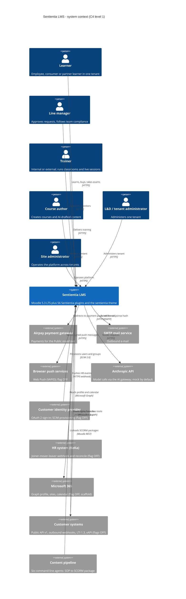
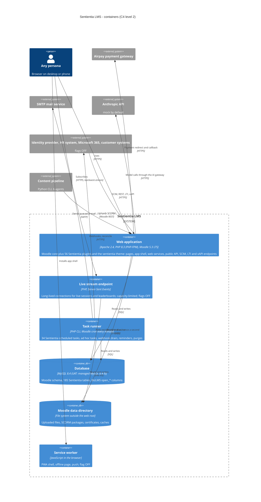
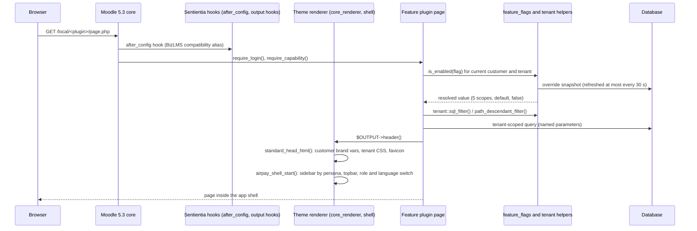

## 1. Executive summary

### 1.1 What this guide is

This guide describes Sentientia LMS for the Chief Technology Officer (CTO): the Moodle 5.3 LTS base, every component we built on it, how the components fit together, and what the platform can become. It is structured against the arc42 architecture template and the C4 model (context, container and component levels). Every statement is traced to the repository or to the shared fact base for this pack set (`docs/stakeholder-packs/2026-11/_facts/`). The date of record is 20 November 2026.

Sentientia LMS is a white-label, multi-tenant learning platform (a learning management system, LMS, with learning experience platform, LXP, features). Airpay Payment Services builds it on Moodle 5.3 LTS (long-term support). Airpay Academy is its first deployment ("customer zero").

**Sentientia is not live.** The production site, www.airpay.academy, still runs the legacy BizLMS platform on Moodle 4.1.2. Sentientia runs on the user-acceptance test (UAT) environment, academy2.airpay.ninja, and on development machines. All user, course and enrolment data on those environments is a test import of a production backup. Replacement of BizLMS happens through a staged cutover: UAT sign-off, then a rehearsal on a fresh live backup with a 100% parity check, then cutover with all data.

### 1.2 Key facts

| Fact | Value | Source |
|---|---|---|
| Platform | Moodle 5.3 LTS (ADR-033); security support to 2029-10-01; needs PHP 8.3 or later and MySQL 8.4 or later | `docs/adr/ADR-033-target-moodle-5.3-lts.md` |
| UAT | Moodle 5.3 since 2026-10-21; PHP 8.3.6; MySQL 8.4.9 (managed database); one application server with 2 vCPU and 2 GB RAM; code at commit `af6e65c0e` | fact base `00-FACTS-INDEX.md` section 2.11 |
| Product components we built | **57**: 47 local plugins, 6 blocks, 1 enrolment plugin, 1 payment gateway, 1 quiz access rule, 1 standalone theme | `00-FACTS-INDEX.md` section 2.1 |
| Component status | 38 Available (UAT); 19 Built (behind a feature flag, off by default); 15 of the 57 also carry later changes that are Built (verified on development) | `00-FACTS-INDEX.md` section 2.14 |
| Feature flags | **141** registered, 13 default ON, 128 default OFF; resolved per customer and per tenant | `00-FACTS-INDEX.md` section 2.3 |
| Data model | **185** tables created by our plugins; 111 hold personal data by column name; 57 of 57 components declare a privacy provider | `00-FACTS-INDEX.md` section 2.4 |
| Interfaces | **174** web-service functions (68 read, 106 write); a versioned public API v1 with SCIM, webhooks and LTI 1.3 behind default-OFF flags | `00-FACTS-INDEX.md` section 2.5 |
| Access model | **181** capabilities; 2 roles created by our code; 9 documented personas; 3 tenants (Airpay 1, Public 77, ZEEA 177) under one customer | `00-FACTS-INDEX.md` section 2.6 |
| Changes to Moodle core on 5.3 | 1 existing core file edited (`public/lib/form/form.js`, ADR-044); 2 added overlay files; 13 records in the core-modifications ledger | `00-FACTS-INDEX.md` section 2.12 |
| Tests | 4,861 PHPUnit test methods in 464 files (static count); 2 PHPUnit groups block continuous integration (CI): tenant isolation and privacy erasure | `00-FACTS-INDEX.md` section 2.8 |
| Design capacity target | 3,500 or more users across 3 tenants; not yet load-tested on a production-class environment | root `CLAUDE.md` mission; `60-eng-qa-infra.md` section 11 |

### 1.3 The architecture in five sentences

1. Sentientia is a set of standard Moodle plugins and one standalone theme on an unmodified Moodle 5.3 LTS core, with one documented, additive core patch and two added overlay files.
2. A shared platform layer (`local_sentientia_platform` and `local_sentientia_core`) supplies the cross-cutting services every other plugin uses: the feature-flag resolver, the customer and tenant model, tenant scoping helpers, branding and the BizLMS import framework.
3. Tenant isolation is a single, fail-closed decision (ADR-031): only site administrators and holders of one deliberately granted capability act across tenants; everyone else is confined to the tenant at the root of their organisation path.
4. Every new user-visible feature ships behind a registered feature flag, so one code base can serve many customers with different feature sets, and a change can be rolled back by a flag flip.
5. Integrations (AI, payments, identity provisioning, HR system, push, messaging) sit behind their own flags and gateways and default to mock or off; of the external integrations, only the Airpay payment gateway and e-mail are active by default.

### 1.4 Decisions and actions asked of the CTO

| # | Ask | Why it matters | Form |
|---|---|---|---|
| A1 | Sponsor the production-class infrastructure request (PHP 8.3, MySQL 8.4, an application server larger than the 2 GB UAT box, a database snapshot path) | Stage B rehearsal, load testing and cutover all wait on it; a draft request exists (`docs/cutover/DRAFT-IT-REQUEST-2026-11-12.md`) but has not been sent | Approval and an owner in IT |
| A2 | Confirm the hosting facts we must not assume: region, encryption at rest, backup recovery point and recovery time objectives (RPO and RTO), monitoring | None is recorded in the repository; every pack marks them "to be confirmed" | Written answers from the DevOps lead |
| A3 | Decide the multi-customer readiness bar before a second customer: tenant registry out of legacy mode (ADR-021), customer flag layer ON, brand table populated (ADR-008), role look-ups by short name everywhere | The code supports these switches, but customer zero runs in the backward-compatible modes (section 2.8) | Decision recorded as an ADR |
| A4 | Review the core-modification discipline (sections 4.5 and 4.6) and endorse it as the standard for future Moodle upgrades | It is the main upgrade-safety control; ADR-041 and ADR-044 are Accepted at product level | Written endorsement or requested changes |
| A5 | Name the owner of the platform cross-tenant role (`local/sentientia_platform:crosstenant`) | No role holds this capability today; ADR-031 lists creating it as an owner action | Role name and holders |

### 1.5 Top risks

| # | Risk | Owner role | Proposed resolution |
|---|---|---|---|
| R1 | Capacity is unproven: UAT is a 2 vCPU / 2 GB box; no load or soak test has run on a production-class environment | DevOps lead | Provision the target environment (A1) and run load tests before cutover |
| R2 | CI runs PHPUnit on Moodle 5.2 with MariaDB, not on 5.3 with MySQL 8.4; the full suite is advisory | QA architect | Add a 5.3 and MySQL 8.4 PHPUnit job; make the full suite blocking once green |
| R3 | No staging tier between UAT and production; UAT deploys leave no machine-readable record of what is deployed | DevOps lead | Add a staging environment and a deployed-version marker |
| R4 | Live AI, WhatsApp and SMS are not usable today (no AI key or signed spend cap; messaging live send not built) | Head of Learning & Development | Treat as Planned in all external material until funded and built |
| R5 | Two plugin trees must stay byte-identical; three local plugins and the theme have one copy only | Platform engineer | Keep the drift gate blocking; decide whether to retire the twin tree |

---

## 2. Product vision and the white-label, multi-customer model

### 2.1 What we are building

Sentientia LMS is a product, not a site customisation. ADR-001 (Accepted, 2026-05-20) records the pivot: the legacy platform was forked, rebuilt as a product and made sellable, with Airpay Academy as the first customer used to harden every feature against real enterprise data.

| Aspect | Position | Source |
|---|---|---|
| Category | White-label enterprise LMS with LXP features (catalogue, recommendations, skills, social and live engagement), built as Moodle plugins | root `CLAUDE.md` mission; ADR-001 |
| First customer | Airpay Payment Services (customer id 1): internal employees, a Public consumer storefront and ZEEA (Tanzania) | `local/sentientia_platform/classes/customer.php` (`AIRPAY = 1`); `tenant.php` (`VALID_TENANTS = [1, 77, 177]`) |
| Future customers | Designed for; none signed. A second customer record on the development database is test data | `20-flags-roles.md` section 6.1 |
| Base platform | Moodle 5.3 LTS, open source under the GNU General Public License v3 (GPL v3); our plugin files carry GPL v3 headers | ADR-033; plugin file headers, for example `theme/sentientia/classes/role_detector.php` |
| Replaces | The legacy BizLMS platform: Moodle 4.1.2 with 22 purchased third-party `local_*` plugins, absorbed and de-branded (ADR-024, ADR-025) | `docs/adr/ADR-024-absorb-and-debrand-bizlms.md` |

### 2.2 Design principles

These principles come from the root `CLAUDE.md` and the ADRs. They explain most of the structure the CTO will see in the code.

| # | Principle | How the code enforces it |
|---|---|---|
| P1 | Two customers in mind for every decision: Airpay today, "Enterprise N" tomorrow | Customer and tenant concepts in the data model (`local_sentientia_customer`, `local_sentientia_tenant`); customer-scoped flags and branding |
| P2 | Backward compatibility with Airpay Academy's current behaviour is non-negotiable | New behaviour ships additive and dark; legacy-mode settings (section 2.8) keep BizLMS-shaped behaviour until switched |
| P3 | Every new user-visible feature ships behind a feature flag, default OFF | Flag registry per plugin; `feature_flags::set()` refuses an unregistered key. Exception by design: 13 flags default ON (section 2.7.4) |
| P4 | One cross-tenant authority, fail closed | `tenant::is_cross_tenant()` and the scoping helpers (ADR-031); blocking `tenant_isolation` test group in CI |
| P5 | Core changes are allowed only with a record | `docs/core-mods/` ledger, `SENTIENTIA-CORE-MOD` markers, pre-commit check 6 and the CI `core-mods.yml` workflow (ADR-001, ADR-041, ADR-044) |
| P6 | Ship whole: a partial plugin or a partial flag is a defect | Plugin checklists in root `CLAUDE.md` section 6; version-bump and upgrade-step gates in CI |
| P7 | Evidence for every UI change | Dated desktop and mobile screenshots in `docs/visual-evidence/` (1,528 images in 47 folders) |

### 2.3 The customer hierarchy

Sentientia models four nested levels. Only the first three are Sentientia concepts; the fourth is Moodle's.

| Level | Meaning | Stored in | Example | Status |
|---|---|---|---|---|
| Customer | A purchaser of Sentientia; owns one or more tenants, a brand and customer-level flag overrides | `local_sentientia_customer`; brand in `local_sentientia_customer_brand` | Customer 1, Airpay | Available (UAT); customer flag layer Built (behind a feature flag, off by default) |
| Tenant | A top-level organisation tree inside a customer; the isolation boundary for data and administration | `local_sentientia_tenant` (`rootid`, `customerid`, `name`, `status`); legacy list `[1, 77, 177]` | Tenant 77, Public storefront | Available (UAT) |
| Organisation unit | Departments and sub-units below the tenant root; drives manager scope and reporting | `local_sentientia_org` (fork of the BizLMS cost-centre tree); `local_sentientia_org_unit`, `local_sentientia_org_member` (ADR-020) | A department under tenant 1 | Available (UAT) |
| User | A Moodle user with an organisation path, a user type and Moodle roles | Moodle `user` table plus the BizLMS column `open_path`; user type in `local_sentientia_user_type` (ADR-017) | "Learner (Airpay tenant)" | Available (UAT) |

User type (ADR-017) is a permanent account attribute separate from roles: `employee`, `consumer`, `partner_employee` and `operator` are Available (UAT); `external_trainer` is Built (behind a feature flag, off by default); `candidate` is Planned (ADR-038). Source: `20-flags-roles.md` section 4.4.

### 2.4 Tenancy: how a user's tenant is decided

| Rule | Detail | Source |
|---|---|---|
| Identity column | The user's `open_path`, a slash-separated path of organisation ids inherited from BizLMS. The first segment is the tenant root: `/1/2/3` is tenant 1, `/77` is tenant 77, `/177/5` is tenant 177 | `local/sentientia_platform/classes/tenant.php` (`root_for_user()`) |
| Not used | `open_costcenterid`: the column does not exist on the production database | root `CLAUDE.md` section 2 |
| Valid tenants | While the legacy registry setting is ON (default), validation uses the hard-coded list `[1, 77, 177]` and every tenant maps to customer 1. With it OFF, validation and the customer of a tenant come from `local_sentientia_tenant` (ADR-021) | `local/sentientia_core/classes/tenant_registry.php` |
| Seam | `local_sentientia_core` provides the tenant-identity seam so plugins stop reading `open_path` inline (ADR-019); a setting chooses between the BizLMS reading and the Sentientia identity layer | `local_sentientia_core/tenant_identity_legacy` setting |
| Customer of the current user | `customer::current()` derives the customer from the tenant root; with the legacy registry ON, or for a site administrator or guest, it returns customer 1 | `local/sentientia_platform/classes/customer.php` |
| Path filters | Every tenant path filter goes through `tenant::path_descendant_filter()`: `/1` matches `/1` and `/1/2`, never `/10` or `/177`. Hand-written `LIKE '/1%'` filters over-counted sibling ids; this defect class shipped more than once before the helper and its guards existed | `tenant.php`; pre-commit check 18; CI `path-boundary-check` |

### 2.5 Cross-tenant authority (ADR-031)

ADR-031 (Accepted, 25 September 2026) closed a defect class found by a sweep of the code (73 hits, 70 confirmed): about 30 plugins granted `manage_all`, `viewall`, `manage` or `view` capabilities to the manager archetype and treated holding the capability as licence to skip the tenant filter. A tenant administrator could read other tenants' personal data, write into other tenants and escalate roles. Where a non-administrator's `open_path` did not resolve, most engines read the empty tenant as "every tenant".

| # | Decision | Effect in code |
|---|---|---|
| 1 | Cross-tenant means a site administrator or a holder of `local/sentientia_platform:crosstenant` (no archetype default) | Tenant administrators, including Airpay's own, are confined to their tenant |
| 2 | One helper decides | `tenant::is_cross_tenant()`; `viewer_can_access()`, `require_path_access()`, `sql_filter()` and `path_filter()` route through it |
| 3 | A capability says what, never where | Tenant scope applies unless `is_cross_tenant()` is true |
| 4 | Fail closed | No resolvable tenant means nothing: `scope_path()` returns `null`, filters return `1=0` |
| 5 | Writes check the target | `require_same_tenant_user()`, `require_access()`, `require_path_access()` |
| 6 | Escalation closed | Role management limited to site administrators or cross-tenant callers; scoped role assignment only of roles the actor holds, inside the actor's tenant |
| 7 | Revoke, not just remove | Upgrade steps call `unassign_capability()`, because changing an archetype default never revokes an existing grant |
| 8 | Every fix ships tests in `@group tenant_isolation` | 135 test files carry the group; the group blocks CI (floor of 40 files) |

Status: Available (UAT). Open owner action: no role holds `local/sentientia_platform:crosstenant` on the development database, so site administrators are today the only cross-tenant principals (fact base `20-flags-roles.md` section 7, R3). The compliance report adds a three-level viewer scope (site, tenant, team) on top of this rule (`local/sentientia_compliance_report/classes/viewer_scope.php`).

### 2.6 Per-customer and per-tenant branding

Branding is applied in layers. Later layers override earlier ones on equal specificity.

| Layer | What it controls | Mechanism | Status |
|---|---|---|---|
| 1. Theme defaults | Brand Book 2026-06 tokens: primary `#0066A7`, accent `#1985DD`, background `#F2F4FB`, Montserrat, 8 px spacing grid, 6 breakpoints | Compiled SCSS; tokens in `theme/sentientia/scss/moodle/_tokens.scss` as CSS custom properties | Available (UAT) |
| 2. Customer brand | Display name, short name, primary colour, background colour, 192 px and 512 px icons (also used as favicon), PWA start URL, language, status-bar style, app categories | `customer::branding()` reads `local_sentientia_customer_brand` (application cache, 1-hour lifetime) and falls back to a built-in Airpay bundle; `core_renderer::standard_head_html()` injects `--ap-color-primary` and `--ap-color-bg` and the favicon | Available (UAT); for customer 1 the values equal the theme defaults, so the layer is a visual no-op today |
| 3. Tenant brand | Logo, favicon, colour overrides, custom CSS, footer HTML, sender address, support address, help URL, landing hero | `local_sentientia_org\tenant_settings` over the `local_sentientia_org` row of the tenant root | Available (UAT) |
| 4. Theme settings | Logo, five login slider images, login text, social links, brand colours | Theme admin settings (`theme/sentientia/settings.php`, strings in `lang/en/theme_sentientia.php`) | Available (UAT) |
| 5. Product naming | User-visible "Moodle" strings renamed to Sentientia; customer name comes from the site name and language strings | `docs/core-mods/2026-05-20-moodle-to-sentientia-rename.md` (a note, no core edit) | Available (UAT) |

Verification note: the older C-suite guide stated that the customer brand registry also controls light and dark logos and typography. The code does not: `customer::branding()` returns colours, icons and PWA fields only. Logos are set per tenant (layer 3) and in theme settings (layer 4); the font family is fixed in the theme tokens. ADR-008, which designs the brand table, still carries the status Proposed, although the table and resolver exist in code.

### 2.7 The feature-flag platform

#### 2.7.1 Registry and storage

| Item | Fact | Source |
|---|---|---|
| Declaration | Each plugin declares `$flags = [key => ['default' => bool, 'description' => string]]` in `db/feature_flags.php` | `local/sentientia_platform/db/feature_flags.php` |
| Registry size | 141 keys in 42 registry files (41 local plugins plus `enrol_sentientiasub`); no duplicate keys | fact base `20-flags-roles.md` section 2.1 |
| Discovery | `feature_flags::load_registry()` walks every installed plugin of every type and merges every readable registry file | `local/sentientia_platform/classes/feature_flags.php` |
| Registry cache | Moodle Universal Cache (MUC) application cache, 60-second lifetime, static acceleration | `local/sentientia_platform/db/caches.php` |
| Overrides | Table `local_sentientia_feature_flags` (key, customer id, tenant id, value, actor, times) | `db/install.xml` |
| Audit | Table `local_sentientia_feature_flag_audit`: old value, new value, actor, reason and time for every change | `feature_flags::set()` |
| Unknown keys | `set()` throws `unknownflagkey`; `is_enabled()` returns `false` | `feature_flags.php` |
| Administration | The Switchboard (`/local/sentientia_platform/admin/switchboard.php`), site administrators only (`moodle/site:config`); shows default, resolved value and the layer that set it | `admin/switchboard.php` |

#### 2.7.2 Resolution order

For a user in customer C and tenant T, `is_enabled($key)` stops at the first row found:

| Step | Scope | Applies when |
|---|---|---|
| 1 | Key, customer C, tenant T | Customer layer ON, C > 0 and T > 0 |
| 2 | Key, customer C, all tenants | Customer layer ON and C > 0 |
| 3 | Key, customer 0, tenant T ("legacy tenant override") | T > 0 |
| 4 | Key, customer 0, tenant 0 (global override) | Always |
| 5 | Registered default from `db/feature_flags.php` | Key registered |
| 6 | `false` (fail-safe) | Key not registered |

Rules around the order (source: `feature_flags.php`; ADR-002):

- **Customer layer gate.** Steps 1 and 2 run only when `sentientia.customer_level_flags.enabled` resolves ON. It defaults OFF, is itself resolved without a customer scope, and cannot be written at customer scope. With the gate OFF the resolver behaves exactly like the original three-level resolver; this is the backward-compatibility guarantee for Airpay Academy.
- **Site administrators** resolve to tenant 0, so they see defaults and global overrides unless they choose a tenant in the Switchboard.
- **Explicit scope.** `is_enabled_for($key, $customerid, $tenantid)` and `is_enabled_for_tenant($key, $tenantid)` evaluate a flag for someone other than the current user (for example in a scheduled task that e-mails many users).
- **Freshness.** Overrides are read once per process into a snapshot that expires after 30 seconds (`SNAPSHOT_TTL = 30`). Long-running processes (cron, task runners, Server-Sent Events connections) pick up a change within 30 seconds without a restart.
- **Writes.** `feature_flags::set($key, $tenantid, ?bool $value, $byuserid, $reason, $customerid)`; a `null` value deletes the override so the scope inherits again. Every effective change writes one audit row.
- **Test isolation.** Registry and snapshot live in a dependency-injection container object that PHPUnit resets for every test.

#### 2.7.3 Flag inventory by category

| Category (first key segment) | Flags | Examples |
|---|---|---|
| `sentientia.*` | 114 | Product features, sub-switches, readers for imported BizLMS history |
| `live.*` | 9 | Live engagement sessions and question types |
| `engagement.*` | 6 | Gamification, WhatsApp, SMS |
| `ai.*` | 3 | Assistant, authoring pipeline, recommendations |
| `commerce.*` | 3 | Cross-tenant course share and request, public marketplace |
| `ux.*` | 3 | Command palette, dark mode, language switcher |
| `identity.*` | 1 | Single sign-on master switch |
| Irregular keys | 2 | `sentientia_m365_enabled`, `sentientia_whatsapp_content_notifications` (underscore form; listed under "other" in the Switchboard) |

Source: `20-flags-roles.md` section 3.2. The largest registries are `local_sentientia_platform` (17), `local_sentientia_live` (9), `local_sentientia_leaderboard` (7) and `local_sentientia_content_market` (6).

#### 2.7.4 Flags that default ON

Thirteen flags default ON: `ai.assistant.enabled`, `engagement.gamification.enabled`, `engagement.gamification.confetti`, `commerce.crossTenantShare.enabled`, `commerce.crossTenantRequest.enabled`, `ux.commandPalette.enabled`, `live.realtime.enabled`, `sentientia.catalog.public_lxp.enabled`, `sentientia.leaderboards.realtime.enabled`, `sentientia.leaderboards.optout.enabled`, and the three calendar-sync event flags (`.courses`, `.classroom`, `.exams`). Most of these are sub-switches under a master switch that defaults OFF (for example `live.realtime.enabled` under `live.enabled`), so they have no effect until the master switch is turned on. One registry inconsistency is open: `sentientia.catalog.public_lxp.enabled` defaults ON while its description says "default OFF" (`local/sentientia_catalog/db/feature_flags.php`). Source: `20-flags-roles.md` section 3.3.

#### 2.7.5 Flag state on UAT

Which flags are ON on UAT is a runtime database setting and is not recorded in the repository: **to be confirmed** from a Switchboard export (owner: Head of Learning & Development). The development database figures (35 override rows over 31 flags) are not UAT state. A read-only snapshot tool exists for before-and-after comparisons around a deploy: a deploy may add flags only as OFF and must not change an existing resolved value (`tools/uat/flag_snapshot.php`). UAT and production flag changes are decided by the Head of Learning & Development.

### 2.8 Multi-customer readiness: what is in place and what is not

| Capability | State today | What a second customer needs | Status |
|---|---|---|---|
| Customer and tenant tables | Present; customer 1 only | Seed the second customer and its tenant roots (`local/sentientia_core/cli/seed_tenants.php`) | Available (UAT) |
| Tenant registry | Legacy mode ON by default: hard-coded roots `[1, 77, 177]`, all mapped to customer 1 | Switch the registry to table mode (ADR-021). The development database already runs in table mode | Built (verified on development) for table mode |
| Customer flag layer | Gate `sentientia.customer_level_flags.enabled` default OFF | Turn the gate on; set customer-level overrides | Built (behind a feature flag, off by default) |
| Customer branding | Resolver and table in code; Airpay values equal theme defaults | Insert a brand row; supply icons | Available (UAT); ADR-008 status Proposed |
| Tenant administration | Confined per tenant (ADR-031) | Create the customer's tenant administrator assignments | Available (UAT) |
| Role look-ups | Most code looks up BizLMS roles by short name (role ids differ between copies: the `administrator` role is id 9 on UAT and 11 on another copy). One exception remains: the dashboard layout's onboarding redirect checks `roleid = 9` (`theme/sentientia/layout/dashboard.php` line 80) | Replace the remaining id check with a short-name look-up | In progress (one known site) |
| White-label naming | Customer name from site name and language strings; product chrome says Sentientia | Set site name and customer strings | Available (UAT) |
| Isolation between customers | Logical isolation inside one Moodle site and one database (shared schema, tenant filters) | A decision on single-site multi-customer versus one site per customer: **to be confirmed** (owner: solution architect, with the CTO) | Planned (decision) |

---

## 3. Architecture (arc42 and C4)

This section follows the arc42 template: introduction and goals (3.1), constraints (3.2), context and scope (3.3), solution strategy (3.4), building blocks (3.5), runtime (3.6), deployment (3.7), cross-cutting concepts (3.8) and decisions (3.9). Diagrams follow the C4 model and are given as Mermaid code so they can be rendered or edited.

### 3.1 Introduction and quality goals

**Requirements overview.** Sentientia must deliver an enterprise learning platform for several organisations in one installation: course catalogue and enrolment, compliance training with deadlines and escalation, classroom (instructor-led training, ILT) and online exams, programmes and learning paths, skills, analytics, commerce for a consumer storefront, and AI-assisted authoring, while staying upgradeable with Moodle LTS releases.

| Priority | Quality goal | Scenario | Main mechanism |
|---|---|---|---|
| 1 | Tenant isolation | A tenant administrator of tenant 77 requests a report: only tenant 77 rows are returned; a user whose tenant cannot be resolved gets nothing | ADR-031 helpers; blocking `tenant_isolation` tests |
| 2 | Upgradeability | A new Moodle 5.3 point release is applied: plugins upgrade through `upgrade.php`; the one core patch is re-applied by script against a pinned upstream hash | Plugin-only design; `core-patches/MANIFEST`; ADR-044 |
| 3 | Safe change | A new feature is deployed dark and turned on per tenant; a fault is rolled back by a flag flip within 30 seconds | Feature-flag platform (section 2.7) |
| 4 | Privacy by design | A data principal's erasure request reaches every plugin that holds their data | Privacy providers in all 57 components; ADR-035 |
| 5 | Backward compatibility | Airpay Academy users see today's behaviour until a flag or setting changes | Legacy modes; default-OFF flags |
| 6 | Localisation | A learner reads the interface in Hindi with parity to English | en and hi parity enforced by pre-commit and CI |

### 3.2 Constraints

| Type | Constraint | Source |
|---|---|---|
| Technical | Moodle 5.3 LTS; PHP 8.3 or later (8.3 is the one version both upgrade hops accept); MySQL 8.4 or later (or MariaDB 11.4, PostgreSQL 17); Apache 2.4 with `mod_rewrite` to `r.php`; `max_input_vars` 5000 or more; `memory_limit` 512M or more; `max_allowed_packet` 64M or more | ADR-033; `60-eng-qa-infra.md` section 9 |
| Technical | Code must run on MariaDB and MySQL 8: no MySQL 8 reserved words as column or alias names | `.claude/rules/database.md` |
| Technical | Moodle core is not in git for 5.3; the package is a SHA-256-verified vanilla 5.3 tree plus our overlay | ADR-044; `tools/packaging/build-standalone.sh` |
| Data | The production schema carries 37 BizLMS `open_*` columns on `user` and 18 on `course`; tenant identity depends on `open_path` | `docs/core-mods/2026-06-04-open-substrate-ownership.md` |
| Migration | Cutover path is two hops: 4.1.2 to 4.5.x to 5.3, a clean code directory per hop, then the BizLMS data import (ADR-032) | ADR-033 decision 2 |
| Organisational | UAT deploys, UAT flag changes and anything on production are decided by the Head of Learning & Development; production is never patched in place | `.claude/CLAUDE.md` escalation list |
| Organisational | Paid external calls (AI, text-to-speech) need explicit approval; AI features run in mock mode by default | `local/sentientia_ai/`; ADR-034 |
| Convention | Moodle coding standards: parameter API for input, output escaping, `$DB` API with named parameters, no raw superglobals; every core change recorded | root `CLAUDE.md` section 5; pre-commit checks |
| Convention | Every plugin exists in a canonical tree (`moodle-enhancement/<type>/<plugin>/`); 44 of the 47 local plugins and all 9 blocks, enrolment, payment and access-rule plugins also have a byte-identical twin under `<type>/<plugin>/`; the theme lives at the repository root only; a drift gate blocks divergence | `tools/check-tree-drift.php` |

### 3.3 Context and scope (C4 level 1)

External interfaces and their status:

| Interface | Direction | Component | Status | Source |
|---|---|---|---|---|
| Browser user interface (11 logged-out surfaces, authenticated app shell) | In | Theme and all user-facing plugins | Available (UAT) | `70-ui-surfaces.md` sections 2 and 3 |
| Moodle web services: 174 functions in 24 service files | In | 23 local plugins and `paygw_airpay` | Available (UAT) for the plugins that are Available (UAT); 2 proctoring report functions added later are Built (behind a feature flag, off by default) | `30-apis.md` |
| Public API v1 (7 functions, OpenAPI 3.0.3, 600 requests per 60 s default rate limit) | In | `local_sentientia_api` | Built (behind a feature flag, off by default) | ADR-030 |
| SCIM 2.0 Users and Groups | In | `local_sentientia_api` | Built (behind a feature flag, off by default) | ADR-030 |
| Outbound webhooks (course completed, enrolment created, certificate issued; HMAC-SHA256 signed; retries then dead-letter) | Out | `local_sentientia_api` | Built (behind a feature flag, off by default) | ADR-030 |
| LTI 1.3 tool provider (OpenID Connect login, signed token verification, nonce replay protection) | In | `local_sentientia_api` | Built (behind a feature flag, off by default) | `30-apis.md` section 8 |
| xAPI 1.0.3 statements endpoint and statement emission | In and out | `local_sentientia_xapi` | Built (behind a feature flag, off by default) | `30-apis.md` section 10 |
| Airpay payment gateway | Out | `paygw_airpay` | Available (UAT) | `payment/gateway/airpay/` |
| E-mail through Moodle core mail | Out | `local_sentientia_emails`, `local_sentientia_notifications` and core | Available (UAT) | `30-apis.md` section 10 |
| Web Push | Out | `local_sentientia_pwa` | Built (behind a feature flag, off by default) | ADR-003, ADR-005 |
| Anthropic model API | Out | `local_sentientia_ai` gateway, 6 consumer plugins | Built (behind a feature flag, off by default); mock by default, no key configured | `50-ai.md` |
| HR system joiner-mover-leaver webhook and reconcile | In | `local_sentientia_integrations` | Built (behind a feature flag, off by default) | ADR-029 |
| Microsoft 365 (Graph) | Out | `local_sentientia_m365` | Built (behind a feature flag, off by default); scaffold level | `30-apis.md` section 10 |
| WhatsApp and SMS | Out | `local_sentientia_whatsapp` | Built (behind a feature flag, off by default) in mock mode; live sending not built | `30-apis.md` section 10 |
| Teams and Zoom meeting creation | Out | `local_sentientia_classroom` | Not built: meeting and recording links are stored only; API integration Planned | ADR-036 |
| Single sign-on (OAuth 2 issuers) | In | Moodle core | Documented configuration; issuer set-up on UAT to be confirmed (owner: IT infrastructure) | `30-apis.md` section 10 |

### 3.4 Solution strategy

| Goal | Strategy | Evidence |
|---|---|---|
| Upgradeability | Build only through Moodle's plugin types and output overrides; avoid editing core; when core must change, keep the patch additive, versioned per Moodle release and checked against a pinned upstream hash | 1 core file patched on 5.3; `tools/check-core-patches.sh` |
| Independence from BizLMS | Absorb the 22 purchased BizLMS plugins into `local_sentientia_*` (ADR-024, ADR-025); introduce seams for tenant identity (ADR-019), organisation hierarchy (ADR-020) and tenant registry (ADR-021); import BizLMS history through one framework (ADR-032) | `local/sentientia_core/`; `local/sentientia_platform/classes/bizlms/` (42 classes) |
| Multi-customer | Customer above tenant; customer-scoped flags and brand; single helper for tenant scope | Sections 2.3 to 2.7 |
| Safe delivery | Dark launch behind flags; additive schema changes; surgical, checksum-verified deploys; dry run by default | `tools/uat/deploy_to_uat.sh` |
| Quality | Gate system (ADR-027): 20 pre-commit checks, 15 CI jobs, defect-class guards | `.claude/hooks/pre-commit.sh`; `.github/workflows/ci.yml` |
| Cost control for AI | One gateway with mock-first routing, fail-closed quotas and a spend ledger | `local_sentientia_ai` |
| Real time without new infrastructure | Server-Sent Events from PHP for live sessions and leaderboards, chosen over WebSockets so no separate server process is needed | ADR-004, ADR-014 |

### 3.5 Building block view

#### 3.5.1 Container view (C4 level 2)

All server-side containers run the same code base. On UAT they share one application server; the target production topology (number of web nodes, cache store, session store, file storage) is **to be confirmed** by the DevOps lead together with the infrastructure request (section 1.4, A1).

#### 3.5.2 Component layers inside the web application (C4 level 3, summarised)

The 57 product components group into seven layers. Each row is a set of Moodle plugins; the full per-plugin inventory is in the plugin reference appendix of this guide.

| Layer | Components | Responsibility | Status (plugin level) |
|---|---|---|---|
| Platform | `local_sentientia_platform` (flags, customer, tenant, user types, branding, BizLMS import framework, audit log, structured logger); `local_sentientia_core` (customer, tenant and organisation tables, tenant-identity seam, admin log, reconcile task); `local_sentientia_org` (organisation tree, tenant settings, BizLMS compatibility alias); `local_sentientia_roles`; `local_sentientia_users`; `local_sentientia_privacy` | Cross-cutting services every other plugin depends on | Available (UAT); `local_sentientia_users` external-trainer accounts Built (behind a feature flag, off by default) |
| Presentation | `theme_sentientia`; `local_sentientia_pages`; `local_sentientia_catalog`; `local_sentientia_pwa` | App shell, navigation, dashboards, login and landing, catalogue and storefront, installable web app | Available (UAT), except PWA: Built (behind a feature flag, off by default) |
| Learning delivery | `local_sentientia_courses`, `_learningpath`, `_programs`, `_classroom`, `_exams`, `_recompletion`, `_evaluation`, `_request`, `_live`; `quizaccess_sentientia_proctoring` with `local_sentientia_proctoring` | Courses, paths, programmes, ILT, exams, recertification, surveys, enrolment requests, live sessions, secure assessment | Available (UAT), except `_live`: Built (behind a feature flag, off by default); proctoring B1/B2 Built (behind a feature flag, off by default) |
| Compliance, people and insight | `local_sentientia_compliance_report`, `_manager`, `_analytics`, `_reports`, `_skills`, `_notifications`, `_emails`; blocks `cert_health`, `compliance`, `cron_health`, `trainer` | Compliance matrix and reminders, manager dashboard, KPIs and reports, skills matrix, notification rules and e-mail templates | Available (UAT) |
| Engagement | `local_sentientia_gamification`, `_challenge`, `_ratings`, `_leaderboard`; blocks `leaderboard`, `recommendations` | Points, challenges, ratings, leaderboards | Available (UAT), except `_leaderboard`: Built (behind a feature flag, off by default) |
| Commerce | `local_sentientia_cart`, `_content_market`; `enrol_sentientiasub`; `paygw_airpay` | Cart, orders, refunds, GST invoices (flag), content marketplace, subscription enrolment, payment | Cart and gateway Available (UAT); content market and subscription enrolment Built (behind a feature flag, off by default) |
| AI | `local_sentientia_ai` (gateway); consumers `_assistant`, `_aiquiz`, `_authoring`, `_skillsai`, `_recommendations`, `_translate` | Model access, quotas and ledger; chat assistant, quiz generation, authoring studio, skills extraction, recommendations, translation | Assistant chat drawer Available (UAT), mock replies unless a provider key is configured (none by default); all others Built (behind a feature flag, off by default) |
| Integration | `local_sentientia_api`, `_integrations`, `_xapi`, `_m365`, `_whatsapp`, `_calendar`, `_lifecycle`, `_talent` | Public API, SCIM, webhooks, LTI, HR system, xAPI, Microsoft 365, messaging, calendar sync, employee lifecycle, talent mobility | Built (behind a feature flag, off by default) |

Dependency rule: feature plugins depend on the platform layer, never the reverse, and guard optional dependencies with `class_exists()` so a customer can run without them. Example: the theme's renderer reads customer branding only when `\local_sentientia_platform\customer` exists, and catches every error so a branding failure cannot break page rendering (`theme/sentientia/classes/output/core_renderer.php`, `standard_head_html()`).

### 3.6 Runtime view

#### 3.6.1 Scenario: an authenticated page request

#### 3.6.2 Other runtime scenarios

| Scenario | Flow | Key code |
|---|---|---|
| Compliance reminders and escalation | Scheduled tasks find learners with upcoming or overdue mandatory courses, resolve the tenant and flags per recipient with `is_enabled_for()`, render tenant-aware templates and send through Moodle messaging and e-mail; every send is logged. Course reminder and overdue tasks ship disabled until switched on | `local_sentientia_courses`, `local_sentientia_emails`, `local_sentientia_notifications` (`db/tasks.php`) |
| Public storefront purchase | Guest browses `/local/sentientia_catalog/public.php`, signs up (Public tenant), adds to cart, pays through `paygw_airpay`; the gateway verifies the response hash and the cart enrols the learner. Storefront checkout is behind `sentientia.catalog.storefront_checkout.enabled` (default OFF) | `local_sentientia_catalog`, `local_sentientia_cart`, `paygw_airpay` |
| AI request | A consumer plugin calls `\local_sentientia_ai\client::complete()`; the gateway checks both gateway flags, a configured key and quota; otherwise it returns a deterministic mock at zero cost. Live attempts without a key fail closed; every call writes a ledger row without prompt or response text | `local/sentientia_ai/classes/gateway.php` |
| Outbound webhook | A Moodle event observer (course completed, enrolment created, certificate issued) queues a delivery; the drain task posts it with an HMAC-SHA256 signature and retries at 1 min, 5 min, 30 min and 2 h before dead-lettering | `local_sentientia_api` observers and `webhook_drain` task |
| Live session | A trainer opens a session; participants join with a code and hold an SSE connection to `stream.php`; the endpoint returns HTTP 503 when its capacity is full. Each open connection holds one web-server worker (ADR-004) | `local_sentientia_live` |
| Erasure request | A data principal request through `tool_dataprivacy` reaches every privacy provider; providers delete or anonymise; a supplementary provider for completeness is behind two default-OFF flags (ADR-035) | `local_sentientia_privacy`; `classes/privacy/provider.php` in each plugin |

### 3.7 Deployment view

| Environment | Platform | Role | Source |
|---|---|---|---|
| Development (XAMPP) | Moodle 5.1.3+, PHP 8.2.12, MariaDB 10.11.16, Apache 2.4.58 | Day-to-day development and persona walks; can lag the repository | `60-eng-qa-infra.md` section 9 |
| Development (5.3 runtime) | Moodle 5.3 (version 2026100500.00), PHP 8.4, MariaDB 11.4 | 5.3 compatibility gate, upgrade rehearsals, 5.3 PHPUnit | same |
| CI (GitHub Actions) | PHP 8.2 (lint, Playwright on the 4.5 snapshot); PHP 8.3 and MariaDB 10.11 on Moodle 5.2 stable (PHPUnit) | Gates on every pull request and push to `production` | `.github/workflows/ci.yml` |
| UAT (academy2.airpay.ninja) | Moodle 5.3, PHP 8.3.6 under PHP-FPM, Apache 2.4 behind a load balancer, managed MySQL 8.4.9; 2 vCPU, 2 GB RAM, 40 GB disk; cron every minute; data directory outside the web root | Acceptance testing with test-import data and test personas; suitable for smoke tests and persona walks only | `60-eng-qa-infra.md` section 9 |
| Staging | None today | Gap (risk R3) | `60-eng-qa-infra.md` section 13 |
| Production (target) | Moodle 5.3 on PHP 8.3 and MySQL 8.4; sizing, region, encryption, backups and monitoring **to be confirmed** (owner: DevOps lead) | Replaces BizLMS at cutover | ADR-033; `DRAFT-IT-REQUEST-2026-11-12.md` |
| Production (current, not Sentientia) | www.airpay.academy: BizLMS on Moodle 4.1.2, managed MySQL 8.0.44 | Legacy platform; never patched in place | `60-eng-qa-infra.md` section 9 |

How code reaches an environment:

| Mechanism | Behaviour | Source |
|---|---|---|
| Release package | `tools/packaging/build-standalone.sh --target 5.3` builds from git (committed files only): verified vanilla 5.3 tree, Sentientia overlay, core patches applied, gates (no `config.php` with settings in the archive), zip, SHA-256 and tag | `tools/packaging/build-standalone.sh` |
| Surgical UAT deploy | `tools/uat/deploy_to_uat.sh`: dry run by default; tar plus SHA-256 manifest, backup of replaced files, verified extract, `upgrade.php --non-interactive`, cache purge; refuses when the two plugin trees disagree; never propagates deletions | `tools/uat/deploy_to_uat.sh` header |
| Cutover | Stage B rehearsal kit (13 steps, dry by default, refuses databases whose names suggest production or UAT), then a gated cutover with a rollback per gate, normally a flag flip | `tools/rehearsal/`; `docs/cutover/SENTIENTIA-CUTOVER-MASTER.md` |
| Manual production workflow | `deploy-production.yml`: manual trigger with a typed confirmation string; not the cutover path | `.github/workflows/deploy-production.yml` |

Recorded rehearsal timings (development workstation, April 2026 production dump, test data): restore 763 to 839 s; hop 1 (4.1.2 to 4.5.10) 1,344 s with 100% parity; hop 2 (4.5.10 to 5.3 with 47 Sentientia plugins) 4,748 s; one parity difference (Moodle 5.0 removes `mod_survey`; one empty survey activity). Production-class timings are to be confirmed in Stage B (owner: DevOps lead). Source: `docs/upgrade/MOODLE-5.3-REAL-DATA-REHEARSAL-2026-10-08.md`.

### 3.8 Cross-cutting concepts

| Concept | Summary | Where described |
|---|---|---|
| Tenancy and isolation | `open_path` root, single cross-tenant authority, fail closed | Sections 2.4 and 2.5 |
| Feature flags | 141 flags, five override scopes, audit, Switchboard | Section 2.7 |
| Branding | Theme tokens, customer brand, tenant brand, theme settings | Section 2.6 |
| Persistence | Moodle XMLDB schema per plugin (185 tables); `$DB` API with named parameters; `timecreated` and `timemodified` on new tables; additive upgrade steps checked in CI for version order | `.claude/rules/database.md`; CI `upgrade-step-versions` |
| Caching | MUC: 21 cache definitions in 8 plugins (analytics 7, catalogue 4, content market 3, platform 3, cart, proctoring, programs and recompletion 1 each); application caches with 5- to 60-minute lifetimes for dashboards and aggregates | `db/caches.php` per plugin (scripted count, 20 Nov 2026) |
| Privacy | Privacy provider in all 57 components (43 metadata providers, 14 `null_provider`); DPDP request hub in `local_sentientia_privacy`; two providers under review | `40-data-privacy.md` section 3 |
| Localisation | 5 language packs (en, hi, kn, mr, sw); Hindi parity enforced; kn, mr and sw at 81% of plugin strings with AI back-translation review only | `70-ui-surfaces.md` section 5 |
| Accessibility | Target WCAG 2.1 AA; focus ring, 44 px tap targets, reduced-motion tokens; an axe-core re-run after contrast fixes is not recorded | `70-ui-surfaces.md` section 6 |
| Observability | Structured logger and audit log in the platform plugin; Moodle logstore; one daily log-scan job on UAT; no APM, uptime check or alerting in the repository | `local_sentientia_platform`; `tools/ops/sentientia-logscan.sh` |
| Quality gates | ADR-027 gate system; 20 pre-commit checks; 15 CI jobs; 17 defect classes with a guard | Part on quality and engineering practices |

### 3.9 Architecture decisions that shape the product

The ADR folder holds 42 records (ADR-001 to ADR-044; 006 and 007 are not used). The records below are the ones a CTO needs to understand the structure. Status is the record's own status line.

| ADR | Title (short) | Status | Consequence |
|---|---|---|---|
| ADR-001 | Fork strategy and product pivot | Accepted | Product, not customisation; core edits allowed only with a ledger |
| ADR-002 | Customer-level feature flags | Accepted | Five-scope resolver with a gated customer layer |
| ADR-004, ADR-014 | Real-time mechanism (live sessions, leaderboards) | Accepted | Server-Sent Events from PHP |
| ADR-005 | PWA install and native wrapper | Accepted | Installable web app first; native wrapper later |
| ADR-008 | Customer brand table | Proposed (table and resolver exist in code) | Brand per customer from the database |
| ADR-017 | Polymorphic user types | Accepted | User type is a permanent attribute separate from roles |
| ADR-018 to ADR-021 | Independence roadmap; tenant-identity seam; organisation hierarchy; tenant registry | ADR-018, ADR-019 Accepted; ADR-020 seam shipped, later waves Proposed; ADR-021 Accepted and executing | Seams that move Sentientia off BizLMS couplings without changing customer-zero behaviour |
| ADR-024, ADR-025 | Absorb and de-brand BizLMS; component rename | Proposed, substantially executed; Complete | All product plugins carry the `sentientia` name |
| ADR-026 | Theme cutover and canonicalisation | Accepted | One standalone theme, `theme_sentientia` |
| ADR-027 | Quality gate system | Accepted | Pre-commit and CI gates |
| ADR-030 | SCIM and outbound webhooks | Implemented (flags OFF) | Enterprise provisioning and event push |
| ADR-031 | Cross-tenant authority | Accepted | Single fail-closed tenant authority |
| ADR-032 | BizLMS data import | Proposed (import decided) | One shared framework imports BizLMS history at cutover |
| ADR-033 | Target Moodle 5.3 LTS | Accepted, subject to its compatibility gate | Two-hop migration; no edits to existing core files except as amended by ADR-044 |
| ADR-035 | Privacy erasure completeness | Accepted | Supplementary erasure provider behind flags |
| ADR-041 | Patching vendored plugins | Accepted | Rules, markers, records and tests for vendor patches |
| ADR-044 | Modal-form dependency guard | Accepted | First and only core patch on 5.3; versioned core-patch mechanism |

---

## 4. Moodle 5.3 LTS: what we rely on and what we changed

### 4.1 Platform baseline

| Item | Value | Source |
|---|---|---|
| Target | Moodle 5.3 LTS; security fixes to 2029-10-01 (5.2: to 2027-10-04) | ADR-033 |
| UAT | Moodle 5.3 since 2026-10-21; exact build number **to be confirmed** (owner: DevOps lead) | `11-plugins-b.md` section 4 |
| Development 5.3 runtime | Build 20261005, version 2026100500.00 | same |
| Directory layout | Moodle 5.1 and later serve from `public/`; the root `lib/` must be deployed beside `public/`; Apache rewrites to `r.php` (the 5.x router) | ADR-033; `60-eng-qa-infra.md` section 9 |
| Dual-target rule | Until UAT moved to 5.3, every fix had to work on 5.2 and 5.3 through feature detection (`method_exists`, `class_exists`) or theme template overrides | ADR-033 decision 5 |

### 4.2 Core subsystems we rely on

Sentientia does not replace Moodle's learning engine. It builds on the core subsystems below. "Evidence" shows where our code uses the subsystem; figures marked "test data" come from the development database, a test import of a production backup, and are not Sentientia usage.

| Core subsystem | What Moodle provides | How Sentientia uses it | Evidence |
|---|---|---|---|
| Courses and categories | Course container, sections, category tree, course formats, backup and restore | Course engine (`local_sentientia_courses`) adds course creation, audience and tenant ownership, sharing between tenants; tenant administrators are assigned at their organisation's course category | `local_sentientia_courses` (11 tables, 15 web services); test data: 423 courses |
| Activities: SCORM | SCORM 1.2 and 2004 player, attempt tracking | Main content format for compliance courses; the compliance and recompletion engines read the current SCORM attempt tables (`scorm_attempt`, `scorm_element`, `scorm_scoes_value`); the content pipeline produces SCORM 1.2 packages | `local_sentientia_compliance_report` and `local_sentientia_recompletion` classes; test data: 851 SCORM activities |
| Activities: quiz and question bank | Quizzes, question bank, attempts, access-rule subplugin type | Online exams (`local_sentientia_exams`); AI quiz drafts pushed into `mod_quiz` after human review (ADR-012); secure assessment through our quiz access rule `quizaccess_sentientia_proctoring` | test data: 238 quizzes, 8,263 questions |
| Activities: H5P | H5P content and the H5P activity | Used as delivered by core; no Sentientia plugin extends or references it | Code search of `moodle-enhancement/local/` found no reference, 20 Nov 2026 |
| Other activities | Assignment, feedback, page, URL, forum and others | Used as delivered; `mod_survey` is removed in Moodle 5.0, and a 5.x-compatible version is to ship in the package for one legacy activity (decision open) | rehearsal record 2026-10-08 |
| Enrolment | Enrolment plugins (manual, self, cohort), `user_enrolments` | Enrolment requests with manager approval, cart-driven enrolment, learning-path and programme enrolment; our own subscription enrolment plugin `enrol_sentientiasub` (flag OFF) | `local_sentientia_request`, `_cart`, `_learningpath`, `_programs`; test data: 23,348 enrolments |
| Completion | Activity and course completion, completion criteria | Compliance matrix, reminders and escalation, recertification cycles that reset completion (`local_sentientia_recompletion`), certificates on completion | `{course_completions}` read in the compliance, recompletion and course engines |
| Gradebook | Grade items, grades, grade aggregation | Exams read results from the gradebook | `local/sentientia_exams/classes/exam_manager.php` |
| Competencies | Competency frameworks, learning plans | Not used by the skills matrix: `local_sentientia_skills` keeps its own skills taxonomy, mapping and ratings in 9 tables; whether to map to core competencies is **to be confirmed** (owner: product owner) | `local/sentientia_skills/db/install.xml`; `classes/skills_manager.php` |
| Messaging and notifications | Message API, providers, processors (popup, e-mail), user preferences | 32 message providers declared in 16 Sentientia plugins; e-mail templates and smart notification rules sit on top | `db/messages.php` per plugin (scripted count, 20 Nov 2026) |
| Web services | External function API, tokens, services, REST server | 174 functions in 24 plugins; public API v1 is a restricted Moodle service (`restrictedusers = 1`, disabled by default) | `db/services.php`; `30-apis.md` |
| Privacy API | Metadata, export and deletion providers; `tool_dataprivacy` request workflow | Provider in all 57 components; DPDP request hub on top of `tool_dataprivacy` | `40-data-privacy.md` |
| Caching (MUC) | Application, session and request caches with pluggable stores | 21 cache definitions in 8 plugins, including the flag registry and customer brand caches | `db/caches.php` |
| Scheduled and ad hoc tasks | Cron, task scheduling, locking | 34 scheduled tasks declared, 7 disabled by default | `db/tasks.php` (scripted count) |
| Events and observers | Event classes, observers, standard log store | 33 observers; 23 custom event classes; the standard log store must keep logging guests or paid-order events are not audited | `db/events.php`; cutover guide |
| Hooks API | Typed hook callbacks | 5 callbacks in 5 plugins plus the theme: `after_config` (BizLMS compatibility alias), `before_footer_html_generation` (3), `before_standard_top_of_body_html_generation` (2 plus the theme) | `db/hooks.php` per plugin and `theme/sentientia/db/hooks.php` |
| Payment subsystem | Payment accounts and gateway plugin type | `paygw_airpay` implements a core payment gateway | `payment/gateway/airpay/` |
| AI subsystem | Provider plugins and AI actions | The assistant keeps a bridge to core AI as an alternative backend behind a provider toggle; our own gateway is the default path | `local/sentientia_assistant/classes/core_ai_bridge.php` |
| Authentication | Manual, e-mail, OAuth 2 and other auth plugins; multi-factor | Used as delivered; no Sentientia auth plugin; self-registration for the Public tenant is a Sentientia page | `local/sentientia_users/signup.php`; `MFA-ENFORCEMENT-RUNBOOK.md` |
| Roles and capabilities | Contexts, roles, archetypes, capability checks | 181 Sentientia capabilities; 2 roles created by our code; BizLMS roles (`administrator`, `employee`, `trainer`) carried in by the data import | `20-flags-roles.md` |
| Certificates | Not in core | Vendored `tool_certificate` 5.0.12 (supported on Moodle 5.0 to 5.3) with 3 recorded patches | Section 4.7 |
| Reporting | Report builder, logs | Sentientia analytics, compliance and transcript reports; vendored `block_learnerscript` report builder with 1 recorded patch | Section 4.7 |

### 4.3 Extension points we use

| Extension point | Use | Count or example |
|---|---|---|
| Local plugins | Feature engines and platform services | 47 `local_sentientia_*` |
| Blocks | Dashboard widgets | 6 `block_sentientia_*` |
| Enrolment plugin | Subscription enrolment | `enrol_sentientiasub` |
| Payment gateway | Airpay payments | `paygw_airpay` |
| Quiz access rule subplugin | Secure assessment mode | `quizaccess_sentientia_proctoring` |
| Theme with renderer overrides | App shell, navigation, branding, login, course header | `theme/sentientia/classes/output/core_renderer.php` (about 2,000 lines) with 8 traits |
| Core template overrides in the theme | Restyle core output without editing core | 66 overrides: `core` 7, `core_form` 52, `core_courseformat` 2, `core_course` 1, `block_myoverview` 3, `tool_certificate` 1 |
| Hooks and callbacks | Page-level injection (assistant drawer, cart badge, banners), configuration-time aliases | Section 4.2 |
| Admin settings and external pages | Plugin settings, Switchboard, tenant management | `settings.php` in most plugins |
| Additive overlay files | Pages that old links require | `my/dashboard.php`, `my/switchrole.php` (section 4.5) |

### 4.4 What we changed or replaced in the user experience

#### 4.4.1 The theme and the app shell

`theme_sentientia` (release 1.0.73-beta, version 2026111902; UAT carries 1.0.72-beta) is a standalone theme: `$THEME->parents = []`, so we own every layout, template and stylesheet. It began as a fork of the BizLMS `epsilon` theme (via the retired `airpayux` theme, ADR-026). It defines 19 page layouts (for example `mydashboard`, `course`, `incourse`, `frontpage`, `login`, `admin`, `secure`) served by 10 layout files, 40 template entries, 219 SCSS files and design tokens from the Airpay Brand Book 2026-06. Status: Available (UAT); the 1.0.73 change (Programs link for L&D administrators) is Built (verified on development).

The **app shell** wraps every authenticated page: a sidebar (260 px, 72 px collapsed), a 64 px top bar with context-aware search, and a content area of at most 1,400 px. Authenticated layouts call `airpay_shell_start()` and `airpay_shell_end()` in the renderer, so the sidebar markup is defined once (`templates/shell.mustache`, `templates/sidebar.mustache`, `scss/moodle/partials/_layout-shell.scss`). The shell is not shown to guests. Status: Available (UAT).

| Shell element | Behaviour | Status |
|---|---|---|
| Context-aware search | Defaults to Moodle global search; rewires itself to the page's own search on catalogue and table pages | Available (UAT) |
| Role switcher | Multi-role users switch, for example from L&D administrator to learner, on every shell page; the switch is stored in the session and respected by the dashboard and the sidebar | Available (UAT) |
| Language switcher | Sidebar language choice saved to the user's profile | Built (behind a feature flag, off by default): `ux.languageSwitcher.enabled` |
| Dark mode | Per-user toggle; never follows the operating-system setting | Built (behind a feature flag, off by default): `ux.darkMode.enabled` |
| Command palette | Keyboard command launcher | Flag `ux.commandPalette.enabled` defaults ON; state on UAT to be confirmed |
| Mobile bottom bar | Home, My Learning, Search, Me; 64 px high, 44 px minimum tap targets | Available (UAT) |
| Assistant drawer | AI learning assistant button and chat drawer on shell pages | Available (UAT); live replies need a provider key, none is configured by default, so replies are mock |

#### 4.4.2 Navigation

Moodle's primary and secondary navigation are replaced in the shell by a persona-aware sidebar built by `theme/sentientia/classes/sidebar_navigation.php`. Items are capability-gated, so a customer without a plugin sees no dead links.

| Persona | Sidebar items | Source |
|---|---|---|
| Site administrator | Manage Users, Manage Courses, Course-share Requests, Online Exams, Classrooms, Learning Paths, Programs, Analytics, Compliance, Organisation, Skills, Evaluations, Certificates, Emails, Privacy, Site Admin | `sidebar_navigation.php`; `70-ui-surfaces.md` section 2.1 |
| L&D or tenant administrator | Manage Users, Manage Courses, Browse Library, Online Exams, Classrooms, Learning Paths, Programs (Built, verified on development), Analytics, Compliance; Authoring group when the capability is held | same |
| Line manager | Compliance, plus the learner items | same |
| Learner | My Courses, Catalog, Browse Library and My Requests (flag-dependent), My Cart (non-Airpay tenants), My Skills, Certificates, Live Sessions (capability-dependent) | same |
| Authoring group | Authoring Studio, AI Quiz, Skills AI (capability-gated; the features are behind default-OFF flags) | same |

Course pages keep Moodle's course index but replace the course header with a branded banner (title, enrolment-based due-date countdown, icon toolbar) and an in-page course content sidebar that starts collapsed at 992 px and below (`templates/course.mustache`, `course_full_header.mustache`; theme release notes 1.0.64 to 1.0.70). One breadcrumb trail is printed per page.

#### 4.4.3 Dashboards

The dashboard is `/my/` (layout `mydashboard`, file `layout/dashboard.php`). One helper, `theme_sentientia\role_detector::detect()`, decides the tier for both the dashboard and the sidebar:

| Tier | Detected by | Dashboard content | Status |
|---|---|---|---|
| Site administrator | `is_siteadmin()` | Administrative KPIs, charts, quick navigation, activity feed and system health, across tenants | Available (UAT) |
| L&D administrator | Course-management capability, or the BizLMS `administrator` role at category context | Same administrative dashboard; its widgets are scoped to the administrator's tenant, and an unresolved tenant shows nothing | Available (UAT) |
| Line manager | Has active direct reports (`open_supervisorid`) | Learner sections plus team views | Available (UAT) |
| Learner | Everyone else, or an administrator who has switched to the learner role | Continue learning, mandatory courses, deadlines, certificates, mini-leaderboard (other people shown as first name and last initial), recommendations, "Courses you teach" for users who also teach | Available (UAT) |

A first-time learner without an administrator or supervisor relationship is redirected once to an onboarding page (`local/sentientia_pages/onboarding.php`). Dashboard blocks can be moved into a drawer behind `sentientia.dashboard.blocksdrawer.enabled`. Every declared block region is printed (into a hidden container where not shown), because Moodle runs blocks in declared regions either way; this closed a dashboard script error on UAT in October 2026 (`tools/check-theme-layout-regions.php` now guards it in CI).

#### 4.4.4 Login, landing and public pages

| Surface | Change from core | Status |
|---|---|---|
| Login | Split-screen layout: hero panel with three feature blocks and three statistics counters, plus the sign-in form and single sign-on buttons when configured (`layout/login.php`, `templates/core/loginform.mustache`) | Available (UAT) |
| Guest landing (site front page) | 10-section marketing page (`layout/frontpage.php`); signed-in users are redirected to `/my/`. Counters read imported test data on UAT and development | Available (UAT) |
| Public storefront and course page | Guest catalogue with search, sort and price; course detail with add to cart, enrol or request | Available (UAT); checkout behind `sentientia.catalog.storefront_checkout.enabled` (default OFF) |
| Self-registration, terms and privacy pages, static pages (privacy, terms, help, contact, DPDP notice) | Sentientia pages | Available (UAT) |
| Certificate verification | Vendored page, patched to show the result on arrival; `noindex, nofollow` added by the theme | Available (UAT); the 20 Nov re-vendor is Built (verified on development) |

### 4.5 Changes to Moodle core

ADR-001 lifted the earlier "never modify core" rule and replaced it with a ledger. ADR-033 decision 4 then set "no edits to existing core files on 5.3"; ADR-044 amends that decision for exactly one file. The rules for every change:

1. A record in `moodle-enhancement/docs/core-mods/` with the file, the before and after, the reason and the upgrade note.
2. A `// SENTIENTIA-CORE-MOD: <reason>` marker at the start of the hunk and `END SENTIENTIA-CORE-MOD` at its end.
3. For core files: hunks may only add lines, so removing every hunk restores the upstream file byte for byte; the patched file is kept in full per Moodle version and listed in `moodle-enhancement/core-patches/MANIFEST` with the SHA-256 of the upstream file; `tools/check-core-patches.sh` checks, applies and verifies (ADR-044).
4. Gates: pre-commit check 6 and the CI workflow `core-mods.yml`, which blocks pull requests.

| Change | Files | Reason | Kind | Status on 5.3 |
|---|---|---|---|---|
| Modal-form dependency guard | `public/lib/form/form.js` (5.3 copy: `moodle-enhancement/core-patches/5.3/public/lib/form/form.js`) | `M.form.initFormDependencies` threw a TypeError when a modal form closed before a deferred callback ran; the 8-line hunk skips a form that is no longer in the document | Core patch (the only edit to an existing core file) | Built (verified on development); PHPUnit tripwires in `local/sentientia_courses/tests/modal_form_guard_test.php` |
| Dashboard shim | `my/dashboard.php` (new file) | Redirects to `/my/` with the query string; the theme navigation, old bookmarks, installed-PWA start URLs and e-mail links still use it | Additive overlay | Available (UAT) |
| Role-switch page | `my/switchrole.php` (new file) | The multi-role switch used by the shell's role switcher | Additive overlay | Available (UAT) |
| `ini_get_bool()` redeclare guard | `lib/setuplib.php` plus a `config.php` polyfill | Fatal error on 5.2 only | Core patch (5.2) | Retired on 5.3; not applied |
| BizLMS schema substrate | 37 `open_*` columns on `user`, 18 on `course` (created by the legacy platform) | Ownership record; tenant identity depends on them | Schema note | No collision on 5.3; checked in the upgrade rehearsal |
| Product rename | None (a map of user-visible strings) | Branding | Note | Version independent |

Result: on Moodle 5.3, exactly one existing core file is edited, and the edit is additive. Upgrade safety: on a new Moodle release, `check-core-patches.sh check` fails if the upstream file's hash changed, which forces a review and a re-apply by hand; the overlays are new files that a Moodle release does not ship.

### 4.6 Vendored third-party plugins

These are not counted among our 57 components. Vendor patches follow ADR-041: patch only when nothing outside the plugin can reach the defect; bug and compatibility fixes only; markers, a record and a test for each hunk; a vendor release import carries a `Core-Mods-Upstream-Sync:` line.

| Plugin | Version | Our patches | Status |
|---|---|---|---|
| `tool_certificate` (certificate issuing and verification) | 5.0.12 (2026111000), supported on Moodle 5.0 to 5.3; re-vendored from 4.5.7 on 20 Nov 2026 | 3 active: image-element guard, verification result on arrival, escaping of holder and certificate names in the result. 2 reverted because upstream 5.0.12 fixed them | The UAT server runs upstream 5.0.12 with two patched files from the 19 Nov deploys; the repository re-vendor is Built (verified on development) |
| `block_learnerscript` (custom report builder), with `block_reportdashboard` and `block_reporttiles` | 2019052008.6 / 2019052001.3 / 2019052001 | 1: the modal factory removed in Moodle 5.2 is ported to `core/modal` (required on 5.2 and 5.3) | Available (UAT) |
| Legacy BizLMS blocks (`userdashboard`, `trainerdashboard`, `masterinfo`) | as carried over | None; their references to the retired `local_costcenter` plugin are served by a compatibility alias in `local_sentientia_org` (an `after_config` hook) instead of editing vendor files | Available (UAT); provenance and licence **to be confirmed** (owner: Head of Learning & Development) |

### 4.7 What we replaced from BizLMS

| BizLMS element | Sentientia replacement | Status | Source |
|---|---|---|---|
| 22 purchased `local_*` plugins | Absorbed, de-branded and renamed into `local_sentientia_*` (35 plugins renamed under ADR-025) | Available (UAT) | ADR-024, ADR-025 |
| `local_costcenter` organisation tree | `local_sentientia_org` (fork of the cost-centre tree) plus the Sentientia organisation model (ADR-020) | Available (UAT); later migration waves Planned | ADR-020 |
| Inline reads of `open_path` across plugins | Tenant-identity seam in `local_sentientia_core` and scoping helpers in `local_sentientia_platform` | Available (UAT) | ADR-019, ADR-031 |
| Theme `epsilon` | `theme_sentientia` (standalone) | Available (UAT); production switches theme at cutover | ADR-026; Stage B step 07 |
| BizLMS feature history (orders, credits, transcripts, e-mail history, imported certificates and others) | Imported at cutover through one framework with parity checks, then shown through "imported history" readers behind flags | Built; import run Planned at cutover | ADR-032; `local/sentientia_platform/classes/bizlms/` |
| Legacy dashboard (`/my/dashboard.php`) | `/my/` with persona tiers; the old URL kept as a redirect shim | Available (UAT) | Section 4.5 |
